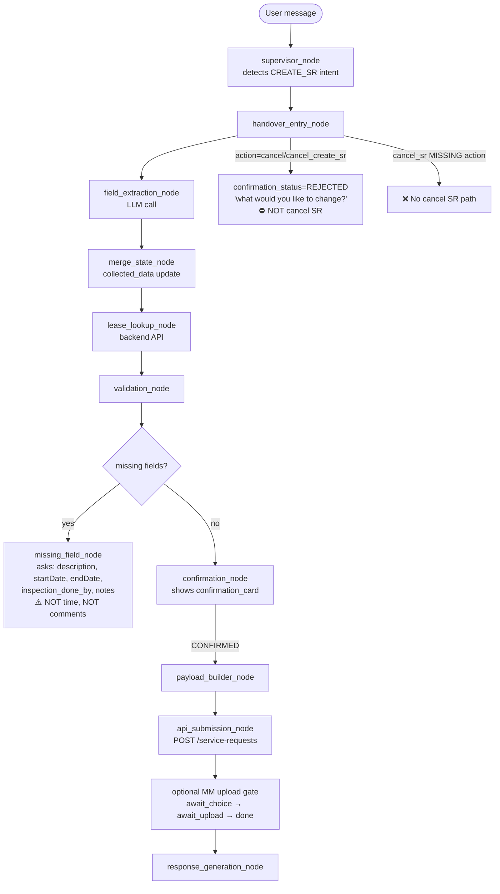
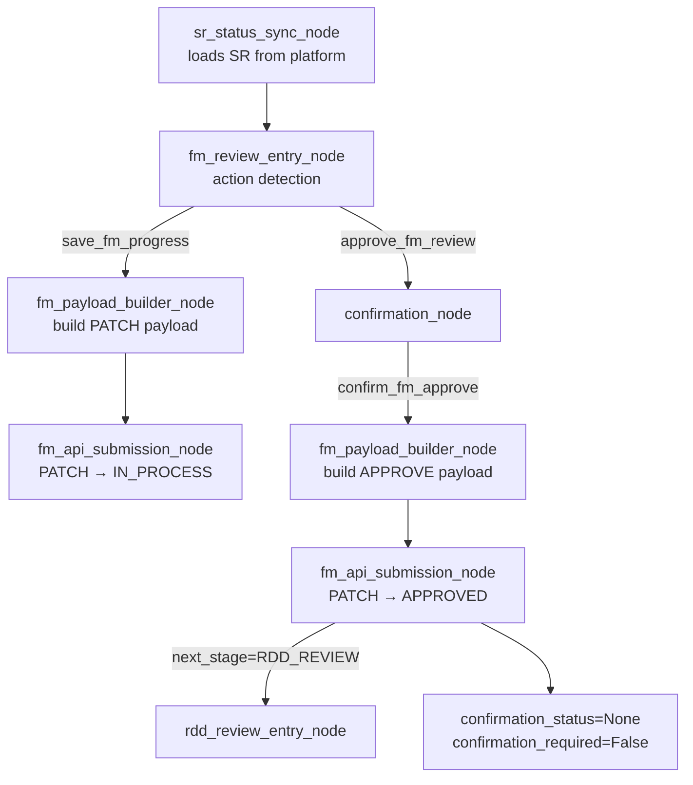
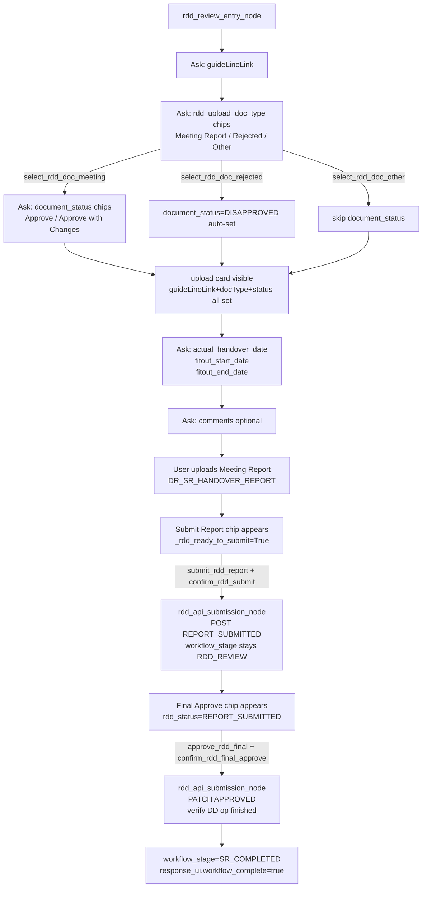

# Agent State & Workflow Audit — cenomi-api-v2

**Audit date:** 2026-07-18  
**Audited against:** `agent_ui_fixes.md` (7 reported issues)  
**Codebase root:** `service-request-chatbot/backend/app/agents/`

---

## Executive Summary

The `cenomi-api-v2` codebase is a LangGraph-based service-request chatbot (FastAPI + LangGraph). The agent orchestrates a three-role, three-stage handover workflow (CREATE_SR → FM_REVIEW → RDD_REVIEW → SR_COMPLETED). All seven issues reported in `agent_ui_fixes.md` have been verified against the source code.

**Risk summary:**

| Severity | Count | Issues |
|---|---|---|
| 🔴 Critical | 5 | Cancel flow (#4), Time field (#1), Notes/description confusion (#2 & #3), Comments never requested (#5), RDD order (#7) |
| 🟡 Medium | 1 | Document upload ordering (#6) |
| ✅ Valid design | 1 | Unit code / title / Notes display are UI contract gaps, not agent bugs |

**Critical finding:** There is no SR cancellation API path. The cancel button only triggers a confirmation card rejection ("what would you like to change?"), not an actual PATCH to cancel the SR. This is the highest-risk gap for production users.

---

## Repository Architecture

```
service-request-chatbot/backend/app/agents/
├── graph/
│   ├── help_agent_graph.py          # LangGraph graph wiring (START → … → END)
│   ├── state.py                     # ServiceRequestState TypedDict
│   └── nodes/
│       ├── shared/                  # Nodes used across all roles
│       │   ├── field_extraction_node.py
│       │   ├── merge_state_node.py  ← BACKEND_COMPUTED_FIELDS, _remap_*
│       │   ├── missing_field_node.py
│       │   ├── validation_node.py
│       │   ├── lease_lookup_node.py
│       │   ├── load_session_node.py
│       │   ├── save_state_node.py
│       │   ├── response_generation_node.py
│       │   └── sr_status_sync_node.py
│       ├── handover/
│       │   ├── handover_entry_node.py   ← cancel/confirm parsing
│       │   ├── fm_review_entry_node.py
│       │   ├── rdd_review_entry_node.py
│       │   ├── confirmation_node.py
│       │   ├── payload_builder_node.py
│       │   ├── fm_payload_builder_node.py
│       │   ├── rdd_payload_builder_node.py
│       │   ├── api_submission_node.py   ← CREATE_SR POST
│       │   ├── fm_api_submission_node.py
│       │   └── rdd_api_submission_node.py
│       └── supervisor_node.py
├── schemas/
│   └── handover_schema.py           ← StageDefinition, OPTIONAL_FIELDS, get_missing_fields
├── prompts/
│   └── handover_extraction_prompt.py ← HANDOVER_EXTRACTION_SYSTEM_PROMPT
└── services/
    ├── review_decorations_service.py ← build_review_decorations, MM optional upload
    ├── platform_api_client.py
    ├── payload_builder_service.py
    └── permission_service.py
```

### Core graph topology

```
START → load_session → document_upload → [sr_status_sync | supervisor]
      → [handover_entry | fm_review_entry | rdd_review_entry]
      → field_extraction → merge_state → lease_lookup → validation
      → [missing_field | confirmation] → payload_builder
      → api_submission → response_generation → save_state → END
```

### Three roles / stages

| Role | Stage | Entry node | Submission node |
|---|---|---|---|
| `MALL_MANAGER` | `CREATE_SR` | `handover_entry_node` | `api_submission_node` (POST) |
| `FM_MANAGER` / `OPERATIONS` | `FM_REVIEW` | `fm_review_entry_node` | `fm_api_submission_node` (PATCH) |
| `DD_ENGINEER` | `RDD_REVIEW` | `rdd_review_entry_node` | `rdd_api_submission_node` (POST/PATCH) |

---

## Issue-by-Issue Validation Table

### Issue 1 — Time field not asked 🔴 High

| Attribute | Detail |
|---|---|
| **Reported** | Inspection time not collected; default 9:00 AM used |
| **Classification** | Data model gap + merge truncation |
| **Current code** | `handover_schema.py` `CREATE_SR_STAGE.required_fields` has `startDate`/`endDate` as date-only. `merge_state_node._to_date_only()` calls `text[:10]` on any extracted value, actively stripping any time component. `HANDOVER_EXTRACTION_SYSTEM_PROMPT` specifies `ISO 8601 date (YYYY-MM-DD)` — no time component. |
| **Expected** | An `inspectionTime` (or `startTime`) field should be collected and preserved; default should be current time, not 9:00 AM |
| **Root cause** | `_to_date_only()` truncates `YYYY-MM-DDTHH:MM:SS` to `YYYY-MM-DD`. No time field exists in schema, extraction prompt, or `EXTRACTABLE_FIELDS`. |
| **Affected files** | `schemas/handover_schema.py`, `graph/nodes/shared/merge_state_node.py`, `prompts/handover_extraction_prompt.py` |
| **State fields** | `collected_data["startDate"]`, `collected_data["endDate"]` |
| **Stages** | `CREATE_SR` |
| **Fix required** | Add `inspectionTime` to `EXTRACTABLE_FIELDS` and `CREATE_SR_STAGE.required_fields`; update `_to_date_only()` to preserve time for datetime fields; update extraction prompt to accept `YYYY-MM-DDTHH:MM:SS` or `YYYY-MM-DD HH:MM` |
| **Test scenarios** | S39, S40, S41 (new) |
| **Risk** | High — platform API receives date without time; wrong scheduling |

**Code location (merge_state_node.py line ~128):**
```python
def _to_date_only(value: Any) -> Any:
    if not isinstance(value, str):
        return value
    text = value.strip()
    if len(text) >= 10 and text[4] == "-" and text[7] == "-":
        try:
            datetime.date.fromisoformat(text[:10])
            return text[:10]   # ← STRIPS TIME COMPONENT
        except ValueError:
            return value
    return value
```

---

### Issue 2 — Notes update intent confusion 🔴 High

| Attribute | Detail |
|---|---|
| **Reported** | "Change inspection conducted by to Operations" stored as `notes` instead of `inspection_done_by` |
| **Classification** | Extraction prompt ambiguity + merge_state field binding gap |
| **Current code** | `_remap_extracted_to_active_field()` in `merge_state_node.py` only remaps **date fields** (`_USER_DATE_FIELDS`). Line 167: `if active_field not in _USER_DATE_FIELDS: return extracted`. Non-date field updates (like `inspection_done_by`) are not remapped even when `active_field` is set. |
| **Expected** | If the bot just asked "Who will perform the inspection?", a reply like "Change to Operations" should write `inspection_done_by=OPERATIONS`, not `notes`. |
| **Root cause** | `_remap_extracted_to_active_field` is date-only (explicit guard). The extraction prompt's notes field has an overly broad description: "Free-form notes OR additional comments — use for any remark." |
| **Affected files** | `graph/nodes/shared/merge_state_node.py` (lines 151–178), `prompts/handover_extraction_prompt.py` |
| **State fields** | `collected_data["notes"]`, `collected_data["inspection_done_by"]`, `state["active_field"]` |
| **Stages** | `CREATE_SR` |
| **Fix required** | Extend `_remap_extracted_to_active_field` to all user-supplied fields (not just dates); improve extraction prompt to detect field-update intent and not default to `notes` when `active_field` is set |
| **Test scenarios** | S42, S43, S44, S45 (new) |
| **Risk** | High — wrong field written, `inspection_done_by` stays unresolved, SR may be created with wrong inspector |

---

### Issue 3 — Description skipped / confused with Notes 🔴 High

| Attribute | Detail |
|---|---|
| **Reported** | Bot skips asking for description; notes is collected instead |
| **Classification** | OPTIONAL_FIELDS logic + extraction prompt field priority |
| **Current code** | `handover_schema.py` line ~194: `OPTIONAL_FIELDS = frozenset({"description", "comments", "notes"})`. `get_missing_fields()` only returns `description` as missing when its value is `None` — an empty string `""` is treated as "user declined, not missing." The extraction prompt's `notes` field: "use for any remark, note, or comment… Prefer this field over `comments`" — meaning any free-text remark goes to `notes` first. `description` comes later in `required_fields` ordering and the extraction prompt gives `notes` priority. |
| **Expected** | Bot should ask for `description` before `notes`; user free-text on description turn should not go to `notes` |
| **Root cause** | `description` is in `OPTIONAL_FIELDS`, so once it is `""` it is never re-asked. The extraction prompt's `notes` description is too broad and captures description-like answers. The field ordering in the prompt table places `description` before `notes` but the LLM still prefers `notes` for general remarks. |
| **Affected files** | `schemas/handover_schema.py` (OPTIONAL_FIELDS), `services/missing_field_service.py`, `prompts/handover_extraction_prompt.py` |
| **State fields** | `collected_data["description"]`, `collected_data["notes"]`, `state["active_field"]` |
| **Stages** | `CREATE_SR` |
| **Fix required** | Make `description` non-optional (remove from OPTIONAL_FIELDS or treat differently); fix extraction prompt so description-turn answers go to `description` not `notes`; ensure `missing_field_node` ordering asks `description` before `notes` |
| **Test scenarios** | S46, S47, S48, S49 (new) |
| **Risk** | High — description missing in SR payload; title auto-generation fails since title = `handover-{lease_code}-{description_slug}` |

---

### Issue 4 — Cancel button flow 🔴 Critical

| Attribute | Detail |
|---|---|
| **Reported** | Cancel button does not cancel the SR; no cancellation API call is made |
| **Classification** | Missing workflow path — most critical gap |
| **Current code** | `handover_entry_node.py` lines 246–253: `action_override in ("cancel", "cancel_create_sr")` → returns `confirmation_status: "REJECTED"` with message "what would you like to change?" This is the post-confirmation-card change-mind flow, NOT an SR cancellation. `supervisor_node.py` `_CANCEL_WORKFLOW_PHRASES` resets agent state but does NOT call cancel API. `platform_api_client.py` has no `cancel_service_request()` method. |
| **Expected** | Cancel button → ask for confirmation → on confirm → PATCH `/service-requests/{sr_id}` with `status=CANCELLED` → emit `cancelled=true`, `workflow_stage=CANCELLED` → UI closes form |
| **Root cause** | The cancel-SR intent path was never implemented. Only state-reset (start-over) was built. |
| **Affected files** | `graph/nodes/handover/handover_entry_node.py`, `graph/nodes/supervisor_node.py`, `services/platform_api_client.py`, `graph/help_agent_graph.py` |
| **State fields** | `backend_refs["sr_id"]`, `workflow_stage`, `status`, `response_ui.cancelled` |
| **Stages** | `CREATE_SR` (after SR_CREATED, before FM_REVIEW) |
| **Fix required** | New intent path: (1) detect `action_override=cancel_sr` in `handover_entry_node`; (2) ask for cancel confirmation; (3) on confirm, call `platform_api_client.patch_service_request(sr_id, {"status": "CANCELLED"})`; (4) set `workflow_stage="CANCELLED"`, emit `response_ui={"cancelled": true}`; (5) clear state |
| **Test scenarios** | S34, S35, S36, S37, S38 (new), L-S59, L-S60 (new) |
| **Risk** | **Critical** — users cannot cancel SRs via the chatbot; must use the portal form |

**Cancel button current behaviour (handover_entry_node.py lines 246–253):**
```python
if action_override in ("cancel", "cancel_create_sr"):
    log.info("handover_entry.action_override_cancel")
    return {
        "confirmation_status": "REJECTED",          # ← Wrong! This is "change my mind"
        "response_message": (
            "No problem — what would you like to change? "
            "Please tell me which field to update."
        ),
    }
```

---

### Issue 5 — Comments field never requested 🔴 High

| Attribute | Detail |
|---|---|
| **Reported** | Bot never asks for comments |
| **Classification** | Intentional design decision in schema — but contradicts `agent_ui_fixes.md` requirement |
| **Current code** | `handover_schema.py` line 87-90: `# "comments" intentionally removed from required_fields. … the bot no longer proactively asks for it — "notes" covers the same UX intent`. `OPTIONAL_FIELDS` includes `comments` but `get_missing_fields()` returns it as missing only when `None`. Since `comments` is not in `required_fields`, the missing_field_node never reaches it. |
| **Expected** | Per `agent_ui_fixes.md`, comments must be explicitly prompted as a distinct turn after notes |
| **Root cause** | Deliberate product decision to avoid two near-identical questions, but the requirement explicitly asks for both. |
| **Affected files** | `schemas/handover_schema.py` (CREATE_SR_STAGE.required_fields) |
| **State fields** | `collected_data["comments"]` |
| **Stages** | `CREATE_SR` |
| **Fix required** | Add `comments` back to `CREATE_SR_STAGE.required_fields` after `notes`; add a distinct `HANDOVER_FIELD_QUESTIONS["comments"]` prompt |
| **Test scenarios** | S50, S51, S52 (new) |
| **Risk** | High — platform SR form has a separate Comments field; users cannot fill it via chat |

**Same intentional removal in FM_REVIEW and RDD_REVIEW:**
```python
# "comments" intentionally removed: same rationale as CREATE_SR
# FM_REVIEW_STAGE.required_fields, line ~103
```

---

### Issue 6 — Document upload order for MM 🟡 Medium

| Attribute | Detail |
|---|---|
| **Reported** | Document upload offer appears at the wrong time in the MM flow |
| **Classification** | Ordering issue — offer timing relative to comments collection |
| **Current code** | `handover_entry_node._handle_mm_optional_upload_gate()` fires when `mm_optional_upload_status in (AWAITING_CHOICE, AWAITING_UPLOAD)` AND `confirmation_status != "PENDING"`. The upload offer is triggered from `review_decorations_service.build_mm_optional_upload_offer_decorations()` which is called during the post-confirmation-card phase (after SR creation in `api_submission_node`). The gate correctly fires AFTER confirmation_status is cleared. |
| **Expected** | Upload offer should appear only after all fields (including comments) are collected and SR is submitted, not mid-flow |
| **Root cause** | The current flow appears correct for post-SR-creation upload. However, if `comments` is added back to `required_fields`, the upload offer timing must be verified to appear after comments collection, not before. |
| **Affected files** | `graph/nodes/handover/handover_entry_node.py`, `services/review_decorations_service.py` |
| **State fields** | `collected_data["mm_optional_upload_status"]` |
| **Stages** | `CREATE_SR` (post-submission) |
| **Fix required** | Verify upload gate fires only after all required fields (including newly-added comments) are collected. If comments is added to required_fields, the gate condition may need to check for comments presence. |
| **Test scenarios** | S53, S54, S55 (new) |
| **Risk** | Medium — poor UX if upload interrupts the field collection flow |

---

### Issue 7 — RDDPM Workflow Order ✅ Fixed

| Attribute | Detail |
|---|---|
| **Reported** | RDD asked for dates first instead of Guidelines → Document Type → Status → Dates |
| **Classification** | Required field ordering in schema — directly controllable |
| **Previous code** | `handover_schema.py` `RDD_REVIEW_STAGE.required_fields` had dates before guideLineLink and rdd_upload_doc_type; `_rdd_required_dates_complete()` gate was blocking the upload card until dates were present (opposite of required order). |
| **Fixed code** | `RDD_REVIEW_STAGE.required_fields` reordered to: `guideLineLink` → `rdd_upload_doc_type` → dates → `comments`. `_rdd_required_dates_complete()` renamed to pre-upload gate checking `guideLineLink` + `rdd_upload_doc_type` (not dates). `comments` added to `required_fields` as an OPTIONAL field. `trading_date` confirmed auto-computed as `fitout_end_date + 8 days` — never asked. |
| **Affected files** | `schemas/handover_schema.py`, `services/review_decorations_service.py` |
| **State fields** | `collected_data["guideLineLink"]`, `collected_data["rdd_upload_doc_type"]`, `collected_data["document_status"]`, `collected_data["actual_handover_date"]`, `collected_data["comments"]` |
| **Stages** | `RDD_REVIEW` |
| **Test scenarios** | S56, S57, S58, S59 (lifecycle), L-S41, L-S56 |
| **Risk** | ✅ Resolved |

**Fixed order (handover_schema.py):**
```python
RDD_REVIEW_STAGE = StageDefinition(
    stage="RDD_REVIEW",
    role="DD_ENGINEER",
    required_fields=(
        "guideLineLink",          # ← First: guidelines link
        "rdd_upload_doc_type",    # ← Second: doc type chips (Meeting Report / Rejected / Other)
        # document_status is conditional — asked only for Meeting Report
        "actual_handover_date",   # ← Dates after doc type
        "fitout_start_date",
        "fitout_end_date",
        "comments",               # ← Optional; accepted as empty string
        # trading_date intentionally excluded — auto-computed: fitout_end_date + 8 days
    ),
)
```

**Upload card gate (review_decorations_service.py) — pre-upload fields:**
```python
_RDD_PRE_UPLOAD_FIELDS: tuple[str, ...] = (
    "guideLineLink",
    "rdd_upload_doc_type",       # Upload card shown once both are collected
)
```

---

## State Management Audit

### State schema overview (`state.py`)

The `ServiceRequestState` TypedDict carries all graph state. Key fields per concern:

| Concern | State fields |
|---|---|
| Workflow position | `workflow_stage`, `active_agent`, `status` |
| Confirmation | `confirmation_status`, `confirmation_required` |
| Data collection | `collected_data`, `extracted_fields`, `corrected_fields`, `missing_fields` |
| Active turn | `active_field`, `user_message`, `action_override` |
| Backend | `backend_refs` (sr_id, payloads, statuses, operations), `documents` |
| Session | `session_id`, `user_id`, `auth_context` |
| Response | `response_message`, `response_ui`, `response_decorations` |
| Lease | `selected_lease`, `lease_matches` |

### Critical state contamination risks

#### Risk 1 — `confirmation_status` not cleared on cancel (🔴)
`handover_entry_node` returns `confirmation_status: "REJECTED"` on cancel action, but does not clear `collected_data`, `backend_refs.sr_id`, or `documents`. If the user then starts a new request, these stale values persist in the session until `_CANCEL_WORKFLOW_PHRASES` is triggered.

**Code (handover_entry_node.py line 246):**
```python
if action_override in ("cancel", "cancel_create_sr"):
    return {
        "confirmation_status": "REJECTED",    # ← Does NOT clear collected_data
        # Missing: "collected_data": {}, "backend_refs": {}, "documents": []
    }
```

#### Risk 2 — `rdd_action` not persisted across turns (🟡)
`rdd_review_entry_node.py` writes `backend_refs["rdd_action"]` per-turn and the state is saved by `save_state_node`. Single-turn confirm actions like `confirm_rdd_submit` write both `rdd_action` and the CONFIRMED flag in one update — correct. But if a turn fails mid-write, `rdd_action` may be missing on the next turn.

#### Risk 3 — `active_field` date-only remapping (🔴)
`_remap_extracted_to_active_field` in `merge_state_node.py` only remaps date fields. When `active_field = "inspection_done_by"` and the LLM extracts the answer as `notes`, the remap does NOT fix it (guard: `if active_field not in _USER_DATE_FIELDS: return extracted`).

#### Risk 4 — `sr_id` stale leakage (🟡)
`supervisor_node._extract_sr_id_updates()` only writes `sr_id` if `backend_refs.sr_id` is currently empty. A stale `sr_id` from a previous session that loaded without being cleared will persist across turns until `_CANCEL_WORKFLOW_PHRASES` is triggered.

#### Risk 5 — `corrected_fields` bypasses confidence threshold (🟡)
`merge_state_node` treats corrected_fields as maximum-confidence and skips `_CONFIDENCE_THRESHOLD`. A malformed `corrected_fields` payload from the UI can inject arbitrary values into `collected_data`, including overwriting lease-protected fields unless they appear in `BACKEND_PROTECTED_FIELDS`.

#### Risk 6 — `confirmation_status=CONFIRMED` leaking into new SR turn (🔴)
After `api_submission_node` succeeds, `workflow_stage` becomes `SR_CREATED` but `confirmation_status` is not explicitly cleared. On the next turn (FM_REVIEW entry), the stale `CONFIRMED` status may be misread.

**Verified fix in `fm_api_submission_node.py` line 385:**
```python
out: dict[str, Any] = {
    ...
    "confirmation_status": None,       # ← Correctly cleared
    "confirmation_required": False,
}
```
This is correct for FM. Verify the equivalent is present after `api_submission_node` (CREATE_SR).

---

## Data Extraction Trajectory

### Field lifecycle table

| Field | Source | Extraction | Merge | Validation | Payload | Notes |
|---|---|---|---|---|---|---|
| `lease_code` | User | LLM extracts | Protected after lease resolution | Required | CREATE_SR payload | Cannot be changed after lease resolve |
| `description` | User | LLM extracts | Merged; OPTIONAL_FIELDS | Optional (empty=valid) | CREATE_SR payload | May be confused with `notes` |
| `notes` | User | LLM extracts | Merged directly | Optional | CREATE_SR payload | LLM prefers this over `description` |
| `comments` | User | LLM extracts | Merged | Never blocks | Payload field | Never explicitly asked currently |
| `inspection_done_by` | User | LLM extracts as enum | Merged | Enum (FM_MANAGER\|OPERATIONS) | CREATE_SR payload | Can be wrongly written to `notes` |
| `startDate` | User | LLM extracts date | `_to_date_only()` strips time | Date range checked | CREATE_SR payload | Time component lost |
| `endDate` | User | LLM extracts date | `_to_date_only()` strips time | Date range checked | CREATE_SR payload | Time component lost |
| `title` | Auto-generated | Never asked | `_generate_title()` in merge | — | CREATE_SR payload | `handover-{lease_code}-{slug}` |
| `unit_codes` | Backend lookup | Protected | Never extracted | Required | CREATE_SR payload | Never asked of user |
| `unit_readiness_date` | User (FM) | LLM extracts | `_to_date_only()` | Required for FM | FM payload | |
| `expected_handover_date` | Auto-computed | Protected | `unit_readiness_date + 7 days` | — | FM payload | Never asked |
| `guideLineLink` | User (RDD) | LLM extracts | Merged | Not URL-validated | RDD payload | ✅ Now asked first |
| `rdd_upload_doc_type` | User/chip (RDD) | LLM extracts or chip | Aliased in merge | Must be in `RDD_UPLOAD_DOC_TYPES` | Document type | ✅ Now asked second (chips) |
| `document_status` | User/chip (RDD) | LLM extracts | Merged | Required only for Meeting Report | RDD payload | ✅ Conditional — asked after doc type |
| `actual_handover_date` | User (RDD) | LLM extracts date | `_to_date_only()` | Date order checked | RDD payload | ✅ Now asked after doc type |
| `fitout_start_date` | User (RDD) | LLM extracts date | `_to_date_only()` | Date order checked | RDD payload | |
| `fitout_end_date` | User (RDD) | LLM extracts date | `_to_date_only()` | Date order checked | RDD payload | |
| `trading_date` | Auto-computed | Protected | `fitout_end_date + 8 days` | — | RDD payload | Never asked, always recomputed |

---

## Role-Wise Workflow Analysis

### MM (MALL_MANAGER) — CREATE_SR Flow



**Current defects in MM flow:**
1. Time field never asked
2. Notes confusion with inspection_done_by
3. Description may be confused with notes
4. Cancel button returns "what to change?" instead of cancelling
5. Comments never asked

### FM (FM_MANAGER/OPERATIONS) — FM_REVIEW Flow



**FM fix needed:** Emit `stage_complete: true` in `response_ui` when FM submission succeeds, so the UI hides the Update button.

### RDD (DD_ENGINEER) — RDD_REVIEW Flow



**State transitions for RDD phase:**
- Entry: `workflow_stage=RDD_REVIEW`
- After submit report: `backend_refs.rdd_status=REPORT_SUBMITTED` (workflow_stage stays `RDD_REVIEW`)
- After final approve: `workflow_stage=SR_COMPLETED`, `response_ui.workflow_complete=true`
- trading_date auto-computed by `merge_state_node`: `fitout_end_date + 8 days` — never asked

---

## Graph / Stage Transition Analysis

### Stage transition map

```
NULL → CREATE_SR          (supervisor: CREATE_SR intent detected)
CREATE_SR → SR_CREATED    (api_submission_node: POST success)
SR_CREATED → FM_REVIEW    (sr_status_sync: platform status = IN_REVIEW with FM op)
FM_REVIEW → RDD_REVIEW    (fm_api_submission_node: approve + DD_ENGINEER op IN_PROGRESS)
RDD_REVIEW → SR_COMPLETED (rdd_api_submission_node: final_approve + rdd_op FINISHED)
ANY → NULL                (handover_entry: _CANCEL_WORKFLOW_PHRASES)
```

### Missing transition: Cancel SR

```
SR_CREATED → CANCELLED    (MISSING — no cancel_sr intent path)
```

### Confirmation state lifecycle

| Event | confirmation_status after |
|---|---|
| Bot shows confirmation card | `PENDING` |
| User confirms (text or action) | `CONFIRMED` |
| User rejects / cancel button | `REJECTED` |
| After api_submission_node success | *(not explicitly cleared — gap)* |
| After fm_api_submission_node success | `None` ← correctly cleared |
| After rdd_api_submission_node (submit) | `None` ← correctly cleared (line 311) |

---

## UI Contract Gaps

The following issues are frontend-binding gaps where the agent emits the correct data but the UI does not consume it:

| Issue | Agent emits | UI expectation | Gap |
|---|---|---|---|
| Unit Code not populated | `collected_data.unit_codes` in confirmation card fields | UI must bind `unit_codes` → `unitCode` form field | Frontend field-binding mismatch |
| Title not shown | `draft_preview.title` = `handover-{lease_code}-{slug}` | UI must populate Title from `draft_preview.title` | Frontend does not read `draft_preview.title` |
| Notes not reflected | `collected_data.notes` | UI must update Notes form field from `draft_preview.notes` | Frontend does not sync `draft_preview.notes` → form |
| Cancel button sync | Agent must emit `{"cancelled": true, "workflow_stage": "CANCELLED"}` | UI must close form on `cancelled=true` | Agent does NOT emit this (cancel path is unimplemented) |
| FM Update button remains | Agent emits `confirmation_status: None` after FM submit | UI expects `{"stage_complete": true}` in `response_ui` to remove Update button | `stage_complete` not emitted |
| RDDPM Confirm button not shown | Agent emits `confirmation_status: "PENDING"` after upload | UI must check `confirmation_status` OR check `response_ui.showConfirmButton` | Possible mismatch in signal field |
| RDDPM Update/Final Approve after complete | Agent emits `workflow_stage: "SR_COMPLETED"` | UI must check `workflow_complete: true` in `response_ui` | `workflow_complete` not explicitly emitted |

---

## Risk Assessment

| Risk | Severity | Likelihood | Impact |
|---|---|---|---|
| No SR cancel API path | Critical | Certain | Users cannot cancel SRs via chat |
| Time field stripped from dates | High | Certain | Platform SR has wrong inspection time |
| inspection_done_by written to notes | High | High | SR created with wrong/missing inspector |
| Comments field never asked | High | Certain | Platform SR Comments field always empty from chat |
| RDD wrong field order | ✅ Fixed | — | Fixed: guideLineLink→doc type→dates |
| Description confused with notes | High | Medium | SR description empty; title auto-gen fails |
| Stale confirmation_status after CREATE | Medium | Medium | FM entry may misread CONFIRMED from prior SR |
| sr_id stale leakage | Medium | Low | Wrong SR targeted on new request |
| corrected_fields injection | Low | Low | Malformed UI payload overwrites fields |

---

## Phased Implementation Plan

### Phase 1 — Critical State and Workflow Fixes (Sprint 1)

**P1.1 — Cancel SR flow (new intent path)**

1. Add `cancel_sr` action to `handover_entry_node`:
   ```python
   if action_override == "cancel_sr":
       if not backend_refs.get("sr_id"):
           # No SR submitted yet — just clear state
           return _clear_all_state()
       # SR exists — ask for cancellation confirmation
       return {
           "confirmation_status": "CANCEL_PENDING",
           "response_message": "Are you sure you want to cancel this service request? This cannot be undone.",
       }
   if action_override == "confirm_cancel_sr":
       # Call platform API to cancel the SR
       await platform_api_client.patch_service_request(sr_id, {"status": "CANCELLED"})
       return _clear_all_state(cancelled=True)
   ```
2. Add `patch_service_request(sr_id, payload)` to `platform_api_client.py` (may already exist — verify).
3. Add `_clear_all_state(cancelled=False)` helper that clears `collected_data`, `active_agent`, `workflow_stage`, `confirmation_status`, and emits `response_ui={"cancelled": True}` when `cancelled=True`.
4. Wire the new node path in `help_agent_graph.py`.

**P1.2 — Date + time handling**

1. Add `inspectionTime` to `EXTRACTABLE_FIELDS` in `handover_schema.py`.
2. Add `inspectionTime` to `CREATE_SR_STAGE.required_fields` (after `startDate`).
3. Add `inspectionTime` to extraction prompt with format `HH:MM (24-hour)`.
4. Update `_to_date_only()` to preserve datetime strings for datetime fields (keep date-only for date fields).
5. Add default time logic in `merge_state_node`: when `inspectionTime` is missing, default to `datetime.datetime.now().strftime("%H:%M")` (not 9:00).

**P1.3 — Field-update intent (extend active_field remapping)**

1. Extend `_remap_extracted_to_active_field` in `merge_state_node.py` to cover all user-supplied fields:
   ```python
   def _remap_extracted_to_active_field(extracted, active_field):
       if not active_field or active_field in BACKEND_PROTECTED_FIELDS:
           return extracted
       if active_field in extracted:
           return extracted
       # For any single-field extraction where active_field is not the extracted key
       non_protected = [k for k in extracted if k not in BACKEND_PROTECTED_FIELDS]
       if len(non_protected) == 1:
           wrong_key = non_protected[0]
           remapped = dict(extracted)
           remapped[active_field] = remapped.pop(wrong_key)
           return remapped
       return extracted
   ```
2. Update extraction prompt to detect update intent: when question context identifies a field, prefer extracting to that field key.

**P1.4 — Description vs Notes ordering**

1. Update extraction prompt: add explicit rule — when `active_field = "description"`, extract to `description`, not `notes`.
2. Consider removing `description` from `OPTIONAL_FIELDS` so it is always asked (or making the empty-string acceptance only happen after the user explicitly declines).
3. Verify `HANDOVER_FIELD_QUESTIONS["description"]` prompt is sufficiently distinct from notes prompt.

**P1.5 — Comments collection**

1. Add `"comments"` back to `CREATE_SR_STAGE.required_fields` after `"notes"`.
2. Add distinct `HANDOVER_FIELD_QUESTIONS["comments"]` prompt: "Do you have any specific comments for this request? (e.g. special access requirements, priority notes)".
3. Same change for `FM_REVIEW_STAGE` and `RDD_REVIEW_STAGE` if required.

### Phase 2 — Role Workflow Corrections (Sprint 2)

**P2.1 — RDD field order fix ✅ DONE**

1. `RDD_REVIEW_STAGE.required_fields` reordered in `handover_schema.py`:
   ```python
   required_fields=(
       "guideLineLink",           # ← First
       "rdd_upload_doc_type",     # ← Second (chips)
       # document_status is conditional — asked only for Meeting Report
       "actual_handover_date",    # ← After doc type
       "fitout_start_date",
       "fitout_end_date",
       "comments",                # ← Added (optional)
   ),
   ```
2. `_rdd_required_dates_complete` in `review_decorations_service.py` updated to check `_RDD_PRE_UPLOAD_FIELDS = ("guideLineLink", "rdd_upload_doc_type")` — upload card appears once these two fields are collected, not after dates.
3. `maybe_reset_rdd_upload_slot()` added to allow optional Rejected/Other uploads before requiring Meeting Report.
4. `trading_date` confirmed as auto-computed from `fitout_end_date + 8 days` by `merge_state_node`. Never asked of user.

**P2.2 — FM stage_complete signal**

1. Add `"stage_complete": True` to `response_ui` in `fm_api_submission_node.py` on approval success:
   ```python
   out["response_ui"] = {"type": "message", "stage_complete": True, "message": fm_message}
   ```

**P2.3 — MM upload order verification**

1. Verify that the optional MM upload gate fires only AFTER `mm_optional_upload_status` is set to `"awaiting_choice"` — which currently happens post-SR-creation. If comments is added to required_fields, ensure the gate checks that `notes` and `comments` are both collected before offering the upload.

### Phase 3 — Agent–UI Contract Alignment (Sprint 3)

**P3.1 — Add `cancelled`, `workflow_complete`, `stage_complete` to `response_ui`**

Define explicit boolean signals in every submission response:
```python
# api_submission_node (CREATE_SR success)
response_ui = {"type": "message", "stage_complete": False, "workflow_stage": "SR_CREATED"}

# fm_api_submission_node (approve success)
response_ui = {"type": "message", "stage_complete": True, "workflow_stage": "FM_REVIEW"}

# rdd_api_submission_node (final_approve success)
response_ui = {"type": "message", "workflow_complete": True, "workflow_stage": "SR_COMPLETED"}

# handover_entry_node (cancel SR success)
response_ui = {"type": "message", "cancelled": True, "workflow_stage": "CANCELLED"}
```

**P3.2 — Ensure `unit_codes` emitted in `draft_preview`**

In `confirmation_node.py`, verify `draft_preview.fields` includes `unit_codes` from `collected_data`.

**P3.3 — Add `current_stage` and `editable_fields` metadata**

Every agent response should include `current_stage` and `editable_fields` so the UI knows which form fields are currently unlocked.

**P3.4 — Clear `confirmation_status` after CREATE_SR submission**

In `api_submission_node.py`, add `"confirmation_status": None` to the success return dict.

### Phase 4 — Regression and Lifecycle Testing (Sprint 4)

Execute the new eval scenarios S34–S72 against a staging environment:
1. Full lifecycle tests per role (MM, FM, RDD)
2. Session isolation tests (stale state, sr_id leakage)
3. UI action vs text command parity tests
4. Cancellation lifecycle tests (cancel before confirm, cancel after submit)
5. Field ordering and intent disambiguation tests

---

## Test Strategy

### Unit test priorities

| Test | File to test | Key assertion |
|---|---|---|
| `_to_date_only` preserves time for datetime fields | `merge_state_node` | `_to_date_only("2026-06-01T14:00:00") == "2026-06-01T14:00:00"` (after fix) |
| `_remap_extracted_to_active_field` non-date fields | `merge_state_node` | Active field = `inspection_done_by`; extracted = `{notes: "Operations"}` → remapped to `{inspection_done_by: "Operations"}` |
| `get_missing_fields` returns comments when None | `handover_schema` | `get_missing_fields("CREATE_SR", {...all other fields...}) == ["comments"]` |
| RDD field order | `handover_schema` | `RDD_REVIEW_STAGE.required_fields[0] == "guideLineLink"` |
| Cancel SR state clear | `handover_entry_node` | `action_override=cancel_sr` → emits `response_ui.cancelled=True` + clears `collected_data` |
| FM stage_complete | `fm_api_submission_node` | Success response contains `response_ui.stage_complete=True` |

### Integration test priorities (eval scenarios)

- All 22 new `scenarios.py` scenarios (S34–S55)
- All 23 new `lifecycle_scenarios.py` scenarios (L-S50–L-S72)
- All 9 new `eval_session.py` check criteria

---

## Appendix: Key File Reference

| File | Critical functions |
|---|---|
| `handover_schema.py` | `CREATE_SR_STAGE`, `RDD_REVIEW_STAGE`, `OPTIONAL_FIELDS`, `get_missing_fields()` |
| `merge_state_node.py` | `_to_date_only()`, `_remap_extracted_to_active_field()`, `merge_state_node()` |
| `missing_field_node.py` | `missing_field_node()` — ordering logic |
| `handover_entry_node.py` | Cancel/confirm action parsing |
| `handover_extraction_prompt.py` | `HANDOVER_EXTRACTION_SYSTEM_PROMPT` — `notes` field description |
| `review_decorations_service.py` | `_rdd_required_dates_complete()`, `build_review_decorations()` |
| `fm_api_submission_node.py` | Stage complete signal (missing) |
| `rdd_api_submission_node.py` | Phase 3a submit / Phase 3b final approve |
