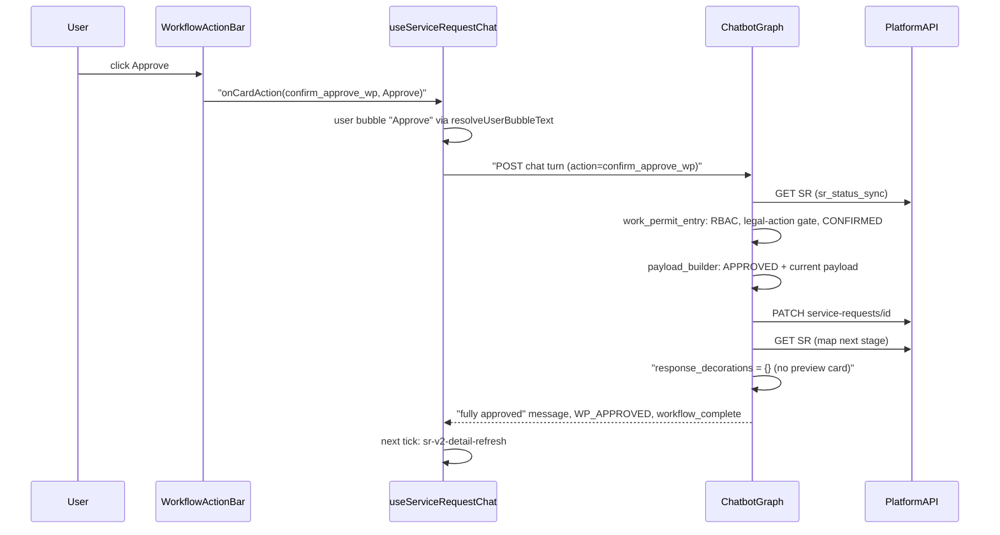
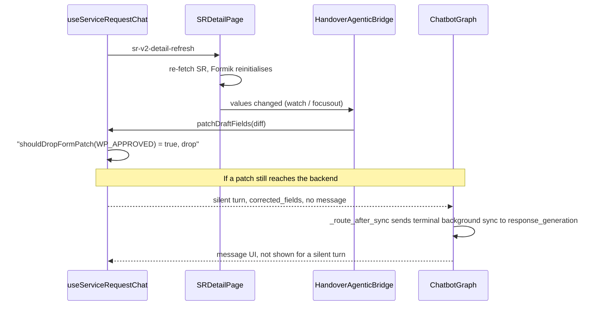

# Spec: Work Permit Agent — Create, Review, Frontend, and Reusable Patterns

**Item:** 3638
**Date:** 2026-09-28 (supersedes the 2026-09-10 revision)
**Status:** Implemented. Backend on branch `3638` (commits `b2c7ed5`, `bf1b389`, `299f870` plus the review-UX working set). Frontend on `feature/work-permit-agent` (`742cd604a`, `e9b49d736`, `568534489`).
**Owner area:** Service Request Chatbot (`work_permit_agent`) and the cenomi-frontend chatbot surfaces
**Platform contract:** Cenomi API V1 `workflow.flow` (workflow_id 5–8). Create is **not** a workflow level.

This is the canonical spec for Work Permit in the chatbot. It covers:

1. The **create** conversation (`CREATE_WORK_PERMIT_SR` → full portal form per subtype → `POST /v1/service-requests`).
2. The **review** conversation (`APPROVE_WORK_PERMIT_SR` / open by SR id / inbox → hop mapping → summary card → business action → `PATCH` or `POST /work-permit/status`).
3. The **frontend contract** that renders both flows and keeps the SR form and the chat in sync.
4. A **reusable-patterns playbook** (§10) for building the next SR agents on the same rails.

Paths are relative to `service-request-chatbot/backend/` for the backend and to `cenomi-frontend/` for the frontend. `…/` abbreviates `libs/ui-web/src/lib/components/`.

---

## 1. Problem and design goals

Work Permits are raised by Mall Managers (and tenant-side admins) and approved through the V1 workflow engine. Each subtype has its own portal form and its own hop chain. The chatbot must:

- collect the **same form the portal collects**, in conversation, and POST a payload the portal accepts;
- let each approver act on **their** hop only, with the platform's actions (approve, ask for more info, reject; extend or cancel once active);
- present the review as a short conversational summary, not a field dump, because the full form is already open beside the chat;
- never contradict the SR form: actions available in chat must match the actions on the form, and form refreshes must not create phantom chat turns.

Work Permit is the first agent built on the **generic review rails** (action resolver, summary card, deterministic card message). New SR agents should reuse them (§10).

---

## 2. Changelog since 2026-09-10

### 2.1 Create

| Change | Detail |
|---|---|
| Full portal form per subtype | Create collects `forms.intialState.common` for each subtype (`work_permit_form_fields.py`, `TENANT_FORM_BY_SUBTYPE`). The old 7-field DTO is gone. **GAP-3 is closed.** Legacy `start_date` / `end_date` / `comments` are forbidden in extraction. |
| Grouped questions | Related open fields are asked together (identity/contact, work details, schedule) with bullet explainers (`missing_field_node._build_wp_group_ask`). |
| Multi-field extraction | One reply may answer several fields. Labeled group replies (`Label - value` lines) are parsed deterministically (`field_extraction_node._parse_labeled_group_fields`). |
| Schedule parsing | Date-only `planneddate` replies, later times-only replies, Ops `effective_starting` + `firstperiod` / `secondperiod` in 12h or 24h. |
| Cold worker Iqama | Each Cold worker needs an Iqama document (`WP_COLD_WORKER_IQAMA_{i}`), collected through a `document_requirement` card. |
| Display strings | Nested widgets carry a human `display` string, so cards and previews never show `[object Object]`. |
| Ops payload | Title / description generation, ISO periods with `fromLT` / `toLT`, `company_name` from `tenant_profile_id`. |
| Create roles | `CAN_RAISE_WORK_PERMIT_SR` now also granted to `COMPANY_ADMIN_CENTRAL`, `COMPANY_ADMIN`, `AUTHORIZED_SIGNATORY`; global admin bypasses. |
| Terminal replies | Success / failure replies are returned verbatim, past the repeat guard (`response_generation_node`). |

### 2.2 Review

| Change | Detail |
|---|---|
| Action resolver | New `app/agents/services/action_resolver.py`. Legal business actions are decided deterministically per SR type (`WorkPermitActionResolver`). The LLM never decides which mutations are legal. |
| Action menu | In-progress hop: **Approve / Ask for more info / Reject**. Active permit with a tenant extend/cancel request: **Extend / Cancel**. |
| Assign To removed | Removed from the chat menu (`WorkPermitActionResolver`) and from the SR form action bar (`actionButtonSR.tsx`, `WORK_PERMIT` branch). Applies to every approver at every level. A stale or typed `assign_to_wp` gets the "not available" reply. |
| Pending inputs | Reject and Ask for more info collect a comment; Extend collects a duration then a comment; Cancel collects a comment (`work_permit_entry_node`, `wp_pending_action`). |
| Summary card | The review card is a conversational summary (`work_permit_review_summary.py`): greeting by first name, a compact summary grid, business actions, prompt chips. |
| Note vs navigation chip | On the SR page the card shows "All request details are available in the form on the left."; elsewhere it offers an "Open full request" chip. |
| New platform calls | `PATCH` with `ACTION_REQUIRED` / `REASSIGN_TO`; `POST /service-requests/work-permit/status` for `EXTEND` / `CANCEL`. Envelope keys are stripped from the nested review payload. |
| PDF 500 | A 500 on a review action returns a message explaining final approval generates the permit PDF, and suggests the SR page. |
| Mid-hop | After a mid-hop approve the reply names the next hop, sets `stage_complete`, and keeps `active_agent=work_permit_agent`. |
| Inbox fan-out | All seven subtypes are in the notification inbox (`notification_inbox_service.py`), with per-subtype audiences. |
| First name | `AuthContext.first_name` from the `first_name` JWT claim (Go `IssueAISessionToken`), used only for the greeting. |

### 2.3 Fixes shipped with this revision

| Symptom | Cause | Fix |
|---|---|---|
| User bubble showed `confirm_approve_wp` | Action buttons sent the id as bubble text | `WorkflowActionBar` passes `(id, label)`; `sendTurn({userBubbleText: label})`; `resolveUserBubbleText`. |
| Full SR details card after every review action | Review decorations carried `promote_preview`, and finalize swapped the reply for the preview card | `work_permit_api_submission_node` sets `response_decorations = {}` for `WP_REVIEW_STAGES`. |
| "HANDOVER SERVICE REQUEST / Approved" card ~0.3 s after final approval, with no user bubble | Approval triggered `sr-v2-detail-refresh`; the form re-fetch echoed values through the bridge as a silent `corrected_fields` patch; `_route_after_sync` sent a terminal SR with `sr_id` to `preview`, which builds a Handover-labelled `sr_preview_card`; silent turns may render that card type | Backend: `_is_background_form_sync` routes terminal-stage silent patches to `response_generation`. Frontend: `patchDraftFields` drops patches once the stage is `WP_APPROVED` / `WP_REJECTED` (`shouldDropFormPatch`). |
| Thumbs in the middle of a reply | Feedback rendered before the card | `SrFabMessages` renders `ChatFeedbackThumbs` after `SrChatUiRenderer`. |
| Plain bold in replies | — | Assistant `strong` uses `--chat-ui-primary` (`AIChatWidget.css`, `copilotV2.css`). |

---

## 3. Agent identity

| Key | Value |
|---|---|
| Agent name | `work_permit_agent` |
| Display name | Work Permit Agent |
| Service category | `WORK_PERMIT` |
| Schema | `work_permit_service_request_schema` (`app/agents/schemas/work_permit_schema.py`) |
| Create stage | `CREATE_WORK_PERMIT` (not Handover `CREATE_SR`) |
| Review stages | `WP_DD_REVIEW`, `WP_FM_REVIEW`, `WP_MM_REVIEW`, `WP_MM_OPS_REVIEW` (`WP_REVIEW_STAGES`) |
| Terminal stages | `WP_CREATED`, `WP_APPROVED`, `WP_REJECTED` (`WP_TERMINAL_STAGES`) |
| Supervisor intents | `CREATE_WORK_PERMIT_SR`, `APPROVE_WORK_PERMIT_SR` |
| Preview label | `draft_preview.requestType = "Work Permit Service Request"` (`chat_orchestration_service.py`) |

All seven subtypes (plus the legacy `WORK_PERMIT` key used before the subtype is known) route to the same agent:

| `sub_category` | Label | Workflow | Extraction hint |
|---|---|---|---|
| `WORK_PERMIT` (legacy) | Not yet chosen | — | — |
| `CONSTRUCTION_HOT` | Construction – Hot Work | 5 | Welding, cutting, heat |
| `CONSTRUCTION_COLD` | Construction – Cold Work | 6 | Construction without heat; **default** for bare "construction" |
| `CONSTRUCTION_ROOF_ACCESS` | Construction – Roof Access | 5 | Roof access for construction |
| `MAINTENANCE_HOT` | Maintenance – Hot Work | 7 | Heat-producing maintenance |
| `MAINTENANCE_COLD` | Maintenance – Cold Work | 7 | Maintenance without heat |
| `MAINTENANCE_ROOF_ACCESS` | Maintenance – Roof Access | 5 | Roof access for maintenance |
| `OPERATIONS` | Operations | 8 | Operational activities in the unit |

`lookup_agent(service_category, sub_category)` in `registry.py` is authoritative. `resolve_wp_sub_category()` replaces the legacy key with a real enum before POST.

`WorkflowConfig` (`app/agents/registries/workflow_config.py`, `work_permit_agent`):

| Field | Value |
|---|---|
| `stage_sync_nodes` | the four review stages → `work_permit_entry` |
| `collection_stages` | `CREATE_WORK_PERMIT` + the four review stages |
| `confirmation_nodes` | all five → `work_permit_confirmation` |
| `terminal_stages` | `WP_CREATED`, `WP_APPROVED`, `WP_REJECTED` |
| `action_intents` | `CREATE_WORK_PERMIT_SR`, `APPROVE_WORK_PERMIT_SR` |
| `lease_trigger_fields` | `lease_code`, `company`, `lease_brand_mall` |

---

## 4. Supervisor routing

### 4.1 Create

**Intent:** `CREATE_WORK_PERMIT_SR`. Keywords: work permit, hot work, cold work, roof access, construction / maintenance / operations permit, "I need a permit".

- `service_category = WORK_PERMIT`; `sub_category = WORK_PERMIT` until `work_permit_type` is confirmed; `target_agent = work_permit_agent`.
- In `_CREATE_NEW_SR_INTENTS`: an existing `backend_refs.sr_id` is **not** opened on this turn.
- RBAC denial happens in `supervisor_node` and routes to `response_generation` with `WAITING_FOR_USER`.
- A new create on a terminal stage clears the draft and pins `CREATE_WORK_PERMIT` (`work_permit_entry_node`, `stale_sr_cleared`).

**Who may create** — permission `CAN_RAISE_WORK_PERMIT_SR` (`PermissionService.ensure_can_create_work_permit`):

| Role | Create |
|---|---|
| `MALL_MANAGER`, `ADMIN` | Yes |
| `COMPANY_ADMIN_CENTRAL`, `COMPANY_ADMIN`, `AUTHORIZED_SIGNATORY` | Yes (new) |
| Global admin (`is_global_admin`) | Yes (bypass in `check()`) |
| `FM_MANAGER`, `DD_ENGINEER`, `OPERATIONS`, `OPERATION_EXECUTIVES`, `BILLING_CONTACT`, `PRIMARY_TENANT_CONTACT` | No |

No `auth_context` (tests / shadow mode) skips the check.

### 4.2 Review / open existing

**Intent:** `APPROVE_WORK_PERMIT_SR`, or any open by SR id, or an inbox Open. Keywords: approve / reject / review work permit, open work permit SR.

- `sr_status_sync` GETs the SR, maps operations to a WP stage, and pins `active_agent=work_permit_agent`.
- Inbox Open with a WP subtype (or category `WORK_PERMIT`) seeds `work_permit_agent` (`open_notification_node._OPEN_SEED_CATEGORIES`).

---

## 5. Create flow

### 5.1 Graph (create)

```
load_state
  → supervisor                 (CREATE_WORK_PERMIT_SR; RBAC)
  → registry                   (active_agent = work_permit_agent)
  → work_permit_entry          (pin CREATE_WORK_PERMIT; type/department chips; HITL confirm / cancel)
  → field_extraction           (WP extraction prompt + deterministic rescues)
  → merge_state                (cold Iqama docs onto workers; cold second period)
  → lease_lookup               (picker or lease_code; skipped once lease_id is set)
  → validation                 (portal emptiness rules, enum, date order)
  → missing_field              (type chip → lease → guided tour → group ask → single ask)
       or work_permit_confirmation  (create card, confirmation_status=PENDING)
  → response_generation

On Confirm (confirm / confirm_create_wp, or "yes" on a PENDING card):
  work_permit_entry (CONFIRMED) → merge_state → lease_lookup / validation
  → work_permit_confirmation (no-op) → work_permit_payload_builder
  → work_permit_api_submission (POST, then GET) → response_generation (verbatim)
```

`_route_after_work_permit_entry`, in order:

| Condition | Next |
|---|---|
| Guided-tour pending answer | `merge_state` |
| `confirmation_status == CONFIRMED` | `merge_state` (submit path) |
| WP type / department chip applied | `merge_state` |
| `confirmation_status == REJECTED` | `field_extraction` (user wants to change something) |
| `status == WAITING_FOR_USER` | `_form_patch_target` or `response_generation` (pending prompts, denials, stale refusals) |
| `action_override == cancel` | `merge_state` |
| Stage in `WP_REVIEW_STAGES` | `merge_state` (review; no extraction) |
| else (create) | `_form_patch_target` or `field_extraction` |

CONFIRMED is checked before a stale `WAITING_FOR_USER` so Confirm never re-asks. "Start over" / "reset" / "new request" wipe the agent, collected data, and `backend_refs`.

### 5.2 Fields per subtype

Source: `app/agents/schemas/work_permit_form_fields.py`. `TENANT_FORM_BY_SUBTYPE` maps each subtype to `WpTenantFormSpec(common_keys, field_types, required_tenant_fields, optional_tenant_fields)`. Keys are the portal's `forms.intialState.common` keys, so the POST body matches the portal.

**Lease-derived, never asked** (`_CREATE_REQUIRED_BASE`): `work_permit_type`, `lease_code`, `lease_id`, `property_id`, `unit_codes`, `mall`, `brand`. `lease`, `lease_brand_mall`, `company_name`, `country_code`, `tenant_contact` go into the payload but are never asked. The LLM must never invent lease-derived values.

#### Cold — `CONSTRUCTION_COLD`, `MAINTENANCE_COLD` (`_COLD_COMMON`, `_COLD_REQUIRED`)

| Key | Label | Required | Shape |
|---|---|---|---|
| `department` | Department | Yes | dropdown (leasing / finance / operations) |
| `unit_type` | Unit Type | Yes | input |
| `owner` | Owner | Yes | input |
| `trade_name` | Trade Name | Yes | input |
| `responsible_person` | Responsible Person | Yes | input |
| `phone` | Phone | Yes | phoneinput |
| `type_work` | Type of Work | Yes | textarea |
| `list_equipment` | List of Equipment | Yes | textarea |
| `work_info` | Work Info | Yes | textarea |
| `planneddate` | Planned Date and Time | Yes | `{worktimedate, worktimefrom, worktimeto, completionworkdate, completionfrom, completionto}` + `*LT` aliases |
| `planned_second_period` | Second Period | Optional, asked once | chat-only timepicker `{from, to}`; merged into `planneddate.completionfrom/to` |
| `workers` | Workers | Yes | listWorker `[{full_name, designation, company_name, phone, country_code:"966", iqama_number, document_id}]` |
| `notes` | Notes | Optional, asked once | textarea |

#### Construction Hot — `CONSTRUCTION_HOT` (`_HOT_COMMON`, `_HOT_REQUIRED`)

| Key | Label | Required | Shape |
|---|---|---|---|
| `unit_type` | Unit Type | Yes | input |
| `contractor_name` | Contractor Name | Yes | input |
| `phone` | Phone | Yes | phoneinput |
| `planneddate` | Planned Date and Time | Yes | planneddate |
| `workers` | Workers | Yes | addworker `{instructor_name, worker:[{name, designation, iqama_number, document_id, worker_qualification}]}` |
| `measureofsafety` | Measure of Safety | Yes | 8-key checklist (below) |
| `work_type`, `work_location`, `demand_appendices`, `special_conditions` | as named | Optional, never asked | textarea |
| `title`, `description` | Title / Description | Optional, ask-or-skip | text |

#### Roof access — `CONSTRUCTION_ROOF_ACCESS`

Same as Hot minus `title` / `description`. `_ROOF_REQUIRED` adds `work_type`, `work_location`, `demand_appendices`, `special_conditions`. These four are also in the global `OPTIONAL_FIELDS` union used by `get_missing_fields`, so they are **asked but a `""` skip is accepted** (see §14, G-7).

#### Maintenance Hot / Roof — `MAINTENANCE_HOT`, `MAINTENANCE_ROOF_ACCESS` (`_MAINT_HOT_COMMON`, `_MAINT_HOT_REQUIRED`)

Hot's required set plus `department`: `department, unit_type, contractor_name, phone, planneddate, workers, measureofsafety`. No title / description. The four roof text fields are optional for both.

#### Operations — `OPERATIONS` (`_OPS_COMMON`, `_OPS_REQUIRED`)

| Key | Label | Required | Shape |
|---|---|---|---|
| `department` | Department | Yes | dropdown |
| `unit_type` | Unit Type | Yes | input |
| `phone` | Phone | Yes | phoneinput |
| `typeofwork` | Type of Work | Yes | `{value:[keys], otheroption}` |
| `permission_given_to` | Permission Given To | Yes | text |
| `effective_starting` | Effective Starting Dates | Yes | daterange `{datefrom, dateto}` DD/MM/YYYY |
| `firstperiod` | First Period | Yes | timepicker `{from, to}` HH:MM |
| `secondperiod` | Second Period | Optional, asked once | timepicker |
| `entry_gate` | Entry Gate | Optional, asked once | input |
| `notes` | Notes | Optional, asked once | textarea |

#### Option lists

| List | Values |
|---|---|
| `WP_TYPEOFWORK_OPTIONS` | Construction `construction`, Shop Fitting `shopfitting`, Stock Delivery `stockdelivery`, Stock Removal `stockremoval`, Inventory/Shop Arrangement `inventory`, Maintenance inside the shop `maintenance`, Others `others` |
| `WP_MEASURE_OF_SAFETY_LABELS` | `fire_extinguisher`, `fire_hoses`, `sprinker_on`, `volatile_remove`, `fire_proofcoating`, `work_hour_organized`, `equipment_for_carryingout`, `all_Holes_in_floorandWalls` |

`_coerce_typeofwork_value` maps labels and typos to keys; unknown text becomes `others` with the text in `otheroption`.

#### Emptiness rules (`is_tenant_field_missing`)

| Shape | Complete when |
|---|---|
| `planneddate` | `worktimedate`, `completionworkdate`, `worktimefrom`, `worktimeto` set (`completionfrom/to` optional) |
| listWorker | every row has `full_name`, `designation`, `company_name`, `iqama_number`, `document_id` |
| addworker | `worker[0].name` set |
| `measureofsafety` | at least one non-empty key |
| `typeofwork` | non-empty `value` |
| daterange | `datefrom` and `dateto` |
| timepicker | `from` and `to` |
| Optional field | missing only if `None`; `""` is an explicit skip |

### 5.3 Question order, groups, and chips

**Order** (`work_permit_schema.get_create_required_fields`): base lease + type fields → `description` / `title` (ask-or-skip, once lease and type are known) → the subtype's `required_tenant_fields` (Cold inserts `planned_second_period` after `planneddate`) → trailing optionals (Ops: `secondperiod`, `entry_gate`, `notes`; Cold: `notes`).

**Short flow** (`wp_short_flow_enabled`, reuses `handover_short_flow_enabled`): `title`, `description`, `notes` are never asked; `sr_autofill_service._build_wp_template_values` and `merge_state_node` fill them.

**Priority in `missing_field_node`:**

1. Handoff.
2. Type chip. `_wp_type_confirmed` is required; an unconfirmed LLM guess is cleared.
3. Blocking validation errors.
4. Lease trigger (`lease_code`, `company`, `lease_brand_mall`) — lease picker when `HANDOVER_LEASE_PICKER_ENABLED`.
5. Guided tour (`guided_tour_gate`, default on), asked once after the lease resolves.
6. Group ask when `resolve_wp_group` returns two or more open fields (`_build_wp_group_ask`, explainers from `_WP_FIELD_EXPLAINERS`).
7. Single ask (`_build_wp_singleton_ask`). Cold `workers` complete as text → `document_requirement` card, one row per worker ("Iqama document — {name}"). When `planneddate` dates are known, asks for times only.

**Groups** (`field_groups_for_subtype`):

| Subtype | Groups |
|---|---|
| Cold | identity/contact (`department, unit_type, owner, trade_name, responsible_person, phone`) → work details (`type_work, list_equipment, work_info`) |
| Construction Hot | `unit_type, contractor_name, phone` |
| Roof | Hot contact group → roof details group |
| Maintenance Hot / Roof | contact group + `department` |
| Operations | contact (`department, unit_type, phone`) → schedule (`effective_starting, firstperiod, secondperiod`) |

**Chips** (`work_permit_suggestions_service.build_wp_decorations`):

| Field | Chips |
|---|---|
| `work_permit_type` | one per subtype, action `select_wp_type_*` (applied in `work_permit_entry_node`, no LLM) |
| `department` | action `select_wp_department_*` (no LLM) |
| `unit_type` | Retail, F&B, Store |
| `typeofwork` | portal keys as values |
| `planneddate` | Today 9–17, Tomorrow 9–17, today → today+4 (Asia/Riyadh) |
| `measureofsafety` | "All common safety measures" + one per remaining item |

### 5.4 Extraction

`app/agents/prompts/work_permit_extraction_prompt.py`:

- Emit portal keys only; nested widgets as JSON strings. Lease-derived keys and legacy `start_date` / `end_date` / `comments` are forbidden.
- When a turn asks several fields, extract every field the user answered and omit the rest.
- `unit_type` and `phone` may be split from one reply. `effective_starting` is dates only; a single date fills both ends; "today" / "tomorrow" resolve to dates. `firstperiod` converts 12h to 24h; a bare hour inherits am/pm from the other side. A "Type of work - X" prefix is stripped. Chip labels map to values.

Deterministic rescues in `field_extraction_node`:

| Rescue | Behaviour |
|---|---|
| `_parse_labeled_group_fields` | Splits `Label - value` / `Label: value` lines via `_WP_LABELED_FIELD_ALIASES` (e.g. "equipments" → `list_equipment`). When labeled lines exist, the whole message is not dumped into `active_field`. |
| Free-text fallback | For `_FREE_TEXT_FIELDS`; never binds a bare phone number to `unit_type`. |
| Optional skip | `_SKIP_ANSWER_RE` on `secondperiod`, `planned_second_period`, `entry_gate`, `notes` writes `""` / empty period. |
| `_extract_time_period` | Fills the first open period only. |
| `_extract_effective_starting` | Fills gaps; copies `datefrom` to `dateto` for a single date. |
| `_merge_planneddate_base` | Date-only replies ("24 to 26 sep", "24sep", ordinals) set the dates; a later times-only reply sets the times; bare "9 to 5" only once dates are known. |
| `_drop_incomplete_schedule_overwrites` | A partial value never wipes a complete one. |
| `_apply_wp_unit_type_phone_split`, `_apply_wp_bare_phone` | Phone replies. |

### 5.5 Validation (`validation_service.validate`)

1. Required fields via `get_create_required_fields` + `is_tenant_field_missing` ("Required field 'x' is missing."). Cold Iqama is enforced here: `_workers_incomplete` fails while any worker `document_id` is empty.
2. Enum: `work_permit_type` in `VALID_WORK_PERMIT_TYPES`.
3. Date order: `validate_wp_date_range` on `planneddate.worktimedate` / `completionworkdate` (or legacy `start_date` / `end_date`). Start ≤ end; **same day is valid**. Runs only when both parse. Do not reuse Handover's strict `startDate < endDate`.

Not validated: time-of-day order within the window, `effective_starting` order, past dates.

Cold Iqama wiring: `apply_cold_worker_iqama_documents` (called from `merge_state_node`) copies `document_id` from `state.documents` (key `WP_COLD_WORKER_IQAMA_{i}`, `cold_worker_iqama_doc_key`) onto the worker row; status `missing` / `rejected` clears it. The frontend mirrors uploads onto `workers[i].document_id` (`mergeDocumentRequirementIntoDraft`).

### 5.6 Create confirmation card

`work_permit_confirmation_node._build_create_confirmation_card`, built only when `get_missing_fields("CREATE_WORK_PERMIT")` is empty.

| Property | Value |
|---|---|
| `type` | `confirmation_card` |
| `requestType` | `Work Permit Service Request` |
| `confirmAction` / `cancelAction` | `confirm_create_wp` / `cancel_create_wp` |
| Rows | `lease_code, mall, brand, unit_codes, work_permit_type`, then the subtype's `common_keys` (minus lease/envelope keys), then `description` / `title` if set |
| Display | `_display_value`: type label from `WORK_PERMIT_TYPE_LABELS`; `planneddate` / `workers` / `measureofsafety` via `format_wp_field_display`; `typeofwork`, `effective_starting`, periods via `summarize_*`. Empty or still-structured rows are dropped. |
| Editable | `work_permit_type`, every key in `field_types`, `notes`, `description`, `title` (inline edits arrive as `corrected_fields`) |
| Provenance | `_ai_field_meta` adds `generated`, `source`, `hint`, `confidence` |
| `response_message` | `None` (card wording is kept; no LLM rewrite) |

Replies: confirm action or "yes / confirm / submit" → `CONFIRMED`. `cancel` / `cancel_create_wp` or a reject phrase → `REJECTED`, "No problem — what would you like to change?".

`wp_draft_fields_from_collected` feeds `draft_preview.fields`: nested widgets as objects with a `display` string per row; Ops periods expanded to ISO from `effective_starting.datefrom`; `planneddate` with LT aliases; `unit_codes` JSON-encoded; `planned_second_period` skipped.

### 5.7 Create payload

`work_permit_payload_builder_node.build_create_work_permit_payload`. Hard required: `lease_code`, `lease_id`, `work_permit_type` (else `ValueError` → `FAILED`).

Illustrative Operations body (values are examples):

```json
{
  "service_category": "WORK_PERMIT",
  "sub_category": "OPERATIONS",
  "title": "Operations – t0096094",
  "lease_id": 123,
  "tenant_profile_id": 456,
  "property_id": 3041,
  "lease_code": "t0096094",
  "service_request_id": "",
  "created_via": "AI_ASSISTANT",
  "payload": {
    "mall": "Yasmeen Mall", "brand": "Lefties", "lease": "t0096094",
    "unit_codes": ["MZ001"], "unit_type": "Retail", "company_name": 456,
    "department": "operations", "phone": "500000000",
    "typeofwork": {"value": ["shopfitting"], "otheroption": ""},
    "permission_given_to": "ABC Fitouts",
    "effective_starting": {"datefrom": "29/09/2026", "dateto": "01/10/2026"},
    "firstperiod": {"from": "2026-09-29T09:00:00.000Z", "to": "2026-09-29T17:00:00.000Z", "fromLT": "9:00 AM", "toLT": "5:00 PM"},
    "title": "Operations – t0096094",
    "description": "Operations work permit for t0096094.",
    "notes": "Operations work permit for Lefties, Yasmeen Mall."
  }
}
```

| Rule | Detail |
|---|---|
| Inner keys | Only the subtype's `common_keys`; empty nested widgets get their portal empty shape (`_inner_payload_from_collected`). |
| Envelope `title` | User title, else `generate_wp_title` ("{short subtype} – {lease_code}"), else `Work Permit - {sub}`; max 50 chars. |
| Inner `title` / `description` | Filled for every subtype when blank (`generate_wp_title`, `generate_wp_description`, max 200). |
| `notes` | `generate_wp_notes` when skipped or short flow. |
| `company_name` | `int(tenant_profile_id)`; omitted if missing / non-numeric (`_apply_company_name_from_tenant_profile`). |
| Ops periods | `_apply_ops_period_iso`: HH:MM + `effective_starting.datefrom` → `YYYY-MM-DDTHH:MM:00.000Z` plus `fromLT` / `toLT`. |
| `planneddate` | Dates DD/MM/YYYY, times HH:MM; `expand_planneddate_for_api` adds `worktimefromLT` / `worktimetoLT` / `completion*LT`. |

### 5.8 Submission and result

`work_permit_api_submission_node` guards, in order: `ensure_can_create_work_permit` → `CONFIRMED` → no blocking validation errors → `create_payload` present. POST `/service-requests` through `platform_api_client._post` (user Bearer token on agentic routes; 401 re-login only on the S2S path).

After success `_create_result` GETs the SR and maps it with `map_wp_operations_to_stage` (detects auto-approve, e.g. Mall Manager + Operations):

| GET mapping | Stage | Message |
|---|---|---|
| In process / GET failed | `WP_CREATED` | "Your Work Permit Service Request has been successfully submitted. Your reference number is **{id}**. It will be routed to the next reviewer when required." |
| Platform approved | `WP_APPROVED` | "…successfully submitted and auto-approved. Your reference number is **{id}**." |
| Platform rejected | `WP_REJECTED` | Rare on create. |

Both set `workflow_complete: True`. Failure: "Unable to submit the work permit request due to an API error. Please try again later. Detail: HTTP 4xx/5xx".

**Repeat guard:** `response_generation_node` returns `SUBMITTED` / `FAILED` / `COMPLETED` replies verbatim (no LLM rewrite, no repeat check). Without this the success text was replaced by the "I'm processing…" placeholder.

### 5.9 Typical conversation (Operations)

1. Mall Manager: "I need an operations work permit for Lefties at Yasmeen Mall."
2. Supervisor → `CREATE_WORK_PERMIT_SR` → `work_permit_agent` → `CREATE_WORK_PERMIT`; type chip confirms `OPERATIONS`.
3. Lease picker (or typed code) → mall / brand / unit / ids filled.
4. Guided tour prompt (once).
5. Group ask: department, unit type, phone (chips for department and unit type).
6. Type of work (chips), permission given to.
7. Group ask: effective dates + first period (+ optional second period).
8. Optional entry gate, notes.
9. Confirmation card → Confirm → POST → GET → `WP_CREATED` (or `WP_APPROVED` if auto-approved).

---

## 6. Platform approval lifecycle

`POST /service-requests` inserts one operation per `flow[]` row (`YET_TO_START`) and promotes **level 1** to `IN_PROGRESS`. SR status starts `IN_PROCESS`.

### 6.1 Flow graphs

| Subtype | `workflow_id` | Hops after create |
|---|---|---|
| `CONSTRUCTION_HOT`, `CONSTRUCTION_ROOF_ACCESS`, `MAINTENANCE_ROOF_ACCESS` | 5 | L1 `DD_ENGINEER` → L2 `FM_MANAGER` → L3 `MALL_MANAGER` |
| `CONSTRUCTION_COLD` | 6 | L1 `DD_ENGINEER` → L2 `MALL_MANAGER` **or** `OPERATION_EXECUTIVES` **or** `OPERATIONS` (same level) |
| `MAINTENANCE_HOT`, `MAINTENANCE_COLD` | 7 | L1 `FM_MANAGER` → L2 `MALL_MANAGER` |
| `OPERATIONS` | 8 | L1 `MALL_MANAGER` only |

### 6.2 Seed role IDs

GET `assigned_role` is a role name or a seed id. `normalize_wp_role` maps both: `11` `MALL_MANAGER`, `12` `DD_ENGINEER`, `20` `FM_MANAGER`, `81` `OPERATIONS`.

### 6.3 Cold L2 (same-level OR)

MM, OE and OPERATIONS are all `workflow_level: 2` and all `IN_PROGRESS`. Any of them can approve; siblings are not deleted; the SR still goes `APPROVED` when the next level is empty.

### 6.4 Auto-approve on create

Only if the creator's role matches level 1 (`shouldAutoApproveOperation`). In practice: Mall Manager creating Operations. The chatbot detects it from the post-create GET, never by guessing locally.

### 6.5 After approval

Once `APPROVED` / `ACTIVE`, the tenant may request **EXTEND** or **CANCEL**. The approver then decides through `POST /service-requests/work-permit/status` (§7.7). The chatbot shows the extension bar (Extend / Cancel) instead of the review bar in that state (§7.4).

---

## 7. Review flow

### 7.1 Stages and labels

Stages are **WP-prefixed** so they never collide with Handover `FM_REVIEW` / `RDD_REVIEW` in shared routing.

| Stage | When | Label | Allowed roles (`WP_REVIEW_ROLES`) |
|---|---|---|---|
| `CREATE_WORK_PERMIT` | Create in progress | Create Work Permit | — |
| `WP_DD_REVIEW` | `DD_ENGINEER` op `IN_PROGRESS` | DD Review | `DD_ENGINEER`, `ADMIN` |
| `WP_FM_REVIEW` | `FM_MANAGER` op `IN_PROGRESS` | FM Review | `FM_MANAGER`, `ADMIN` |
| `WP_MM_REVIEW` | `MALL_MANAGER` op `IN_PROGRESS` (Ops L1, Hot L3, Maintenance L2) | Mall Manager Review | `MALL_MANAGER`, `ADMIN` |
| `WP_MM_OPS_REVIEW` | Cold L2, or more than one of MM / OE / OPERATIONS in progress | Mall Manager / Operations Review | `MALL_MANAGER`, `OPERATIONS`, `OPERATION_EXECUTIVES`, `ADMIN` |
| `WP_CREATED` | Create succeeded; also after Ask for more info | Submitted | — |
| `WP_APPROVED` | Final approve, or platform terminal approved | Approved | — |
| `WP_REJECTED` | Rejected | Rejected | — |

### 7.2 Status sync (GET → stage)

`sr_status_sync_node` GETs `/v1/service-requests/{id}` (detail DTO: `status`, `category`, `sub_category`, `service_request_operations[]`).

`_map_operations_to_stage` **early-exits for Work Permit** (`is_work_permit_category`) and calls `map_wp_operations_to_stage`, otherwise Hot `DD_ENGINEER IN_PROGRESS` would become Handover `RDD_REVIEW`:

1. Platform `REJECTED` → `WP_REJECTED`.
2. Platform in `{APPROVED, COMPLETED, DONE, ACTIVE, EXPIRED, CLOSED, EXTENDED}` → `WP_APPROVED`.
3. First IN_PROGRESS role: DD → `WP_DD_REVIEW`; FM → `WP_FM_REVIEW`; MM / OE / OPERATIONS → `WP_MM_OPS_REVIEW` if Cold or several roles, else `WP_MM_REVIEW`.
4. No IN_PROGRESS ops → keep the current stage.

Written to `backend_refs`: `platform_sr_status`, `sr_operations`, `sr_history`, `work_permit_extension`, `user_role`, `create_payload` (snapshot; `sub_category` via `resolve_wp_sub_category`). State: `active_agent=work_permit_agent`, `service_category=WORK_PERMIT`, `sub_category`.

Decorations: `review_decorations_service.build_review_decorations` returns `{"promote_preview": True}` on WP review stages (plus View SR chips for non-actors).

### 7.3 Hop RBAC

There is no `APPROVE_SR_WORK_PERMIT` permission. The gate is `PermissionService.can_approve_work_permit(auth, workflow_stage, in_progress_roles(sr_operations))`:

- Admin / global admin pass.
- Otherwise the caller's role must be in the IN_PROGRESS `assigned_role` set; with none, fall back to `WP_REVIEW_ROLES[stage]`.

Denial (`work_permit_entry_node._deny_review_action`): "You do not have permission to act on this Work Permit hop ({label}). This stage is assigned to another reviewer." The submission node re-checks with `ensure_can_approve_work_permit`.

Non-actors opening the SR get `_non_actor_review_message`: "Work Permit SR **X** is with **{label}**. You do not have an action on this hop — …", a `message` UI, an "Open full request" chip, and no actions.

Not in any WP flow: HSE, CONTRACTOR, SUB_CONTRACTOR, `REGIONAL_DD_ENGINEER`.

### 7.4 Business actions (`app/agents/services/action_resolver.py`)

Generic contract, designed to be reused by other SR types:

```python
@dataclass(frozen=True)
class ActionRequires:            # inputs collected before the action executes
    comment: bool = False
    role: bool = False
    duration: bool = False
    confirm: bool = False

@dataclass(frozen=True)
class BusinessAction:
    id: str                      # sent back as action_override
    label: str                   # button text and user bubble text
    requires: ActionRequires
    def to_dict(self): ...       # {id, label, type: "workflow_action", requires?}

@dataclass(frozen=True)
class ServiceRequestContext:
    sr_type: str; subtype: str | None; workflow_stage: str | None
    assigned_roles: frozenset[str]; user_roles: frozenset[str]
    platform_status: str | None; request_history: tuple[dict, ...]
    work_permit_extension: dict | None; assign_to_options: tuple[dict, ...]
    is_actor: bool = True; is_admin: bool = False

class ActionResolver(Protocol):
    def available_actions(self, context: ServiceRequestContext) -> list[BusinessAction]: ...
```

`resolve_actions(context, resolver=None)` dispatches by `sr_type` (Work Permit today); `actions_to_ui` serialises for `response_ui.actions`.

**Work Permit action ids:**

| Constant | Id | Label | Requires |
|---|---|---|---|
| `WP_ACTION_APPROVE` | `confirm_approve_wp` | Approve | — |
| `WP_ACTION_MORE_INFO` | `ask_more_info_wp` | Ask for more info | comment |
| `WP_ACTION_REJECT` | `reject_wp` | Reject | comment |
| `WP_ACTION_EXTEND` | `extend_wp` | Extend | duration, comment |
| `WP_ACTION_CANCEL_PERMIT` | `cancel_permit_wp` | Cancel | comment, confirm |
| `WP_ACTION_ASSIGN` | `assign_to_wp` | — | **not offered** (kept only so stale clicks are refused) |

**`WorkPermitActionResolver.available_actions`:**

| Context | Menu |
|---|---|
| Not `WORK_PERMIT`, or neither actor nor admin | `[]` |
| Extension bar (`should_show_wp_extension_actions`) | Extend (only if last status `EXTEND` or extension pending, and not `already_extended`) + Cancel (always) |
| Any in-progress hop, any subtype, any approver | **Approve, Ask for more info, Reject** |

`should_show_wp_extension_actions` is true for an actor/admin when `work_permit_extension.pending`, or when the last history entry is from the tenant (`user_type` / `operator_type` `TENANT` or empty) with status `EXTEND` / `CANCEL`.

Assign To was removed on 2026-09-28 for every approver at every level; the SR form was aligned (§8.9).

### 7.5 Entry node: review actions and pending inputs

`work_permit_entry_node` aliases (`_normalize_review_action`):

| Alias set | Key |
|---|---|
| `confirm_approve_wp`, `approve`, `approve_wp`, `confirm` | `approve` |
| `reject_wp`, `reject` | `reject` |
| `ask_more_info_wp`, `ask_more_info` | `action_required` |
| `assign_to_wp`, `assign_to` | `assign_to` |
| `extend_wp`, `extend` | `extend` |
| `cancel_permit_wp`, `cancel_permit` | `cancel_permit` |

`_begin_or_complete_review_action`, in order:

1. **Hop RBAC** (`_deny_review_action`).
2. **Legal-action gate.** `_legal_action_ids` builds a `ServiceRequestContext` from `backend_refs` and calls `resolve_actions`. An action not in the legal set (except approve / reject) is refused: "That action is not available on this hop right now. Please choose one of the options shown." (`confirmation_status` stays `PENDING`). Assign To always lands here now.
3. **Reject / Ask for more info.** Comment from `collected.comments` / `notes` / `comment` or the user message. If missing, `_ask_for_input` sets `backend_refs.wp_pending_action`, `PENDING`, `WAITING_FOR_USER`:
   - more info: "I'll send that back. What should I tell them?"
   - reject: "I'll decline this permit. What reason should I include?"
   With a comment: `collected.comments`, `backend_refs.wp_action`, `CONFIRMED`.
4. **Extend.** Duration from `wp_extension_duration` or `_parse_duration` (hours or days; bare number = hours) → `{extension_duration_in_hours|days: n}`. Missing duration → ask with chips 1 Hour / 2 Hours / 4 Hours / 1 Day. Missing comment → "Got it. Any comment to include with the extension?". Both → `CONFIRMED`.
5. **Cancel permit.** Asks "They've asked to cancel. I'll confirm the cancellation — what comment should I include?", then `CONFIRMED`.
6. **Approve.** Comment optional; `wp_action=approve`; `CONFIRMED`.

A pending input is resumed on the next turn when the stage is a review stage, `wp_pending_action` is set and status is `PENDING`; the user message becomes the comment / duration.

Typed text while `PENDING`: reject phrases (`reject, decline, refuse, not approved, do not approve, don't approve`) → reject; "more info / ask for more / action required" → more info; confirm phrases (`yes, confirm, approve, ok…`) → approve; change phrases → `REJECTED`.

### 7.6 Review card

`work_permit_confirmation_node._build_review_confirmation_card` (review stages, actor only):

| Property | Value |
|---|---|
| `type` | `confirmation_card` (no `confirmAction` / `rejectAction`) |
| `requestType` | `Work Permit — {STAGE_LABELS[stage]}` |
| `message` | `compose_wp_review_message` (below) |
| `summary` | `build_wp_review_summary` (below) |
| `actions` | `actions_to_ui(resolve_actions(ctx))` |
| `suggestions` | `build_wp_review_prompt_suggestions` (`labeled_options`) |
| `note` | "All request details are available in the form on the left." when `msp_context.current_sr_id == sr_id` (`_is_on_sr_page`) |
| Navigation chip | Otherwise `{"label": "Open full request", "value": sr_id, "action": "view_service_request"}` appended to suggestions |

Node return: `confirmation_required=True`, `confirmation_status=PENDING`, `status=READY_TO_SUBMIT`, `response_message=None` (keeps the deterministic card text; no LLM rewrite), `response_decorations={"suggestions": card.suggestions}`.

**Summary items** (`app/agents/services/work_permit_review_summary.py`, `build_wp_review_summary`). Empty values are dropped, and an empty `detail` is dropped:

| `key` | Label | Icon | Source |
|---|---|---|---|
| `brand` | Brand | `store` | `brand` |
| `mall` | Mall | `location` | `mall` |
| `unit` | Unit | `building` | `unit_codes` |
| `schedule` | Schedule | `calendar` | Ops: `effective_starting` "from – to", `detail` = first/second period. Others: `planneddate` dates, `detail` = times |
| `request_type` | Permit / Request Type | `document` | `WORK_PERMIT_TYPE_LABELS[subtype]` |
| `type_of_work` | Type of work | `tool` | Ops `typeofwork` (keys → labels); Cold `type_work`; Hot / Roof `work_type` |

**Message** (`compose_wp_review_message`), three paragraphs:

```
Hi {first_name}!            (or "Hi!")

**{brand}** wants to carry out **{work}** at **{mall}, Unit {unit}**, from **{from} to {to}**.
    (single day: "on **{date}**"; no work text: "has requested a **{permit}** permit"; no brand: "A tenant")

Ops:    The **Operations review** is now pending with you. What would you like to do?
Others: This **{permit}** permit is now pending your **{hop} review**. What would you like to do?
```

**Prompt chips** (`build_wp_review_prompt_suggestions`, no action ids, sent as text): "Show safety details" (first, when `measureofsafety` is set or Hot/Roof), "Who raised this?", "Show work details", "Show the schedule" (when a schedule exists).

### 7.7 Review payloads

`work_permit_payload_builder_node`. The inner payload is `backend_refs.create_payload.payload` (from sync) or rebuilt from `collected_data`. `_strip_review_inner_envelope` removes `_REVIEW_INNER_ENVELOPE_KEYS` (`category, service_category, lease_id, lease_code, tenant_profile_id, property_id, sub_category, workflow_version, contract_id`) from the nested payload.

`PATCH /v1/service-requests/{id}` — `build_review_work_permit_payload` (`wp_submit_mode="patch"`):

| Action | Body |
|---|---|
| approve | `{status:"APPROVED", sub_category, comment, payload}` — payload **required** (empty fails `ValidateSR`) |
| reject | `{status:"REJECTED", sub_category, comment?}` — no payload |
| action_required | `{status:"ACTION_REQUIRED", sub_category, payload, comment?}` |
| assign_to | `{status:"REASSIGN_TO", sub_category, assign_to, payload, comment?}` — builder kept; not reachable from chat |

`POST /v1/service-requests/work-permit/status` — `build_wp_status_payload` (`wp_submit_mode="work_permit_status"`, `svc.update_work_permit_status`, HTTP and mock adapters):

```json
{"service_request_id": "341526", "status": "EXTEND", "comment": "ok", "document_ids": [], "extension_duration_in_hours": 2}
```

Cancel is the same with `status: "CANCEL"` and no duration.

### 7.8 Submission outcomes

`work_permit_api_submission_node` wraps `_submit`. For `WP_REVIEW_STAGES` it always sets `response_decorations = {}` so `finalize_response_ui` does not swap the reply for the SR preview card (`promote_preview`) or re-attach review chips.

| Outcome | Message | Next stage | Flags |
|---|---|---|---|
| Approve, mid-hop | "Your approval for Work Permit SR **X** was recorded. The request is now with **{next label}**." | next WP review stage | `stage_complete`, `action:"wp_hop_approved"`, `active_agent=work_permit_agent` |
| Approve, final | "Work Permit SR **X** has been fully approved." (or "is now **{platform status}**") | `WP_APPROVED` | `workflow_complete` |
| Reject | "Work Permit SR **X** has been rejected." | `WP_REJECTED` | `workflow_complete` |
| Ask for more info | "I've asked for more information on Work Permit SR **X**. The requester will be notified." | `WP_CREATED` | `stage_complete` |
| Extend / Cancel | "Work Permit SR **X** — extension approved / cancellation confirmed." | unchanged | `stage_complete` |
| HTTP 500 | "Unable to complete Work Permit approval due to a platform error (final approval generates the permit PDF). Please try again later or approve from the Service Request page. Detail: …" | unchanged | — |
| Other failure | "Unable to submit the work permit request due to an API error…" | unchanged | — |

After approve the node GETs the SR again and maps it (mid-hop vs final). Decisions are recorded for analytics (`record_sr_decision`).

### 7.9 Graph (review)

```
supervisor (APPROVE_WORK_PERMIT_SR, open by sr_id, or inbox open)
  → sr_status_sync              (GET → WP_*_REVIEW; active_agent=work_permit_agent)
  → work_permit_entry           (card turn: no action; action turn: RBAC, legal gate, pending inputs)
  → merge_state                 (review skips extraction / lease lookup)
  → validation                  (no required fields on review stages)
  → work_permit_confirmation    (summary card, or no-op when CONFIRMED)
  → work_permit_payload_builder (PATCH body or /work-permit/status body)
  → work_permit_api_submission  (call, GET, outcome, response_decorations = {})
  → response_generation         (verbatim)
```

### 7.10 Form actions reported to chat

When the user acts on the SR **form** instead of the chat, the frontend sends `action = form_action_done:<kind>[:<sub_category>]` (§8.7). `_route_after_load` sends it to `form_action_sync_node` → `save_state`. The node never calls the platform:

| Kind | Reply |
|---|---|
| `created` | Terminal create message |
| `approved`, `more_info`, `rejected`, `reassigned`, `report_submitted` | "Done — Service Request **{id}** was approved from the form." (and equivalents), `verbatim`, `response_decorations={"promote_preview": True}` |

### 7.11 Background form sync on a finished SR

`help_agent_graph._route_after_sync`, terminal-stage branch:

```python
def _is_background_form_sync(state) -> bool:
    return bool(
        (state.get("corrected_fields") or {})
        and not str(state.get("user_message") or "").strip()
        and not state.get("action_override")
    )

if workflow_stage in all_terminal:
    if _is_background_form_sync(state):
        return "response_generation"      # not preview: no unrequested card
    if backend_refs.get("sr_id"):
        return "preview"                  # deliberate "open SR" still previews
    return "supervisor"
```

`response_generation` yields a plain `message` UI, which the frontend does not show for silent turns (§8.4). The frontend also stops sending these patches (§8.5), so this is defence in depth.

---

## 8. Frontend contract

HTTP surface: `POST /api/chat/service-request` via `postServiceRequestChatTurn` (`libs/api/src/lib/srChatbot/srChatbotApi.ts`). Body: `session_id, user_id, message, attachments, action, selected_lease_id, corrected_fields, sr_id`, plus `language`, `context`, `active_notification_id` and notification fields when set.

`context` (`ChatTurnContext`) is built from the page: `current_url_pattern`, `help_category`, `help_subcategory`, `property_id`, **`current_sr_id`** (the SR open beside the chat; the backend reads it as `msp_context.current_sr_id`), `channel` (`copilot_rail` / `copilot_panel`).

### 8.1 Response UI payload

`SrChatbotUiPayload` fields used by Work Permit:

| Field | Meaning |
|---|---|
| `type` | `text_question`, `confirmation_card`, `sr_preview_card`, `document_requirement`, `message`, … |
| `message` | Card / bubble text (markdown bold) |
| `fields` | `SrChatbotConfirmationField[]` for full cards: `value`, `display`, `editable`, `emphasis`, `options`, `inputType: 'date' \| 'time'` |
| `confirmAction` / `cancelAction` | Create card buttons |
| `actions` | `SrChatbotBusinessAction[]`: `{id, label, type?: 'workflow_action', requires?: {comment?, role?, duration?, confirm?}}` |
| `summary` | `SrChatbotSummaryItem[]`: `{key, label, value, detail?, icon?}`; icons `store, location, building, calendar, document, tool, person` |
| `note` | One-line note under the summary |
| `links` | `SrChatbotResponseLink[]`: `{id, label, type?, srId?}` |
| `suggestions` | `static_options {options: string[]}`, `labeled_options {options: {label, value, action?}[]}`, `resource_picker`, `handover_leases`, `pending_handover_srs` |
| Lifecycle | `stage`, `srId`, `status`, `isSubmitted`, `stage_complete`, `workflow_complete`, `cancelled`, `reset_conversation`, `workflow_stage`, `refresh_card` |

`SrChatbotChatAction` includes `confirm_approve_wp`, `confirm_create_wp`, `reject_wp`, `ask_more_info_wp`, `assign_to_wp`, `extend_wp`, `cancel_permit_wp`, `cancel_create_wp`, and `` `form_action_done:${string}` ``.

### 8.2 Rendering

`…/serviceRequestChatbot/SrChatUiRenderer.tsx`:

| UI | Renders |
|---|---|
| `message`, `text_question` | Nothing extra (bubble text only) |
| `confirmation_card` with `summary` | `.chat-ui-summary-layout` → `SummaryGrid(items, note)` + `WorkflowActionBar(actions, links)` |
| Other `confirmation_card` | `ConfirmationCard` (full field card; `actions` replace Confirm / Cancel when present) |
| `sr_preview_card` | `SrPreviewCard` |

- `SummaryGrid.tsx`: `ChatCard.chat-ui-summary-card` → `dl.chat-ui-summary-grid` (two columns); each item `div[data-summary-key]` with icon + label and a value chip (`.chat-ui-summary-chip`) and optional `.chat-ui-summary-detail`; note as `p.chat-ui-summary-note`.
- `WorkflowActionBar.tsx`: one `ChatButton` per action; ids containing `reject` / `cancel` use the outline variant. On click: `setChatTurnInFlight(true)`, then `setTimeout(() => onAction(id, label), 0)`. Links render as outline buttons (`onLink`).
- `ConfirmationCard.tsx` (create): edits commit on blur through `srSession.patchDraftFields`; Confirm overlays `notes` / `comments` from `peekFormValues()`, builds `corrected_fields`, calls `onConfirm(corrected, confirmAction)`.
- Disabled state (`confirmationCardDisabled.ts`): older cards are disabled; the latest card is disabled after a mid-hop `stage_complete` until a new card with `confirmAction` or `actions` arrives.

### 8.3 Sending a turn

`useServiceRequestChat.ts` (`sendTurn`):

| Param | Use |
|---|---|
| `message`, `action` | Card actions send `message: actionId, action: actionId` |
| `showUserBubble`, `userBubbleText` | Card actions pass `userBubbleText: label` so the bubble says "Approve", not `confirm_approve_wp` |
| `silent` | Background turn: no bubble, no loading state |
| `srId`, `forceNewSession` | Open an SR / notification in a fresh session |
| `correctedFields` | Form edits riding to the draft |

`resolveUserBubbleText` order: `userBubbleText` → `message` → `Open SR <id>` → `action` → `selectedLeaseId`.

Wired in `AIChatWidget.tsx` (both surfaces), `AgenticHandoverWorkspace.tsx` and `CenomiAssistantPanel` → `AgenticChatShell`:

```ts
onCardAction={(actionId, label) =>
  sendTurn({ message: actionId, action: actionId, showUserBubble: true, userBubbleText: label })
}
```

`onCardLink` (only in `AIChatWidget`): `view_service_request` / `view_sr` → `navigateToSrDetails(srId, router)`. Suggestion chips (`SuggestionFooter.tsx`): `static_options` send the text; `labeled_options` navigate (`view_service_request`), call `onAction(opt.action)`, or send `opt.value`.

### 8.4 Silent turns

`applyResponse(response, {silent: true})` with `silentTurnMessage.ts`:

- Chips are published only if `silentTurnCarriesUi(ui)` or `ui.type === 'text_question'`.
- A bubble is added if `silentTurnCarriesUi(ui)`, or `shouldShowSilentTurnMessage` (a `text_question` with a `field`, non-empty text, different from the last assistant bubble).
- `RENDERABLE_SILENT_UI` = `confirmation_card`, `sr_preview_card`, `document_requirement`, `lease_selection`, `existing_handover`, `redirect_confirmation`.

Consequence: **a silent turn that returns one of these UI types is visible**. The backend must never answer a background patch with an unrequested card (§7.11).

### 8.5 Form-to-chat patches

`patchDraftFields(fields)` returns early when there is no user/session, when a chat turn is in flight, when **`shouldDropFormPatch(workflowStageRef.current)`**, or when `shouldAcceptDraftFieldPatch` fails. Otherwise it merges into `draftFields`, buffers, and after `SILENT_PATCH_DEBOUNCE_MS` (100 ms) sends `sendTurn({message: '', correctedFields, silent: true, showUserBubble: false})`.

```ts
export const FINISHED_REVIEW_WORKFLOW_STAGES: ReadonlySet<string> = new Set(['WP_APPROVED', 'WP_REJECTED']);
export function shouldDropFormPatch(stage: string | null | undefined): boolean {
  return Boolean(stage && FINISHED_REVIEW_WORKFLOW_STAGES.has(stage));
}
```

The stage is read through a ref so the bridge's memoised callback sees the latest value.

### 8.6 Form ↔ chat bridge

`…/serviceRequestChatbot/HandoverAgenticBridge.tsx`, mounted by `ServiceRequestAgenticHost.tsx`.

- Enabled when AI mode is active and the page is a supported create (`isHandoverCreate`, `isFitoutConfirmCreate`, **`isWorkPermitCreate`** = no open SR, category `WORK_PERMIT`, `isAiSupportedCreatePair`) or a detail page (`isDetailMode`).
- **Form → chat** (`syncFormToChat`): skipped while `isApplyingFromAiRef` or a turn is in flight; diffs Formik values against `lastFormSnapshotRef` (`formikToCorrectedFields`), drops `FORM_TO_CHAT_DOC_SKIP` keys (documents and file names), then `patchDraftFields`. Triggers: `focusout` on `[data-agentic-handover-form], [data-agentic-sr-form]`, and a 500 ms watch of `HANDOVER_WATCHED_FORM_KEYS`.
- **Chat → form** (`applyDraftToFormik`): sets `isApplyingFromAiRef`, builds Formik updates from the draft, looks up the lease on create, applies, releases after 400 ms (`APPLY_GUARD_MS`). Re-applies after `sr-v2-detail-refresh` and new uploads.
- Registers `syncFormToChat`, `peekFormValues`, `resetFormFromChat` via `patchSrSession`.
- Registry: `buildCreateSrSeedMessage` → "I want to create a Work Permit service request (<label>)" (`WORK_PERMIT_SUBTYPE_SEED_LABELS`); `handoverDraftFieldRegistry.ts` marks `work_permit_type` `forceSync` / `commitsWithoutBlur`.
- Navigation: `createTargetForAgent('work_permit_agent', subCategory)` (default `WORK_PERMIT/CONSTRUCTION_HOT`); the soft redirect to the create form waits for `_wp_type_confirmed` and `work_permit_type`.
- Access: `canAccessAgenticCreateForPair` requires `SERVICE_REQUEST_CREATE` or `CAN_RAISE_WORK_PERMIT_SR`, plus `VIEW_AI_ASSISTANT`.

### 8.7 Refresh and form-action sync

- **Refresh after chat mutations:** after each turn, on the next tick, `maybeDispatchSrDetailRefresh({action, actionResult, srId})` emits `CustomEvent('sr-v2-detail-refresh', {detail: {srId}})` when `action_result === 'success'` and the action is mutating (`PLATFORM_MUTATING_ACTIONS` or any `confirm_*`). `confirm_approve_wp` qualifies; `reject_wp`, `ask_more_info_wp`, `extend_wp` do not (§14, G-6).
- **Form actions reported to chat:** the SR form dispatches `SR_SAVED_EVENT` (`cenomi:sr-saved`) on POST / PATCH. `formActionFor(detail, {sessionId, workflowStage, activeAgent, activeSrId})` maps a PATCH on the active SR to `approved`, `more_info` (`ACTION_REQUIRED` / `REQUESTED_RE_UPLOAD`), `rejected`, `reassigned`, `report_submitted`, and a POST in a create stage (`CREATE_WORK_PERMIT` included) to `created:<sub_category>`. `DRAFT` saves are ignored. The hook sends `{action: 'form_action_done:<kind>', srId}` (§7.10).
- **Opening:** `openExistingSr(srId)` / `openNotification(ref)` reset the session and send with `forceNewSession: true`. A deep-link effect opens `pageContext.srId` unless it is already the active or created SR.
- **Completion:** `CREATE_SUCCESS_WORKFLOW_STAGES` (`SR_CREATED`, `SR_APPROVED`, `SR_COMPLETED`, `HANDED_OVER_COMPLETED`, `WP_CREATED`, `WP_APPROVED`) drive `isComplete` and View SR / Create another.

### 8.8 Chat surfaces

- `…/AIChatWidget/SrFabMessages.tsx`: `ChatFeedbackThumbs` renders **after** `SrChatUiRenderer`, closing the turn (assistant messages with a `traceId`). `showSuggestions` prop (default true).
- `ChatPanel.tsx` / `SrCopilotPanel.tsx` pass `showSuggestions={false}` and render chips pinned above the input (`.cenomi-pinned-suggestions`), hidden when the thread is empty or cancelled.
- Copilot empty state on WP pages: "Show my work permit notifications".
- Styles: assistant `strong` uses `color: var(--chat-ui-primary)` (weight 600 in `AIChatWidget.css`, 500 under `[data-copilot-v2]` in `copilotV2.css`); summary styles in `chatbot-ui/chatbotUi.css` (`.chat-ui-summary-*`).

### 8.9 SR form parity

`…/actionButton/actionButtonSR.tsx`, `getActionList`: Work Permit falls through to the generic `actionMenu`; a `WORK_PERMIT` branch now filters `ASSIGNTO`, leaving Approve / Ask for more info / Reject (same rule as `NEW_CUSTOMER` / `DEALS_FLOW`). `WorkPermitAdminView.tsx` renders `ActionButtonSR` with `servieceRequestCatogory='WORK_PERMIT'` and no `defaultActionMenu`, so the branch applies.

### 8.10 Notifications

- `notifications/notificationTypes.ts`: `AGENT_NOTIFICATION_SUB_CATEGORIES` includes the seven subtypes; `canOpenNotificationInAssistant` needs `action_required`, `notification_type === 'SERVICE_REQUEST'`, an SR id and a supported subtype.
- `agenticSrAccess.ts`: `NOTIFICATION_CHIPS.work_permit` and the `work_permit` inbox tab for FM_MANAGER, MALL_MANAGER, DD_ENGINEER, OPERATIONS.
- Backend (`notification_inbox_service.py`): per-subtype paths (e.g. `/notifications/agent/construction-hot`), audiences (Hot/Roof: DD, FM, MM; Cold: DD, MM, OPERATIONS, OE; Maintenance: FM, MM; Operations: MM), and a 404 from a category route is treated as an empty group. "work permit(s)" in a list request expands to all seven subtypes (`notification_intent._WORK_PERMIT_SUBS`).

---

## 9. Sequence diagrams

### 9.1 A review action turn (Approve on the final hop)



### 9.2 Form refresh after approval (now silent)



---

## 10. Reusable patterns for new agents

Work Permit is the reference implementation for SR agents that **create** and **review** through the platform workflow. Follow this checklist for the next agent (e.g. General Inquiry, other permit types). Each item names the Work Permit code to copy.

### 10.1 Registration and stages

| # | Do | Work Permit reference |
|---|---|---|
| P-1 | Register every `(service_category, sub_category)` pair to one agent, including a legacy "unknown subtype" key. | `registry.py`, `lookup_agent` |
| P-2 | Add a `WorkflowConfig` entry: `stage_sync_nodes`, `collection_stages`, `confirmation_nodes`, `terminal_stages`, `action_intents`, `lease_trigger_fields`. Routing is data-driven; no graph code for new stages. | `workflow_config.py` |
| P-3 | **Prefix stage names with the agent** (`WP_*`). Shared routing keys off stage names; `FM_REVIEW` / `RDD_REVIEW` belong to Handover. | `work_permit_schema.py` |
| P-4 | In `_map_operations_to_stage`, **early-exit for your category** before Handover mapping, with your own `map_*_operations_to_stage` and role-id normaliser. | `is_work_permit_category`, `map_wp_operations_to_stage`, `normalize_wp_role` |
| P-5 | Add supervisor intents for create and review; put the create intent in `_CREATE_NEW_SR_INTENTS` so it never re-opens an old SR. | `CREATE_WORK_PERMIT_SR`, `APPROVE_WORK_PERMIT_SR` |
| P-6 | Add the subtypes to the notification inbox (paths, audiences, labels, list-intent expansion) and to `_OPEN_SEED_CATEGORIES`. | `notification_inbox_service.py`, `open_notification_node` |

### 10.2 Create

| # | Do | Reference |
|---|---|---|
| P-7 | Mirror the portal form keys exactly (`forms.intialState.common`) in a per-subtype spec with required / optional sets and an emptiness function. Never invent a chatbot-only DTO. | `TENANT_FORM_BY_SUBTYPE`, `is_tenant_field_missing` |
| P-8 | Lease-derived fields come only from lease lookup; forbid them in the extraction prompt. | `_CREATE_REQUIRED_BASE`, extraction prompt |
| P-9 | Ask related fields as a group; accept multi-field and labeled replies; add deterministic rescues for dates, times and phones rather than trusting the LLM. | `_build_wp_group_ask`, `_parse_labeled_group_fields`, `_merge_planneddate_base` |
| P-10 | Chips that set a value (type, department) are applied by the entry node without an LLM call. | `select_wp_type_*`, `select_wp_department_*` |
| P-11 | Every nested value sent to the UI carries a human `display` string. | `wp_draft_fields_from_collected`, `format_wp_field_display` |
| P-12 | After POST, GET the SR and map the stage (auto-approve detection). | `_create_result` |
| P-13 | Terminal replies (`SUBMITTED` / `FAILED` / `COMPLETED`) are verbatim, past the repeat guard. | `response_generation_node` |
| P-14 | Give `draft_preview` a per-agent `requestType`; never fall back to the Handover card. | `chat_orchestration_service.py` |

### 10.3 Review

| # | Do | Reference |
|---|---|---|
| P-15 | Implement an `ActionResolver` for the SR type. The resolver, not the LLM, decides legal mutations. Return `[]` for non-actors. | `WorkPermitActionResolver` |
| P-16 | Gate every action twice: hop RBAC, then the legal-action set, with a friendly stale-action refusal. Re-check permission in the submission node. | `_deny_review_action`, `_legal_action_ids`, `ensure_can_approve_work_permit` |
| P-17 | Declare inputs with `ActionRequires` and collect them conversationally with a pending-action slot, so the next free-text reply completes the action. | `wp_pending_action`, `_ask_for_input` |
| P-18 | Build the review card deterministically: summary builder that drops empty rows, greeting by `first_name`, and **`response_message=None`** so the LLM does not rewrite it. | `build_wp_review_summary`, `compose_wp_review_message` |
| P-19 | Use `current_sr_id` from the page context: show a `note` when the SR form is already open; offer an "Open full request" chip otherwise. | `_is_on_sr_page` |
| P-20 | After a review action, set `response_decorations = {}` so finalize does not promote the preview card or re-attach review chips. | `work_permit_api_submission_node` |
| P-21 | After a mid-hop action, name the next hop, set `stage_complete`, keep `active_agent`. After the last hop, set `workflow_complete`. | `_review_result` |
| P-22 | Keep chat actions and SR form actions identical. If an action is removed in chat, remove it in `actionButtonSR.getActionList` too. | `WORK_PERMIT` branch |
| P-23 | Map platform errors to specific, actionable messages (e.g. PDF generation on final approval). | review HTTP 500 message |

### 10.4 Frontend and sync rules

| # | Do | Reference |
|---|---|---|
| P-24 | Return `summary` + `actions` on the card; the renderer picks the compact layout automatically. No per-agent components. | `SrChatUiRenderer`, `SummaryGrid`, `WorkflowActionBar` |
| P-25 | Action buttons send the id as `action` and the label as `userBubbleText`. | `resolveUserBubbleText` |
| P-26 | **Silent turns can render cards.** A background form patch must never be answered with a card; guard terminal stages on the backend. | `_is_background_form_sync`, `RENDERABLE_SILENT_UI` |
| P-27 | Stop form patches once the SR is finished; add your terminal review stages to the drop set. | `FINISHED_REVIEW_WORKFLOW_STAGES` |
| P-28 | Mutating chat actions refresh the SR form (`sr-v2-detail-refresh`); make sure your action ids are in `PLATFORM_MUTATING_ACTIONS` (or start with `confirm_`). | `maybeDispatchSrDetailRefresh` |
| P-29 | Form-side saves are reported to chat as `form_action_done:<kind>`; add your create stage to `formActionFor`. | `formActionSync.ts`, `form_action_sync_node` |
| P-30 | Enable the bridge for your create pair (`is<Agent>Create`) and add seed messages and navigation targets. | `HandoverAgenticBridge`, `serviceRequestAgenticRegistry.ts`, `agenticSrNavigation.ts` |

### 10.5 Test checklist for a new agent

- Stage mapping from GET operations, including numeric role ids and the early exit before Handover.
- Hop RBAC: right role passes, wrong hop denied, admin bypass, non-actor gets no actions.
- Resolver menu per context, and the stale-action refusal for actions not offered.
- Pending inputs: action without comment asks; the next reply completes it.
- Review card: summary keys and order, empty rows dropped, deterministic message, note vs chip.
- Submission: each outcome's message, stage and flags; `response_decorations == {}` after review actions.
- Routing: terminal stage + background patch → `response_generation`; deliberate open → `preview`.
- Frontend: renderer picks the summary layout, `(id, label)` reaches `onCardAction`, bubble shows the label, finished stages drop patches.
- Eval: create happy path, create RBAC denials, each hop, reject, wrong-hop denial.

---

## 11. Implementation map

### 11.1 Backend (`service-request-chatbot/backend/`)

| Concern | Location |
|---|---|
| Stages, labels, review roles, role ids, `map_wp_operations_to_stage`, `get_create_required_fields` | `app/agents/schemas/work_permit_schema.py` |
| Portal form per subtype, emptiness rules, option lists, display helpers, Iqama helpers | `app/agents/schemas/work_permit_form_fields.py` |
| Extraction prompt | `app/agents/prompts/work_permit_extraction_prompt.py` |
| Deterministic extraction rescues | `app/agents/graph/nodes/shared/field_extraction_node.py` |
| Question order, groups, singleton asks, `document_requirement` | `app/agents/graph/nodes/shared/missing_field_node.py` |
| Chips | `app/agents/services/work_permit_suggestions_service.py` |
| Registry | `app/agents/registry.py` |
| Workflow config | `app/agents/registries/workflow_config.py` |
| Entry: chips, confirm/cancel, review actions, pending inputs | `app/agents/graph/nodes/work_permit/work_permit_entry_node.py` |
| Create card, review card, non-actor message | `app/agents/graph/nodes/work_permit/work_permit_confirmation_node.py` |
| Review summary, message, prompt chips | `app/agents/services/work_permit_review_summary.py` |
| Business actions | `app/agents/services/action_resolver.py` |
| Create / PATCH / status payloads | `app/agents/graph/nodes/work_permit/work_permit_payload_builder_node.py` |
| Submission, outcomes, decorations reset | `app/agents/graph/nodes/work_permit/work_permit_api_submission_node.py` |
| GET → stage (WP early exit), history, extension | `app/agents/graph/nodes/shared/sr_status_sync_node.py` |
| Form-action replies | `app/agents/graph/nodes/shared/form_action_sync_node.py` |
| Routing (`_route_after_work_permit_entry`, `_route_after_sync`, `_is_background_form_sync`) | `app/agents/graph/help_agent_graph.py` |
| Validation (`validate_wp_date_range`, required fields) | `app/agents/services/validation_service.py` |
| Permissions (create, hop RBAC) | `app/agents/services/permission_service.py` |
| Platform client (`update_work_permit_status`, history, extension) | `app/agents/services/platform_api_client.py`, `service_request_api_service.py` |
| Finalize (decorations, `promote_preview`) | `app/services/response_ui_finalize.py` |
| `draft_preview` per agent | `app/services/chat_orchestration_service.py` |
| Review decorations | `app/agents/services/review_decorations_service.py` |
| Inbox | `app/services/notification_inbox_service.py` (and notification intent / payload helpers) |
| `first_name` claim | `app/core/security.py`, `app/types/chat.py` (`AuthContext.first_name`) |

Go platform: `IssueAISessionToken` adds the `first_name` claim to the AI session token.

### 11.2 Frontend (`cenomi-frontend/`)

| Concern | Location |
|---|---|
| API types and chat turn call | `libs/api/src/lib/srChatbot/srChatbotApi.ts` (exported from `libs/api/src/index.ts`) |
| `SR_SAVED_EVENT` | `libs/api/src/lib/service_requests/serviceRequestApi.ts` |
| Renderer | `…/serviceRequestChatbot/SrChatUiRenderer.tsx` |
| Summary grid, action bar | `…/serviceRequestChatbot/SummaryGrid.tsx`, `WorkflowActionBar.tsx` |
| Full card | `…/serviceRequestChatbot/ConfirmationCard.tsx`, `confirmationCardDisabled.ts` |
| Chat hook (`sendTurn`, `resolveUserBubbleText`, `patchDraftFields`, `shouldDropFormPatch`) | `…/serviceRequestChatbot/useServiceRequestChat.ts` |
| Silent turns | `…/serviceRequestChatbot/silentTurnMessage.ts` |
| Form-action sync | `…/serviceRequestChatbot/formActionSync.ts` |
| Bridge and host | `…/serviceRequestChatbot/HandoverAgenticBridge.tsx`, `ServiceRequestAgenticHost.tsx` |
| Seeds, navigation, access | `serviceRequestAgenticRegistry.ts`, `agenticSrNavigation.ts`, `agenticSrAccess.ts` |
| Surfaces | `…/AIChatWidget/AIChatWidget.tsx`, `SrFabMessages.tsx`, `SrCopilotPanel.tsx`, `ChatPanel.tsx`, `SuggestionFooter.tsx`, `CenomiAssistantPanel`, `AgenticChatShell`, `…/serviceRequestChatbot/AgenticHandoverWorkspace.tsx` |
| Styles | `AIChatWidget.css`, `copilotV2.css`, `chatbot-ui/chatbotUi.css` |
| SR form actions | `…/actionButton/actionButtonSR.tsx`, `…/serviceRequestForms/WorkPermitAdminView.tsx` |
| Notifications | `…/notifications/notificationTypes.ts` |

---

## 12. Tests and eval

### 12.1 Backend unit tests (`tests/unit/`)

| Area | Files |
|---|---|
| Review hops, mapping, routing (incl. background-sync guard), decorations reset | `test_work_permit_review.py` |
| Review actions, pending inputs, Assign To refusal, PATCH bodies | `test_work_permit_review_actions.py` |
| Review card contract (summary layout, exact action list, message, note vs chip) | `test_work_permit_review_card.py` |
| Summary builder and message | `test_work_permit_review_summary.py` |
| Action resolver (menus per context, no Assign To for any approver) | `test_action_resolver.py` |
| Create and hop permissions | `test_work_permit_permissions.py` |
| Grouped questions | `test_work_permit_grouped_questions.py` |
| Title / description generation | `test_work_permit_title_description.py` |
| Type confirm and extraction | `test_work_permit_type_confirm_and_extract.py` |
| Nested draft fields and display strings | `test_wp_draft_fields_nested.py` |
| Group and `planneddate` parsing | `test_wp_group_and_planneddate_parse.py` |
| Cold create readiness (Iqama) | `test_cold_wp_create_readiness.py` |
| Ops schedule parsing | `test_ops_schedule_parse.py` |

End-to-end: `tests/e2e/test_work_permit_tenant_create_e2e.py`.

Run: `pytest tests/unit --ignore=tests/unit/indexer` (the indexer tests need network for tiktoken).

### 12.2 Frontend specs (`…/`)

`SrChatUiRenderer.spec.tsx`, `ConfirmationCardV2.spec.tsx`, `formPatchGuard.spec.ts`, `userBubbleText.spec.ts`, `confirmationCardDisabled.spec.ts`, `silentTurnMessage.spec.ts`, `srDetailRefresh.spec.ts`, `formActionSync.spec.ts`, `AIChatWidget/SrFabMessages.spec.tsx`, `HandoverAgenticBridge.spec.tsx`, `agenticSrAccess.spec.ts`, `agenticSrNavigation.spec.ts`, `serviceRequestAgenticRegistry.spec.ts`, `notifications/notificationTypes.spec.ts`, `actionButton/WorkflowActionBarUiV2.spec.tsx`.

### 12.3 Eval (tier 9)

```bash
cd service-request-chatbot
./run_agent_eval.sh --no-start --tier 9
./run_lifecycle_eval.sh --no-start --tier 9a   # L240–L243 happy paths
./run_lifecycle_eval.sh --no-start --tier 9b   # L244 reject
./run_lifecycle_eval.sh --no-start --tier 9c   # L245 wrong-hop deny
```

| ID | Kind | Proves |
|---|---|---|
| S207 | Smoke | Packed Hot create → card → `WP_CREATED` |
| `_WP_S240` | Flat | Supervisor classifies create work permit |
| `_WP_S241` | Flat | Packed Hot create happy path |
| `_WP_S242` / `_WP_S243` | Flat | FM / DD cannot create |
| `_WP_S244` | Flat | Invalid permit type recovery |
| L240 | Lifecycle | Hot: MM create → DD → FM → MM → `WP_APPROVED` |
| L241 | Lifecycle | Cold: DD → OPERATIONS at L2 → `WP_APPROVED` |
| L242 | Lifecycle | Maintenance Hot: FM → MM |
| L243 | Lifecycle | Operations: MM only |
| L244 | Lifecycle | DD reject → `WP_REJECTED` |
| L245 | Lifecycle | FM denied on DD hop |

The local mock must seed WP operations (not Handover FM → DD), or L240–L245 enter `RDD_REVIEW`. **No eval covers Ask for more info, Extend or Cancel yet.**

---

## 13. Acceptance criteria

- [x] All seven subtypes registered to `work_permit_agent`; Hot `DD_ENGINEER IN_PROGRESS` maps to `WP_DD_REVIEW`, not `RDD_REVIEW`.
- [x] Create collects the full portal form per subtype and POSTs it (GAP-3 closed).
- [x] Cold workers require Iqama documents; nested values display as text.
- [x] Post-create GET maps platform auto-approve to `WP_APPROVED`.
- [x] Hop RBAC: role must match IN_PROGRESS `assigned_role` (admin bypass); non-actors get no actions.
- [x] Review menu is Approve / Ask for more info / Reject for every approver at every level; Extend / Cancel when a tenant request is pending.
- [x] Assign To is not offered in chat or on the SR form; stale or typed Assign To is refused.
- [x] Reject and Ask for more info collect a comment; Extend collects a duration and a comment; Cancel collects a comment.
- [x] Review card: first-name greeting, summary grid, actions, prompt chips, note on the SR page or "Open full request" elsewhere.
- [x] The user bubble for a card action shows the button label.
- [x] No SR details card after a review action.
- [x] No stray Handover card after final approval (frontend drops patches; backend routes background patches on terminal stages to `response_generation`).
- [x] Work Permit subtypes appear in the notification inbox.
- [x] Eval `--tier 9` and L240–L245 registered.
- [ ] Eval coverage for Ask for more info, Extend, Cancel.

---

## 14. Known gaps and follow-ups

Found while reviewing the code for this revision. None block the current flows.

| # | Gap | Impact | Suggested fix |
|---|---|---|---|
| G-1 | The frontend ignores `ActionRequires`; buttons send the action immediately. | Comments / durations are collected by chat prompts instead of inline inputs. Works, but one extra turn. | Optional inline comment / duration input in `WorkflowActionBar`. |
| G-2 | Cancel declares `requires.confirm`, but the entry node only collects a comment. | No explicit yes/no before cancelling an active permit. | Add a confirm step or drop the flag. |
| G-3 | Entry-node fallback text still says "approve, ask for more info, assign, or reject". | Mentions an action that is no longer offered. | Remove "assign". |
| G-4 | `assign_to_options` is never written; `wp_assign_to_options` and the Assign To branch are dead code. | None today. | Delete if Assign To stays out of scope. |
| G-5 | The review HTTP 500 message says "approval" for any review action, and the permission-denied text says "approve" for every action. | Slightly misleading wording on reject / more info failures. | Word by action. |
| G-6 | `reject_wp`, `ask_more_info_wp`, `extend_wp` are not in `PLATFORM_MUTATING_ACTIONS`. | The SR form does not auto-refresh after these chat actions. | Add them (and `cancel_permit_wp`); extend `FINISHED_REVIEW_WORKFLOW_STAGES` if needed. |
| G-7 | Roof "required" text fields (`work_type`, `work_location`, `demand_appendices`, `special_conditions`) are also in `OPTIONAL_FIELDS`. | Asked, but a skip is accepted. | Confirm intended behaviour with product. |
| G-8 | `preview_node` always labels its card "Handover Service Request". | Deliberately opening an approved / rejected Work Permit shows a Handover-labelled card. | Label by `active_agent`, reuse `wp_draft_fields_from_collected`. |
| G-9 | The review summary shows Type of work only; List of Equipment (Cold `list_equipment`) is not shown, and Hot `work_type` is often empty. | Reviewers see less context on Cold / Hot permits. | Add an equipment row (Cold `list_equipment`; Hot ticked `equipment_for_carryingout`). Pending product decision. |
| G-10 | No eval for Ask for more info, Extend, Cancel. | Regressions caught only by unit tests. | Add tier-9 lifecycle scenarios. |
| G-11 | Validation does not check time-of-day order, `effective_starting` order, or past dates. | Platform may reject or accept odd schedules. | Add to `validation_service` if product wants it. |

Still out of scope: portal UI changes beyond action parity, permit PDF / QR generation (platform does it on final approval), post-approval COMPLETE / CLOSE / ISSUE statuses, seeding an `OPERATION_EXECUTIVES` eval user, mock auto-approve for Operations.
