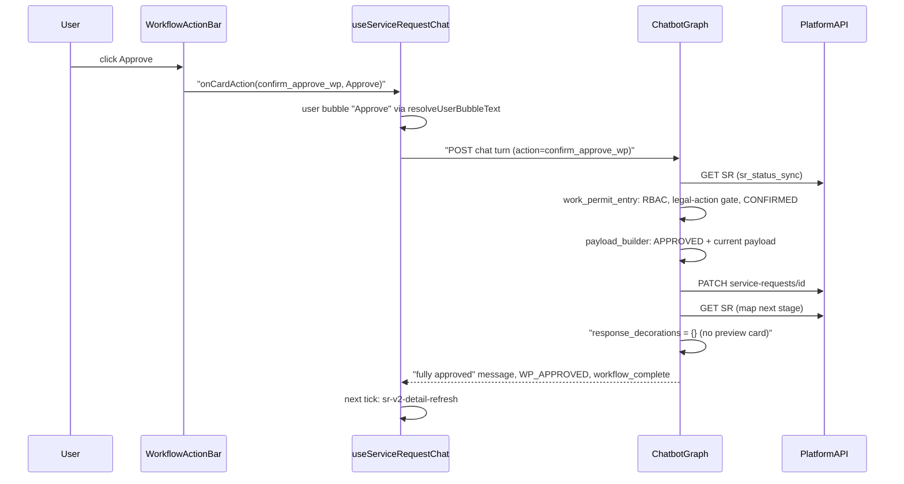
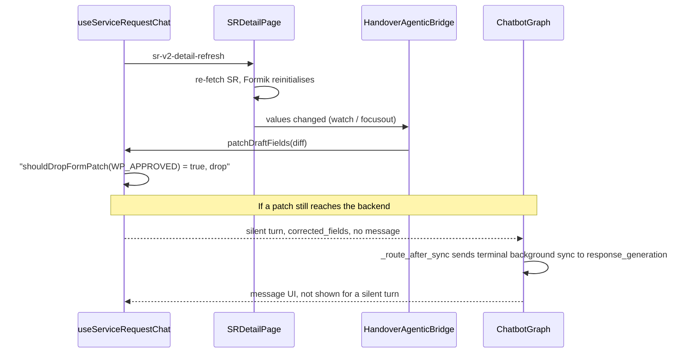

# Spec: Work Permit Agent — Create, Review, Frontend, and Reusable Patterns

**Item:** 3638
**Date:** 2026-09-28 (supersedes the 2026-09-10 revision)
**Status:** Implemented. Backend on branch `3638` (commits `b2c7ed5`, `bf1b389`, `299f870` plus the review-UX working set). Frontend on `feature/work-permit-agent` (`742cd604a`, `e9b49d736`, `568534489`).
**Owner area:** Service Request Chatbot (`work_permit_agent`) and the cenomi-frontend chatbot surfaces
**Platform contract:** Cenomi API V1 `workflow.flow` (workflow_id 5–8). Create is **not** a workflow level.

This is the canonical spec for Work Permit in the chatbot. It covers:

1. The **create** conversation (`CREATE_WORK_PERMIT_SR` → full portal form per subtype → `POST /v1/service-requests`).
2. The **review** conversation (`APPROVE_WORK_PERMIT_SR` / open by SR id / inbox → hop mapping → summary card → business action → `PATCH` or `POST /work-permit/status`).
3. The **frontend contract** that renders both flows and keeps the SR form and the chat in sync.
4. A **reusable-patterns playbook** (§10) for building the next SR agents on the same rails.

Paths are relative to `service-request-chatbot/backend/` for the backend and to `cenomi-frontend/` for the frontend. `…/` abbreviates `libs/ui-web/src/lib/components/`.

---

## 1. Problem and design goals

Work Permits are raised by Mall Managers (and tenant-side admins) and approved through the V1 workflow engine. Each subtype has its own portal form and its own hop chain. The chatbot must:

- collect the **same form the portal collects**, in conversation, and POST a payload the portal accepts;
- let each approver act on **their** hop only, with the platform's actions (approve, ask for more info, reject; extend or cancel once active);
- present the review as a short conversational summary, not a field dump, because the full form is already open beside the chat;
- never contradict the SR form: actions available in chat must match the actions on the form, and form refreshes must not create phantom chat turns.

Work Permit is the first agent built on the **generic review rails** (action resolver, summary card, deterministic card message). New SR agents should reuse them (§10).

---

## 2. Changelog since 2026-09-10

### 2.1 Create

| Change | Detail |
|---|---|
| Full portal form per subtype | Create collects `forms.intialState.common` for each subtype (`work_permit_form_fields.py`, `TENANT_FORM_BY_SUBTYPE`). The old 7-field DTO is gone. **GAP-3 is closed.** Legacy `start_date` / `end_date` / `comments` are forbidden in extraction. |
| Grouped questions | Related open fields are asked together (identity/contact, work details, schedule) with bullet explainers (`missing_field_node._build_wp_group_ask`). |
| Multi-field extraction | One reply may answer several fields. Labeled group replies (`Label - value` lines) are parsed deterministically (`field_extraction_node._parse_labeled_group_fields`). |
| Schedule parsing | Date-only `planneddate` replies, later times-only replies, Ops `effective_starting` + `firstperiod` / `secondperiod` in 12h or 24h. |
| Cold worker Iqama | Each Cold worker needs an Iqama document (`WP_COLD_WORKER_IQAMA_{i}`), collected through a `document_requirement` card. |
| Display strings | Nested widgets carry a human `display` string, so cards and previews never show `[object Object]`. |
| Ops payload | Title / description generation, ISO periods with `fromLT` / `toLT`, `company_name` from `tenant_profile_id`. |
| Create roles | `CAN_RAISE_WORK_PERMIT_SR` now also granted to `COMPANY_ADMIN_CENTRAL`, `COMPANY_ADMIN`, `AUTHORIZED_SIGNATORY`; global admin bypasses. |
| Terminal replies | Success / failure replies are returned verbatim, past the repeat guard (`response_generation_node`). |

### 2.2 Review

| Change | Detail |
|---|---|
| Action resolver | New `app/agents/services/action_resolver.py`. Legal business actions are decided deterministically per SR type (`WorkPermitActionResolver`). The LLM never decides which mutations are legal. |
| Action menu | In-progress hop: **Approve / Ask for more info / Reject**. Active permit with a tenant extend/cancel request: **Extend / Cancel**. |
| Assign To removed | Removed from the chat menu (`WorkPermitActionResolver`) and from the SR form action bar (`actionButtonSR.tsx`, `WORK_PERMIT` branch). Applies to every approver at every level. A stale or typed `assign_to_wp` gets the "not available" reply. |
| Pending inputs | Reject and Ask for more info collect a comment; Extend collects a duration then a comment; Cancel collects a comment (`work_permit_entry_node`, `wp_pending_action`). |
| Comment step on every review action | Approve, Ask for more info and Reject all ask for a comment in chat before anything is sent (§7.5). The comment is required for Ask for more info and Reject; Approve offers an "Approve without comment" chip. Every prompt has a Cancel chip. The clicked action id is never taken as the comment, and the comment lives in `backend_refs.wp_review_comment` (cleared after submission) instead of `collected_data`. The reply bubble reads "Reject: Missing safety certificate", or just "Approve" when skipped (§8.3). |
| Summary card | The review card is a conversational summary (`work_permit_review_summary.py`): greeting by first name, a compact summary grid, business actions, prompt chips. |
| View details | The card carries `details` (every filled field). "View details" with an "N of M fields" count grows the same chip grid with the fields the summary leaves out (no layout switch, no duplicates via `summaryKey`); "Hide details" returns to the six chips. |
| Pinned actions | Approve / Ask for more info / Reject sit in a footer below the chat scroller (`.chat-ui-pinned-actions`) while the review is pending with the user, so they never cover the card, and vanish once the action is done. |
| Who did what | The review message ends with who submitted the request and the latest step since, from the platform `operation_history` (or the SR creator): "**Ali Hassan** (Tenant) submitted this request, and **Sara** (DD Engineer) approved it. What would you like to do?" No dates. Tenant-side roles read "(Tenant)". The tenant's reply to a send-back counts as a resubmission, so it is the latest step: "**Tenant Central** (Tenant) submitted this request, and resubmitted it with the requested information." (§7.6) |
| Navigation chip | On the SR page the card has no note; the reviewer uses "View details" for the rest of the fields. Elsewhere it also offers an "Open full request" chip. |
| New platform calls | `PATCH` with `ACTION_REQUIRED` / `REASSIGN_TO`; `POST /service-requests/work-permit/status` for `EXTEND` / `CANCEL`. Envelope keys are stripped from the nested review payload. |
| PDF 500 | A 500 on a review action returns a message explaining final approval generates the permit PDF, and suggests the SR page. |
| Mid-hop | After a mid-hop approve the reply names the next hop, sets `stage_complete`, and keeps `active_agent=work_permit_agent`. |
| Inbox fan-out | All seven subtypes are in the notification inbox (`notification_inbox_service.py`), with per-subtype audiences. |
| First name | `AuthContext.first_name` from the `first_name` JWT claim (Go `IssueAISessionToken`), used only for the greeting. |

### 2.3 Fixes shipped with this revision

| Symptom | Cause | Fix |
|---|---|---|
| User bubble showed `confirm_approve_wp` | Action buttons sent the id as bubble text | `WorkflowActionBar` passes `(id, label)`; `sendTurn({userBubbleText: label})`; `resolveUserBubbleText`. |
| Reject / Ask for more info went through with the comment `reject_wp` / `ask_more_info_wp` | The button sends the action id as the message, and the entry node used the message as the comment | `_reply_text` drops action echoes; a comment is only taken from the reply to the comment prompt (§7.5). |
| A comment from an earlier action reappeared on the next one | The comment was kept in `collected_data.comments`, which lives across hops | Stored in `backend_refs.wp_review_comment`; `work_permit_api_submission_node` clears it with `wp_action` / `wp_pending_action` after the call. |
| History sentence said a reviewer asked for more info after the tenant had already resubmitted | The tenant's reply rows (`RE_EXAMINE`, `UPDATE`, `IN_PROCESS`) were skipped as noise | `_meaningful_rows` turns the first reply after a send-back into a resubmission (§7.6). |
| History sentence still named the Mall Manager's send-back after the tenant resubmitted (SR 341529) | The resubmission came back as a second `SUBMITTED` row, and the latest-step search skips submission rows | A submission row inside an open send-back window is also re-tagged as `RESUBMITTED` (§7.6). |
| The reason typed after "What should I tell them?" was answered by the LLM and nothing was sent back | The graph keeps no state between turns and the draft only restored `sr_id` / `service_request_status` into `backend_refs`, so `wp_pending_action` was lost and the reply fell through to the generic confirmation branch | `save_checkpoint` stores the pending prompt as `collected_data._wp_pending`; `load` restores it into `backend_refs` (§7.5). |
| SR page on the left still showed the old hop after approving with a comment | `maybeDispatchSrDetailRefresh` only fired for a mutating card action; the comment reply that completes the action carries no action id (and `reject_wp` / `ask_more_info_wp` were never mutating) | Also refresh on a successful non-silent turn whose `ui` has `stage_complete` / `workflow_complete` (`stepCompleted`, §8.7). |
| Full SR details card after every review action | Review decorations carried `promote_preview`, and finalize swapped the reply for the preview card | `work_permit_api_submission_node` sets `response_decorations = {}` for `WP_REVIEW_STAGES`. |
| "HANDOVER SERVICE REQUEST / Approved" card ~0.3 s after final approval, with no user bubble | Approval triggered `sr-v2-detail-refresh`; the form re-fetch echoed values through the bridge as a silent `corrected_fields` patch; `_route_after_sync` sent a terminal SR with `sr_id` to `preview`, which builds a Handover-labelled `sr_preview_card`; silent turns may render that card type | Backend: `_is_background_form_sync` routes terminal-stage silent patches to `response_generation`. Frontend: `patchDraftFields` drops patches once the stage is `WP_APPROVED` / `WP_REJECTED` (`shouldDropFormPatch`). |
| "Work Permit Service Request / Submitted" details card when a non-approver opens an SR under review, with LLM-reworded text | `build_review_decorations` set `promote_preview` on WP review stages, so finalize swapped the non-actor `message` for the preview card; the message was not `verbatim` | WP review stages no longer set `promote_preview`. The non-actor reply is a fixed `verbatim` message, with `response_decorations = {}`, and the "Open full request" chip only off the SR page. |
| "HANDOVER SERVICE REQUEST / Review" card and a Handover "Form completion 7/15" meter when opening a Work Permit that was sent back to the tenant | Platform `ACTION_REQUIRED` has no IN_PROGRESS operation, so `map_wp_operations_to_stage` returned `None`; `_route_after_sync` fell back to the hard-coded `preview` node, which always labels its card "Handover Service Request". The frontend meter counted Handover fields for any agent and for existing SRs | `ACTION_REQUIRED` → `WP_ACTION_REQUIRED`. `WorkflowConfig.status_view_node` (default `preview`) replaces every hard-coded `preview` route; Work Permit uses `work_permit_status` (§7.12). `preview_node` takes its header from `WorkflowConfig.request_type_label`. The meter only shows while drafting a new SR for a workflow with a known field set (§8.11). |
| Thumbs in the middle of a reply | Feedback rendered before the card | `SrFabMessages` renders `ChatFeedbackThumbs` after `SrChatUiRenderer`. |
| Plain bold in replies | — | Assistant `strong` uses `--chat-ui-primary` (`AIChatWidget.css`, `copilotV2.css`). |

---

## 3. Agent identity

| Key | Value |
|---|---|
| Agent name | `work_permit_agent` |
| Display name | Work Permit Agent |
| Service category | `WORK_PERMIT` |
| Schema | `work_permit_service_request_schema` (`app/agents/schemas/work_permit_schema.py`) |
| Create stage | `CREATE_WORK_PERMIT` (not Handover `CREATE_SR`) |
| Review stages | `WP_DD_REVIEW`, `WP_FM_REVIEW`, `WP_MM_REVIEW`, `WP_MM_OPS_REVIEW` (`WP_REVIEW_STAGES`) |
| Terminal stages | `WP_CREATED`, `WP_APPROVED`, `WP_REJECTED` (`WP_TERMINAL_STAGES`) |
| Sent back | `WP_ACTION_REQUIRED` (platform `ACTION_REQUIRED`; no review hop open) |
| Supervisor intents | `CREATE_WORK_PERMIT_SR`, `APPROVE_WORK_PERMIT_SR` |
| Preview label | `draft_preview.requestType = "Work Permit Service Request"` (`chat_orchestration_service.py`); `WorkflowConfig.request_type_label` |
| Status view | `work_permit_status` node — never the Handover `preview` node (§7.12) |

All seven subtypes (plus the legacy `WORK_PERMIT` key used before the subtype is known) route to the same agent:

| `sub_category` | Label | Workflow | Extraction hint |
|---|---|---|---|
| `WORK_PERMIT` (legacy) | Not yet chosen | — | — |
| `CONSTRUCTION_HOT` | Construction – Hot Work | 5 | Welding, cutting, heat |
| `CONSTRUCTION_COLD` | Construction – Cold Work | 6 | Construction without heat; **default** for bare "construction" |
| `CONSTRUCTION_ROOF_ACCESS` | Construction – Roof Access | 5 | Roof access for construction |
| `MAINTENANCE_HOT` | Maintenance – Hot Work | 7 | Heat-producing maintenance |
| `MAINTENANCE_COLD` | Maintenance – Cold Work | 7 | Maintenance without heat |
| `MAINTENANCE_ROOF_ACCESS` | Maintenance – Roof Access | 5 | Roof access for maintenance |
| `OPERATIONS` | Operations | 8 | Operational activities in the unit |

`lookup_agent(service_category, sub_category)` in `registry.py` is authoritative. `resolve_wp_sub_category()` replaces the legacy key with a real enum before POST.

`WorkflowConfig` (`app/agents/registries/workflow_config.py`, `work_permit_agent`):

| Field | Value |
|---|---|
| `stage_sync_nodes` | the four review stages → `work_permit_entry`; `WP_ACTION_REQUIRED` → `work_permit_status` |
| `collection_stages` | `CREATE_WORK_PERMIT` + the four review stages |
| `confirmation_nodes` | all five → `work_permit_confirmation` |
| `terminal_stages` | `WP_CREATED`, `WP_APPROVED`, `WP_REJECTED` |
| `action_intents` | `CREATE_WORK_PERMIT_SR`, `APPROVE_WORK_PERMIT_SR` |
| `lease_trigger_fields` | `lease_code`, `company`, `lease_brand_mall` |
| `status_view_node` | `work_permit_status` (default for other workflows: `preview`) |
| `request_type_label` | "Work Permit Service Request" |

`status_view_node` and `request_type_label` are generic: Handover uses `preview` + "Handover Service Request"; Fitout Start / Fitout End / Trading use `preview` + "Fitout Start Confirmation Service Request" / "Fitout End Confirmation Service Request" / "Trading Confirmation Service Request".

---

## 4. Supervisor routing

### 4.1 Create

**Intent:** `CREATE_WORK_PERMIT_SR`. Keywords: work permit, hot work, cold work, roof access, construction / maintenance / operations permit, "I need a permit".

- `service_category = WORK_PERMIT`; `sub_category = WORK_PERMIT` until `work_permit_type` is confirmed; `target_agent = work_permit_agent`.
- In `_CREATE_NEW_SR_INTENTS`: an existing `backend_refs.sr_id` is **not** opened on this turn.
- RBAC denial happens in `supervisor_node` and routes to `response_generation` with `WAITING_FOR_USER`.
- A new create on a terminal stage clears the draft and pins `CREATE_WORK_PERMIT` (`work_permit_entry_node`, `stale_sr_cleared`).

**Who may create** — permission `CAN_RAISE_WORK_PERMIT_SR` (`PermissionService.ensure_can_create_work_permit`):

| Role | Create |
|---|---|
| `MALL_MANAGER`, `ADMIN` | Yes |
| `COMPANY_ADMIN_CENTRAL`, `COMPANY_ADMIN`, `AUTHORIZED_SIGNATORY` | Yes (new) |
| Global admin (`is_global_admin`) | Yes (bypass in `check()`) |
| `FM_MANAGER`, `DD_ENGINEER`, `OPERATIONS`, `OPERATION_EXECUTIVES`, `BILLING_CONTACT`, `PRIMARY_TENANT_CONTACT` | No |

No `auth_context` (tests / shadow mode) skips the check.

### 4.2 Review / open existing

**Intent:** `APPROVE_WORK_PERMIT_SR`, or any open by SR id, or an inbox Open. Keywords: approve / reject / review work permit, open work permit SR.

- `sr_status_sync` GETs the SR, maps operations to a WP stage, and pins `active_agent=work_permit_agent`.
- Inbox Open with a WP subtype (or category `WORK_PERMIT`) seeds `work_permit_agent` (`open_notification_node._OPEN_SEED_CATEGORIES`).

---

## 5. Create flow

### 5.1 Graph (create)

```
load_state
  → supervisor                 (CREATE_WORK_PERMIT_SR; RBAC)
  → registry                   (active_agent = work_permit_agent)
  → work_permit_entry          (pin CREATE_WORK_PERMIT; type/department chips; HITL confirm / cancel)
  → field_extraction           (WP extraction prompt + deterministic rescues)
  → merge_state                (cold Iqama docs onto workers; cold second period)
  → lease_lookup               (picker or lease_code; skipped once lease_id is set)
  → validation                 (portal emptiness rules, enum, date order)
  → missing_field              (type chip → lease → guided tour → group ask → single ask)
       or work_permit_confirmation  (create card, confirmation_status=PENDING)
  → response_generation

On Confirm (confirm / confirm_create_wp, or "yes" on a PENDING card):
  work_permit_entry (CONFIRMED) → merge_state → lease_lookup / validation
  → work_permit_confirmation (no-op) → work_permit_payload_builder
  → work_permit_api_submission (POST, then GET) → response_generation (verbatim)
```

`_route_after_work_permit_entry`, in order:

| Condition | Next |
|---|---|
| Guided-tour pending answer | `merge_state` |
| `confirmation_status == CONFIRMED` | `merge_state` (submit path) |
| WP type / department chip applied | `merge_state` |
| `confirmation_status == REJECTED` | `field_extraction` (user wants to change something) |
| `status == WAITING_FOR_USER` | `_form_patch_target` or `response_generation` (pending prompts, denials, stale refusals) |
| `action_override == cancel` | `merge_state` |
| Stage in `WP_REVIEW_STAGES` | `merge_state` (review; no extraction) |
| else (create) | `_form_patch_target` or `field_extraction` |

CONFIRMED is checked before a stale `WAITING_FOR_USER` so Confirm never re-asks. "Start over" / "reset" / "new request" wipe the agent, collected data, and `backend_refs`.

### 5.2 Fields per subtype

Source: `app/agents/schemas/work_permit_form_fields.py`. `TENANT_FORM_BY_SUBTYPE` maps each subtype to `WpTenantFormSpec(common_keys, field_types, required_tenant_fields, optional_tenant_fields)`. Keys are the portal's `forms.intialState.common` keys, so the POST body matches the portal.

**Lease-derived, never asked** (`_CREATE_REQUIRED_BASE`): `work_permit_type`, `lease_code`, `lease_id`, `property_id`, `unit_codes`, `mall`, `brand`. `lease`, `lease_brand_mall`, `company_name`, `country_code`, `tenant_contact` go into the payload but are never asked. The LLM must never invent lease-derived values.

#### Cold — `CONSTRUCTION_COLD`, `MAINTENANCE_COLD` (`_COLD_COMMON`, `_COLD_REQUIRED`)

| Key | Label | Required | Shape |
|---|---|---|---|
| `department` | Department | Yes | dropdown (leasing / finance / operations) |
| `unit_type` | Unit Type | Yes | input |
| `owner` | Owner | Yes | input |
| `trade_name` | Trade Name | Yes | input |
| `responsible_person` | Responsible Person | Yes | input |
| `phone` | Phone | Yes | phoneinput |
| `type_work` | Type of Work | Yes | textarea |
| `list_equipment` | List of Equipment | Yes | textarea |
| `work_info` | Work Info | Yes | textarea |
| `planneddate` | Planned Date and Time | Yes | `{worktimedate, worktimefrom, worktimeto, completionworkdate, completionfrom, completionto}` + `*LT` aliases |
| `planned_second_period` | Second Period | Optional, asked once | chat-only timepicker `{from, to}`; merged into `planneddate.completionfrom/to` |
| `workers` | Workers | Yes | listWorker `[{full_name, designation, company_name, phone, country_code:"966", iqama_number, document_id}]` |
| `notes` | Notes | Optional, asked once | textarea |

#### Construction Hot — `CONSTRUCTION_HOT` (`_HOT_COMMON`, `_HOT_REQUIRED`)

| Key | Label | Required | Shape |
|---|---|---|---|
| `unit_type` | Unit Type | Yes | input |
| `contractor_name` | Contractor Name | Yes | input |
| `phone` | Phone | Yes | phoneinput |
| `planneddate` | Planned Date and Time | Yes | planneddate |
| `workers` | Workers | Yes | addworker `{instructor_name, worker:[{name, designation, iqama_number, document_id, worker_qualification}]}` |
| `measureofsafety` | Measure of Safety | Yes | 8-key checklist (below) |
| `work_type`, `work_location`, `demand_appendices`, `special_conditions` | as named | Optional, never asked | textarea |
| `title`, `description` | Title / Description | Optional, ask-or-skip | text |

#### Roof access — `CONSTRUCTION_ROOF_ACCESS`

Same as Hot minus `title` / `description`. `_ROOF_REQUIRED` adds `work_type`, `work_location`, `demand_appendices`, `special_conditions`. These four are also in the global `OPTIONAL_FIELDS` union used by `get_missing_fields`, so they are **asked but a `""` skip is accepted** (see §14, G-7).

#### Maintenance Hot / Roof — `MAINTENANCE_HOT`, `MAINTENANCE_ROOF_ACCESS` (`_MAINT_HOT_COMMON`, `_MAINT_HOT_REQUIRED`)

Hot's required set plus `department`: `department, unit_type, contractor_name, phone, planneddate, workers, measureofsafety`. No title / description. The four roof text fields are optional for both.

#### Operations — `OPERATIONS` (`_OPS_COMMON`, `_OPS_REQUIRED`)

| Key | Label | Required | Shape |
|---|---|---|---|
| `department` | Department | Yes | dropdown |
| `unit_type` | Unit Type | Yes | input |
| `phone` | Phone | Yes | phoneinput |
| `typeofwork` | Type of Work | Yes | `{value:[keys], otheroption}` |
| `permission_given_to` | Permission Given To | Yes | text |
| `effective_starting` | Effective Starting Dates | Yes | daterange `{datefrom, dateto}` DD/MM/YYYY |
| `firstperiod` | First Period | Yes | timepicker `{from, to}` HH:MM |
| `secondperiod` | Second Period | Optional, asked once | timepicker |
| `entry_gate` | Entry Gate | Optional, asked once | input |
| `notes` | Notes | Optional, asked once | textarea |

#### Option lists

| List | Values |
|---|---|
| `WP_TYPEOFWORK_OPTIONS` | Construction `construction`, Shop Fitting `shopfitting`, Stock Delivery `stockdelivery`, Stock Removal `stockremoval`, Inventory/Shop Arrangement `inventory`, Maintenance inside the shop `maintenance`, Others `others` |
| `WP_MEASURE_OF_SAFETY_LABELS` | `fire_extinguisher`, `fire_hoses`, `sprinker_on`, `volatile_remove`, `fire_proofcoating`, `work_hour_organized`, `equipment_for_carryingout`, `all_Holes_in_floorandWalls` |

`_coerce_typeofwork_value` maps labels and typos to keys; unknown text becomes `others` with the text in `otheroption`.

#### Emptiness rules (`is_tenant_field_missing`)

| Shape | Complete when |
|---|---|
| `planneddate` | `worktimedate`, `completionworkdate`, `worktimefrom`, `worktimeto` set (`completionfrom/to` optional) |
| listWorker | every row has `full_name`, `designation`, `company_name`, `iqama_number`, `document_id` |
| addworker | `worker[0].name` set |
| `measureofsafety` | at least one non-empty key |
| `typeofwork` | non-empty `value` |
| daterange | `datefrom` and `dateto` |
| timepicker | `from` and `to` |
| Optional field | missing only if `None`; `""` is an explicit skip |

### 5.3 Question order, groups, and chips

**Order** (`work_permit_schema.get_create_required_fields`): base lease + type fields → `description` / `title` (ask-or-skip, once lease and type are known) → the subtype's `required_tenant_fields` (Cold inserts `planned_second_period` after `planneddate`) → trailing optionals (Ops: `secondperiod`, `entry_gate`, `notes`; Cold: `notes`).

**Short flow** (`wp_short_flow_enabled`, reuses `handover_short_flow_enabled`): `title`, `description`, `notes` are never asked; `sr_autofill_service._build_wp_template_values` and `merge_state_node` fill them.

**Priority in `missing_field_node`:**

1. Handoff.
2. Type chip. `_wp_type_confirmed` is required; an unconfirmed LLM guess is cleared.
3. Blocking validation errors.
4. Lease trigger (`lease_code`, `company`, `lease_brand_mall`) — lease picker when `HANDOVER_LEASE_PICKER_ENABLED`.
5. Guided tour (`guided_tour_gate`, default on), asked once after the lease resolves.
6. Group ask when `resolve_wp_group` returns two or more open fields (`_build_wp_group_ask`, explainers from `_WP_FIELD_EXPLAINERS`).
7. Single ask (`_build_wp_singleton_ask`). Cold `workers` complete as text → `document_requirement` card, one row per worker ("Iqama document — {name}"). When `planneddate` dates are known, asks for times only.

**Groups** (`field_groups_for_subtype`):

| Subtype | Groups |
|---|---|
| Cold | identity/contact (`department, unit_type, owner, trade_name, responsible_person, phone`) → work details (`type_work, list_equipment, work_info`) |
| Construction Hot | `unit_type, contractor_name, phone` |
| Roof | Hot contact group → roof details group |
| Maintenance Hot / Roof | contact group + `department` |
| Operations | contact (`department, unit_type, phone`) → schedule (`effective_starting, firstperiod, secondperiod`) |

**Chips** (`work_permit_suggestions_service.build_wp_decorations`):

| Field | Chips |
|---|---|
| `work_permit_type` | one per subtype, action `select_wp_type_*` (applied in `work_permit_entry_node`, no LLM) |
| `department` | action `select_wp_department_*` (no LLM) |
| `unit_type` | Retail, F&B, Store |
| `typeofwork` | portal keys as values |
| `planneddate` | Today 9–17, Tomorrow 9–17, today → today+4 (Asia/Riyadh) |
| `measureofsafety` | "All common safety measures" + one per remaining item |

### 5.4 Extraction

`app/agents/prompts/work_permit_extraction_prompt.py`:

- Emit portal keys only; nested widgets as JSON strings. Lease-derived keys and legacy `start_date` / `end_date` / `comments` are forbidden.
- When a turn asks several fields, extract every field the user answered and omit the rest.
- `unit_type` and `phone` may be split from one reply. `effective_starting` is dates only; a single date fills both ends; "today" / "tomorrow" resolve to dates. `firstperiod` converts 12h to 24h; a bare hour inherits am/pm from the other side. A "Type of work - X" prefix is stripped. Chip labels map to values.

Deterministic rescues in `field_extraction_node`:

| Rescue | Behaviour |
|---|---|
| `_parse_labeled_group_fields` | Splits `Label - value` / `Label: value` lines via `_WP_LABELED_FIELD_ALIASES` (e.g. "equipments" → `list_equipment`). When labeled lines exist, the whole message is not dumped into `active_field`. |
| Free-text fallback | For `_FREE_TEXT_FIELDS`; never binds a bare phone number to `unit_type`. |
| Optional skip | `_SKIP_ANSWER_RE` on `secondperiod`, `planned_second_period`, `entry_gate`, `notes` writes `""` / empty period. |
| `_extract_time_period` | Fills the first open period only. |
| `_extract_effective_starting` | Fills gaps; copies `datefrom` to `dateto` for a single date. |
| `_merge_planneddate_base` | Date-only replies ("24 to 26 sep", "24sep", ordinals) set the dates; a later times-only reply sets the times; bare "9 to 5" only once dates are known. |
| `_drop_incomplete_schedule_overwrites` | A partial value never wipes a complete one. |
| `_apply_wp_unit_type_phone_split`, `_apply_wp_bare_phone` | Phone replies. |

### 5.5 Validation (`validation_service.validate`)

1. Required fields via `get_create_required_fields` + `is_tenant_field_missing` ("Required field 'x' is missing."). Cold Iqama is enforced here: `_workers_incomplete` fails while any worker `document_id` is empty.
2. Enum: `work_permit_type` in `VALID_WORK_PERMIT_TYPES`.
3. Date order: `validate_wp_date_range` on `planneddate.worktimedate` / `completionworkdate` (or legacy `start_date` / `end_date`). Start ≤ end; **same day is valid**. Runs only when both parse. Do not reuse Handover's strict `startDate < endDate`.

Not validated: time-of-day order within the window, `effective_starting` order, past dates.

Cold Iqama wiring: `apply_cold_worker_iqama_documents` (called from `merge_state_node`) copies `document_id` from `state.documents` (key `WP_COLD_WORKER_IQAMA_{i}`, `cold_worker_iqama_doc_key`) onto the worker row; status `missing` / `rejected` clears it. The frontend mirrors uploads onto `workers[i].document_id` (`mergeDocumentRequirementIntoDraft`).

### 5.6 Create confirmation card

`work_permit_confirmation_node._build_create_confirmation_card`, built only when `get_missing_fields("CREATE_WORK_PERMIT")` is empty.

| Property | Value |
|---|---|
| `type` | `confirmation_card` |
| `requestType` | `Work Permit Service Request` |
| `confirmAction` / `cancelAction` | `confirm_create_wp` / `cancel_create_wp` |
| Rows | `lease_code, mall, brand, unit_codes, work_permit_type`, then the subtype's `common_keys` (minus lease/envelope keys), then `description` / `title` if set |
| Display | `_display_value`: type label from `WORK_PERMIT_TYPE_LABELS`; `planneddate` / `workers` / `measureofsafety` via `format_wp_field_display`; `typeofwork`, `effective_starting`, periods via `summarize_*`. Empty or still-structured rows are dropped. |
| Editable | `work_permit_type`, every key in `field_types`, `notes`, `description`, `title` (inline edits arrive as `corrected_fields`) |
| Provenance | `_ai_field_meta` adds `generated`, `source`, `hint`, `confidence` |
| `response_message` | `None` (card wording is kept; no LLM rewrite) |

Replies: confirm action or "yes / confirm / submit" → `CONFIRMED`. `cancel` / `cancel_create_wp` or a reject phrase → `REJECTED`, "No problem — what would you like to change?".

`wp_draft_fields_from_collected` feeds `draft_preview.fields`: nested widgets as objects with a `display` string per row; Ops periods expanded to ISO from `effective_starting.datefrom`; `planneddate` with LT aliases; `unit_codes` JSON-encoded; `planned_second_period` skipped.

### 5.7 Create payload

`work_permit_payload_builder_node.build_create_work_permit_payload`. Hard required: `lease_code`, `lease_id`, `work_permit_type` (else `ValueError` → `FAILED`).

Illustrative Operations body (values are examples):

```json
{
  "service_category": "WORK_PERMIT",
  "sub_category": "OPERATIONS",
  "title": "Operations – t0096094",
  "lease_id": 123,
  "tenant_profile_id": 456,
  "property_id": 3041,
  "lease_code": "t0096094",
  "service_request_id": "",
  "created_via": "AI_ASSISTANT",
  "payload": {
    "mall": "Yasmeen Mall", "brand": "Lefties", "lease": "t0096094",
    "unit_codes": ["MZ001"], "unit_type": "Retail", "company_name": 456,
    "department": "operations", "phone": "500000000",
    "typeofwork": {"value": ["shopfitting"], "otheroption": ""},
    "permission_given_to": "ABC Fitouts",
    "effective_starting": {"datefrom": "29/09/2026", "dateto": "01/10/2026"},
    "firstperiod": {"from": "2026-09-29T09:00:00.000Z", "to": "2026-09-29T17:00:00.000Z", "fromLT": "9:00 AM", "toLT": "5:00 PM"},
    "title": "Operations – t0096094",
    "description": "Operations work permit for t0096094.",
    "notes": "Operations work permit for Lefties, Yasmeen Mall."
  }
}
```

| Rule | Detail |
|---|---|
| Inner keys | Only the subtype's `common_keys`; empty nested widgets get their portal empty shape (`_inner_payload_from_collected`). |
| Envelope `title` | User title, else `generate_wp_title` ("{short subtype} – {lease_code}"), else `Work Permit - {sub}`; max 50 chars. |
| Inner `title` / `description` | Filled for every subtype when blank (`generate_wp_title`, `generate_wp_description`, max 200). |
| `notes` | `generate_wp_notes` when skipped or short flow. |
| `company_name` | `int(tenant_profile_id)`; omitted if missing / non-numeric (`_apply_company_name_from_tenant_profile`). |
| Ops periods | `_apply_ops_period_iso`: HH:MM + `effective_starting.datefrom` → `YYYY-MM-DDTHH:MM:00.000Z` plus `fromLT` / `toLT`. |
| `planneddate` | Dates DD/MM/YYYY, times HH:MM; `expand_planneddate_for_api` adds `worktimefromLT` / `worktimetoLT` / `completion*LT`. |

### 5.8 Submission and result

`work_permit_api_submission_node` guards, in order: `ensure_can_create_work_permit` → `CONFIRMED` → no blocking validation errors → `create_payload` present. POST `/service-requests` through `platform_api_client._post` (user Bearer token on agentic routes; 401 re-login only on the S2S path).

After success `_create_result` GETs the SR and maps it with `map_wp_operations_to_stage` (detects auto-approve, e.g. Mall Manager + Operations):

| GET mapping | Stage | Message |
|---|---|---|
| In process / GET failed | `WP_CREATED` | "Your Work Permit Service Request has been successfully submitted. Your reference number is **{id}**. It will be routed to the next reviewer when required." |
| Platform approved | `WP_APPROVED` | "…successfully submitted and auto-approved. Your reference number is **{id}**." |
| Platform rejected | `WP_REJECTED` | Rare on create. |

Both set `workflow_complete: True`. Failure: "Unable to submit the work permit request due to an API error. Please try again later. Detail: HTTP 4xx/5xx".

**Repeat guard:** `response_generation_node` returns `SUBMITTED` / `FAILED` / `COMPLETED` replies verbatim (no LLM rewrite, no repeat check). Without this the success text was replaced by the "I'm processing…" placeholder.

### 5.9 Typical conversation (Operations)

1. Mall Manager: "I need an operations work permit for Lefties at Yasmeen Mall."
2. Supervisor → `CREATE_WORK_PERMIT_SR` → `work_permit_agent` → `CREATE_WORK_PERMIT`; type chip confirms `OPERATIONS`.
3. Lease picker (or typed code) → mall / brand / unit / ids filled.
4. Guided tour prompt (once).
5. Group ask: department, unit type, phone (chips for department and unit type).
6. Type of work (chips), permission given to.
7. Group ask: effective dates + first period (+ optional second period).
8. Optional entry gate, notes.
9. Confirmation card → Confirm → POST → GET → `WP_CREATED` (or `WP_APPROVED` if auto-approved).

---

## 6. Platform approval lifecycle

`POST /service-requests` inserts one operation per `flow[]` row (`YET_TO_START`) and promotes **level 1** to `IN_PROGRESS`. SR status starts `IN_PROCESS`.

### 6.1 Flow graphs

| Subtype | `workflow_id` | Hops after create |
|---|---|---|
| `CONSTRUCTION_HOT`, `CONSTRUCTION_ROOF_ACCESS`, `MAINTENANCE_ROOF_ACCESS` | 5 | L1 `DD_ENGINEER` → L2 `FM_MANAGER` → L3 `MALL_MANAGER` |
| `CONSTRUCTION_COLD` | 6 | L1 `DD_ENGINEER` → L2 `MALL_MANAGER` **or** `OPERATION_EXECUTIVES` **or** `OPERATIONS` (same level) |
| `MAINTENANCE_HOT`, `MAINTENANCE_COLD` | 7 | L1 `FM_MANAGER` → L2 `MALL_MANAGER` |
| `OPERATIONS` | 8 | L1 `MALL_MANAGER` only |

### 6.2 Seed role IDs

GET `assigned_role` is a role name or a seed id. `normalize_wp_role` maps both: `11` `MALL_MANAGER`, `12` `DD_ENGINEER`, `20` `FM_MANAGER`, `81` `OPERATIONS`.

### 6.3 Cold L2 (same-level OR)

MM, OE and OPERATIONS are all `workflow_level: 2` and all `IN_PROGRESS`. Any of them can approve; siblings are not deleted; the SR still goes `APPROVED` when the next level is empty.

### 6.4 Auto-approve on create

Only if the creator's role matches level 1 (`shouldAutoApproveOperation`). In practice: Mall Manager creating Operations. The chatbot detects it from the post-create GET, never by guessing locally.

### 6.5 After approval

Once `APPROVED` / `ACTIVE`, the tenant may request **EXTEND** or **CANCEL**. The approver then decides through `POST /service-requests/work-permit/status` (§7.7). The chatbot shows the extension bar (Extend / Cancel) instead of the review bar in that state (§7.4).

---

## 7. Review flow

### 7.1 Stages and labels

Stages are **WP-prefixed** so they never collide with Handover `FM_REVIEW` / `RDD_REVIEW` in shared routing.

| Stage | When | Label | Allowed roles (`WP_REVIEW_ROLES`) |
|---|---|---|---|
| `CREATE_WORK_PERMIT` | Create in progress | Create Work Permit | — |
| `WP_DD_REVIEW` | `DD_ENGINEER` op `IN_PROGRESS` | DD Review | `DD_ENGINEER`, `ADMIN` |
| `WP_FM_REVIEW` | `FM_MANAGER` op `IN_PROGRESS` | FM Review | `FM_MANAGER`, `ADMIN` |
| `WP_MM_REVIEW` | `MALL_MANAGER` op `IN_PROGRESS` (Ops L1, Hot L3, Maintenance L2) | Mall Manager Review | `MALL_MANAGER`, `ADMIN` |
| `WP_MM_OPS_REVIEW` | Cold L2, or more than one of MM / OE / OPERATIONS in progress | Mall Manager / Operations Review | `MALL_MANAGER`, `OPERATIONS`, `OPERATION_EXECUTIVES`, `ADMIN` |
| `WP_CREATED` | Create succeeded; also after Ask for more info | Submitted | — |
| `WP_APPROVED` | Final approve, or platform terminal approved | Approved | — |
| `WP_REJECTED` | Rejected | Rejected | — |
| `WP_ACTION_REQUIRED` | Platform `ACTION_REQUIRED` (sent back to the tenant) | Sent back to tenant | — |

### 7.2 Status sync (GET → stage)

`sr_status_sync_node` GETs `/v1/service-requests/{id}` (detail DTO: `status`, `category`, `sub_category`, `service_request_operations[]`).

`_map_operations_to_stage` **early-exits for Work Permit** (`is_work_permit_category`) and calls `map_wp_operations_to_stage`, otherwise Hot `DD_ENGINEER IN_PROGRESS` would become Handover `RDD_REVIEW`:

1. Platform `REJECTED` → `WP_REJECTED`.
2. Platform in `{APPROVED, COMPLETED, DONE, ACTIVE, EXPIRED, CLOSED, EXTENDED}` → `WP_APPROVED`.
3. Platform `ACTION_REQUIRED` → `WP_ACTION_REQUIRED` (wins over a stale review stage in the checkpoint).
4. First IN_PROGRESS role: DD → `WP_DD_REVIEW`; FM → `WP_FM_REVIEW`; MM / OE / OPERATIONS → `WP_MM_OPS_REVIEW` if Cold or several roles, else `WP_MM_REVIEW`.
5. No IN_PROGRESS ops → keep the current stage.

Written to `backend_refs`: `platform_sr_status`, `sr_operations`, `sr_history`, `sr_creator`, `work_permit_extension`, `user_role`, `create_payload` (snapshot; `sub_category` via `resolve_wp_sub_category`). State: `active_agent=work_permit_agent`, `service_category=WORK_PERMIT`, `sub_category`.

- `sr_history`: the detail DTO returns the approval history as `operation_history` (the key the SR page reads). `platform_api_client.get_service_request` reads `operation_history`, then `service_request_history` / `sr_history` / `history`. Rows: `status`, `operator_name`, `operator_role`, `user_type`, `comment`, `created_at`.
- `sr_creator`: `{name, role, created_at}` from the DTO's top-level `created_by`, `created_user_role` and `created_at` (`ServiceRequestGetResult.created_*`); blank values are dropped, and the key is absent when all three are blank.

Decorations: `review_decorations_service.build_review_decorations` returns `{}` on WP review stages for the actor, and only a View SR chip for non-actors. It does **not** set `promote_preview`: the full "Work Permit Service Request / Submitted" details card duplicates the SR form on the left, and the review card is a `confirmation_card`, which never relied on the swap. Handover (FM/RDD) still promotes the preview.

### 7.3 Hop RBAC

There is no `APPROVE_SR_WORK_PERMIT` permission. The gate is `PermissionService.can_approve_work_permit(auth, workflow_stage, in_progress_roles(sr_operations))`:

- Admin / global admin pass.
- Otherwise the caller's role must be in the IN_PROGRESS `assigned_role` set; with none, fall back to `WP_REVIEW_ROLES[stage]`.

Denial (`work_permit_entry_node._deny_review_action`): "You do not have permission to act on this Work Permit hop ({label}). This stage is assigned to another reviewer." The submission node re-checks with `ensure_can_approve_work_permit`.

Non-actors opening the SR get `_non_actor_review_message`, a fixed text: "Work Permit SR **X** is with **{label}**. You don't have an action on this step." The reply is:

- a `message` UI with `verbatim: True`, so response generation never rewords it;
- no actions;
- an "Open full request" chip only when the user is **not** already on that SR's page (`_is_on_sr_page`); on the page, the message stands alone;
- `response_decorations = {}`, so finalize neither swaps it for the SR details card nor merges the sync turn's View SR chip back in.

Not in any WP flow: HSE, CONTRACTOR, SUB_CONTRACTOR, `REGIONAL_DD_ENGINEER`.

### 7.4 Business actions (`app/agents/services/action_resolver.py`)

Generic contract, designed to be reused by other SR types:

```python
@dataclass(frozen=True)
class ActionRequires:            # inputs collected before the action executes
    comment: bool = False
    role: bool = False
    duration: bool = False
    confirm: bool = False

@dataclass(frozen=True)
class BusinessAction:
    id: str                      # sent back as action_override
    label: str                   # button text and user bubble text
    requires: ActionRequires
    def to_dict(self): ...       # {id, label, type: "workflow_action", requires?}

@dataclass(frozen=True)
class ServiceRequestContext:
    sr_type: str; subtype: str | None; workflow_stage: str | None
    assigned_roles: frozenset[str]; user_roles: frozenset[str]
    platform_status: str | None; request_history: tuple[dict, ...]
    work_permit_extension: dict | None; assign_to_options: tuple[dict, ...]
    is_actor: bool = True; is_admin: bool = False

class ActionResolver(Protocol):
    def available_actions(self, context: ServiceRequestContext) -> list[BusinessAction]: ...
```

`resolve_actions(context, resolver=None)` dispatches by `sr_type` (Work Permit today); `actions_to_ui` serialises for `response_ui.actions`.

**Work Permit action ids:**

| Constant | Id | Label | Requires |
|---|---|---|---|
| `WP_ACTION_APPROVE` | `confirm_approve_wp` | Approve | — |
| `WP_ACTION_MORE_INFO` | `ask_more_info_wp` | Ask for more info | comment |
| `WP_ACTION_REJECT` | `reject_wp` | Reject | comment |
| `WP_ACTION_EXTEND` | `extend_wp` | Extend | duration, comment |
| `WP_ACTION_CANCEL_PERMIT` | `cancel_permit_wp` | Cancel | comment, confirm |
| `WP_ACTION_ASSIGN` | `assign_to_wp` | — | **not offered** (kept only so stale clicks are refused) |

**`WorkPermitActionResolver.available_actions`:**

| Context | Menu |
|---|---|
| Not `WORK_PERMIT`, or neither actor nor admin | `[]` |
| Extension bar (`should_show_wp_extension_actions`) | Extend (only if last status `EXTEND` or extension pending, and not `already_extended`) + Cancel (always) |
| Any in-progress hop, any subtype, any approver | **Approve, Ask for more info, Reject** |

`should_show_wp_extension_actions` is true for an actor/admin when `work_permit_extension.pending`, or when the last history entry is from the tenant (`user_type` / `operator_type` `TENANT` or empty) with status `EXTEND` / `CANCEL`.

Assign To was removed on 2026-09-28 for every approver at every level; the SR form was aligned (§8.9).

### 7.5 Entry node: review actions and pending inputs

`work_permit_entry_node` aliases (`_normalize_review_action`):

| Alias set | Key |
|---|---|
| `confirm_approve_wp`, `approve`, `approve_wp`, `confirm` | `approve` |
| `reject_wp`, `reject` | `reject` |
| `ask_more_info_wp`, `ask_more_info` | `action_required` |
| `assign_to_wp`, `assign_to` | `assign_to` |
| `extend_wp`, `extend` | `extend` |
| `cancel_permit_wp`, `cancel_permit` | `cancel_permit` |

`_begin_or_complete_review_action`, in order:

1. **Hop RBAC** (`_deny_review_action`).
2. **Legal-action gate.** `_legal_action_ids` builds a `ServiceRequestContext` from `backend_refs` and calls `resolve_actions`. An action not in the legal set (except approve / reject) is refused: "That action is not available on this hop right now. Please choose one of the options shown." (`confirmation_status` stays `PENDING`). Assign To always lands here now.
3. **Approve / Ask for more info / Reject: comment prompt.** Clicking the button (or typing the action) never submits straight away. `_ask_for_comment` asks in chat and sets `backend_refs.wp_pending_action`, `PENDING`, `WAITING_FOR_USER`:

   | Action | Prompt (`_COMMENT_PROMPTS`) | Comment | Chips (`labeled_options`) |
   |---|---|---|---|
   | Approve | "I'll approve this permit. Would you like to add a comment? It's optional." | Optional | Approve without comment (`approve without comment`), Cancel (`cancel`) |
   | Ask for more info | "I'll send this back to the tenant. What should I tell them?" | Required | Cancel |
   | Reject | "I'll reject this permit. What reason should I include?" | Required | Cancel |

   The prompt's UI carries `verbatim: true` (so `response_generation_node` keeps the wording) and `comment_for: {action_id, label, required, skip_value?}`, which the frontend uses for the reply bubble (§8.3).
4. **Resuming the prompt** (next turn, `resuming=True`). `_reply_text` returns the typed reply, or `""` when the message is only an action echo (`_ACTION_ECHOES`: every action id and button label, case-insensitive). Comments are never read from `collected_data` or from the clicked action id.
   - Cancel phrase (`cancel`, `never mind`, `nevermind`, `stop`): `_cancel_pending_prompt` clears `wp_pending_action` / `wp_review_comment` and replies "No problem, the permit is still waiting for your review." (`verbatim`, `confirmation_status=PENDING`).
   - Ask for more info / Reject: an empty reply asks again; otherwise the reply is the comment.
   - Approve: a skip phrase (`approve without comment`, `without comment`, `no comment`, `skip`, `no`, `none`) approves with no comment; any other text is the comment.
   - Clicking a different action while a prompt is open starts that action's prompt instead.
   - `_confirmed` stores `backend_refs.wp_action` and `backend_refs.wp_review_comment` (popped when there is no comment), clears `wp_pending_action`, and sets `CONFIRMED` / `IN_PROGRESS`.
5. **Extend.** Duration from `wp_extension_duration` or `_parse_duration` (hours or days; bare number = hours) → `{extension_duration_in_hours|days: n}`. Missing duration → ask with chips 1 Hour / 2 Hours / 4 Hours / 1 Day. Missing comment → "Got it. Any comment to include with the extension?" (a reply is taken as the comment only once the duration is stored). Both → `CONFIRMED`.
6. **Cancel permit.** Asks "They've asked to cancel. I'll confirm the cancellation — what comment should I include?", then `CONFIRMED` with the reply as `wp_review_comment`.

A pending input is resumed on the next turn when the stage is a review stage, `wp_pending_action` is set and status is `PENDING`.

**Across turns.** The graph has no checkpointer; each turn starts from the session draft. `_ask_for_input` (and the Extend comment step) records `wp_pending_action`, `wp_pending_stage` (the workflow stage) and `wp_pending_sr_id`. `ConversationStateService.save_checkpoint` writes those plus `wp_extension_duration` (`PENDING_REVIEW_REFS`) to the reserved `collected_data._wp_pending` key while a prompt is open and removes it otherwise; `load` pops it back into `backend_refs`, so nodes and payloads never see it. `work_permit_entry_node` resumes only when the stored stage and SR id match the current ones; a prompt from another hop or SR is dropped (`work_permit_entry.stale_pending_dropped`) and the turn carries on as if none was open.

`work_permit_api_submission_node` pops `wp_review_comment`, `wp_action` and every `PENDING_REVIEW_REFS` key from `backend_refs` after the platform call, so nothing carries over to the next hop or action.

Typed text while `PENDING`: reject phrases (`reject, decline, refuse, not approved, do not approve, don't approve`) → reject; "more info / ask for more / action required" → more info; confirm phrases (`yes, confirm, approve, ok…`) → approve; change phrases → `REJECTED`.

### 7.6 Review card

`work_permit_confirmation_node._build_review_confirmation_card` (review stages, actor only):

| Property | Value |
|---|---|
| `type` | `confirmation_card` (no `confirmAction` / `rejectAction`) |
| `requestType` | `Work Permit — {STAGE_LABELS[stage]}` |
| `message` | `compose_wp_review_message` (below) |
| `summary` | `build_wp_review_summary` (below) |
| `details` | `build_wp_review_details` (below): every filled form field, for "View details" |
| `actions` | `actions_to_ui(resolve_actions(ctx))` |
| `suggestions` | `build_wp_review_prompt_suggestions` (`labeled_options`) |
| Navigation chip | Only when the user is **not** on that SR's page (`_is_on_sr_page`: `msp_context.current_sr_id != sr_id`): `{"label": "Open full request", "value": sr_id, "action": "view_service_request"}` appended to suggestions. On the SR page there is no chip. |

The card sends no `note`: the compact summary plus "View details" (§8.2) cover the request, so a pointer to the form on the left is redundant.

Node return: `confirmation_required=True`, `confirmation_status=PENDING`, `status=READY_TO_SUBMIT`, `response_message=None` (keeps the deterministic card text; no LLM rewrite), `response_decorations={"suggestions": card.suggestions}`.

**Summary items** (`app/agents/services/work_permit_review_summary.py`, `build_wp_review_summary`). Empty values are dropped, and an empty `detail` is dropped:

| `key` | Label | Icon | Source |
|---|---|---|---|
| `brand` | Brand | `store` | `brand` |
| `mall` | Mall | `location` | `mall` |
| `unit` | Unit | `building` | `unit_codes` |
| `schedule` | Schedule | `calendar` | Ops: `effective_starting` "from – to", `detail` = first/second period. Others: `planneddate` dates, `detail` = times |
| `request_type` | Permit / Request Type | `document` | `WORK_PERMIT_TYPE_LABELS[subtype]` |
| `type_of_work` | Type of work | `tool` | Ops `typeofwork` (keys → labels); Cold `type_work`; Hot / Roof `work_type` |

**Details** (`build_wp_review_details`, same row shape as summary items without `icon` / `detail`, plus an optional `summaryKey`). Nothing is hardcoded; every value comes from `collected_data`:

- **Keys:** the subtype's form spec (`form_spec_for(subtype)`: `common_keys` + `field_types` keys) plus `work_permit_type`. With no known subtype, every `FIELD_LABELS` key.
- **Order:** Mall, Brand, Unit, then `FIELD_LABELS` order, then Company Name.
- **Skipped:** `lease`, `country_code`, `tenant_contact`, `lease_brand_mall` (form plumbing) and `planned_second_period` (already folded into `planneddate`), plus any empty value.
- **Values:** nested widgets through `format_wp_field_display` (planned window, workers, safety checklist, Ops dates and periods); Ops `typeofwork` keys → labels; `work_permit_type` → `WORK_PERMIT_TYPE_LABELS`; `department` → its dropdown label; lists joined with ", ".
- **`summaryKey`** (`_DETAIL_SUMMARY_KEYS`): names the summary chip that already shows the field, so the expanded grid does not repeat it. `brand` → `brand`, `mall` → `mall`, `unit_codes` → `unit`, `work_permit_type` → `request_type`, `work_type` / `type_work` / `typeofwork` → `type_of_work`, `planneddate` / `effective_starting` / `firstperiod` / `secondperiod` → `schedule`. Fields with no summary chip (contractor, workers, safety, gate, equipment…) carry no `summaryKey`.

The card shows the summary by default; "View details" appends the remaining `details` to the same grid (§8.2).

**Message** (`compose_wp_review_message(..., request_history=sr_history, creator=sr_creator)`), four paragraphs, with the history sentence last and the question closing it:

```
Hi {first_name}!            (or "Hi!")

**{brand}** wants to carry out **{work}** at **{mall}, Unit {unit}**, from **{from} to {to}**.
    (single day: "on **{date}**"; no work text: "has requested a **{permit}** permit"; no brand: "A tenant")

Ops:    The **Operations review** is now pending with you.
Others: This **{permit}** permit is now pending your **{hop} review**.

**{submitter}** ({role}) submitted this request, and **{actor}** ({role}) approved it. What would you like to do?
```

When there is no history sentence, the message has three paragraphs and "What would you like to do?" ends the pending line.

**History sentence** (`compose_wp_history_sentence(history, creator)`): who submitted the request and, when there is one, the latest step since. Intermediate steps are not listed.

- **Meaningful rows** (`_meaningful_rows`, a copy; input rows are never mutated). Non-dict rows are ignored. A send-back (`_SEND_BACK_STATUSES`: `ACTION_REQUIRED`, `ASK_FOR_MORE_INFO`, `REQUEST_MORE_INFO`, `REQUESTED_RE_UPLOAD`, `REQUEST_TO_REUPLOAD`) opens a reply window. The first tenant reply inside it (`_REPLY_STATUSES`: `UPDATE` from the workflow bar, `RE_EXAMINE` from the SR form, `IN_PROCESS` from the level-0 resubmit, or a fresh submission `CREATED` / `NEW` / `SUBMIT` / `SUBMITTED`, which the SR page shows as a second "Submitted" row) becomes a `RESUBMITTED` row and closes the window. Any other status is kept and also closes it, including an explicit `RESUBMIT(TED)` / `RE_SUBMITTED`. Replies outside a window, and noise (`_HISTORY_NOISE`: `""`, `SKIPPED`, `UPDATE`, `RE_EXAMINE`), are dropped.
- **Submitter:** the first row whose `status` is `CREATED` / `NEW` / `SUBMIT` / `SUBMITTED`; without one, `creator` (`sr_creator`) stands in as a `CREATED` row when it has a name or a role.
- **Latest step:** the last meaningful row after the submission row (all rows when the submitter came from `creator`) that is not another submission. A later decision wins over an earlier resubmission. A send-back with no reply yet stays the latest step ("…, and **Sara** (DD Engineer) asked for more information.").
- **Same actor:** when the latest step's `operator_name` matches the submitter's (case-insensitive), the joined clause drops the name and role: "**Tenant Central** (Tenant) submitted this request, and resubmitted it with the requested information."
- **Verb** (`_HISTORY_VERBS`, active / passive). In the joined clause "this request" becomes "it":

| `status` | Active | Passive |
|---|---|---|
| `CREATED`, `NEW`, `SUBMIT(TED)` | submitted this request | was submitted |
| `RESUBMIT(TED)`, `RE_SUBMITTED` (and replies to a send-back) | resubmitted this request with the requested information | was resubmitted with the requested information |
| `APPROVE(D)`, `FINISHED`, `DONE`, `COMPLETED` | approved this request | was approved |
| `REJECT(ED)` | rejected this request | was rejected |
| `ACTION_REQUIRED`, `ASK_FOR_MORE_INFO`, `REQUEST_MORE_INFO` | asked for more information | was sent back for more information |
| `REQUESTED_RE_UPLOAD`, `REQUEST_TO_REUPLOAD` | asked for documents to be re-uploaded | was sent back for re-upload |
| `REASSIGN_TO`, `REASSIGN_ROLE`, `ASSIGN_TO` | reassigned this request | was reassigned |
| `EXTEND` | requested an extension | had an extension requested |
| `CANCEL(LED)` | requested a cancellation | had a cancellation requested |
| anything else | moved this request to **{Humanized Status}** | moved to **{Humanized Status}** |

- **Actor:** `operator_name`; role from `operator_role` through `normalize_wp_role` (names or seed ids 11 / 12 / 20 / 81). Tenant-side roles (`_TENANT_ROLES`: `TENANT`, `PRIMARY_TENANT_CONTACT`, `SECONDARY_TENANT_CONTACT`, `COMPANY_ADMIN`, `COMPANY_ADMIN_CENTRAL`, `AUTHORIZED_SIGNATORY`, `BILLING_CONTACT`, `FINANCIAL_CONTROLLER`, `SHOP_MANAGER`, `STORE_MANAGER`, `EXISTING_TENANT`, `PROSPECTIVE_TENANT`) all read "Tenant"; `LEASING_MANAGER` is not one of them (Cenomi staff hold it too) and keeps its own label. Staff roles go through `_WP_ROLE_LABELS` (DD Engineer, FM Manager, Mall Manager, Operations, Operation Executive, Admin). With no role, `user_type: TENANT` falls back to "Tenant". Name + role → "**Sara** (DD Engineer)"; name only → "**Sara**"; role only → "The **FM Manager**" ("the" mid-sentence); neither → the clause goes passive ("This request was rejected", "…, and it was rejected") rather than inventing a person.
- **No dates.** Dates are never shown; the form and the SR page already carry them.
- **Shapes:**
  - Submitted only: "**Ali Hassan** (Tenant) submitted this request."
  - Submitted, then a later step: "**Ali Hassan** (Tenant) submitted this request, and **Sara** (DD Engineer) approved it."
  - Sent back, then the tenant replied: "**Tenant Central** (Tenant) submitted this request, and resubmitted it with the requested information."
  - Resubmitted by someone else: "**Ali Hassan** (Tenant) submitted this request, and **Omar** (Tenant) resubmitted it with the requested information."
  - Later step, no submitter known: "**Sara** (DD Engineer) approved this request."
  - Nothing known: `""`, and the paragraph is omitted (no generic fallback).

**Prompt chips** (`build_wp_review_prompt_suggestions`, no action ids, sent as text): "Show safety details" (first, when `measureofsafety` is set or Hot/Roof), "Who raised this?", "Show work details", "Show the schedule" (when a schedule exists).

### 7.7 Review payloads

`work_permit_payload_builder_node`. The inner payload is `backend_refs.create_payload.payload` (from sync) or rebuilt from `collected_data`. `_strip_review_inner_envelope` removes `_REVIEW_INNER_ENVELOPE_KEYS` (`category, service_category, lease_id, lease_code, tenant_profile_id, property_id, sub_category, workflow_version, contract_id`) from the nested payload.

The comment is `backend_refs.wp_review_comment` (stripped), set by the comment prompt (§7.5). `collected_data.comments` is not read for review actions.

`PATCH /v1/service-requests/{id}` — `build_review_work_permit_payload` (`wp_submit_mode="patch"`):

| Action | Body |
|---|---|
| approve | `{status:"APPROVED", sub_category, comment?, payload}` — payload **required** (empty fails `ValidateSR`); `comment` only when the approver added one |
| reject | `{status:"REJECTED", sub_category, comment?}` — no payload |
| action_required | `{status:"ACTION_REQUIRED", sub_category, payload, comment?}` |
| assign_to | `{status:"REASSIGN_TO", sub_category, assign_to, payload, comment?}` — builder kept; not reachable from chat |

`POST /v1/service-requests/work-permit/status` — `build_wp_status_payload` (`wp_submit_mode="work_permit_status"`, `svc.update_work_permit_status`, HTTP and mock adapters):

```json
{"service_request_id": "341526", "status": "EXTEND", "comment": "ok", "document_ids": [], "extension_duration_in_hours": 2}
```

Cancel is the same with `status: "CANCEL"` and no duration.

### 7.8 Submission outcomes

`work_permit_api_submission_node` wraps `_submit`. For `WP_REVIEW_STAGES` it always sets `response_decorations = {}` so `finalize_response_ui` does not re-attach review chips (or, from a stale checkpoint written before WP stopped setting `promote_preview`, swap the reply for the SR preview card).

| Outcome | Message | Next stage | Flags |
|---|---|---|---|
| Approve, mid-hop | "Your approval for Work Permit SR **X** was recorded. The request is now with **{next label}**." | next WP review stage | `stage_complete`, `action:"wp_hop_approved"`, `active_agent=work_permit_agent` |
| Approve, final | "Work Permit SR **X** has been fully approved." (or "is now **{platform status}**") | `WP_APPROVED` | `workflow_complete` |
| Reject | "Work Permit SR **X** has been rejected." | `WP_REJECTED` | `workflow_complete` |
| Ask for more info | "I've asked for more information on Work Permit SR **X**. The requester will be notified." | `WP_CREATED` | `stage_complete` |
| Extend / Cancel | "Work Permit SR **X** — extension approved / cancellation confirmed." | unchanged | `stage_complete` |
| HTTP 500 | "Unable to complete Work Permit approval due to a platform error (final approval generates the permit PDF). Please try again later or approve from the Service Request page. Detail: …" | unchanged | — |
| Other failure | "Unable to submit the work permit request due to an API error…" | unchanged | — |

After approve the node GETs the SR again and maps it (mid-hop vs final). Decisions are recorded for analytics (`record_sr_decision`).

### 7.9 Graph (review)

```
supervisor (APPROVE_WORK_PERMIT_SR, open by sr_id, or inbox open)
  → sr_status_sync              (GET → WP_*_REVIEW; active_agent=work_permit_agent)
  → work_permit_entry           (card turn: no action; action turn: RBAC, legal gate, pending inputs)
  → merge_state                 (review skips extraction / lease lookup)
  → validation                  (no required fields on review stages)
  → work_permit_confirmation    (summary card, or no-op when CONFIRMED)
  → work_permit_payload_builder (PATCH body or /work-permit/status body)
  → work_permit_api_submission  (call, GET, outcome, response_decorations = {})
  → response_generation         (verbatim)
```

### 7.10 Form actions reported to chat

When the user acts on the SR **form** instead of the chat, the frontend sends `action = form_action_done:<kind>[:<sub_category>]` (§8.7). `_route_after_load` sends it to `form_action_sync_node` → `save_state`. The node never calls the platform:

| Kind | Reply |
|---|---|
| `created` | Terminal create message |
| `approved`, `more_info`, `rejected`, `reassigned`, `report_submitted` | "Done — Service Request **{id}** was approved from the form." (and equivalents), `verbatim`, `response_decorations={"promote_preview": True}` |

### 7.11 Background form sync on a finished SR

`help_agent_graph._route_after_sync`, terminal-stage branch:

```python
def _is_background_form_sync(state) -> bool:
    return bool(
        (state.get("corrected_fields") or {})
        and not str(state.get("user_message") or "").strip()
        and not state.get("action_override")
    )

if workflow_stage in all_terminal:
    if _is_background_form_sync(state):
        return "response_generation"      # not preview: no unrequested card
    if backend_refs.get("sr_id"):
        return _status_view_node(state)   # deliberate "open SR": workflow's status view
    return "supervisor"
```

`response_generation` yields a plain `message` UI, which the frontend does not show for silent turns (§8.4). The frontend also stops sending these patches (§8.5), so this is defence in depth.

### 7.12 Status view (no review step waiting)

`_status_view_node(state)` returns `get_workflow_config(active_agent).status_view_node`, or `preview` with no agent. It replaces every hard-coded `preview` route: the sync terminal branch, the sync fallback (unknown stage with `sr_id`), and the supervisor's `PREVIEW_SERVICE_REQUEST` / `CHECK_SERVICE_REQUEST_STATUS` intents. `WP_ACTION_REQUIRED` reaches the node directly through `stage_sync_nodes`.

`work_permit_status_node` (`nodes/work_permit/work_permit_status_node.py`) builds the same compact card as the review hop, with no workflow actions:

| Key | Value |
|---|---|
| `type` | `confirmation_card` |
| `requestType` | `Work Permit — {STAGE_LABELS[stage]}` (for example "Sent back to tenant", "Approved"), the humanized platform status for an unknown stage, or "Draft" with no `sr_id` |
| `message` | `compose_wp_status_message` (below) |
| `summary` / `details` | `build_wp_review_summary` / `build_wp_review_details` (same "View details" toggle as §7.6) |
| `actions` | `[]` — `WorkflowActionBar` renders nothing and nothing is pinned |
| `suggestions` | "Open full request" only when the widget is not on this SR's page |

The node returns `response_message = None` (the card's wording is kept verbatim), `status = WAITING_FOR_USER`, and `response_decorations` holding only its own chip. With an `sr_id` it also clears `confirmation_required` / `confirmation_status`; a draft preview leaves a pending create confirmation alone.

`compose_wp_status_message` (`work_permit_review_summary.py`):

| Case | Message |
|---|---|
| `WP_ACTION_REQUIRED`, reviewer | "Work Permit SR **{id}** (**{permit}**) was sent back to the tenant for more information. It returns to the review queue once they update the requested details and resubmit it, so there is nothing for you to do on it right now. Use **View details** below to see what was submitted." |
| `WP_ACTION_REQUIRED`, tenant (any `TENANT*` role) | "…was sent back to you for more information. Update the requested details in the form and resubmit it to restart the review…" |
| `WP_APPROVED` | "…has been approved by all reviewers, so the permit is final. No further action is needed…" |
| `WP_REJECTED` | "…was rejected, and its review is closed. To carry out this work, a new Work Permit needs to be raised…" |
| Review stage (status check) | "…is currently at **{hop}**. It's waiting on that reviewer…" |
| `WP_CREATED` / unknown | "…is in progress (status: **{platform status}**). There is no step waiting on you right now…" |
| No `sr_id` | "Here's your **{permit}** Work Permit draft so far — it hasn't been submitted yet…" |

`preview_node` (Handover, Fitout) takes its `requestType` from `request_type_label` of the active workflow, then the fitout `sub_category`, then "Handover Service Request".

---

## 8. Frontend contract

HTTP surface: `POST /api/chat/service-request` via `postServiceRequestChatTurn` (`libs/api/src/lib/srChatbot/srChatbotApi.ts`). Body: `session_id, user_id, message, attachments, action, selected_lease_id, corrected_fields, sr_id`, plus `language`, `context`, `active_notification_id` and notification fields when set.

`context` (`ChatTurnContext`) is built from the page: `current_url_pattern`, `help_category`, `help_subcategory`, `property_id`, **`current_sr_id`** (the SR open beside the chat; the backend reads it as `msp_context.current_sr_id`), `channel` (`copilot_rail` / `copilot_panel`).

### 8.1 Response UI payload

`SrChatbotUiPayload` fields used by Work Permit:

| Field | Meaning |
|---|---|
| `type` | `text_question`, `confirmation_card`, `sr_preview_card`, `document_requirement`, `message`, … |
| `message` | Card / bubble text (markdown bold) |
| `fields` | `SrChatbotConfirmationField[]` for full cards: `value`, `display`, `editable`, `emphasis`, `options`, `inputType: 'date' \| 'time'` |
| `confirmAction` / `cancelAction` | Create card buttons |
| `actions` | `SrChatbotBusinessAction[]`: `{id, label, type?: 'workflow_action', requires?: {comment?, role?, duration?, confirm?}}` |
| `summary` | `SrChatbotSummaryItem[]`: `{key, label, value, detail?, icon?}`; icons `store, location, building, calendar, document, tool, person` |
| `details` | `SrChatbotSummaryItem[]` (`{key, label, value}`): every filled field, shown when the summary card is expanded |
| `note` | Optional one-line note under the summary (generic; Work Permit does not send it) |
| `links` | `SrChatbotResponseLink[]`: `{id, label, type?, srId?}` |
| `suggestions` | `static_options {options: string[]}`, `labeled_options {options: {label, value, action?}[]}`, `resource_picker`, `handover_leases`, `pending_handover_srs` |
| Lifecycle | `stage`, `srId`, `status`, `isSubmitted`, `stage_complete`, `workflow_complete`, `cancelled`, `reset_conversation`, `workflow_stage`, `refresh_card` |

`SrChatbotChatAction` includes `confirm_approve_wp`, `confirm_create_wp`, `reject_wp`, `ask_more_info_wp`, `assign_to_wp`, `extend_wp`, `cancel_permit_wp`, `cancel_create_wp`, and `` `form_action_done:${string}` ``.

### 8.2 Rendering

`…/serviceRequestChatbot/SrChatUiRenderer.tsx`:

| UI | Renders |
|---|---|
| `message`, `text_question` | Nothing extra (bubble text only) |
| `confirmation_card` with `summary` | `.chat-ui-summary-layout` → `SummaryGrid(items, details, note, t)` + `WorkflowActionBar(actions, links)`, unless `hideActions` (the chat threads always pass it; see pinned actions below) |
| Other `confirmation_card` | `ConfirmationCard` (full field card; `actions` replace Confirm / Cancel when present) |
| `sr_preview_card` | `SrPreviewCard` |

- `SummaryGrid.tsx`: `ChatCard.chat-ui-summary-card` → `dl.chat-ui-summary-grid` (two columns); each item `div[data-summary-key]` with icon + label and a value chip (`.chat-ui-summary-chip`) and optional `.chat-ui-summary-detail`; a `note`, when sent, as `p.chat-ui-summary-note` (Work Permit sends none).
  - **View details:** `extraDetails(items, details)` keeps the `details` rows the summary does not already show: a row is skipped when its `summaryKey` (or, without one, its `key`) matches a summary item's `key`, or when its `key` repeats. A row whose `summaryKey` points at a chip that was not sent stays. When at least one extra remains, a footer (`.chat-ui-summary-footer`) shows "{shown} of {total} fields" (`srChatbotFieldCount`, total = summary + extras) and a "View details" toggle (`srChatbotViewDetails`).
  - **Footer styling:** one slim row inside the card: `margin-top: 8px`, no divider or padding, about 20px tall, the count on the left (xs, muted) and the toggle on the right. The toggle is a native `button.chat-ui-summary-toggle` (not `ChatButton`), styled as an xs primary-coloured text link with a 12px chevron (`svg.chat-ui-summary-chevron`) that rotates 180deg while `aria-expanded="true"`. Hover gives a soft primary background and `focus-visible` a 2px primary outline. The rotation is off under `prefers-reduced-motion`.
  - **Expanded:** the same `dl.chat-ui-summary-grid` stays and gains `.chat-ui-summary-grid--expanded` (`grid-auto-flow: row dense`); the extras are appended after the summary items as the same label + icon + chip items (`div[data-detail-key]`), with a short fade-in (`chat-ui-summary-reveal`, off under `prefers-reduced-motion`). A detail value longer than 28 characters or containing a newline is `.chat-ui-summary-item--wide`: it spans both columns and its chip wraps (`white-space: pre-line`, 12px radius). Summary chips never go wide, so the compact layout is unchanged. The button becomes "Hide details" (`srChatbotHideDetails`), and collapsing returns to the six chips. The toggle is local state with `aria-expanded` and `aria-controls` pointing at the grid's `id`; nothing navigates, so the user stays on the SR page.
- **Pinned review actions** (`SrFabMessages`, and the deprecated `AgenticChatShell`): summary cards never draw their own action bar. `pinnedReviewActionsMessage` (`confirmationCardDisabled.ts`) picks the live card: the latest `confirmation_card`, with `summary` and `actions`, while the flow is not `isComplete` / `stageComplete` / `cancelled` and no later reply carries `stage_complete` or `workflow_complete`. Its actions render once in `div.chat-ui-pinned-actions[data-pinned-actions]`, a sibling placed **after** the scrollable thread (`.cenomi-messages` in `SrFabMessages`; before `.agentic-sr-panel-footer` in `AgenticChatShell`), not inside it. The footer is `flex: 0 0 auto` with a surface background and a top border, so the thread shrinks to make room and the bar can never overlap the card or an expanded grid. The bar is disabled while a turn is in flight and disappears once the action lands. Older and spent cards show no actions; their summary and "View details" still work. Conversational follow-ups keep the bar; suggestion chips stay in `SuggestionFooter`, inside the scroller and separate from the bar.
- `WorkflowActionBar.tsx`: one `ChatButton` per action; ids containing `reject` / `cancel` use the outline variant. On click: `setChatTurnInFlight(true)`, then `setTimeout(() => onAction(id, label), 0)`. Links render as outline buttons (`onLink`).
- `ConfirmationCard.tsx` (create): edits commit on blur through `srSession.patchDraftFields`; Confirm overlays `notes` / `comments` from `peekFormValues()`, builds `corrected_fields`, calls `onConfirm(corrected, confirmAction)`.
- Disabled state (`confirmationCardDisabled.ts`): older cards are disabled; the latest card is disabled after a mid-hop `stage_complete` until a new card with `confirmAction` or `actions` arrives.

### 8.3 Sending a turn

`useServiceRequestChat.ts` (`sendTurn`):

| Param | Use |
|---|---|
| `message`, `action` | Card actions send `message: actionId, action: actionId` |
| `showUserBubble`, `userBubbleText` | Card actions pass `userBubbleText: label` so the bubble says "Approve", not `confirm_approve_wp` |
| `silent` | Background turn: no bubble, no loading state |
| `srId`, `forceNewSession` | Open an SR / notification in a fresh session |
| `correctedFields` | Form edits riding to the draft |

`resolveUserBubbleText` order: `userBubbleText` → `message` → `Open SR <id>` → `action` → `selectedLeaseId`.

**Comment replies.** When a turn has no `action` and no `userBubbleText`, and the last message is an assistant message whose `ui.comment_for` is set (the review comment prompt, §7.5), `commentBubbleText(lastMessage, text)` supplies the bubble: "{label}: {text}" (e.g. "Reject: Missing safety certificate"), or just "{label}" when the text equals `skip_value` case-insensitively (the "Approve without comment" chip → "Approve"). A `cancel` reply or an empty reply keeps the normal bubble. `SrChatbotUiPayload.comment_for` is typed `{action_id, label, required?, skip_value?}`.

Wired in `AIChatWidget.tsx` (both surfaces), `AgenticHandoverWorkspace.tsx` and `CenomiAssistantPanel` → `AgenticChatShell`:

```ts
onCardAction={(actionId, label) =>
  sendTurn({ message: actionId, action: actionId, showUserBubble: true, userBubbleText: label })
}
```

`onCardLink` (only in `AIChatWidget`): `view_service_request` / `view_sr` → `navigateToSrDetails(srId, router)`. Suggestion chips (`SuggestionFooter.tsx`): `static_options` send the text; `labeled_options` navigate (`view_service_request`), call `onAction(opt.action)`, or send `opt.value`.

### 8.4 Silent turns

`applyResponse(response, {silent: true})` with `silentTurnMessage.ts`:

- Chips are published only if `silentTurnCarriesUi(ui)` or `ui.type === 'text_question'`.
- A bubble is added if `silentTurnCarriesUi(ui)`, or `shouldShowSilentTurnMessage` (a `text_question` with a `field`, non-empty text, different from the last assistant bubble).
- `RENDERABLE_SILENT_UI` = `confirmation_card`, `sr_preview_card`, `document_requirement`, `lease_selection`, `existing_handover`, `redirect_confirmation`.

Consequence: **a silent turn that returns one of these UI types is visible**. The backend must never answer a background patch with an unrequested card (§7.11).

### 8.5 Form-to-chat patches

`patchDraftFields(fields)` returns early when there is no user/session, when a chat turn is in flight, when **`shouldDropFormPatch(workflowStageRef.current)`**, or when `shouldAcceptDraftFieldPatch` fails. Otherwise it merges into `draftFields`, buffers, and after `SILENT_PATCH_DEBOUNCE_MS` (100 ms) sends `sendTurn({message: '', correctedFields, silent: true, showUserBubble: false})`.

```ts
export const FINISHED_REVIEW_WORKFLOW_STAGES: ReadonlySet<string> = new Set(['WP_APPROVED', 'WP_REJECTED']);
export function shouldDropFormPatch(stage: string | null | undefined): boolean {
  return Boolean(stage && FINISHED_REVIEW_WORKFLOW_STAGES.has(stage));
}
```

The stage is read through a ref so the bridge's memoised callback sees the latest value.

### 8.6 Form ↔ chat bridge

`…/serviceRequestChatbot/HandoverAgenticBridge.tsx`, mounted by `ServiceRequestAgenticHost.tsx`.

- Enabled when AI mode is active and the page is a supported create (`isHandoverCreate`, `isFitoutConfirmCreate`, **`isWorkPermitCreate`** = no open SR, category `WORK_PERMIT`, `isAiSupportedCreatePair`) or a detail page (`isDetailMode`).
- **Form → chat** (`syncFormToChat`): skipped while `isApplyingFromAiRef` or a turn is in flight; diffs Formik values against `lastFormSnapshotRef` (`formikToCorrectedFields`), drops `FORM_TO_CHAT_DOC_SKIP` keys (documents and file names), then `patchDraftFields`. Triggers: `focusout` on `[data-agentic-handover-form], [data-agentic-sr-form]`, and a 500 ms watch of `HANDOVER_WATCHED_FORM_KEYS`.
- **Chat → form** (`applyDraftToFormik`): sets `isApplyingFromAiRef`, builds Formik updates from the draft, looks up the lease on create, applies, releases after 400 ms (`APPLY_GUARD_MS`). Re-applies after `sr-v2-detail-refresh` and new uploads.
- Registers `syncFormToChat`, `peekFormValues`, `resetFormFromChat` via `patchSrSession`.
- Registry: `buildCreateSrSeedMessage` → "I want to create a Work Permit service request (<label>)" (`WORK_PERMIT_SUBTYPE_SEED_LABELS`); `handoverDraftFieldRegistry.ts` marks `work_permit_type` `forceSync` / `commitsWithoutBlur`.
- Navigation: `createTargetForAgent('work_permit_agent', subCategory)` (default `WORK_PERMIT/CONSTRUCTION_HOT`); the soft redirect to the create form waits for `_wp_type_confirmed` and `work_permit_type`.
- Access: `canAccessAgenticCreateForPair` requires `SERVICE_REQUEST_CREATE` or `CAN_RAISE_WORK_PERMIT_SR`, plus `VIEW_AI_ASSISTANT`.

### 8.7 Refresh and form-action sync

- **Refresh after chat mutations:** after each turn, on the next tick, `maybeDispatchSrDetailRefresh({action, actionResult, srId, stepCompleted})` emits `CustomEvent('sr-v2-detail-refresh', {detail: {srId}})` when `action_result === 'success'` and either the action is mutating (`PLATFORM_MUTATING_ACTIONS` or any `confirm_*`) or `stepCompleted` is set. `sendTurn` sets `stepCompleted` on a non-silent turn whose `ui` carries `stage_complete` or `workflow_complete`, which every Work Permit review result does (§7.8). That covers review actions that complete on the comment reply (§7.5), which is sent with no action id, and Reject / Ask for more info / Extend / Cancel, whose ids are not in the mutating list. Silent turns never take the `stepCompleted` path, so a form-to-chat sync cannot loop.
- **Form actions reported to chat:** the SR form dispatches `SR_SAVED_EVENT` (`cenomi:sr-saved`) on POST / PATCH. `formActionFor(detail, {sessionId, workflowStage, activeAgent, activeSrId})` maps a PATCH on the active SR to `approved`, `more_info` (`ACTION_REQUIRED` / `REQUESTED_RE_UPLOAD`), `rejected`, `reassigned`, `report_submitted`, and a POST in a create stage (`CREATE_WORK_PERMIT` included) to `created:<sub_category>`. `DRAFT` saves are ignored. The hook sends `{action: 'form_action_done:<kind>', srId}` (§7.10).
- **Opening:** `openExistingSr(srId)` / `openNotification(ref)` reset the session and send with `forceNewSession: true`. A deep-link effect opens `pageContext.srId` unless it is already the active or created SR.
- **Completion:** `CREATE_SUCCESS_WORKFLOW_STAGES` (`SR_CREATED`, `SR_APPROVED`, `SR_COMPLETED`, `HANDED_OVER_COMPLETED`, `WP_CREATED`, `WP_APPROVED`) drive `isComplete` and View SR / Create another.

### 8.8 Chat surfaces

- `…/AIChatWidget/SrFabMessages.tsx`: `ChatFeedbackThumbs` renders **after** `SrChatUiRenderer`, closing the turn (assistant messages with a `traceId`). `showSuggestions` prop (default true).
- `ChatPanel.tsx` / `SrCopilotPanel.tsx` pass `showSuggestions={false}` and render chips pinned above the input (`.cenomi-pinned-suggestions`), hidden when the thread is empty or cancelled.
- Copilot empty state on WP pages: "Show my work permit notifications".
- Styles: assistant `strong` uses `color: var(--chat-ui-primary)` (weight 600 in `AIChatWidget.css`, 500 under `[data-copilot-v2]` in `copilotV2.css`); summary styles in `chatbot-ui/chatbotUi.css` (`.chat-ui-summary-*`).

### 8.9 SR form parity

`…/actionButton/actionButtonSR.tsx`, `getActionList`: Work Permit falls through to the generic `actionMenu`; a `WORK_PERMIT` branch now filters `ASSIGNTO`, leaving Approve / Ask for more info / Reject (same rule as `NEW_CUSTOMER` / `DEALS_FLOW`). `WorkPermitAdminView.tsx` renders `ActionButtonSR` with `servieceRequestCatogory='WORK_PERMIT'` and no `defaultActionMenu`, so the branch applies.

### 8.10 Notifications

- `notifications/notificationTypes.ts`: `AGENT_NOTIFICATION_SUB_CATEGORIES` includes the seven subtypes; `canOpenNotificationInAssistant` needs `action_required`, `notification_type === 'SERVICE_REQUEST'`, an SR id and a supported subtype.
- `agenticSrAccess.ts`: `NOTIFICATION_CHIPS.work_permit` and the `work_permit` inbox tab for FM_MANAGER, MALL_MANAGER, DD_ENGINEER, OPERATIONS.
- Backend (`notification_inbox_service.py`): per-subtype paths (e.g. `/notifications/agent/construction-hot`), audiences (Hot/Roof: DD, FM, MM; Cold: DD, MM, OPERATIONS, OE; Maintenance: FM, MM; Operations: MM), and a 404 from a category route is treated as an empty group. "work permit(s)" in a list request expands to all seven subtypes (`notification_intent._WORK_PERMIT_SUBS`).

### 8.11 "Form completion" meter

`SrCopilotPanel` shows the meter when `showProgress && totalCount > 0 && !isComplete`. `useServiceRequestChat` gets `filledCount` / `totalCount` from `computeDraftProgress({activeAgent, activeSrId, draft})` (`handoverAgenticFormConfig.ts`). The rule is generic for every SR type:

| Case | Meter |
|---|---|
| `activeSrId` set (reviewing or viewing any existing SR) | Hidden (`total: 0`) |
| Fitout Start / Fitout End / Trading agent | `computeFitoutConfirmProgress` |
| `rdd_handover_agent` | `HANDOVER_PROGRESS_FIELD_KEYS` |
| Any other agent (Work Permit, Sales Data) | Hidden (`total: 0`) |
| No agent yet | Fitout set when the draft has a fitout status field, else Handover |

---

## 9. Sequence diagrams

### 9.1 A review action turn (Approve on the final hop)



### 9.2 Form refresh after approval (now silent)



---

## 10. Reusable patterns for new agents

Work Permit is the reference implementation for SR agents that **create** and **review** through the platform workflow. Follow this checklist for the next agent (e.g. General Inquiry, other permit types). Each item names the Work Permit code to copy.

### 10.1 Registration and stages

| # | Do | Work Permit reference |
|---|---|---|
| P-1 | Register every `(service_category, sub_category)` pair to one agent, including a legacy "unknown subtype" key. | `registry.py`, `lookup_agent` |
| P-2 | Add a `WorkflowConfig` entry: `stage_sync_nodes`, `collection_stages`, `confirmation_nodes`, `terminal_stages`, `action_intents`, `lease_trigger_fields`. Routing is data-driven; no graph code for new stages. | `workflow_config.py` |
| P-3 | **Prefix stage names with the agent** (`WP_*`). Shared routing keys off stage names; `FM_REVIEW` / `RDD_REVIEW` belong to Handover. | `work_permit_schema.py` |
| P-4 | In `_map_operations_to_stage`, **early-exit for your category** before Handover mapping, with your own `map_*_operations_to_stage` and role-id normaliser. | `is_work_permit_category`, `map_wp_operations_to_stage`, `normalize_wp_role` |
| P-5 | Add supervisor intents for create and review; put the create intent in `_CREATE_NEW_SR_INTENTS` so it never re-opens an old SR. | `CREATE_WORK_PERMIT_SR`, `APPROVE_WORK_PERMIT_SR` |
| P-6 | Add the subtypes to the notification inbox (paths, audiences, labels, list-intent expansion) and to `_OPEN_SEED_CATEGORIES`. | `notification_inbox_service.py`, `open_notification_node` |

### 10.2 Create

| # | Do | Reference |
|---|---|---|
| P-7 | Mirror the portal form keys exactly (`forms.intialState.common`) in a per-subtype spec with required / optional sets and an emptiness function. Never invent a chatbot-only DTO. | `TENANT_FORM_BY_SUBTYPE`, `is_tenant_field_missing` |
| P-8 | Lease-derived fields come only from lease lookup; forbid them in the extraction prompt. | `_CREATE_REQUIRED_BASE`, extraction prompt |
| P-9 | Ask related fields as a group; accept multi-field and labeled replies; add deterministic rescues for dates, times and phones rather than trusting the LLM. | `_build_wp_group_ask`, `_parse_labeled_group_fields`, `_merge_planneddate_base` |
| P-10 | Chips that set a value (type, department) are applied by the entry node without an LLM call. | `select_wp_type_*`, `select_wp_department_*` |
| P-11 | Every nested value sent to the UI carries a human `display` string. | `wp_draft_fields_from_collected`, `format_wp_field_display` |
| P-12 | After POST, GET the SR and map the stage (auto-approve detection). | `_create_result` |
| P-13 | Terminal replies (`SUBMITTED` / `FAILED` / `COMPLETED`) are verbatim, past the repeat guard. | `response_generation_node` |
| P-14 | Give `draft_preview` a per-agent `requestType`; never fall back to the Handover card. | `chat_orchestration_service.py` |

### 10.3 Review

| # | Do | Reference |
|---|---|---|
| P-15 | Implement an `ActionResolver` for the SR type. The resolver, not the LLM, decides legal mutations. Return `[]` for non-actors. | `WorkPermitActionResolver` |
| P-16 | Gate every action twice: hop RBAC, then the legal-action set, with a friendly stale-action refusal. Re-check permission in the submission node. | `_deny_review_action`, `_legal_action_ids`, `ensure_can_approve_work_permit` |
| P-17 | Declare inputs with `ActionRequires` and collect them conversationally with a pending-action slot, so the next free-text reply completes the action. | `wp_pending_action`, `_ask_for_input` |
| P-18 | Build the review card deterministically: summary builder that drops empty rows, greeting by `first_name`, and **`response_message=None`** so the LLM does not rewrite it. | `build_wp_review_summary`, `compose_wp_review_message` |
| P-19 | Use `current_sr_id` from the page context: offer an "Open full request" chip only when the SR form is not already open. Don't add "see the form" notes; make the card expandable ("View details") instead. | `_is_on_sr_page` |
| P-20 | After a review action, set `response_decorations = {}` so finalize does not promote the preview card or re-attach review chips. | `work_permit_api_submission_node` |
| P-21 | After a mid-hop action, name the next hop, set `stage_complete`, keep `active_agent`. After the last hop, set `workflow_complete`. | `_review_result` |
| P-22 | Keep chat actions and SR form actions identical. If an action is removed in chat, remove it in `actionButtonSR.getActionList` too. | `WORK_PERMIT` branch |
| P-23 | Map platform errors to specific, actionable messages (e.g. PDF generation on final approval). | review HTTP 500 message |

### 10.4 Frontend and sync rules

| # | Do | Reference |
|---|---|---|
| P-24 | Return `summary` + `actions` on the card; the renderer picks the compact layout automatically. No per-agent components. | `SrChatUiRenderer`, `SummaryGrid`, `WorkflowActionBar` |
| P-25 | Action buttons send the id as `action` and the label as `userBubbleText`. | `resolveUserBubbleText` |
| P-26 | **Silent turns can render cards.** A background form patch must never be answered with a card; guard terminal stages on the backend. | `_is_background_form_sync`, `RENDERABLE_SILENT_UI` |
| P-27 | Stop form patches once the SR is finished; add your terminal review stages to the drop set. | `FINISHED_REVIEW_WORKFLOW_STAGES` |
| P-28 | Mutating chat actions refresh the SR form (`sr-v2-detail-refresh`); make sure your action ids are in `PLATFORM_MUTATING_ACTIONS` (or start with `confirm_`). | `maybeDispatchSrDetailRefresh` |
| P-29 | Form-side saves are reported to chat as `form_action_done:<kind>`; add your create stage to `formActionFor`. | `formActionSync.ts`, `form_action_sync_node` |
| P-30 | Enable the bridge for your create pair (`is<Agent>Create`) and add seed messages and navigation targets. | `HandoverAgenticBridge`, `serviceRequestAgenticRegistry.ts`, `agenticSrNavigation.ts` |

### 10.5 Test checklist for a new agent

- Stage mapping from GET operations, including numeric role ids and the early exit before Handover.
- Hop RBAC: right role passes, wrong hop denied, admin bypass, non-actor gets no actions.
- Resolver menu per context, and the stale-action refusal for actions not offered.
- Pending inputs: every action asks for its comment in chat; the clicked action id is never the comment; the next reply completes it, a skip chip submits an optional one empty, Cancel backs out; the comment is cleared after submission.
- Review card: summary keys and order, `details` list, empty rows dropped, deterministic message, no note, chip only off the SR page.
- Submission: each outcome's message, stage and flags; `response_decorations == {}` after review actions.
- Routing: terminal stage + background patch → `response_generation`; deliberate open → `preview`.
- Frontend: renderer picks the summary layout, `(id, label)` reaches `onCardAction`, bubble shows the label, finished stages drop patches.
- Eval: create happy path, create RBAC denials, each hop, reject, wrong-hop denial.

---

## 11. Implementation map

### 11.1 Backend (`service-request-chatbot/backend/`)

| Concern | Location |
|---|---|
| Stages, labels, review roles, role ids, `map_wp_operations_to_stage`, `get_create_required_fields` | `app/agents/schemas/work_permit_schema.py` |
| Portal form per subtype, emptiness rules, option lists, display helpers, Iqama helpers | `app/agents/schemas/work_permit_form_fields.py` |
| Extraction prompt | `app/agents/prompts/work_permit_extraction_prompt.py` |
| Deterministic extraction rescues | `app/agents/graph/nodes/shared/field_extraction_node.py` |
| Question order, groups, singleton asks, `document_requirement` | `app/agents/graph/nodes/shared/missing_field_node.py` |
| Chips | `app/agents/services/work_permit_suggestions_service.py` |
| Registry | `app/agents/registry.py` |
| Workflow config | `app/agents/registries/workflow_config.py` |
| Entry: chips, confirm/cancel, review actions, pending inputs | `app/agents/graph/nodes/work_permit/work_permit_entry_node.py` |
| Create card, review card, non-actor message | `app/agents/graph/nodes/work_permit/work_permit_confirmation_node.py` |
| Review summary, message, prompt chips | `app/agents/services/work_permit_review_summary.py` |
| Business actions | `app/agents/services/action_resolver.py` |
| Create / PATCH / status payloads | `app/agents/graph/nodes/work_permit/work_permit_payload_builder_node.py` |
| Submission, outcomes, decorations reset | `app/agents/graph/nodes/work_permit/work_permit_api_submission_node.py` |
| GET → stage (WP early exit), history, extension | `app/agents/graph/nodes/shared/sr_status_sync_node.py` |
| Form-action replies | `app/agents/graph/nodes/shared/form_action_sync_node.py` |
| Routing (`_route_after_work_permit_entry`, `_route_after_sync`, `_is_background_form_sync`) | `app/agents/graph/help_agent_graph.py` |
| Validation (`validate_wp_date_range`, required fields) | `app/agents/services/validation_service.py` |
| Permissions (create, hop RBAC) | `app/agents/services/permission_service.py` |
| Platform client (`update_work_permit_status`, history, extension) | `app/agents/services/platform_api_client.py`, `service_request_api_service.py` |
| Finalize (decorations, `promote_preview`) | `app/services/response_ui_finalize.py` |
| `draft_preview` per agent | `app/services/chat_orchestration_service.py` |
| Review decorations | `app/agents/services/review_decorations_service.py` |
| Inbox | `app/services/notification_inbox_service.py` (and notification intent / payload helpers) |
| `first_name` claim | `app/core/security.py`, `app/types/chat.py` (`AuthContext.first_name`) |

Go platform: `IssueAISessionToken` adds the `first_name` claim to the AI session token.

### 11.2 Frontend (`cenomi-frontend/`)

| Concern | Location |
|---|---|
| API types and chat turn call | `libs/api/src/lib/srChatbot/srChatbotApi.ts` (exported from `libs/api/src/index.ts`) |
| `SR_SAVED_EVENT` | `libs/api/src/lib/service_requests/serviceRequestApi.ts` |
| Renderer | `…/serviceRequestChatbot/SrChatUiRenderer.tsx` |
| Summary grid, action bar | `…/serviceRequestChatbot/SummaryGrid.tsx`, `WorkflowActionBar.tsx` |
| Full card | `…/serviceRequestChatbot/ConfirmationCard.tsx`, `confirmationCardDisabled.ts` |
| Chat hook (`sendTurn`, `resolveUserBubbleText`, `patchDraftFields`, `shouldDropFormPatch`) | `…/serviceRequestChatbot/useServiceRequestChat.ts` |
| Silent turns | `…/serviceRequestChatbot/silentTurnMessage.ts` |
| Form-action sync | `…/serviceRequestChatbot/formActionSync.ts` |
| Bridge and host | `…/serviceRequestChatbot/HandoverAgenticBridge.tsx`, `ServiceRequestAgenticHost.tsx` |
| Seeds, navigation, access | `serviceRequestAgenticRegistry.ts`, `agenticSrNavigation.ts`, `agenticSrAccess.ts` |
| Surfaces | `…/AIChatWidget/AIChatWidget.tsx`, `SrFabMessages.tsx`, `SrCopilotPanel.tsx`, `ChatPanel.tsx`, `SuggestionFooter.tsx`, `CenomiAssistantPanel`, `AgenticChatShell`, `…/serviceRequestChatbot/AgenticHandoverWorkspace.tsx` |
| Styles | `AIChatWidget.css`, `copilotV2.css`, `chatbot-ui/chatbotUi.css` |
| SR form actions | `…/actionButton/actionButtonSR.tsx`, `…/serviceRequestForms/WorkPermitAdminView.tsx` |
| Notifications | `…/notifications/notificationTypes.ts` |

---

## 12. Tests and eval

### 12.1 Backend unit tests (`tests/unit/`)

| Area | Files |
|---|---|
| Review hops, mapping (incl. `ACTION_REQUIRED` → `WP_ACTION_REQUIRED`), routing (background-sync guard, status view never `preview` for WP), decorations reset | `test_work_permit_review.py` |
| Status view card (per-status message, tenant variant, no actions, chip only off the SR page, draft keeps pending confirmation) and `preview_node` labels per workflow | `test_work_permit_status.py` |
| Review actions, pending inputs, Assign To refusal, PATCH bodies; comment step (button echo prompts instead of submitting, stale form comment ignored, `comment_for` and chips per action, required comment re-asked, approve skip / typed comment, Cancel chip, switching action mid-prompt, `wp_review_comment` read by the payload builder, APPROVED `comment` only when set) | `test_work_permit_review_actions.py` |
| Pending prompt across turns (save / load round trip then the typed reason confirms Ask for more info, nothing kept once answered, Extend duration kept, prompt from another stage or SR dropped) | `test_wp_pending_prompt_persists.py` |
| Review card contract (summary layout, `details` list with `summaryKey`, exact action list, message ending with the history sentence from `sr_history` / `sr_creator`, no note, chip only off the SR page, non-actor reply) | `test_work_permit_review_card.py` |
| Summary builder and message; `summaryKey` mappings (Cold, Ops); history sentence (submitted only, submitter + latest step, latest step only, creator fallback, tenant-side roles read Tenant, leasing manager keeps its label, dates never shown, reply to a send-back becomes a resubmission for `RE_EXAMINE` / `UPDATE` / `IN_PROCESS` / `RE_SUBMITTED` / `SUBMITTED` / `SUBMIT`, the SR 341529 sequence, a repeat submission with no send-back is not a step, same-actor shortening, resubmission by someone else, unanswered send-back, a later decision wins, rows not mutated, noise skipped, passive, empty when nothing is known, unknown status, history last with the closing question) | `test_work_permit_review_summary.py` |
| GET reads `operation_history` and `created_by` / `created_user_role` / `created_at` | `test_platform_api_client.py` |
| Sync stores `sr_history` and `sr_creator` | `test_sr_status_sync_role_ids.py` |
| Action resolver (menus per context, no Assign To for any approver) | `test_action_resolver.py` |
| Create and hop permissions | `test_work_permit_permissions.py` |
| Grouped questions | `test_work_permit_grouped_questions.py` |
| Title / description generation | `test_work_permit_title_description.py` |
| Type confirm and extraction | `test_work_permit_type_confirm_and_extract.py` |
| Nested draft fields and display strings | `test_wp_draft_fields_nested.py` |
| Group and `planneddate` parsing | `test_wp_group_and_planneddate_parse.py` |
| Cold create readiness (Iqama) | `test_cold_wp_create_readiness.py` |
| Ops schedule parsing | `test_ops_schedule_parse.py` |

End-to-end: `tests/e2e/test_work_permit_tenant_create_e2e.py`.

Run: `pytest tests/unit --ignore=tests/unit/indexer` (the indexer tests need network for tiktoken).

### 12.2 Frontend specs (`…/`)

`SrChatUiRenderer.spec.tsx`, `SummaryGrid.spec.tsx` (same grid when expanded, only unique extras, `summaryKey` dedupe, wide detail chips only, counts, `aria-controls`, collapse, slim text-link toggle with chevron), `draftProgress.spec.ts`, `ConfirmationCardV2.spec.tsx`, `formPatchGuard.spec.ts`, `userBubbleText.spec.ts` (button label; comment reply bubble "Reject: …", skip chip → "Approve", cancel / empty / no prompt untouched), `confirmationCardDisabled.spec.ts`, `silentTurnMessage.spec.ts`, `srDetailRefresh.spec.ts` (completed step on a reply with no action refreshes; not without success, an SR id, or a signal), `formActionSync.spec.ts`, `AIChatWidget/SrFabMessages.spec.tsx` (pinned actions render after `.cenomi-messages`, not inside it), `HandoverAgenticBridge.spec.tsx`, `agenticSrAccess.spec.ts`, `agenticSrNavigation.spec.ts`, `serviceRequestAgenticRegistry.spec.ts`, `notifications/notificationTypes.spec.ts`, `actionButton/WorkflowActionBarUiV2.spec.tsx`.

### 12.3 Eval (tier 9)

```bash
cd service-request-chatbot
./run_agent_eval.sh --no-start --tier 9
./run_lifecycle_eval.sh --no-start --tier 9a   # L240–L243 happy paths
./run_lifecycle_eval.sh --no-start --tier 9b   # L244 reject
./run_lifecycle_eval.sh --no-start --tier 9c   # L245 wrong-hop deny
```

| ID | Kind | Proves |
|---|---|---|
| S207 | Smoke | Packed Hot create → card → `WP_CREATED` |
| `_WP_S240` | Flat | Supervisor classifies create work permit |
| `_WP_S241` | Flat | Packed Hot create happy path |
| `_WP_S242` / `_WP_S243` | Flat | FM / DD cannot create |
| `_WP_S244` | Flat | Invalid permit type recovery |
| L240 | Lifecycle | Hot: MM create → DD → FM → MM → `WP_APPROVED` |
| L241 | Lifecycle | Cold: DD → OPERATIONS at L2 → `WP_APPROVED` |
| L242 | Lifecycle | Maintenance Hot: FM → MM |
| L243 | Lifecycle | Operations: MM only |
| L244 | Lifecycle | DD reject → `WP_REJECTED` |
| L245 | Lifecycle | FM denied on DD hop |

The local mock must seed WP operations (not Handover FM → DD), or L240–L245 enter `RDD_REVIEW`. **No eval covers Ask for more info, Extend or Cancel yet.**

---

## 13. Acceptance criteria

- [x] All seven subtypes registered to `work_permit_agent`; Hot `DD_ENGINEER IN_PROGRESS` maps to `WP_DD_REVIEW`, not `RDD_REVIEW`.
- [x] Create collects the full portal form per subtype and POSTs it (GAP-3 closed).
- [x] Cold workers require Iqama documents; nested values display as text.
- [x] Post-create GET maps platform auto-approve to `WP_APPROVED`.
- [x] Hop RBAC: role must match IN_PROGRESS `assigned_role` (admin bypass); non-actors get no actions.
- [x] Review menu is Approve / Ask for more info / Reject for every approver at every level; Extend / Cancel when a tenant request is pending.
- [x] Assign To is not offered in chat or on the SR form; stale or typed Assign To is refused.
- [x] Reject and Ask for more info collect a comment; Extend collects a duration and a comment; Cancel collects a comment.
- [x] Approve, Ask for more info and Reject each ask for a comment in chat before submitting (required for Ask and Reject, optional for Approve with an "Approve without comment" chip, Cancel on every prompt); the action id is never taken as the comment; `wp_review_comment` is cleared after submission.
- [x] The history sentence shows the tenant's resubmission as the latest step, reads "(Tenant)" for tenant-side roles, and shows no dates.
- [x] Review card: first-name greeting, summary grid with "View details" / "Hide details", pinned actions, prompt chips, "Open full request" only off the SR page.
- [x] "View details" grows the same chip grid with only the fields the summary leaves out; long values wrap across the row; collapsing restores the six chips.
- [x] Pinned actions sit in a footer below the chat scroller and never cover the card.
- [x] The "N of M fields / View details" row is a slim, borderless part of the card.
- [x] The review message ends with who submitted the request and the latest step since (name, role, date), from the platform `operation_history`, with no generic fallback.
- [x] The user bubble for a card action shows the button label.
- [x] The reply to a comment prompt shows "{Action}: {comment}", or just the action label when skipped.
- [x] No SR details card after a review action.
- [x] No stray Handover card after final approval (frontend drops patches; backend routes background patches on terminal stages to `response_generation`).
- [x] Opening a Work Permit that is sent back, approved, rejected or in an unknown stage shows the Work Permit status card (no actions), never the Handover preview card; the "Form completion" meter is hidden for existing SRs and for workflows without a field set.
- [x] Work Permit subtypes appear in the notification inbox.
- [x] Eval `--tier 9` and L240–L245 registered.
- [ ] Eval coverage for Ask for more info, Extend, Cancel.

---

## 14. Known gaps and follow-ups

Found while reviewing the code for this revision. None block the current flows.

| # | Gap | Impact | Suggested fix |
|---|---|---|---|
| G-1 | The frontend ignores `ActionRequires`; buttons send the action immediately. | Comments / durations are collected by chat prompts instead of inline inputs. Works, but one extra turn. | Optional inline comment / duration input in `WorkflowActionBar`. |
| G-2 | Cancel declares `requires.confirm`, but the entry node only collects a comment. | No explicit yes/no before cancelling an active permit. | Add a confirm step or drop the flag. |
| G-3 | Entry-node fallback text still says "approve, ask for more info, assign, or reject". | Mentions an action that is no longer offered. | Remove "assign". |
| G-4 | `assign_to_options` is never written; `wp_assign_to_options` and the Assign To branch are dead code. | None today. | Delete if Assign To stays out of scope. |
| G-5 | The review HTTP 500 message says "approval" for any review action, and the permission-denied text says "approve" for every action. | Slightly misleading wording on reject / more info failures. | Word by action. |
| G-6 | ~~`reject_wp`, `ask_more_info_wp`, `extend_wp` are not in `PLATFORM_MUTATING_ACTIONS`.~~ **Resolved:** the refresh also fires on `stage_complete` / `workflow_complete` (§8.7). | — | Extend `FINISHED_REVIEW_WORKFLOW_STAGES` if needed. |
| G-7 | Roof "required" text fields (`work_type`, `work_location`, `demand_appendices`, `special_conditions`) are also in `OPTIONAL_FIELDS`. | Asked, but a skip is accepted. | Confirm intended behaviour with product. |
| G-8 | `preview_node` always labels its card "Handover Service Request". | Deliberately opening an approved / rejected Work Permit shows a Handover-labelled card. | Label by `active_agent`, reuse `wp_draft_fields_from_collected`. |
| G-9 | The review summary shows Type of work only; List of Equipment (Cold `list_equipment`) is not shown, and Hot `work_type` is often empty. | Reviewers see less context on Cold / Hot permits. | Add an equipment row (Cold `list_equipment`; Hot ticked `equipment_for_carryingout`). Pending product decision. |
| G-10 | No eval for Ask for more info, Extend, Cancel. | Regressions caught only by unit tests. | Add tier-9 lifecycle scenarios. |
| G-11 | Validation does not check time-of-day order, `effective_starting` order, or past dates. | Platform may reject or accept odd schedules. | Add to `validation_service` if product wants it. |

Still out of scope: portal UI changes beyond action parity, permit PDF / QR generation (platform does it on final approval), post-approval COMPLETE / CLOSE / ISSUE statuses, seeding an `OPERATION_EXECUTIVES` eval user, mock auto-approve for Operations.
