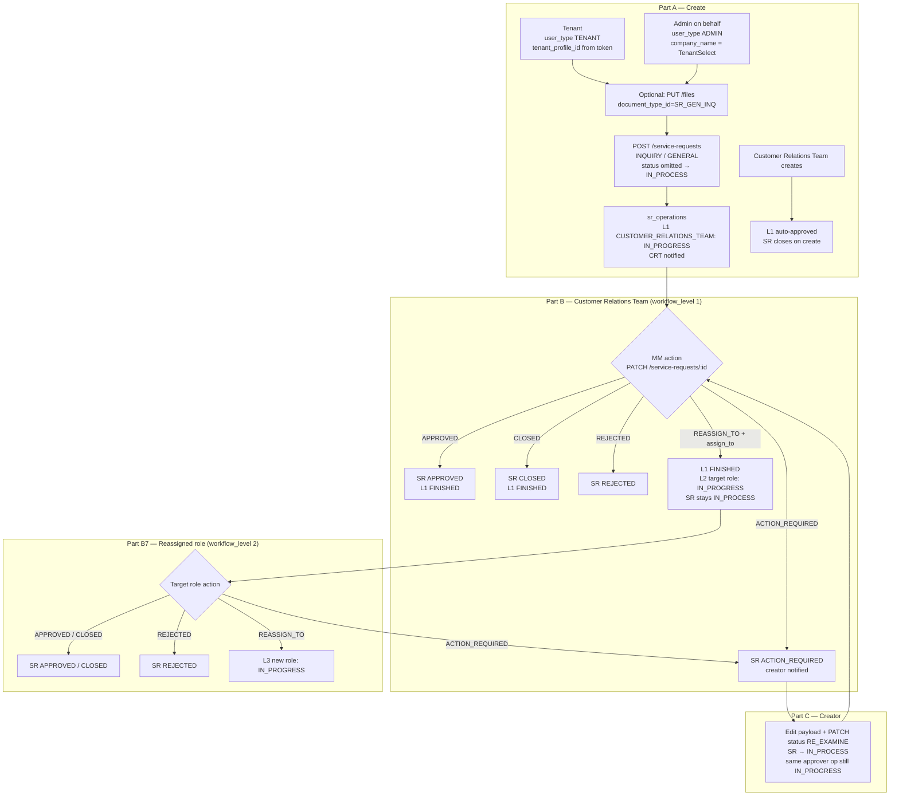

# General Inquiry Service Request — Complete Technical Reference (Create + Approval)

**Service Category:** `INQUIRY`  
**Sub Category:** `GENERAL` (display name: *General Inquires*)  
**Engine:** V1 (`serviceRequestUsecase`). `INQUIRY` isn't in `shouldRouteServiceRequestCreateToV2`.  
**Assignment Type:** *(none — no* `assignmentType` *key in the form JSON)* → reassign is **role-based** (`assign_to`)  
**Workflow ID:** `1` · **Mapping ID:** `1` (`workflow_service_request_mapping`)  
**Base URL:** `http://localhost:4200/backend_api` (proxied via `NEXT_PUBLIC_API_BASE_PATH`)

A General Inquiry is a free-text question raised against a lease. **Both tenants and admins can create it:**


| Creator                                                             | Token `user_type` | Tenant chosen via                              | Lease                                                | What happens at create                                                               |
| ------------------------------------------------------------------- | ----------------- | ---------------------------------------------- | ---------------------------------------------------- | ------------------------------------------------------------------------------------ |
| **Tenant** (any tenant contact of the company)                      | `TENANT`          | From the token (`userData.TenantProfileID`)    | Picked in `lease_brand_mall` (only their own leases) | Goes to Customer Relations Team, `IN_PROCESS`                                        |
| **Admin raising on the tenant's behalf** (Leasing, Legal, FM, Mall Manager, etc.) | `ADMIN` | `company_name` TenantSelect (admin-only field) | Picked in `lease_brand_mall`                         | Goes to Customer Relations Team, `IN_PROCESS`                                        |
| **Customer Relations Team**                                         | `ADMIN`           | `company_name` TenantSelect                    | Picked in `lease_brand_mall`                         | Level 1 **auto-approves** (creator holds the level-1 role), so it closes immediately |


The workflow has **one approver level, Customer Relations Team (**`role_id 8`**, `CUSTOMER_RELATIONS_TEAM`**)**. That team can **Approve / Close**, **Reject**, send it back to the creator (**Action Required**), or **Reassign** it to another department.

---


## Contents

1. [Workflow Overview](#workflow-overview)
2. [Workflow Definition, SLA, Permissions](#workflow-definition)
3. [Part A — Create](#part-a--create)
  - A1 Fetch form skeleton
  - A2 Upload attachment (optional)
  - A3 Create as **Tenant**
  - A4 Create as **Admin on behalf of tenant**
  - A5 What the backend does on create
4. [Part B — Approval (Customer Relations Team / reassigned role)](#part-b--approval)
  - B1 List & open the SR
  - B2 Approve
  - B3 Close
  - B4 Reject
  - B5 Action Required (send back)
  - B6 Reassign
  - B7 Approval by the reassigned role
5. [Part C — Creator follow-up (Tenant / Admin creator)](#part-c--creator-follow-up)
  - C1 Resubmit after Action Required (`RE_EXAMINE`)
  - C2 Track status
6. [Access & Edit Rules](#access--edit-rules)
7. [Notifications](#notifications)
8. [Status Progression &](#status-progression) `sr_operations` [State Machine](#status-progression)
9. [Errors](#errors)
10. [Form Skeleton](#form-skeleton)
11. [Source References](#source-references)

---


## Workflow Overview




---


## Workflow Definition


### `workflow` (id `1`)

```json
[{ "role_id": 11, "workflow_level": 1 }]
```


| role_id | role_name                 | Level |
| ------- | ------------------------- | ----- |
| 8       | `CUSTOMER_RELATIONS_TEAM` | 1     |


Source: roles seed `1702559770_insert_roles_data.up.sql` sets `8 = CUSTOMER_RELATIONS_TEAM` (display name *Customer Relations Team*). The original workflow seed (`1707406122_update_service_request_workflows.up.sql`) stored `role_id 11` (`MALL_MANAGER`); the approver for this workflow is Customer Relations Team.

### SLA


| category  | sub_category | SLA hours | Reminder freq    | Business hours |
| --------- | ------------ | --------- | ---------------- | -------------- |
| `INQUIRY` | `NULL` (all) | 48        | 0 (no reminders) | none           |


Source: `1780000107_sla_config_tables.up.sql`, `1783000003_sla_config_reminder_columns.up.sql`.

### Permissions


| Capability              | Where                                                                                                                                                        | Who                                                                                                                                                                              |
| ----------------------- | ------------------------------------------------------------------------------------------------------------------------------------------------------------ | -------------------------------------------------------------------------------------------------------------------------------------------------------------------------------- |
| Create SR               | `SERVICE_REQUEST_CREATE`                                                                                                                                     | Tenant contacts with SR access + admin roles                                                                                                                                     |
| Edit / act on SR        | `SERVICE_REQUEST_EDIT`                                                                                                                                       | Admin roles                                                                                                                                                                      |
| See INQUIRY SRs in list | `VIEW_SR_INQUIRY` → `INQUIRY` (`constants.ServiceRequestPermissionMap`), seeded as *View Inquiry* in `1755682660_create_sr_category_wise_permissions.up.sql` | Admin roles with the permission. Roles in the workflow and the creator also see them.                                                                                            |
| Category gate           | `userCanAccessServiceRequestCategory`                                                                                                                        | Facilities / RDD **contractors** can only create in their allowed categories, so they get `ErrCategorySubCategoryCombinationNotValid` for `INQUIRY` unless it's allowed for them |


---


## Part A — Create


### A1 — Fetch form skeleton (both creators)

```bash
curl -X GET 'http://localhost:4200/backend_api/service-requests/workflows?service_category=INQUIRY&sub_category=GENERAL' \
  -H 'Authorization: Bearer <TOKEN>'
```

The same skeleton is returned to both. The frontend hides fields flagged `"admin": true` (`company_name`) for tenants and shows them to admins. Fields with `"tenantReq": true` are required for tenants. See [Form Skeleton](#form-skeleton).


| Field                         | Tenant sees         | Admin sees                   | Required    |
| ----------------------------- | ------------------- | ---------------------------- | ----------- |
| `title`                       | ✅                   | ✅                            | Yes         |
| `company_name` (TenantSelect) | ❌                   | ✅                            | Yes (admin) |
| `lease_brand_mall`            | ✅ (own leases only) | ✅ (selected tenant's leases) | Yes         |
| `description`                 | ✅                   | ✅                            | Yes         |
| `notes`                       | ✅                   | ✅                            | No          |
| `file` (attachment)           | ✅                   | ✅                            | No          |


### A2 — Upload attachment (optional, both creators)

`PUT /files` **(query params only — binary file as body)**

```
PUT /files
  ?query=SERVICE_REQUEST
  &file_extension=pdf
  &document_type_id=SR_GEN_INQ
  &lease_id=95404
  &brand_id=267
  &property_id=3041
  &lease_code=t0105712
  &sr_id=
  &tenant_profile_id=116
  &document_type_status=
  &signed_url=true
  &file_name=inquiry-attachment.pdf___
```


| Param               | Description                                                                   |
| ------------------- | ----------------------------------------------------------------------------- |
| `query`             | Always `SERVICE_REQUEST`                                                      |
| `document_type_id`  | `SR_GEN_INQ` (*Service Request General Inquiries* / استفسارات عامة عن الخدمة) |
| `sr_id`             | Empty on create; the SR id when uploading on resubmit                         |
| `tenant_profile_id` | Tenant: own profile id. Admin: selected tenant's profile id.                  |
| `signed_url`        | `true`                                                                        |
| `file_name`         | Original filename suffixed with `___`                                         |


**Response** returns a `document_id` (UUID). Put it in `payload.documents_ids` (and `payload.file`).

---


### A3 — Create as **Tenant**

`POST /service-requests` with a tenant token.

- `tenant_profile_id` may be `""` or omitted. The handler fills it from the token.
- No `company_name` / `tenant_contact` (admin-only section).
- No `status`. The handler defaults it to `IN_PROCESS`.


#### Request Body

```json
{
  "payload": {
    "mall": "Jawharat Jeddah",
    "brand": "Brand Under Armour",
    "lease": "t0105712",
    "title": "Query about service charge",
    "description": "Please clarify the Q3 service charge breakdown.",
    "notes": "",
    "file": "",
    "documents_ids": [],
    "lease_brand_mall": "t0105712 - Brand Under Armour - Jawharat Jeddah",
    "unit_codes": ["FF050"],
    "city": "Jeddah",
    "brand_id": 267,
    "tenant_profile_id": 116,
    "contract_id": 95404,
    "property_id": 3041
  },
  "title": "Query about service charge",
  "tenant_profile_id": "",
  "property_id": 3041,
  "service_category": "INQUIRY",
  "sub_category": "GENERAL",
  "lease_code": "t0105712",
  "lease_id": 95404,
  "service_request_id": ""
}
```


#### cURL — Tenant create

```bash
curl -X POST 'http://localhost:4200/backend_api/service-requests' \
  -H 'Content-Type: application/json' \
  -H 'Authorization: Bearer <TENANT_TOKEN>' \
  -d '{
    "payload": {
      "mall": "Jawharat Jeddah",
      "brand": "Brand Under Armour",
      "lease": "t0105712",
      "title": "Query about service charge",
      "description": "Please clarify the Q3 service charge breakdown.",
      "notes": "",
      "file": "",
      "documents_ids": [],
      "lease_brand_mall": "t0105712 - Brand Under Armour - Jawharat Jeddah",
      "unit_codes": ["FF050"],
      "city": "Jeddah",
      "brand_id": 267,
      "tenant_profile_id": 116,
      "contract_id": 95404,
      "property_id": 3041
    },
    "title": "Query about service charge",
    "tenant_profile_id": "",
    "property_id": 3041,
    "service_category": "INQUIRY",
    "sub_category": "GENERAL",
    "lease_code": "t0105712",
    "lease_id": 95404,
    "service_request_id": ""
  }'
```


#### Tenant-specific backend rules


| Rule                               | Behaviour                                                                                                                                                                        |
| ---------------------------------- | -------------------------------------------------------------------------------------------------------------------------------------------------------------------------------- |
| `tenant_profile_id`                | `""` / `0` / omitted → taken from the token                                                                                                                                      |
| `lease_id = 0`                     | Backend picks the tenant's **first activated lease** (`FetchLeaseByTenantProfileID`, sorted by `pms_created_at ASC`) and sets `lease_id`, `lease_code` and `property_id` from it |
| No active lease                    | `ErrNoActiveLeases` → **400**, unless the company is *prospective*                                                                                                               |
| Expired lease                      | `ErrLeaseExpired` (tenant tokens only). The handler doesn't map it, so it comes back as **500** `Failed to insert service request`                                               |
| Prospective tenant without a lease | Allowed. Notifications use the `unique_property_id` of the tenant's first lead enquiry.                                                                                          |
| `created_for`                      | Defaults to the tenant's own `user_id`                                                                                                                                           |


---


### A4 — Create as **Admin on behalf of a tenant**

`POST /service-requests` with an admin token.

- `company_name` (the selected tenant's `tenant_profile_id` as a string) and `tenant_contact` are sent in `payload` (from `intialState.admin`).
- The top-level `tenant_profile_id` **must** be the selected tenant's id. An admin token usually has no `TenantProfileID`, so `0` → **400** `should provide a valid tenant profile id`.
- Optional `created_for`: a tenant contact's user id, to raise it in their name. Defaults to the admin's own user id.


#### Request Body

```json
{
  "payload": {
    "mall": "Jawharat Jeddah",
    "brand": "Brand Under Armour",
    "lease": "t0105712",
    "title": "Query about service charge",
    "description": "Tenant called asking about the Q3 service charge breakdown.",
    "notes": "Raised on behalf of tenant after phone call.",
    "file": "",
    "documents_ids": [],
    "lease_brand_mall": "t0105712 - Brand Under Armour - Jawharat Jeddah",
    "company_name": "116",
    "tenant_contact": "",
    "unit_codes": ["FF050"],
    "city": "Jeddah",
    "brand_id": 267,
    "tenant_profile_id": 116,
    "contract_id": 95404,
    "property_id": 3041
  },
  "title": "Query about service charge",
  "tenant_profile_id": 116,
  "property_id": 3041,
  "service_category": "INQUIRY",
  "sub_category": "GENERAL",
  "lease_code": "t0105712",
  "lease_id": 95404,
  "service_request_id": ""
}
```


#### cURL — Admin create

```bash
curl -X POST 'http://localhost:4200/backend_api/service-requests' \
  -H 'Content-Type: application/json' \
  -H 'Authorization: Bearer <ADMIN_TOKEN>' \
  -d '{
    "payload": {
      "mall": "Jawharat Jeddah",
      "brand": "Brand Under Armour",
      "lease": "t0105712",
      "title": "Query about service charge",
      "description": "Tenant called asking about the Q3 service charge breakdown.",
      "notes": "Raised on behalf of tenant after phone call.",
      "file": "",
      "documents_ids": [],
      "lease_brand_mall": "t0105712 - Brand Under Armour - Jawharat Jeddah",
      "company_name": "116",
      "tenant_contact": "",
      "unit_codes": ["FF050"],
      "city": "Jeddah",
      "brand_id": 267,
      "tenant_profile_id": 116,
      "contract_id": 95404,
      "property_id": 3041
    },
    "title": "Query about service charge",
    "tenant_profile_id": 116,
    "property_id": 3041,
    "service_category": "INQUIRY",
    "sub_category": "GENERAL",
    "lease_code": "t0105712",
    "lease_id": 95404,
    "service_request_id": ""
  }'
```

> **Customer Relations Team as creator:** `shouldAutoApproveOperation` finishes any step whose role the creator holds, and General Inquiry has no exclusion for this. When someone on the Customer Relations Team creates the SR, level 1 is auto-approved in the create transaction. With no level 2, the SR is approved immediately and nobody reviews it. A Mall Manager who creates one does **not** auto-approve — the request still goes to Customer Relations Team.


#### Tenant vs Admin create — differences at a glance


|                                           | Tenant                       | Admin on behalf                                                         |
| ----------------------------------------- | ---------------------------- | ----------------------------------------------------------------------- |
| Token                                     | `TENANT`                     | `ADMIN`                                                                 |
| `tenant_profile_id` (top level)           | `""` / omitted (from token)  | **Required** — selected tenant                                          |
| `payload.company_name` / `tenant_contact` | Not sent                     | Sent (admin `intialState`)                                              |
| Lease choices                             | Own leases                   | Selected tenant's leases (and within the admin's lease/property access) |
| Expired-lease check                       | Enforced (`ErrLeaseExpired`) | Not enforced                                                            |
| `created_for`                             | Own user id                  | Admin's user id, or the `created_for` passed                            |
| CRT auto-approve                      | No                           | **Yes, if the admin is on the Customer Relations Team**         |


---


### A5 — What the backend does on create (both creators)

`POST /service-requests` → `serviceRequestHandler.Create` → `serviceRequestUsecase.CreateServiceRequest`:

1. Default `status` → `IN_PROCESS` (the Work Request / Company-Docs special cases don't apply)
2. `srvalidations.ValidateSR`: there are no `GENERAL`-specific rules, so this is a pass-through
3. Category gate for contractors, then lease resolution (see A3)
4. `service_request` row inserted, with history `CREATED` recorded for the initiator
5. One `service_request_operation` row per workflow level, created as `YET_TO_START`
6. `findAndTrigerOperations(level 0)` promotes level 1 (`CUSTOMER_RELATIONS_TEAM`) → `IN_PROGRESS` and notifies that role
  - If the creator holds `CUSTOMER_RELATIONS_TEAM` → level 1 goes straight to `FINISHED` and the SR is approved
7. Email notification (unless `?send_email=false`)


#### Response

```json
{
  "data": {
    "service_request_id": "8431"
  }
}
```


#### `sr_operations` after creation


| level | role           | status        |
| ----- | -------------- | ------------- |
| 1     | `CUSTOMER_RELATIONS_TEAM` | `IN_PROGRESS` |


---


## Part B — Approval

All approval actions use `PATCH /service-requests/{sr_id}` with an **admin** token whose role matches an `IN_PROGRESS` operation on the SR (`checkAdminUserHasPermissionToEdit`). The body shape is the same for every action. Only `status` (plus `assign_to` for reassign) changes.

```json
{
  "payload": { "...": "full current payload echoed back" },
  "status": "<ACTION>",
  "comment": "<approver comment>",
  "user_action": null,
  "title": "<SR title>",
  "sub_category": "GENERAL"
}
```


### B1 — List & open the SR

```bash
# Inquiry list (admin or tenant token)
curl -G 'http://localhost:4200/backend_api/service-requests' \
  -H 'Authorization: Bearer <TOKEN>' \
  --data-urlencode 'service_category=INQUIRY' \
  --data-urlencode 'sub_category=GENERAL' \
  --data-urlencode 'status=IN_PROCESS' \
  --data-urlencode 'page=1' --data-urlencode 'limit=10'

# Detail (payload + operations + history)
curl 'http://localhost:4200/backend_api/service-requests/8431' \
  -H 'Authorization: Bearer <TOKEN>'
```

Supported list filters: `service_category`, `sub_category`, `status`, `search`, `property_id`, `lease_id`, `tenant_profile_id`, `mall`, `brand`, `region`, `month`, `year`, `self`, `page`, `limit`, `disable_pagination`.

### B2 — Approve

```json
{
  "payload": { "...": "existing payload" },
  "status": "APPROVED",
  "comment": "Breakdown shared with tenant by email.",
  "user_action": null,
  "title": "Query about service charge",
  "sub_category": "GENERAL"
}
```

```bash
curl -X PATCH 'http://localhost:4200/backend_api/service-requests/8431' \
  -H 'Content-Type: application/json' \
  -H 'Authorization: Bearer <CUSTOMER_RELATIONS_TEAM_TOKEN>' \
  -d '{
    "payload": { "title": "Query about service charge", "description": "Please clarify the Q3 service charge breakdown.", "lease_brand_mall": "t0105712 - Brand Under Armour - Jawharat Jeddah", "documents_ids": [] },
    "status": "APPROVED",
    "comment": "Breakdown shared with tenant by email.",
    "user_action": null,
    "title": "Query about service charge",
    "sub_category": "GENERAL"
  }'
```

`operationsRelatedToApproveServiceRequestOperation` marks level 1 `FINISHED` and looks for level 2. There isn't one, so the SR → `APPROVED`, history `APPROVED` is recorded with the comment, and the creator side is notified.


| level | role           | status     |
| ----- | -------------- | ---------- |
| 1     | `CUSTOMER_RELATIONS_TEAM` | `FINISHED` |


### B3 — Close

Same body with `"status": "CLOSED"`. The backend sets `user_action = CLOSED` and finishes the operation. The SR becomes `CLOSED` once no approver is left. With a single level, that happens right away.

### B4 — Reject

Same body with `"status": "REJECTED"`. `operationsRelatedToRejectServiceRequestOperation` sets the SR to `REJECTED`, records history and notifies the creator side. This is terminal.

### B5 — Action Required (send back to creator)

```json
{
  "payload": { "...": "existing payload" },
  "status": "ACTION_REQUIRED",
  "comment": "Please attach the invoice you are referring to.",
  "user_action": null,
  "title": "Query about service charge",
  "sub_category": "GENERAL"
}
```

`operationsRelatedToReCheckServiceRequestOperation`:

- SR status → `ACTION_REQUIRED`
- The approver's operation **stays** `IN_PROGRESS`, so the SR comes back to the same approver after resubmit
- In-app notification (`ServiceRequestActionRequired`) + email to the tenant side. `INQUIRY` isn't in the tenant-recipient-set categories, so the legacy tenant notification path is used.


### B6 — Reassign

The form JSON has **no** `assignmentType`, so the role-based path is used:

- `assign_to` (role name) is **required**
- `assign_to_level` → **error** `assign_to_level is not allowed in this service request`

```json
{
  "payload": { "...": "existing payload" },
  "status": "REASSIGN_TO",
  "assign_to": "LEGAL",
  "comment": "Needs a legal opinion on clause 7.",
  "user_action": null,
  "title": "Query about service charge",
  "sub_category": "GENERAL"
}
```


#### Reassign targets — `essential_data` type `ASSIGN_TO_INQUIRY_GENERAL`

Served by `GET /master-data` (the full `essential_data` list; the frontend filters on `type`).


| `key` (sent as `assign_to`) | `value` (label)   | Notes                                               |
| --------------------------- | ----------------- | --------------------------------------------------- |
| `LEASING_ADMIN`             | `LEASING_ADMIN`   | Renamed from `LEASING` (`1719319239`, `1719379367`) |
| `LEGAL`                     | `LEGAL`           |                                                     |
| `DD_ENGINEER`               | `DD_ENGINEER`     | RDD                                                 |
| `COLLECTOR_IG`              | Collections Team  |                                                     |
| `FM_MANAGER_IG`             | `FM_MANAGER_IG`   |                                                     |
| `MALL_MANAGER_IG`           | `MALL_MANAGER_IG` |                                                     |


> ⚠️ The backend resolves `assign_to` with `SELECT role_id FROM roles WHERE role_name = ANY($1)`, an exact match. The `_IG` keys aren't seeded as roles in any migration. Either the frontend strips the suffix (e.g. `COLLECTOR_IG` → `COLLECTOR`), or those roles exist only in the environment DB. If neither is true, the call fails with `failed to get the role id of the given role name …`. Also, `LEASING_ADMIN` is seeded as a **TENANT** role (`role_id 5`), so check that reassigning to it reaches the intended admin users.


#### What the backend does (one transaction)

1. Current operation → `FINISHED`
2. If a level `current + 1` operation already exists for the target role, it is set to `IN_PROGRESS`. Otherwise a new one is created at `current + 1` with `IN_PROGRESS`.
3. In-app notification (`ServiceRequestReAssign`) to the target role, `ActionRequired: true`
4. History `REASSIGN_TO` recorded with the comment
5. If `sub_category` is sent, it is written back to the SR
6. **SR status is unchanged** (stays `IN_PROCESS`)


| level | role           | status        |
| ----- | -------------- | ------------- |
| 1     | `CUSTOMER_RELATIONS_TEAM` | `FINISHED`    |
| 2     | `LEGAL`        | `IN_PROGRESS` |


### B7 — Approval by the reassigned role

The reassigned role (e.g. Legal) uses exactly the same PATCH shapes as B2–B6 with its own token:


| Action                      | Result                                                               |
| --------------------------- | -------------------------------------------------------------------- |
| `APPROVED` / `CLOSED`       | L2 `FINISHED`, no L3 → SR `APPROVED` / `CLOSED`                      |
| `REJECTED`                  | SR `REJECTED`                                                        |
| `ACTION_REQUIRED`           | SR `ACTION_REQUIRED`, back to creator, then returns to **this** role |
| `REASSIGN_TO` + `assign_to` | L2 `FINISHED`, new L3 op for the next role                           |


---


## Part C — Creator follow-up


### C1 — Resubmit after Action Required (`RE_EXAMINE`)

The **creator** resubmits: a tenant contact of the same company (tenant token), or the admin who created it.

1. (Optional) upload a new attachment: `PUT /files` with `document_type_id=SR_GEN_INQ&sr_id=8431`
2. PATCH with the edited payload:

```json
{
  "payload": {
    "mall": "Jawharat Jeddah",
    "brand": "Brand Under Armour",
    "lease": "t0105712",
    "title": "Query about service charge",
    "description": "Please clarify the Q3 service charge breakdown. Invoice INV-2291 attached.",
    "notes": "",
    "file": "c1f0a3d2-9e1b-4c2f-8f0a-2b7c9d1e4a55",
    "documents_ids": ["c1f0a3d2-9e1b-4c2f-8f0a-2b7c9d1e4a55"],
    "lease_brand_mall": "t0105712 - Brand Under Armour - Jawharat Jeddah",
    "unit_codes": ["FF050"],
    "city": "Jeddah",
    "brand_id": 267,
    "tenant_profile_id": 116,
    "contract_id": 95404,
    "property_id": 3041
  },
  "status": "RE_EXAMINE",
  "comment": "Invoice attached.",
  "title": "Query about service charge",
  "sub_category": "GENERAL"
}
```

```bash
curl -X PATCH 'http://localhost:4200/backend_api/service-requests/8431' \
  -H 'Content-Type: application/json' \
  -H 'Authorization: Bearer <TENANT_TOKEN>' \
  -d @resubmit.json
```

Backend (`editServiceRequest`):

- The payload replaces the stored payload. New document ids are added to SR attachments (`insertNewSrAttachments`), and documents removed from the payload are deleted (`deleteRemovedDocuments`).
- SR status → `IN_PROCESS`, history `SUBMITTED`
- The approver's operation is still `IN_PROGRESS`, so the SR is back in their queue


### C2 — Track status

The tenant uses the same `GET /service-requests?service_category=INQUIRY&sub_category=GENERAL` and `GET /service-requests/{id}` with a tenant token. Results are scoped to the token's `tenant_profile_id`.

---


## Access & Edit Rules

From `checkUserCanEditServiceRequest` and `UpdateServiceRequest`:


| Who                                             | Can PATCH when                                | What they can do                                                                                               |
| ----------------------------------------------- | --------------------------------------------- | -------------------------------------------------------------------------------------------------------------- |
| **Tenant** (same `tenant_profile_id` as the SR) | SR is `ACTION_REQUIRED`                       | Edit payload + `RE_EXAMINE`                                                                                    |
| Tenant, other states                            | —                                             | Payload edits ignored. Actions → `ErrNoPermissionToEdit`.                                                      |
| Tenant of another company                       | never                                         | —                                                                                                              |
| **Admin creator**                               | SR is `ACTION_REQUIRED`                       | Edit payload + `RE_EXAMINE`                                                                                    |
| **Admin approver**                              | Their role matches an `IN_PROGRESS` operation | `APPROVED`, `CLOSED`, `REJECTED`, `ACTION_REQUIRED`, `REASSIGN_TO`                                             |
| Admin without lease access                      | —                                             | `ErrLeaseIDNotMatch`, unless they're the creator (lease override / accessible leases from `GetPermittedItems`) |
| Admin without property access                   | —                                             | `ErrNoPermissionToEdit`, unless they're the creator                                                            |
| Anyone, no active operation                     | —                                             | `ErrServiceRequestOperationNotFound` (e.g. acting on an already approved SR)                                   |


### Allowed `status` values on PATCH (`ServiceRequestEditDTO`)

`IN_PROCESS` · `DRAFT` · `APPROVED` · `CLOSED` · `REJECTED` · `ACTION_REQUIRED` · `REASSIGN_TO` · `RE_EXAMINE` · `REQUESTED_RE_UPLOAD` · `REQUESTED_RESUBMIT` · `SUBMITTED`

These are **not used** for General Inquiry: `REQUESTED_RESUBMIT` (only Discrepancy / Meter Reading / Mall Opening & Closing checklists) and `REQUESTED_RE_UPLOAD` (fit-out drawing / company docs).

---


## Notifications


| Event                    | Recipient                                                                  | Channel                                         |
| ------------------------ | -------------------------------------------------------------------------- | ----------------------------------------------- |
| Create (tenant or admin) | Admin users with `CUSTOMER_RELATIONS_TEAM` on the property             | In-app (action required) + email                |
| Create by Customer Relations Team | — (auto-approved)                                                  | Approval notification to the tenant side        |
| `APPROVED` / `CLOSED`    | Tenant side (creator / tenant profile)                                     | In-app + email                                  |
| `REJECTED`               | Tenant side                                                                | In-app + email                                  |
| `ACTION_REQUIRED`        | Tenant side (legacy tenant path, targeted at the SR's `tenant_profile_id`) | In-app + email                                  |
| `REASSIGN_TO`            | Target role (`TargetRoleID`), admin users                                  | In-app (action required) + email for next level |
| `RE_EXAMINE` (resubmit)  | Current approver role                                                      | In-app / email                                  |


Pass `?send_email=false` on POST to suppress emails, for example when testing.

---


## Status Progression

```
                ┌──────────── APPROVED / CLOSED
(created) → IN_PROCESS ─────┼──────────── REJECTED
   │            │  ▲        └─ REASSIGN_TO → (still IN_PROCESS, next role acts) → …
   │            │  │
   │            ▼  │ RE_EXAMINE (creator)
   │       ACTION_REQUIRED
   │
   └─ creator is CUSTOMER_RELATIONS_TEAM → L1 auto-approved → APPROVED on create
```


| Step           | Actor                | HTTP  | Status sent                 | SR status after   | Operations after                                    |
| -------------- | -------------------- | ----- | --------------------------- | ----------------- | --------------------------------------------------- |
| A3 — Create    | Tenant               | POST  | *(none)*                    | `IN_PROCESS`      | L1 MM `IN_PROGRESS`                                 |
| A4 — Create    | Admin (not MM)       | POST  | *(none)*                    | `IN_PROCESS`      | L1 MM `IN_PROGRESS`                                 |
| A4 — Create    | Customer Relations Team | POST  | *(none)*                    | `APPROVED`        | L1 CRT `FINISHED`                                   |
| B2 — Approve   | MM / reassigned role | PATCH | `APPROVED`                  | `APPROVED`        | current `FINISHED`                                  |
| B3 — Close     | MM / reassigned role | PATCH | `CLOSED`                    | `CLOSED`          | current `FINISHED`                                  |
| B4 — Reject    | MM / reassigned role | PATCH | `REJECTED`                  | `REJECTED`        | —                                                   |
| B5 — Send back | MM / reassigned role | PATCH | `ACTION_REQUIRED`           | `ACTION_REQUIRED` | current stays `IN_PROGRESS`                         |
| C1 — Resubmit  | Creator              | PATCH | `RE_EXAMINE`                | `IN_PROCESS`      | unchanged                                           |
| B6 — Reassign  | MM / reassigned role | PATCH | `REASSIGN_TO` + `assign_to` | `IN_PROCESS`      | current `FINISHED`, next level target `IN_PROGRESS` |


### `sr_operations` state machine


| `workflow_level` | `assigned_role`               | Statuses                                                                                                                      |
| ---------------- | ----------------------------- | ----------------------------------------------------------------------------------------------------------------------------- |
| 1                | `CUSTOMER_RELATIONS_TEAM`     | `YET_TO_START` → `IN_PROGRESS` (on create) → `FINISHED` (approve / close / reassign). `FINISHED` right away if Customer Relations Team created it. |
| 2                | *target of 1st reassign*      | created `IN_PROGRESS` → `FINISHED`                                                                                            |
| 3+               | *target of further reassigns* | created `IN_PROGRESS` → `FINISHED`                                                                                            |


---


## Errors


| Situation                                          | Error                                                    | HTTP                                   |
| -------------------------------------------------- | -------------------------------------------------------- | -------------------------------------- |
| Admin create without `tenant_profile_id`           | `should provide a valid tenant profile id`               | 400                                    |
| Tenant has no active lease (and isn't prospective) | `ErrNoActiveLeases`                                      | 400                                    |
| `lease_id` not found                               | `ErrLeaseNotFound`                                       | 400                                    |
| Tenant picks an expired lease                      | `ErrLeaseExpired` (not mapped in handler)                | 500 `Failed to insert service request` |
| Contractor not allowed in `INQUIRY`                | `ErrCategorySubCategoryCombinationNotValid`              | 400                                    |
| PATCH by a role with no active operation           | `ErrNoPermissionToEdit`                                  | 4xx                                    |
| PATCH on an SR with no active operation            | `ErrServiceRequestOperationNotFound`                     | 4xx                                    |
| Admin without access to the SR's lease             | `ErrLeaseIDNotMatch`                                     | 4xx                                    |
| Reassign with `assign_to_level`                    | `assign_to_level is not allowed in this service request` | 500                                    |
| Reassign to an unknown role name                   | `failed to get the role id of the given role name <X>`   | 500                                    |
| Invalid `status` value                             | validator `oneof` error                                  | 400                                    |


---


## Document Types


| Document type | Name (EN)                         | Name (AR)                | Who uploads                                                |
| ------------- | --------------------------------- | ------------------------ | ---------------------------------------------------------- |
| `SR_GEN_INQ`  | Service Request General Inquiries | استفسارات عامة عن الخدمة | Creator (tenant or admin), optional, at create or resubmit |


Source: `1723618189_doc_types_insert.up.sql`, `1723781321_doc_role_map.up.sql`.

---


## Form Skeleton

Current version from `1730109769_update_workflow_sr_gen_inq.up.sql`:

```json
{
  "skelton": [
    {
      "title": "genEnquiry",
      "section": [
        {
          "id": 233,
          "grid": true,
          "fields": [
            { "id": 234, "name": "title", "type": "input", "label": "formTitle", "required": true, "tenantReq": true, "placeHolder": "formPlaceholderTitle" },
            { "id": 235, "name": "company_name", "type": "TenantSelect", "admin": true, "label": "formtenant", "required": true, "placeHolder": "placeholdercompanyname" },
            { "id": 236, "name": "lease_brand_mall", "type": "LeaseBrandMall", "label": "lease-brand-mall", "required": true, "tenantReq": true, "placeHolder": "formPlaceholderLBM", "fieldsUpdate": [] },
            { "id": 238, "name": "description", "type": "textarea", "label": "formDescription", "required": true, "tenantReq": true, "placeHolder": "Type here" },
            { "id": 239, "name": "notes", "type": "textarea", "label": "formNotes", "required": false, "placeHolder": "Type here" },
            { "id": 240, "name": "file", "type": "file", "label": "formAttachments", "required": false, "fileLabel": "formDropAttachments", "placeHolder": "" }
          ]
        }
      ]
    }
  ],
  "intialState": {
    "admin": {
      "company_name": "",
      "tenant_contact": ""
    },
    "common": {
      "file": "",
      "mall": "",
      "brand": "",
      "lease": "",
      "notes": "",
      "title": "",
      "description": "",
      "lease_brand_mall": ""
    }
  }
}
```

- `"admin": true` → field is shown only to admin users (tenant never sees `company_name`)
- `"tenantReq": true` → field is required for tenants
- `intialState.admin` is merged in only for admins; `intialState.common` for everyone
- No `assignmentType` key → role-based reassign (B6)
- No role-gated sections: approvers see the same read-only form plus the action bar

---


## Display Names & Reporting


| Item                             | Value                                                                         |
| -------------------------------- | ----------------------------------------------------------------------------- |
| Category display                 | `Inquiry`                                                                     |
| Sub-category display             | `General Inquires`                                                            |
| Leasing Manager dashboard bucket | `INQUIRY_GENERAL` → *General Inquiries* (`domain/leasingManagerDashboard.go`) |


---


## Source References


| What                                                                   | Where                                                                                                                                                                                                           |
| ---------------------------------------------------------------------- | --------------------------------------------------------------------------------------------------------------------------------------------------------------------------------------------------------------- |
| Routes                                                                 | `servicerequest/delivery/http/service_request_handler.go` — `NewServiceRequestHandler`                                                                                                                          |
| Create handler (tenant_profile_id fill, default status, V1/V2 routing) | `service_request_handler.go` — `Create`, `shouldRouteServiceRequestCreateToV2`                                                                                                                                  |
| Create usecase (lease resolution, expired lease, category gate)        | `servicerequest/usecase/service_request_usecase.go` — `CreateServiceRequest`                                                                                                                                    |
| Operation triggering                                                   | `service_request_usecase.go` — `findAndTrigerOperations`                                                                                                                                                        |
| Auto-approve rule                                                      | `service_request_usecase.go` — `shouldAutoApproveOperation`                                                                                                                                                     |
| PATCH flow / permission checks                                         | `service_request_usecase.go` — `UpdateServiceRequest`, `checkAdminUserHasPermissionToEdit`, `checkUserCanEditServiceRequest`, `editServiceRequest`                                                              |
| Approve / Close / Reject / Action Required                             | `operationsRelatedToApproveServiceRequestOperation`, `operationsRelatedToCloseServiceRequestOperation`, `operationsRelatedToRejectServiceRequestOperation`, `operationsRelatedToReCheckServiceRequestOperation` |
| Reassign                                                               | `case constants.ServiceRequestOperationStatusReAssignTo`, `operationsRelatedToReAssignServiceRequestOperation`                                                                                                  |
| Tenant recipient set (INQUIRY not included)                            | `servicerequest/usecase/tenant_recipient_set.go`                                                                                                                                                                |
| DTOs / allowed statuses                                                | `domain/serviceRequestdto.go` — `ServiceRequestDTO`, `ServiceRequestEditDTO`                                                                                                                                    |
| Workflow + mapping seed                                                | `migration/data/migrations/1707406122_update_service_request_workflows.up.sql`                                                                                                                                  |
| Current form JSON                                                      | `migration/data/migrations/1730109769_update_workflow_sr_gen_inq.up.sql`                                                                                                                                        |
| Reassign dropdown                                                      | `1714733370_…_dropdown_in_essential_data.up.sql`, `1719319239_…`, `1719379367_…`                                                                                                                                |
| Master data endpoint                                                   | `master_data_retriever/delivery/http/master_data_handler.go` — `GET /master-data`                                                                                                                               |
| Display names / permission map                                         | `internal/constants/constants.go`                                                                                                                                                                               |


