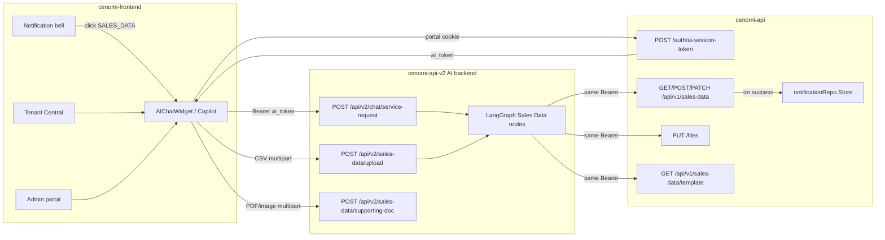

# Sales Data Agent — Official Integration Guide

**Audience:** backend (`cenomi-api`), frontend (`cenomi-frontend`), AI chatbot (`cenomi-api-v2/service-request-chatbot`), and notification / copilot owners.

**Status of this repo:** the Sales Data Agent is implemented and demo-proven against a mock sales-data API. This document is the cutover playbook to **Tenant Central / Admin portal**, live **`cenomi-api`**, and **in-app notifications**. It is a how-to, not a product spec. Product behaviour lives in [`sales_data_agent_PRD.md`](./sales_data_agent_PRD.md) and [`backend/docs/sales_data_detailed_scope_and_flow.md`](../backend/docs/sales_data_detailed_scope_and_flow.md).

**Reference implementation (copy from, do not ship):** [`sales-data-agent/`](../sales-data-agent/) on port `3001`. Treat that Next.js app as the working UI contract.

---

## 0. Read this first

1. The agent **does not create new sales-data periods**. It only updates rows that already exist in `cenomi-api` (`PENDING` / `NEED_*`).
2. The agent **does not send notifications**. `cenomi-api` already fires them inside `notifyUserOnSalesDataUpdate` / the sales-data sync cron. Integration work is **click → open chatbot with context**, not a new notification writer.
3. Live sales-data HTTP must use the **user’s AI session JWT**, forwarded as `Authorization: Bearer`. Do not use the S2S `POST /cenomi-ai/login` token for GET/POST/PATCH `/sales-data` or `PUT /files`.
4. Platform JWT `roles` are names like `Billing Contact` / `SALES_DATA_TEAM`. The agent’s supervisor currently understands **`TENANT_CSV_UPLOADER`**, **`TENANT_DOC_UPLOADER`**, **`SALES_DATA_APPROVER`**. Mapping those is a hard cutover requirement (Step 4).
5. Keep the mock (`:8001`) for local agent work. Staging/prod must point `SALES_DATA_API_BASE_URL` at **`cenomi-api`**, never at a second uvicorn AI process on `8001`.

---

## 1. Architecture



| Hop | Who | What |
|---|---|---|
| Portal session | `cenomi-frontend` | Existing cookie / SSO. Unchanged. |
| AI session JWT | `cenomi-api` `POST /auth/ai-session-token` | Same mint used by the RDD / help copilot. |
| Chat turn | AI `POST /api/v2/chat/service-request` | Natural language + `action` + `corrected_fields`. |
| CSV bytes | AI `POST /api/v2/sales-data/upload` | Parsed into an in-memory/Redis cache; **not** posted to `cenomi-api` yet. |
| Layer 2 + submit | `SalesDataApiClient` | `GET` then `POST` `/api/v1/sales-data` with the user’s Bearer. |
| Supporting doc | AI cache then `PUT /files` then `PATCH /api/v1/sales-data` | `document_id` + tenant response status. |
| Notifications | `cenomi-api` only | Created in the same DB transaction as POST/PATCH success. |

The **Notification Agent** (PRD name) is the layer that turns a bell click into a first chat turn. In this monorepo that layer does **not** exist as a separate service. Implement it as a thin frontend + first-turn handoff (Step 8). Do not build a second LangGraph just to parse `text_content`.

---

## 2. What you are integrating (capabilities)

The agent already does all of the following against mock or live `cenomi-api`:

| Capability | Tenant | Admin (`SALES_DATA_APPROVE`) |
|---|---|---|
| CSV upload (Cenomi template or legacy headers) | yes | no |
| Typed single-row entry | yes | no |
| PENDING-month reminder / switch (same lease only) | yes | n/a |
| Brand / Property fill or identity mismatch | yes | n/a |
| Asked-month vs file-month warning | yes | n/a |
| Supporting / audited / re-upload file | if `UPLOAD_SALES_DATA` | n/a |
| Review list, approve, ask upload | no | yes |
| Status check | yes | yes |

Statuses the agent must match **exactly** (platform strings, not labels):

`PENDING`, `SUBMITTED`, `APPROVED`, `NEED_REUPLOAD`, `NEED_UPLOAD_SUPPORTING_DOCUMENT`, `NEED_UPLOAD_AUDITED_SALES`, `RE_UPLOADED`, `UPLOADED_SUPPORTING_DOCUMENT`, `UPLOADED_AUDITED_SALES`.

Identity for PATCH (never `sales_data_id`):

```text
(lease_id, lease_code, sales_period_start, sales_period_end)
```

POST `/sales-data` body is a **JSON array**. All-or-nothing. Each item:

```json
{
  "lease_code": "LC-1001",
  "sales_period_start": "2026-08-01",
  "sales_period_end": "2026-08-31",
  "sales_amt": 100000
}
```

Dates on the wire are **`YYYY-MM-DD`**. The official CSV template uses **`DD-MM-YYYY`**; the AI parser converts.

---

## 3. Integration checklist (do in this order)

| # | Workstream | Blocking? | Outcome |
|---|---|---|---|
| 4 | Map platform permissions → chatbot roles | **Yes** | Supervisor allows tenant/admin sales intents |
| 5 | Point AI backend at live `cenomi-api` | **Yes** | GET/POST/PATCH/files hit real data |
| 6 | Harden AI backend for multi-instance | Strongly recommended | CSV cache survives reload / replica |
| 7 | Frontend chat UI + CSV/doc upload | **Yes** | Users can complete the flow in Tenant Central |
| 8 | Notification click → `notification_context` | **Yes** for bell UX | Deep-link matches demo / PRD |
| 9 | Optional `cenomi-api` gaps | Only if staging proves them | JWT claims, `agents_permissions`, CORS |
| 10 | Staging verification matrix | **Yes** | Sign-off before prod |

Steps 4–10 below are the detailed procedures.

---

## 4. Auth and RBAC (must do before any live GET)

### 4.1 Tokens — do not mix them

This is the same model as handover / RDD. See [`lease-lookup-bearer-auth-plan.md`](./lease-lookup-bearer-auth-plan.md).

| Token | Issuer | Consumer | Use for sales data? |
|---|---|---|---|
| Portal session cookie | Tenant Central / Admin | `POST /auth/ai-session-token` | Indirect only |
| **AI session JWT** (`ai_token`) | `cenomi-api` `POST /auth/ai-session-token` | Chatbot inbound **and** forwarded to `/sales-data` and `/files` | **Yes — this is the one** |
| S2S platform Bearer | `POST /cenomi-ai/login` + `x-internal-api-token` | Chatbot `PlatformApiClient` (SR create/patch) | **No** |
| MSP `x-internal-api-token` | Shared secret | Chatbot machine auth | Not a user identity |

Frontend already mints the AI token (RDD copilot):

```ts
// cenomi-frontend/libs/ui-web/.../useServiceRequestChat.ts
POST ${NEXT_PUBLIC_API_BASE_PATH}/auth/ai-session-token
credentials: 'include'
→ json.data.ai_token   // store in sessionStorage key sr-chatbot-ai-session-token
```

Every sales-data chat turn and every CSV/doc upload **must** send:

```http
Authorization: Bearer <ai_token>
```

Secrets that must match (already required for RDD):

| Chatbot env | `cenomi-api` env |
|---|---|
| `JWT_SECRET_KEY` | `AI_SESSION_TOKEN_SECRET` |
| `JWT_ALGORITHM=HS256` | HS256 |

Set `RBAC_ENFORCE=true` in staging/prod so missing/invalid JWT is `401`, not anonymous.

### 4.2 Chatbot roles vs platform permissions

Chatbot `ROLE_PERMITTED_INTENTS` (`backend/app/agents/schemas/help_agent_schema.py`):

| Chatbot role in JWT `roles` | Intents |
|---|---|
| `TENANT_CSV_UPLOADER` | `UPLOAD_SALES_DATA`, `ENTER_SALES_DATA_MANUAL`, `CHECK_SALES_DATA_STATUS`, `UPLOAD_SUPPORTING_DOCUMENT` |
| `TENANT_DOC_UPLOADER` | same tenant set (supporting docs are still gated later by platform `PUT /files` / `UPLOAD_SALES_DATA`) |
| `SALES_DATA_APPROVER` | `REVIEW_SALES_DATA`, `APPROVE_SALES_DATA`, `CHECK_SALES_DATA_STATUS` |
| `ADMIN` / `is_global_admin` | all intents |

Platform permissions (frontend enums / `cenomi.permissions`):

| Permission | Typical actors | Maps to chatbot role |
|---|---|---|
| `SALES_DATA_UPDATE` | Billing Contact, Leasing Manager, Company Admin | `TENANT_CSV_UPLOADER` |
| `SALES_DATA_UPDATE` **and** `UPLOAD_SALES_DATA` (and usually `REUPLOAD_SALES_DATA`) | Company Admin | also `TENANT_DOC_UPLOADER` |
| `SALES_DATA_APPROVE` | Sales Data Team (`SALES_DATA_TEAM`, role id 30) | `SALES_DATA_APPROVER` |

`IssueAISessionToken` today puts **platform role names** in `roles`, not these three strings. Until you map them, a real tenant JWT will be treated as unknown → **read-only / unmatched**, and sales shortcuts will never fire.

### 4.3 Required code: map permissions onto JWT `roles`

**Preferred place:** `cenomi-api` `IssueAISessionToken` (`cenomi_ai/usecase/cenomi_ai_usecase.go`), after `collectSessionPermissions`. Append synthetic chatbot roles so every downstream consumer (chatbot supervisor, eval, logs) sees one vocabulary.

```go
func appendSalesDataChatbotRoles(roles []string, permissionNames []string) []string {
    has := map[string]struct{}{}
    for _, p := range permissionNames {
        has[p] = struct{}{}
    }
    out := append([]string{}, roles...)
    if _, ok := has["SALES_DATA_UPDATE"]; ok {
        out = append(out, "TENANT_CSV_UPLOADER")
    }
    if _, ok1 := has["SALES_DATA_UPDATE"]; ok1 {
        if _, ok2 := has["UPLOAD_SALES_DATA"]; ok2 {
            out = append(out, "TENANT_DOC_UPLOADER")
        }
    }
    if _, ok := has["SALES_DATA_APPROVE"]; ok {
        out = append(out, "SALES_DATA_APPROVER")
    }
    return dedupeStrings(out)
}
```

**Fallback place** (if API change is slower): chatbot `get_auth_context` in `backend/app/core/security.py` — decode JWT, read `roles` + any permission claim, union the three chatbot roles onto `AuthContext.roles`. Prefer the API so `allowed_agents` and logs stay consistent.

Verify a minted token (jwt.io or `python -c` decode):

```json
{
  "sub": "user:123",
  "user_id": 123,
  "user_type": "TENANT",
  "tenant_profile_id": 101,
  "roles": ["Billing Contact", "TENANT_CSV_UPLOADER"],
  "unique_property_ids": [3041],
  "is_global_admin": false
}
```

Admin Sales Data Team token must contain `"SALES_DATA_APPROVER"`.

### 4.4 Chat entitlement (`agents_permissions`)

`POST /auth/ai-session-token` refuses users with **zero** `allowed_agents` (`ErrAISessionNoChatEntitlement`). Sales Data currently rides the **same Help Agent graph** as FAQ / RDD routing (`allAIAgents()` is still `help`, `rdd`, `tenant_ops`).

Practical rule:

- Any user who already has `HELP_AGENT` (or Super Admin) can open the widget; the supervisor then allows/denies sales intents from `roles`.
- Users who have `SALES_DATA_UPDATE` / `SALES_DATA_APPROVE` but **no** `HELP_AGENT` cannot mint an AI token today.

Decide one of:

1. **Grant `HELP_AGENT`** to every sales-data role that should use the copilot (role-permission admin, no schema change), or
2. Add a dedicated `SALES_DATA_AGENT` permission + `agents_permissions` row. That requires relaxing the CHECK constraint (`grants_agent IN ('help','rdd','tenant_ops')`) **and** teaching the chatbot to honour `allowed_agents` for sales. Prefer option 1 for Phase 1.

---

## 5. Point the AI backend at official `cenomi-api`

### 5.1 Environment

On the **AI backend** (`cenomi-api-v2/service-request-chatbot/backend/.env`):

```bash
# Live Cenomi API origin — NO trailing slash. Same host the portal uses for /api/v1.
# Local example: http://localhost:8080
# Staging example: https://api-staging.example.com
SALES_DATA_API_BASE_URL=https://<cenomi-api-host>

# Must stay aligned with cenomi-api AI_SESSION_TOKEN_SECRET
JWT_SECRET_KEY=<same-as-AI_SESSION_TOKEN_SECRET>
JWT_ALGORITHM=HS256
RBAC_ENFORCE=true

# Include Tenant Central + Admin origins (Nx tenant-web is often :4200)
CORS_ORIGINS=http://localhost:4200,http://localhost:3000,https://tenant-staging.example.com,https://admin-staging.example.com

# Already used for RDD — keep pointing at the same cenomi-api
SERVICE_REQUEST_API_BASE_URL=https://<cenomi-api-host>
LEASE_TENANT_API_BASE_URL=https://<cenomi-api-host>
```

`SalesDataApiClient` (`backend/app/agents/services/sales_data_api_client.py`) calls:

| Method | Path | Notes |
|---|---|---|
| GET | `{SALES_DATA_API_BASE_URL}/api/v1/sales-data` | `disable_pagination=true` for Layer 2 |
| POST | `{SALES_DATA_API_BASE_URL}/api/v1/sales-data` | JSON array, all-or-nothing |
| PATCH | `{SALES_DATA_API_BASE_URL}/api/v1/sales-data` | Single object |
| PUT | `{SALES_DATA_API_BASE_URL}/files` | Supporting docs |
| GET | `{SALES_DATA_API_BASE_URL}/api/v1/sales-data/template` | CSV template bytes |

If `cenomi-api` is reverse-proxied so the public origin already includes `/api/v1`, **do not** set the base to that prefix — the client appends `/api/v1/sales-data` itself. Base must be the host (and optional gateway prefix **before** `/api/v1`).

Add `SALES_DATA_API_BASE_URL` to `.env.example` and the deployment charts when you cut over.

### 5.2 Live GET envelope (already handled)

Client unwraps both shapes via `unwrap_sales_data_rows`:

```json
{ "success": true, "data": { "list": [ /* rows */ ], "total_count": 12 } }
```

Brand / property field aliases (Layer 2 identity):

| Meaning | Accepted keys on a GET row |
|---|---|
| Brand | `brand_name`, `brand` |
| Property / mall | `property_name`, `mall_name`, `property`, `mall` |

Staging smoke (as a tenant with PENDING rows):

```bash
TOKEN="<ai_token>"
BASE="https://<cenomi-api-host>"

curl -sS -H "Authorization: Bearer $TOKEN" \
  "$BASE/api/v1/sales-data?disable_pagination=true" | jq '.data.list[0]'
```

Confirm the first row has `lease_id`, `lease_code`, `sales_period_start`, `sales_period_end`, `status`, and a brand/property name.

### 5.3 CORS and files

`PUT /files` and `/sales-data` are **server-to-server from the AI process**, so browser CORS on `cenomi-api` does not apply to those hops. Browser CORS **does** apply to:

- Tenant Central → AI `POST /api/v2/chat/service-request`
- Tenant Central → AI `POST /api/v2/sales-data/upload`
- Tenant Central → `cenomi-api` `POST /auth/ai-session-token` (already working for RDD)

If the copilot loads but CSV upload fails with a browser CORS error, add the portal origin to chatbot `CORS_ORIGINS` and restart.

### 5.4 What **not** to change in `cenomi-api` (Phase 1)

Do **not** add new sales-data REST endpoints for the agent. Do **not** move notification creation into the chatbot.

Optional later (only if staging shows it):

- POST `/sales-data` lease-access checks weaker than GET (PRD note). If a tenant can POST a lease they cannot GET, that is a platform bug — do not paper over it in the agent.
- Bulk PATCH. Admin review currently PATCHes **one row at a time** on purpose (per-row notifications + Yardi).

---

## 6. AI backend production hardening (this repo)

### 6.1 CSV / supporting-doc cache

`POST /api/v2/sales-data/upload` and `POST /api/v2/sales-data/supporting-doc` store bytes in a **process-local dict**. That breaks if:

- uvicorn `--reload` restarts between upload and the next chat turn
- more than one AI replica handles the follow-up turn
- the next turn hits a different pod

**Before staging with >1 replica:** move `_FILE_CACHE` in `sales_data_upload.py` and the supporting-doc twin to Redis (`REDIS_URL` is already in config) keyed by `session_id`, TTL ~1 hour. The chat turn looks up `corrected_fields.csv_session_id` / `doc_session_id`.

Until then, run **one** AI replica and tell testers not to wait many minutes between dropzone and Submit.

### 6.2 Chat routes to use from official frontend

Official SR copilot already calls:

```text
POST {NEXT_PUBLIC_AI_API_URL}/api/v2/chat/service-request
```

Sales data uses **that same route**. Demo `:3001` still calls `/api/chat/service-request` (unversioned duplicate). Production FE should stay on **v2**.

CSV / docs (AI, not `cenomi-api`):

```text
POST {NEXT_PUBLIC_AI_API_URL}/api/v2/sales-data/upload
POST {NEXT_PUBLIC_AI_API_URL}/api/v2/sales-data/supporting-doc
```

Multipart field name: `file`. Optional form field: `session_id`.

### 6.3 Template download

Options (pick one):

1. **Portal already has it** — keep `GET /api/v1/sales-data/template` from `salesdataApi.ts` with the portal session (not the AI token, unless `cenomi-api` AI middleware allows it). Simplest.
2. **Proxy via AI** — chatbot calls `SalesDataApiClient.get_template()` with the forwarded Bearer and streams CSV. Use this if the template must appear inside the copilot without a second origin.

The upload prompt UI sets `show_template_download: true`. Wire the button to whichever option you chose.

---

## 7. Official frontend integration (`cenomi-frontend`)

Reuse the existing FAB / Copilot (`AIChatWidget`, `useServiceRequestChat`, `postServiceRequestChatTurn`). Do not mount the demo Next app.

### 7.1 Env

Tenant Central and Admin already need:

```bash
NEXT_PUBLIC_AI_API_URL=https://<ai-backend-host>
NEXT_PUBLIC_API_BASE_PATH=/api   # or whatever prefixes /auth/ai-session-token
```

No new public env is required if RDD copilot already works on that portal.

### 7.2 Types and actions

**File:** `libs/api/src/lib/srChatbot/srChatbotApi.ts`

1. Extend `SrChatbotUiType` with the sales-data UI types (full list in Appendix A).
2. Extend `SrChatbotChatAction` with the sales-data actions (Appendix B).
3. Keep sending `corrected_fields` as a free-form object — `notification_context`, `csv_session_id`, `doc_session_id`, `rows` already flow through.

### 7.3 Render cards in the existing chat bubble

**File:** `libs/ui-web/src/lib/components/serviceRequestChatbot/SrChatUiRenderer.tsx`

Today unknown `ui.type` returns `null` (markdown message still shows). Port these demo components into `libs/ui-web` (or a `salesDataChatbot/` folder) and switch on `ui.type`:

| `ui.type` | Port from | User action to emit |
|---|---|---|
| `sales_data_upload_prompt` | dropzone + template button | CSV → upload API then `csv_uploaded` |
| `pending_months_list` | chips per lease/month | typed month **or** CSV drop |
| `other_months_reminder` | proceed / switch chips (max 4) | `proceed_other_months` / `switch_pending_month` |
| `period_mismatch_warning` | two CTAs | `confirm_period_mismatch` / `cancel_period_mismatch` |
| `sales_data_review` | `SalesDataReviewCard.tsx` | `CONFIRM_CSV_SUBMISSION` + `rows` |
| `manual_entry_confirm` | `ManualEntryConfirmCard.tsx` | `confirm_manual_entry` / `cancel_manual_entry` |
| `csv_validation_error` / `lease_validation_error` | error table | re-upload |
| `submission_success` / `submission_error` | `SubmissionResultCard.tsx` | optional re-upload |
| `status_summary` | `StatusSummaryCard.tsx` | — |
| `admin_sales_data_list` | `AdminRowMenu.tsx` | follow-up turns |
| `admin_confirm` | confirm/cancel | `confirm_admin_action` / `cancel_admin` |
| supporting-doc confirm | `SupportingDocConfirmCard.tsx` | `confirm_supporting_doc` + comment |

Demo sources (copy behaviour, restyle to Cenomi chat CSS):

```text
cenomi-api-v2/service-request-chatbot/sales-data-agent/components/chatbot/
  SalesDataChat.tsx              # action wiring (source of truth)
  SalesDataReviewCard.tsx
  ManualEntryConfirmCard.tsx
  SupportingDocConfirmCard.tsx
  FileUploadButton.tsx
  StatusSummaryCard.tsx
  SubmissionResultCard.tsx
```

### 7.4 CSV and supporting-doc upload from ChatInput

**File:** `ChatFileUpload.tsx` currently allows only PDF/JPEG/PNG and posts to `/api/v2/upload` (SR documents).

Add a sales-data-aware attach path:

1. If `ui.show_file_upload` or last `ui.type` is `sales_data_upload_prompt` / `pending_months_list` / `other_months_reminder` / `period_mismatch_warning` / `csv_validation_error` / `lease_validation_error` → accept `.csv` and `POST /api/v2/sales-data/upload`.
2. If last stage is supporting-doc (`AWAITING_DOC_UPLOAD` or `ui` asking for a file) → accept PDF/JPEG/PNG and `POST /api/v2/sales-data/supporting-doc`.
3. Otherwise keep the existing SR upload.

After CSV upload succeeds:

```ts
await postServiceRequestChatTurn({
  session_id: sessionId,
  user_id: String(userId),
  message: `Uploaded ${filename}`,
  action: 'csv_uploaded',
  corrected_fields: { csv_session_id: result.sessionId },
}, aiToken);
```

After supporting-doc upload:

```ts
action: 'doc_uploaded',
corrected_fields: { doc_session_id: result.sessionId }
```

`session_id` on the multipart form must be the **chat** session id when you already have one, so the cache key matches the next turn. If the upload API returns a new id, **that** id is what you put in `csv_session_id`.

### 7.5 Review Submit payload

When the tenant clicks Submit on `sales_data_review`, send edited amounts (only `sales_amt` is editable):

```ts
{
  action: 'CONFIRM_CSV_SUBMISSION',
  message: 'Confirmed — please submit.',
  corrected_fields: {
    rows: [
      {
        lease_code: 'LC-1001',
        lease_id: 1,
        sales_period_start: '2026-08-01',
        sales_period_end: '2026-08-31',
        sales_amt: 100000
      }
    ]
  }
}
```

Pending-month chips:

```ts
{ action: 'proceed_other_months', message: 'Proceed with August' }

{ action: 'switch_pending_month',
  message: 'Switch to July 2026',
  corrected_fields: { year_month: '2026-07', lease_code: 'LC-1001' } }
```

Period mismatch:

```ts
{ action: 'confirm_period_mismatch', message: 'Submit this file' }
{ action: 'cancel_period_mismatch', message: 'Upload a different file' }
```

Manual confirm:

```ts
{ action: 'confirm_manual_entry', message: 'Confirmed — please submit.' }
{ action: 'cancel_manual_entry', message: 'Cancel — let me change the details.' }
```

### 7.6 Open copilot in sales-data mode

**File:** `serviceRequestAgenticRegistry.ts`

Add `openCopilotInSalesDataMode(seed?: SalesDataChatSeed)` modelled on `openCopilotInSrMode()`:

- `setFabOpen(true)` / `copilotOpen`
- `window.dispatchEvent(new CustomEvent('cenomi-fab:open-sr', { detail: seed }))`

**File:** `AIChatWidget.tsx`

Listen for that event (the RDD listener already exists). If `detail.notificationContext` is present, after `ai_token` is ready, fire **one** first turn (see Step 8). Do not wait for the user to type.

Optional: when `state.intent` on a response is `UPLOAD_SALES_DATA` / `ENTER_SALES_DATA_MANUAL` / `REVIEW_SALES_DATA`, `router.push('/dashboard/salesdata')` so listing + copilot sit in split view. Listing page itself stays the classic UI.

### 7.7 ChatInput allow-list for CSV

Extend accept + MIME checks. Do not send CSV to `/api/v2/upload` (SR file pipeline).

### 7.8 i18n

Add EN/AR strings for chip labels (`Proceed`, `Switch`, `Submit this file`, `Download template`). Agent `response_message` is currently English; `verbatim: true` on several cards means **do not rewrite** those messages in `response_generation`. Display `ui.message` as returned.

---

## 8. Notification integration (bell → agent)

### 8.1 What `cenomi-api` already does (do not duplicate)

| Event | Template key | Target |
|---|---|---|
| Sync cron: missing period | `SALES_DATA_PENDING` | Tenant contacts, type `SALES_DATA`, category `PENDING` |
| Tenant POST submit | `SALES_DATA_SUBMITTED` | Role `SALES_DATA_TEAM` (id 30), permissions `SALES_DATA_APPROVE` / `SALES_DATA_REJECT` |
| Admin PATCH ask re-upload | `SALES_DATA_NEED_REUPLOAD` | Tenant, `ActionRequired: true` |
| Admin PATCH supporting doc | `SALES_DATA_NEED_UPLOAD_SUPPORTING_DOCUMENT` | Tenant |
| Admin PATCH audited | `SALES_DATA_NEED_UPLOAD_AUDITED_SALES` | Tenant |
| Admin approve | `SALES_DATA_APPROVED` | Tenant |
| Tenant re-upload / doc / audited | `SALES_DATA_REUPLOADED` / `SALES_DATA_UPLOADED_SUPPORTING_DOCUMENT` / `SALES_DATA_UPLOADED_AUDITED_SALES_DATA` | Sales data team |

Templates: `cenomi-api/internal/config/notification.json`. Writer: `notifyUserOnSalesDataUpdate` and sales-data sync.

PENDING `text_content` (typical):

```json
{
  "key": "SALES_DATA_PENDING",
  "type": "SALES_DATA",
  "category": "PENDING",
  "id": "<PMSTenantCode / lease_code>",
  "en": "Please submit sales data as of month August for Brand@Mall.",
  "ar": "..."
}
```

**Not stored:** ISO `sales_period_start` / `end`, structured metadata. Period is only in the EN/AR sentence. Numeric `lease_id` **is** on the notification row (`NotificationRow.lease_id`) even though it is not inside `text_content`.

### 8.2 Current click behaviour (must change)

**File:** `libs/ui-web/src/lib/utils/Util.ts` — `handleNotificationNavigation`

Today `NotificationTypeEnum.SALES_DATA` routes to:

```text
/dashboard/salesdata?page=1&limit=10&lease_code={text_content.id}&section={Pending|...}&from_notification=true
```

Call sites: `NotificationDetailModal.tsx` (`handleGoToEntity`) and the header bell listing.

### 8.3 Target click behaviour

Keep listing navigation as a **fallback** (e.g. if AI URL is not configured). For users who can use the copilot:

1. Stay on current page **or** go to `/dashboard/salesdata` (optional split screen).
2. Open the AI widget (`openCopilotInSalesDataMode`).
3. Seed the first chat turn with `corrected_fields.notification_context`.

### 8.4 Handoff payload (contract the agent already implements)

The agent reads **only** `corrected_fields.notification_context` (or `backend_refs` after the first turn). Shape:

```json
{
  "lease_code": "LC-1001",
  "period_hint": "month August",
  "period_label": "month August",
  "source": "notification"
}
```

| Field | Required | Source |
|---|---|---|
| `lease_code` | **Yes** (empty object is ignored) | `text_content.id` |
| `period_hint` | Strongly recommended | Parse EN body (`as of month August` / `as of August 2026`) |
| `period_label` | Optional alias | Same as hint |
| `source` | Set `"notification"` | Tells entry/manual nodes this is a deep-link |

First HTTP turn (after widget has `session_id` optional / `ai_token` required):

```http
POST /api/v2/chat/service-request
Authorization: Bearer <ai_token>
Content-Type: application/json

{
  "session_id": null,
  "user_id": "<platform user id>",
  "message": "I need to submit sales data from my notification.",
  "action": null,
  "corrected_fields": {
    "notification_context": {
      "lease_code": "LC-1001",
      "period_hint": "month August",
      "source": "notification"
    }
  }
}
```

What the agent does next:

1. Resolves PENDING rows for that lease (and period if parseable).
2. If other **PENDING** months exist on the **same lease** → `other_months_reminder` (wait for proceed/switch before dropzone).
3. If the month is unique → `sales_data_upload_prompt` pre-filled for that lease/period. User may type an amount instead of CSV.
4. If no PENDING/NEED_REUPLOAD row remains → `stale_notification` copy + link to listing (submitted via portal already).

For **NEED_REUPLOAD** / supporting / audited keys, still pass `lease_code` + `period_hint`. Put the key in the user message or in `notification_context` if you extend it; supporting-doc node already peeks at `notification_context`. Minimum viable: same three fields + let the user attach a file; the agent matches NEED_* rows on GET.

### 8.5 Parse `period_hint` from EN text

Notification Agent (or the FE helper, if you skip a separate agent) should extract a short hint, not ISO dates.

Examples that the agent’s period resolver understands:

- `month August`
- `August 2026`
- `Aug 2026`
- `Q3 2026`

Regex starter against `text_content.en`:

```text
as of\s+(month\s+)?([A-Za-z]+(?:\s+\d{4})?)
```

If parse fails, still send `lease_code`. The agent will list PENDING months for that lease (`pending_months_list`).

### 8.6 Concrete frontend patch sketch

`handleNotificationNavigation` SALES_DATA branch:

```ts
} else if (NotificationTypeEnum.SALES_DATA === type) {
  const leaseCode = inquiryId; // text_content.id
  const periodHint = extractSalesDataPeriodHint(englishBody); // pass en from caller if needed
  const aiConfigured = Boolean(process.env.NEXT_PUBLIC_AI_API_URL?.trim());

  if (aiConfigured) {
    openCopilotInSalesDataMode({
      notificationContext: {
        lease_code: leaseCode,
        period_hint: periodHint || '',
        source: 'notification',
      },
    });
    // optional: still land on listing for split screen
    const baseUrl = destination.format(inquiryId, setSalesDataSection(category));
    const sep = baseUrl.includes('?') ? '&' : '?';
    router.push(`${baseUrl}${sep}from_notification=true`);
    return;
  }

  const baseUrl = destination.format(inquiryId, setSalesDataSection(category));
  const separator = baseUrl.includes('?') ? '&' : '?';
  router.push(`${baseUrl}${separator}from_notification=true`);
}
```

You must thread `text_content.en` into `handleNotificationNavigation` (today the signature has `inquiryId` / `category` / `key` but not the EN body). Either:

- add an optional `textContent?: { en?: string; key?: string }` argument, or
- parse period in `NotificationDetailModal` / listing click handler and pass `periodHint`.

**Admin `SALES_DATA_SUBMITTED`:** opening copilot with `REVIEW_SALES_DATA` intent is a nice-to-have. Phase 1 can keep listing navigation for admin submit notifications and only deep-link **tenant** PENDING / NEED_* keys.

### 8.7 If a standalone Notification Agent already exists

Its only job for sales data:

1. Classify `text_content.key` ∈ sales-data keys → domain = Sales Data Agent.
2. Extract `lease_code` + `period_hint`.
3. Call the same `POST /api/v2/chat/service-request` with `corrected_fields.notification_context` (do not invent a second chat endpoint).
4. Do **not** call `/sales-data` itself.

---

## 9. Optional `cenomi-api` work

Only if staging proves it:

| Item | Why |
|---|---|
| Append chatbot roles in `IssueAISessionToken` | Step 4.3 |
| Grant `HELP_AGENT` to sales-data roles | Token mint |
| AI session middleware: allow `GET /sales-data` and `PUT /files` with AI JWT | If those routes reject AI JWTs the same way some SR routes once did |
| CORS on `cenomi-api` for `/auth/ai-session-token` | Already required for RDD |
| Confirm `disable_pagination=true` returns all tenant rows | Layer 2 completeness |

AI JWT middleware (`ai_session_auth.go`) hydrates `SSOUser` from `user_type` + `tenant_profile_id`. Tenant sales-data GET is scoped by tenant profile. If GET returns empty for a user who sees rows in the classic listing, compare headers: classic listing uses portal JWT; agent uses AI JWT. Fix scoping in `cenomi-api`, not by disabling auth on the chatbot.

---

## 10. Staging verification matrix

Reset nothing on live DB. Use a known tenant profile with PENDING rows (or wait for sync cron).

| # | Actor | Steps | Expected |
|---|---|---|---|
| 1 | Tenant with `SALES_DATA_UPDATE` | Mint AI token; decode JWT | Contains `TENANT_CSV_UPLOADER` |
| 2 | Same | “I want to submit sales data” (no month) | `pending_months_list` or upload prompt; **not** SR handover |
| 3 | Same | Name a month that has other PENDING months on that lease | `other_months_reminder`; dropzone **hidden** until proceed/switch |
| 4 | Same | Proceed, upload Cenomi CSV for that month | `sales_data_review` with platform Brand/Property |
| 5 | Same | CSV Brand wrong name (not case) | `lease_validation_error`; ask re-upload; **not** stale notification |
| 6 | Same | CSV Brand same name, different case | Pass; review shows **platform** spelling |
| 7 | Same | File is a **different** month than asked | `period_mismatch_warning` “Month does not match” |
| 8 | Same | File includes asked month **plus** extras | “Extra months in this file” / Submit this file |
| 9 | Same | Confirm Submit | `POST /sales-data` 200; listing row `SUBMITTED`; Sales Data Team gets `SALES_DATA_SUBMITTED` |
| 10 | Same | Type `sales amount for lease code LC-… for month august 2026 is 100000 SAR` | `manual_entry_confirm` with Brand/Property filled from GET |
| 11 | Tenant | Click PENDING notification | Copilot opens; reminder or prompt for that lease/month; **not** only listing filter |
| 12 | Tenant | Submit via listing, then click old notification | Stale copy; no overwrite of `SUBMITTED`/`APPROVED` |
| 13 | Admin `SALES_DATA_APPROVE` | “Review sales data” | `admin_sales_data_list`; Approve / Ask upload |
| 14 | Admin | Approve | PATCH; tenant `SALES_DATA_APPROVED`; Yardi path unchanged |
| 15 | Admin | Ask supporting document | Tenant NEED_* notification; tenant attaches PDF in copilot; PATCH `UPLOADED_SUPPORTING_DOCUMENT` |
| 16 | Tenant **without** `UPLOAD_SALES_DATA` | Try supporting-doc intent | Denied or platform `PUT /files` fails; Billing Contact still can CSV |
| 17 | Mall Manager without sales perms | “upload sales data” | Denied; RDD intents still work |
| 18 | Replica / reload | Upload CSV, restart AI, then Submit | Fails until Redis cache (Step 6.1) — known |

Also confirm **classic** `/dashboard/salesdata/upload` still works. The agent is additive.

---

## 11. Local vs staging cutover

### Local (keep mock)

```text
sales-data-agent :3001  →  AI :8000  →  mock-backend :8001
```

```bash
# mock
cd cenomi-api-v2/service-request-chatbot/mock-backend
uvicorn main:app --reload --port 8001

# AI
cd ../backend
# SALES_DATA_API_BASE_URL=http://localhost:8001
uvicorn app.main:app --reload --port 8000
```

If `GET /dev/mock/reset` 404s, port 8001 is **not** mock — kill the extra AI process.

### Staging

```text
Tenant Central / Admin  →  AI (staging)  →  cenomi-api (staging)
```

1. Deploy AI with `SALES_DATA_API_BASE_URL` = staging `cenomi-api`.
2. Confirm RDD copilot still works (same JWT secret).
3. Ship FE notification + UI cards.
4. Run the matrix on a dedicated tenant profile.

### Production

Same as staging. Do not leave `SALES_DATA_API_BASE_URL=http://localhost:8001`. Do not run mock-backend in the cluster.

---

## 12. Feature behaviour the FE must not “simplify”

These are easy to break if the UI skips stages:

1. **PENDING reminder gate** — after the user names a month, wait for proceed/switch. Do not show the CSV dropzone on the reminder card.
2. **Other months = same lease + PENDING only** — never NEED_REUPLOAD / supporting / audited in that chip list.
3. **Switch chips** — show at most 4; then “and N more — type the month”.
4. **August on multiple leases** — list leases; do not guess.
5. **Brand/Property** — blank CSV cells are filled from platform; wrong names block submit.
6. **verbatim cards** — render `ui.message` as-is.

---

## Appendix A — `response_ui.type` values

| type | Typical stage |
|---|---|
| `message` | generic |
| `sales_data_upload_prompt` | `UPLOAD_INTENT` |
| `pending_months_list` | `AWAITING_PENDING_MONTHS_CHOICE` |
| `other_months_reminder` | `AWAITING_OTHER_MONTHS_REMINDER` |
| `period_mismatch_warning` | `AWAITING_PERIOD_MISMATCH_CONFIRM` |
| `csv_validation_error` | Layer 1 fail |
| `lease_validation_error` | Layer 2 fail |
| `sales_data_review` | confirm CSV |
| `manual_entry_confirm` | confirm typed row |
| `submission_success` / `submission_error` | after POST |
| `status_summary` | status check |
| `admin_sales_data_list` / `admin_confirm` / `admin_action_success` | admin |
| supporting-doc confirm types (see demo `SupportingDocConfirmCard`) | `AWAITING_DOC_CONFIRM` |

TypeScript shapes: `sales-data-agent/lib/types/chat.ts`.

---

## Appendix B — chat `action` values

| action | When |
|---|---|
| `csv_uploaded` | After `POST /api/v2/sales-data/upload` |
| `CONFIRM_CSV_SUBMISSION` | Review Submit |
| `confirm_period_mismatch` / `cancel_period_mismatch` | Month mismatch card |
| `proceed_other_months` / `switch_pending_month` | Reminder card |
| `confirm_manual_entry` / `cancel_manual_entry` | Manual card |
| `doc_uploaded` | After supporting-doc upload API |
| `confirm_supporting_doc` / `cancel_supporting_doc` | Doc confirm (comment required) |
| `confirm_admin_action` / `cancel_admin` | Admin confirm |
| `cancel` | Generic cancel |

Always send a non-empty `message` even when `action` is set (the API allows empty only for some SR `sr_id` opens).

---

## Appendix C — CSV templates

**Official Cenomi columns** (accepted):

```text
Lease code, Brand, Property, Start date(DD-MM-YYYY), End date(DD-MM-YYYY), Sales amount
```

**Legacy** (still accepted):

```text
lease_code, sales_period_start, sales_period_end, sales_amt
```

Brand and Property optional on upload. Internal dates after parse: `YYYY-MM-DD`.

---

## Appendix D — key source files

| Area | Path |
|---|---|
| HTTP client | `backend/app/agents/services/sales_data_api_client.py` |
| Chat route | `backend/app/api/routes/chat.py` |
| CSV upload | `backend/app/api/routes/sales_data_upload.py` |
| Entry / notification | `backend/app/agents/graph/nodes/sales_data/sales_data_entry_node.py` |
| Pending months | `.../pending_months.py`, `pending_months_gate_node.py` |
| RBAC | `backend/app/agents/schemas/help_agent_schema.py` |
| Demo chat wiring | `sales-data-agent/components/chatbot/SalesDataChat.tsx` |
| Demo types | `sales-data-agent/lib/types/chat.ts` |
| Portal notification nav | `cenomi-frontend/libs/ui-web/src/lib/utils/Util.ts` |
| Portal chat turn | `cenomi-frontend/libs/api/src/lib/srChatbot/srChatbotApi.ts` |
| AI token mint | `cenomi-api/cenomi_ai/usecase/cenomi_ai_usecase.go` |
| Sales notifications | `cenomi-api/sales_data/usecase/sales_data_usecase.go` |

---

## Appendix E — common failures

| Symptom | Likely cause |
|---|---|
| “I can help with platform questions” / no sales routing | JWT `roles` missing `TENANT_CSV_UPLOADER` / `SALES_DATA_APPROVER` |
| `401` on GET `/sales-data` from AI logs | Bearer not forwarded, or AI JWT rejected by `cenomi-api` |
| GET 200 empty list, listing page has rows | Tenant profile / AI JWT scope mismatch |
| Upload then “please re-upload” | `csv_session_id` not sent, or in-memory cache lost (reload/replica) |
| PATCH 400 invalid record | Wrong identity tuple or row no longer PENDING/NEED_* |
| Notification opens listing only | `handleNotificationNavigation` not updated |
| Brand mismatch on correct mall | GET row uses a field alias the client does not read — add it in `canonical_*` |
| CORS on chat from Tenant Central | `CORS_ORIGINS` missing portal origin |
| Token mint `ErrAISessionNoChatEntitlement` | Role lacks `HELP_AGENT` (or Super Admin) |
