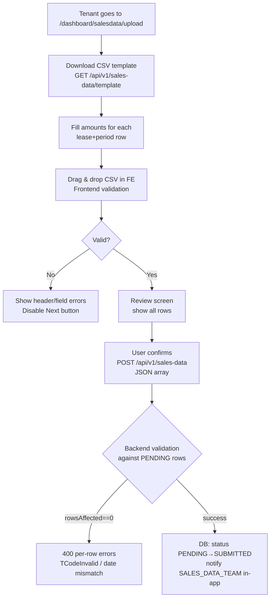
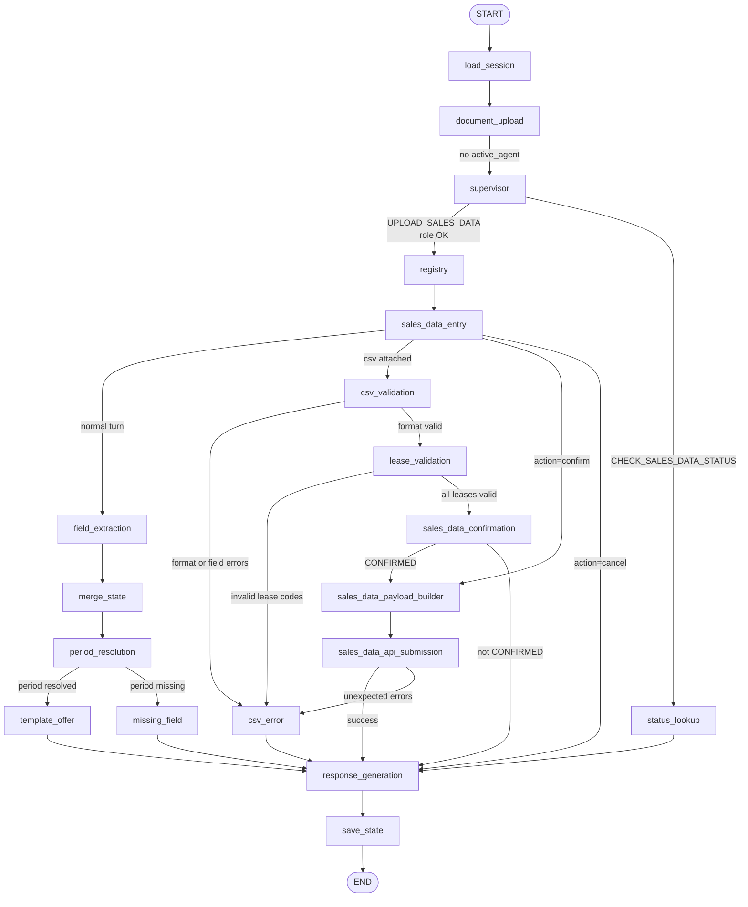

# Sales Data Agent — Product Requirements Document

## 1. Executive Summary

A new `sales_data_agent` will be added to the existing LangGraph Help Agent system (cenomi-api-v2). Tenant company admins will be able to say "I want to upload sales data for Q3 2026" in the AI chat widget, receive a template download link, upload their filled CSV, have it validated with the same rules the current frontend applies, review it in chat, confirm, and submit — triggering the existing `POST /api/v1/sales-data` on cenomi-api, which writes to the DB and fires the in-app notification to `SALES_DATA_TEAM`.

**Phase 1 scope:** Tenant upload flow only. SALES_DATA_TEAM review/approve stays on the existing platform UI.

---

## 2. Existing Sales Data Flow (Source of Truth)



**Key backend architecture facts (from exploration):**
- `POST /api/v1/sales-data` accepts **JSON array**, not multipart
- Backend validates rows against pre-existing `PENDING`/`NEED_REUPLOAD` rows in `sales_data` table
- Upload does NOT insert new periods — rows must already exist from PHASE3 sync
- Notification is synchronous in the same DB transaction: `notificationRepo.Store(...)` targets role `SALES_DATA_TEAM` (role id 30) via `SALES_DATA_SUBMITTED` template
- No email/push — in-app `notifications` table only

**Frontend validation rules replicated in agent:**

| Rule | Detail |
|---|---|
| File format | CSV only |
| File size | Max 5 MB |
| File name | No middle-extension attacks (`.php`, `.exe`, `.js`, etc.) |
| Required headers | `Lease code`, `Brand`, `Property`, `Start date`, `End date`, `Sales amount` (parenthetical suffixes stripped) |
| Empty fields | Lease code, brand, property, start/end date, sales amount all required per row |
| Date format | `DD-MM-YYYY` or `YYYY-MM-DD`; invalid → row error |
| Empty CSV | File with header only (≤1 data row) is rejected |

---

## 3. Agent Architecture

### 3.1 Intent Taxonomy

Two new intents added to `supervisor_prompt.py` and `help_agent_schema.py`:

| Intent | Trigger phrases | Target agent |
|---|---|---|
| `UPLOAD_SALES_DATA` | "upload sales data", "submit sales data for Q3", "I want to send monthly sales", "upload my sales figures" | `sales_data_agent` |
| `CHECK_SALES_DATA_STATUS` | "what is the status of my sales data", "was my sales data submitted", "sales data status for January" | `sales_data_agent` (status check path) |

`CHECK_SALES_DATA_STATUS` maps to a read path — no file upload, queries `GET /api/v1/sales-data` and summarizes.

### 3.2 RBAC Design

**Preferred auth flow — context-dependent (Demo vs Production):**

#### Demo mode (standalone `service-request-chatbot/frontend`)

The standalone demo frontend (the same one used for RDD handover demos) authenticates entirely against the AI backend's own auth system — it never touches cenomi-api. The flow is:

```
Demo frontend → POST /api/auth/login (AI backend)
             → AI backend issues own HS256 JWT
             → JWT contains { roles: ["TENANT_COMPANY_ADMIN"], ... }
             → Supervisor RBAC gate checks ROLE_PERMITTED_INTENTS
```

**Action required:** Add one new entry to `backend/scripts/seed_users.py`:

```python
{"username": "company_admin@cenomi.com", "password": "test1234",
 "role": "TENANT_COMPANY_ADMIN", "unique_property_ids": [], "mall_names": []}
```

#### Production mode (main Cenomi platform + AIChatWidget FAB)

The tenant is already authenticated via cenomi-api. The AIChatWidget calls cenomi-api's `/auth/ai-session-token` endpoint (using the existing platform session cookie) to exchange it for an AI token. The AI backend decodes this token — which carries the cenomi-api role/permission claims — and extracts `SALES_DATA_UPDATE` permission or `user_type = TENANT` to gate access.

```
Tenant (logged into Cenomi platform)
  → AIChatWidget calls POST {NEXT_PUBLIC_API_BASE_PATH}/auth/ai-session-token
  → cenomi-api issues AI token with { user_type: "TENANT", permissions: ["SALES_DATA_UPDATE", ...] }
  → AI backend validates token, extracts auth_context
  → Supervisor RBAC gate checks for SALES_DATA_UPDATE in permissions
```

No user seeding needed in production — permission is inherited from cenomi-api's role system.

**Supervisor RBAC gate (applies to both modes):**
```python
ROLE_PERMITTED_INTENTS = {
    ...
    "TENANT_COMPANY_ADMIN": _SR_READ | {"UPLOAD_SALES_DATA", "CHECK_SALES_DATA_STATUS"},
}
```

The `auth_context` populated from either JWT source maps to `TENANT_COMPANY_ADMIN` role in both cases — demo via the seeded AI user, production via the cenomi-api token claims.

### 3.3 Node Architecture (new `nodes/sales_data/` package)



### 3.4 Node Responsibilities

| Node | File | LLM | Responsibility |
|---|---|---|---|
| `sales_data_entry` | `nodes/sales_data/sales_data_entry_node.py` | No | Parse `action_override`; detect CSV attachment; route to csv_validation or field_extraction |
| `period_resolution` | `nodes/sales_data/period_resolution_node.py` | No | Convert extracted period strings (Q3 2026, January 2026, etc.) to `start_date`/`end_date` (YYYY-MM-DD). Pure deterministic Python. |
| `template_offer` | `nodes/sales_data/template_offer_node.py` | No | Build response with template download URL (`{base_url}/sales-data/template`) and file upload prompt |
| `csv_validation` | `nodes/sales_data/csv_validation_node.py` | No | Layer 1 validation (format-only, mirrors current frontend): file format, size, filename safety, required headers, empty fields per row, date format. Does NOT hit any API. Returns `validated_rows[]` or `validation_errors[]`. |
| `lease_validation` | `nodes/sales_data/lease_validation_node.py` | No | Layer 2 validation (early lease existence check): calls `GET /api/v1/sales-data?status=PENDING&tenant_profile_id=X` to fetch the tenant's pending rows, then cross-checks every lease code + period in the CSV against those rows. Returns `invalid_lease_rows[]` with clear per-row messages before any submission attempt. |
| `sales_data_confirmation` | `nodes/sales_data/sales_data_confirmation_node.py` | No | Build `confirmation_card` UI with row count, period, lease summary. Set `confirmation_status=PENDING`. Only reached when both validation layers pass. |
| `sales_data_payload_builder` | `nodes/sales_data/sales_data_payload_builder_node.py` | No | Build JSON array payload from `validated_rows` |
| `sales_data_api_submission` | `nodes/sales_data/sales_data_api_submission_node.py` | No | Call `POST /api/v1/sales-data`; 3-guard check (CONFIRMED + no errors + payload). Backend errors at this stage are unexpected (lease pre-checked) but still surfaced to user if they occur. |
| `status_lookup` | `nodes/sales_data/status_lookup_node.py` | No | Call `GET /api/v1/sales-data` and summarize statuses for the tenant |

**Two-layer validation rationale:**

| Layer | Node | What it checks | API call? |
|---|---|---|---|
| 1 — Format | `csv_validation` | File type, size, headers, empty cells, date format | No |
| 2 — Lease existence | `lease_validation` | Lease code exists as PENDING/NEED_REUPLOAD row for this tenant + period | Yes — `GET /api/v1/sales-data?status=PENDING` |

This mirrors how the existing flow works (format errors caught client-side, lease errors caught server-side) but surfaces lease errors **before** the user clicks Confirm — eliminating a wasted submission roundtrip.

---

## 4. CSV File Handling (Key Architectural Decision)

The existing AI backend upload route (`POST /api/v2/upload`) accepts only PDF/JPEG/PNG (for SR documents). CSV upload for sales data requires a **separate route or route extension**.

**Recommended approach:** New dedicated endpoint in the AI backend:

```
POST /api/v2/sales-data/upload
Content-Type: multipart/form-data
Fields: file (CSV), session_id
Auth: Bearer AI token
```

This route:
1. Validates file is CSV, ≤ 5 MB, valid filename
2. Parses CSV using Python `csv` module
3. Runs all validation rules (headers, empty fields, date format, row count)
4. Stores raw rows in session draft (`collected_data.csv_rows`)
5. Returns `{valid: bool, row_count, errors[], preview_rows[]}`

The `sales_data_entry_node` detects an attached file in `state["attachments"]` and routes directly to `csv_validation_node` which reads from draft state. The `document_upload_node` (existing) is extended or bypassed for CSV files.

**Frontend upload trigger:** The `AIChatWidget` file attachment mechanism already exists (upload button in `ChatInput`). The `onDocumentUploaded` callback needs to route CSV attachments to the new `/api/v2/sales-data/upload` endpoint instead of `/api/v2/upload`.

---

## 5. Conversation Flow (Typical 4-Turn Journey)

```
Turn 1 — User states intent + period
  User:  "I want to upload sales data for Q3 2026"
  Agent: period_resolution → Q3 2026 = 2026-07-01 to 2026-09-30
         template_offer node → response with download button
  Reply: "I can help you upload your sales data for July–September 2026.
          First, download the pre-filled template, add your sales amounts,
          then upload the filled CSV here.
          [Download Template]"

Turn 2 — User uploads filled CSV
  User:  [Attaches SalesData_Q3_2026.csv]
  Agent: sales_data_entry → detects attachment
         Layer 1 (csv_validation): headers ✓, no empty fields ✓, dates valid ✓
         Layer 2 (lease_validation): GET /api/v1/sales-data?status=PENDING
           → fetches 12 PENDING rows for this tenant
           → cross-checks all CSV lease codes → all 12 match ✓
         → sales_data_confirmation
  Reply: [Confirmation card]:
         "Ready to submit 12 sales records for Q3 2026
          Lease codes: T0028604, T0105712 ... (12 total)
          Period: 01 Jul 2026 – 30 Sep 2026
          Total amount: SAR 2,847,500
          [Confirm] [Cancel]"

Turn 2 (alternate) — Layer 1 format errors
  Agent: csv_validation → 1 row has empty sales amount, 1 has invalid date
  Reply: "2 rows have format errors:
          Row 5 (LC-789): Sales amount is missing
          Row 9 (LC-012): Start date '32-07-2026' is not a valid date
          Please fix these in your CSV and re-upload."

Turn 2 (alternate) — Layer 2 lease existence errors
  Agent: csv_validation passes → lease_validation:
         GET /api/v1/sales-data?status=PENDING → 12 pending rows
         CSV row 4 lease code 'LC-INVALID' not in pending list
         CSV row 7 lease 'T0028604' found but period end date mismatch
  Reply: "2 rows have lease errors:
          Row 4 (LC-INVALID): Lease code not found in your pending records.
            Please use the exact lease codes from the downloaded template.
          Row 7 (T0028604): Period end date does not match the pending
            record (expected 30 Sep 2026, found 31 Aug 2026).
          Please correct these in your CSV and re-upload."

Turn 3b — User confirms
  User:  Clicks Confirm
  Agent: 3-guard check → payload_builder → sales_data_api_submission
         POST /api/v1/sales-data → 200 success
         Backend: 12 rows → SUBMITTED; SALES_DATA_TEAM notified in-app
  Reply: "Your sales data for Q3 2026 has been submitted successfully.
          12 records updated. The Sales Data team has been notified and
          will review your submission."
```

---

## 6. State Schema Extensions

New fields added to `ServiceRequestGraphState` (all persisted in `service_request_drafts.collected_data`):

| Field | Type | Description |
|---|---|---|
| `sales_period_start` | `str` | YYYY-MM-DD resolved from user input |
| `sales_period_end` | `str` | YYYY-MM-DD resolved from user input |
| `period_label` | `str` | Human-readable label ("Q3 2026", "January 2026") |
| `csv_rows` | `list[dict]` | Parsed + validated rows from CSV |
| `csv_row_count` | `int` | Total valid row count |
| `csv_validation_errors` | `list[dict]` | Per-row errors `{row, field, code, message}` |
| `csv_total_amount` | `float` | Sum of `sales_amt` across all rows (for confirmation card) |
| `sales_submission_result` | `dict` | Backend response (success / errors) |

---

## 7. WorkflowConfig Registration

In [`backend/app/agents/registries/workflow_config.py`](cenomi-api-v2/service-request-chatbot/backend/app/agents/registries/workflow_config.py):

```python
register_workflow(WorkflowConfig(
    agent_name="sales_data_agent",
    extraction_prompt=SALES_DATA_EXTRACTION_SYSTEM_PROMPT,
    field_questions=SALES_DATA_FIELD_QUESTIONS,  # period, quarter
    stage_sync_nodes={},            # no multi-user stage sync
    collection_stages=frozenset({"UPLOAD_SALES_DATA"}),
    confirmation_nodes={"UPLOAD_SALES_DATA": "sales_data_confirmation"},
    terminal_stages=frozenset({"SALES_DATA_SUBMITTED", "SALES_DATA_CANCELLED"}),
    backend_fields=frozenset({"tenant_profile_id"}),  # from JWT, never user-provided
    auto_generated_fields=frozenset({"csv_total_amount", "csv_row_count"}),
    lease_trigger_fields=(),          # no lease lookup (rows come from CSV)
    action_intents=frozenset({"UPLOAD_SALES_DATA", "CHECK_SALES_DATA_STATUS"}),
))
```

In [`backend/app/agents/registry.py`](cenomi-api-v2/service-request-chatbot/backend/app/agents/registry.py):

```python
SERVICE_REQUEST_AGENT_REGISTRY["SALES_DATA"] = {
    "BULK_UPLOAD": {
        "agent_name": "sales_data_agent",
        "display_name": "Sales Data Agent",
        "schema_key": "sales_data_schema",
    }
}
```

---

## 8. New Platform API Client

New file: `backend/app/agents/services/sales_data_api_client.py`

| Method | HTTP | cenomi-api endpoint |
|---|---|---|
| `get_sales_data_template(tenant_profile_id)` | GET | `/api/v1/sales-data/template` |
| `upload_sales_data(tenant_profile_id, rows[])` | POST | `/api/v1/sales-data` |
| `get_sales_data_list(tenant_profile_id, filters)` | GET | `/api/v1/sales-data` |

Auth: Same service-to-service Bearer token pattern as `platform_api_client.py`.

---

## 9. Files to Create / Modify

### New files (AI backend — cenomi-api-v2)

- `backend/app/agents/graph/nodes/sales_data/__init__.py`
- `backend/app/agents/graph/nodes/sales_data/sales_data_entry_node.py`
- `backend/app/agents/graph/nodes/sales_data/period_resolution_node.py`
- `backend/app/agents/graph/nodes/sales_data/template_offer_node.py`
- `backend/app/agents/graph/nodes/sales_data/csv_validation_node.py`
- `backend/app/agents/graph/nodes/sales_data/sales_data_confirmation_node.py`
- `backend/app/agents/graph/nodes/sales_data/sales_data_payload_builder_node.py`
- `backend/app/agents/graph/nodes/sales_data/sales_data_api_submission_node.py`
- `backend/app/agents/graph/nodes/sales_data/status_lookup_node.py`
- `backend/app/agents/prompts/sales_data_extraction_prompt.py`
- `backend/app/agents/schemas/sales_data_schema.py`
- `backend/app/agents/services/sales_data_api_client.py`
- `backend/app/api/routes/sales_data_upload.py` (new CSV upload route)

### Modified files (AI backend)

- [`backend/app/agents/registries/workflow_config.py`](cenomi-api-v2/service-request-chatbot/backend/app/agents/registries/workflow_config.py) — register `sales_data_agent`
- [`backend/app/agents/registry.py`](cenomi-api-v2/service-request-chatbot/backend/app/agents/registry.py) — add `SALES_DATA / BULK_UPLOAD` entry
- [`backend/app/agents/graph/help_agent_graph.py`](cenomi-api-v2/service-request-chatbot/backend/app/agents/graph/help_agent_graph.py) — add nodes + edges
- [`backend/app/agents/schemas/help_agent_schema.py`](cenomi-api-v2/service-request-chatbot/backend/app/agents/schemas/help_agent_schema.py) — add `TENANT_COMPANY_ADMIN` to `ROLE_PERMITTED_INTENTS`
- [`backend/app/agents/prompts/supervisor_prompt.py`](cenomi-api-v2/service-request-chatbot/backend/app/agents/prompts/supervisor_prompt.py) — document new intents
- [`backend/app/main.py`](cenomi-api-v2/service-request-chatbot/backend/app/main.py) — mount new upload route
- `backend/app/db/models.py` — add `TENANT_COMPANY_ADMIN` user seeding support
- `backend/scripts/seed_users.py` — add tenant company admin test user

### New files (cenomi-frontend)

- `libs/ui-web/src/lib/components/AIChatWidget/useSalesDataUpload.ts` — hook for CSV upload to new AI endpoint
- `libs/api/src/lib/srChatbot/salesDataAgentApi.ts` — `postSalesDataCsvUpload()` function

### Modified files (cenomi-frontend)

- [`libs/ui-web/src/lib/components/AIChatWidget/ChatPanel.tsx`](cenomi-frontend/libs/ui-web/src/lib/components/AIChatWidget/ChatPanel.tsx) — route CSV attachments to sales data upload endpoint
- [`libs/ui-web/src/lib/components/serviceRequestChatbot/agenticSrAccess.ts`](cenomi-frontend/libs/ui-web/src/lib/components/serviceRequestChatbot/agenticSrAccess.ts) — add `TENANT_COMPANY_ADMIN` role to access check

### No changes needed (cenomi-api)
The cenomi-api backend `POST /api/v1/sales-data` is consumed as-is. Zero changes required.

---

## 10. Open Technical Decisions (Requires Stakeholder Input)

1. **Template download in agent** — The template endpoint (`GET /api/v1/sales-data/template`) requires auth. Options: (a) AI backend proxies the download and streams the CSV, or (b) agent provides a deep-link to the existing `/dashboard/salesdata/upload` page where the user can download it, then returns to the chat to upload the filled file.

2. **Period ambiguity resolution** — When user says "Q3" without a year, agent should ask: "Which year — 2026?" This is deterministic (no LLM needed for period math).

3. **Partial success handling** — If backend returns some rows submitted but others with errors, should the agent let the user fix-and-resubmit within the same session, or close the session and direct to the existing platform UI for corrections?

---

## 11. Out of Scope (Phase 1)

- SALES_DATA_TEAM review/approve via agent chat
- Supporting document reupload flow (NEED_UPLOAD_SUPPORTING_DOCUMENT, NEED_REUPLOAD)
- Anomaly detection / AI-assisted validation vs historical data (Phase 2 per scope doc)
- Daily POS transaction upload (`POST /sales-data/daily`)
- Admin sales data listing or reporting via agent
