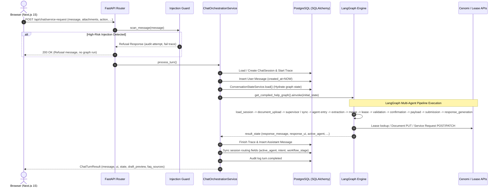
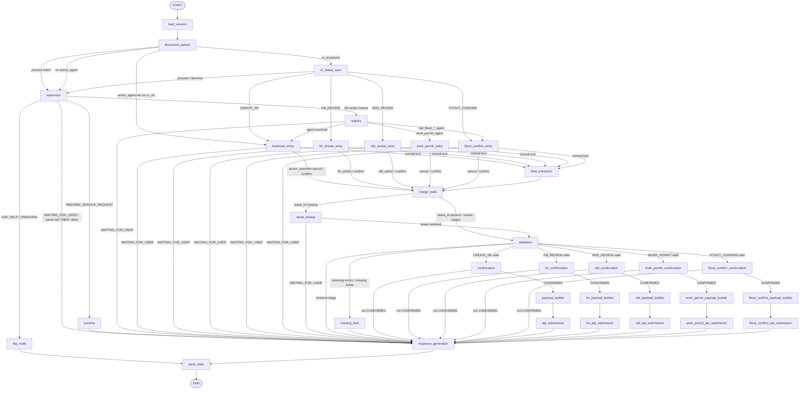
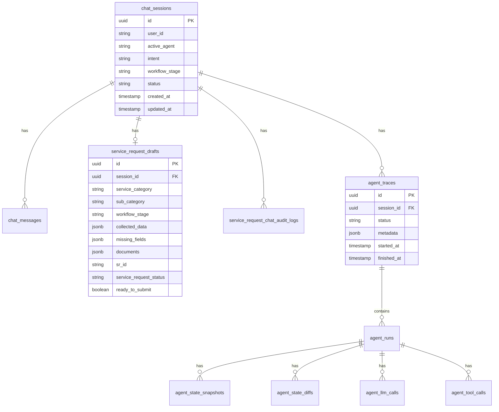

# Cenomi Service Request Chatbot: AI Developer Architecture & Context Blueprint

This document serves as an **authoritative architectural context and technical reference** for AI coding assistants and developers working on the **Cenomi Service Request Chatbot** codebase (`cenomi-api-v2/service-request-chatbot`).

---

## 1. Executive Summary & Design Philosophy

The Cenomi Service Request Chatbot is an enterprise conversational AI platform that enables mall tenants and internal teams (FM Managers, RDD Engineers, Mall Managers) to submit and manage Service Requests (Handover, Fit-out, Work Permits) through natural language.

```
cenomi-api-v2/
└── service-request-chatbot/
    ├── backend/      # Python 3.11+, FastAPI, LangGraph, SQLAlchemy 2 Async, Pydantic v2
    ├── frontend/     # Next.js 15 App Router, React 19, TypeScript 5, Tailwind CSS 3
    └── docs/         # Architecture, testing, and observability documentation
```

### Core Design Principles
1. **LLMs Understand and Propose — Code Validates, Authorises, Persists, and Submits:**
   - LLMs are strictly used for **intent classification**, **unstructured-to-structured field extraction**, and **conversational response generation / Q&A**.
   - All business logic—field validation, required-field gating, RBAC permission checks, lease resolution, API payload building, and HTTP submission—is executed by **deterministic application code**.
2. **Generic Conversational Frontend Shell:**
   - The Next.js 15 frontend is a generic chat UI (`ServiceRequestChat.tsx`). It has **zero knowledge** of backend routing, active agents, or workflow stages.
   - It sends only raw user text, attachments, and UI interaction metadata (`action`, `corrected_fields`, `selected_lease_id`, `sr_id`).
3. **Backend-Owned Multi-Agent Orchestration:**
   - The FastAPI backend owns all routing decisions. `active_agent`, `intent`, `service_category`, `sub_category`, and `workflow_stage` are resolved deterministically by backend registries and persisted in PostgreSQL.
4. **Stateless Graph, Stateful Database:**
   - The LangGraph graph executes statelessly from scratch on every HTTP turn. All conversation and draft state is reloaded from PostgreSQL at the start of the turn and persisted at the end.

---

## 2. End-to-End Architectural Flow (Turn Lifecycle)

Every chat turn initiated from the frontend (`POST /api/chat/service-request` or `/api/v2/chat/service-request`) runs through a strict 12-step orchestration pipeline managed by `ChatOrchestrationService.process_turn`:



### The 12-Step Turn Lifecycle in `ChatOrchestrationService`
1. **Session Load/Create:** Loads existing `ChatSession` by UUID or creates a fresh session.
2. **Start Observability Trace:** Creates an `AgentTrace` record in PostgreSQL via `TraceManager`.
3. **Audit Log & Security Scan:**
   - Records `turn.started` in `service_request_chat_audit_logs`.
   - Runs `scan_message(message)` to check for prompt injection. High-risk patterns short-circuit the request immediately.
4. **Persist User Message:** Saves user message to `chat_messages` with an explicit UTC timestamp.
5. **Build Initial Graph State (`ServiceRequestGraphState`):**
   - Hydrates `active_agent`, `intent`, and `workflow_stage` from the database.
   - Injects runtime services (`trace_manager`, `conversation_state_service`), JWT auth context, and UI action overrides (`action`, `corrected_fields`, `selected_lease_id`, `sr_id`).
6. **Invoke Compiled Graph:** Runs `get_compiled_help_graph().ainvoke(initial_state)` asynchronously.
7. **Extract Response & UI Signals:** Extracts `response_message`, `response_ui`, `active_agent`, and `status`.
8. **Finish Trace:** Records final state and stage transitions in `AgentTrace`.
9. **Persist Assistant Message:** Saves assistant response and `faq_sources` to `chat_messages`.
10. **Sync Session Routing State:** Updates `ChatSession` table with any changes to `active_agent`, `intent`, `workflow_stage`, or `status`.
11. **Audit Completion:** Records `turn.completed` in audit logs.
12. **Return Final Result:** Constructs `ChatTurnResult` containing `message`, `ui` (with card decorations and `draft_preview`), `state`, and `faq_sources`.

---

## 3. LangGraph Multi-Agent Engine & Routing Architecture

The application graph is defined in `app/agents/graph/help_agent_graph.py` and compiled once as a singleton (`get_compiled_help_graph()`).



### Key Node Responsibilities
- **`load_session_node`**: Hydrates `ServiceRequestGraphState` from `ConversationStateService`.
- **`document_upload_node`**: Partitions uploaded attachments into FM and RDD document buckets in `state["documents"]`.
- **`sr_status_sync_node`**: When `sr_id` is present, fetches platform status via `ServiceRequestPlatformClient` and synchronises the workflow stage.
- **`supervisor_node`**: Classifies user intent via LLM (`gpt-4o-mini`) and enforces RBAC permissions against JWT `auth_context`.
- **`faq_node`**: Handles Q&A ("ASK_HELP", "UNKNOWN") using Azure AI Search RAG. Short-circuits directly to `save_state`.
- **`registry_node`**: Deterministically resolves `(service_category, sub_category)` to an agent configuration in `SERVICE_REQUEST_AGENT_REGISTRY`.
- **Stage Entry Nodes (`handover_entry`, `fm_review_entry`, `rdd_review_entry`, `work_permit_entry`, `fitout_confirm_entry`)**: Handle Human-in-the-Loop (HITL) button clicks (`confirm`, `cancel`, `reject`) and inline field edits.
- **`field_extraction_node`**: LLM call that extracts unstructured text into candidate field key-value pairs.
- **`merge_state_node`**: Pure deterministic code that merges candidate fields into `collected_data`, applying intent disambiguation and type coercions.
- **`lease_lookup_node`**: Resolves lease code via `HttpLeaseLookupService`. Handles 0-match (prompt user), 1-match (auto-enrich), and N-match (lease selection card).
- **`validation_node` & `missing_field_node`**: Validates `collected_data` against Pydantic/domain schemas. If non-optional required fields are missing or invalid, routes to `missing_field_node` to prompt the user.
- **Confirmation Nodes (`confirmation`, `fm_confirmation`, etc.)**: Emits `{ "type": "confirmation_card" }` when all required fields are collected, asking for final user sign-off.
- **Payload Builder & API Submission Nodes**: Constructs strict HTTP payloads and submits to Cenomi platform APIs (`POST/PATCH /service-requests`).
- **`response_generation_node`**: Generates conversational assistant replies and emits UI signals (`stage_complete`, `workflow_complete`, `cancelled`).
- **`save_state_node`**: Persists checkpoint back to PostgreSQL via `ConversationStateService`.

---

## 4. Agent Taxonomy & Registry Architecture

Routing is fully decoupled from hardcoded logic via two registries:
1. **`SERVICE_REQUEST_AGENT_REGISTRY`** (`app/agents/registry.py`): Maps `(service_category, sub_category)` to `AgentConfig`.
2. **`WORKFLOW_CONFIG_REGISTRY`** (`app/agents/registries/workflow_config.py`): Maps each canonical `agent_name` to its supported intents, stages, and node targets.

### Currently Registered Agents (`feat/llm-adapters` branch)

| `agent_name` | `service_category` | `sub_category` | Schema Key | Purpose & Workflow Stages |
| :--- | :--- | :--- | :--- | :--- |
| **`help_agent`** | *(Supervisor / Root)* | *(N/A)* | *(N/A)* | Intent classification, RBAC filtering, and FAQ RAG answering (`ASK_HELP`, `UNKNOWN`). |
| **`rdd_handover_agent`** | `FIT_OUT_AND_HANDOVER` | `HANDOVER` / `HANDED_OVER` | `handover_service_request_schema` | Full RDD Handover lifecycle (`CREATE_SR` → `FM_REVIEW` → `RDD_REVIEW` → `SR_COMPLETED`). |
| **`work_permit_agent`** | `WORK_PERMIT` | `WORK_PERMIT` | `work_permit_service_request_schema` | Single-stage Work Permit Service Request creation (`CREATE_WORK_PERMIT`). |
| **`rdd_fitout_start_agent`** | `FIT_OUT_AND_HANDOVER` | `FIT_OUT_CONFIRM_FOS` | `fitout_confirm_schema` | Fit-out Start (FOS) confirmation flow. |
| **`rdd_fitout_end_agent`** | `FIT_OUT_AND_HANDOVER` | `FIT_OUT_CONFIRM_END` | `fitout_confirm_schema` | Fit-out End confirmation flow. |
| **`rdd_trading_confirmation_agent`** | `FIT_OUT_AND_HANDOVER` | `FIT_OUT_CONFIRM_TRADING` | `fitout_confirm_schema` | Trading confirmation flow. |

---

## 5. State Management & Database Schema

The graph is stateless per HTTP turn; all conversation and draft state is persisted in PostgreSQL 16.



### State Storage Strategy
- **`chat_sessions`**: Stores top-level routing pointers (`active_agent`, `intent`, `workflow_stage`, `status`).
- **`service_request_drafts`**: Stores domain data (`collected_data` JSONB, `missing_fields` JSONB, `documents` JSONB, `sr_id`, `ready_to_submit`).
- **`ConversationStateService`**:
  - `.load(session_id)`: Joins `chat_sessions` and `service_request_drafts` to construct `ServiceRequestGraphState` at the start of a turn.
  - `.save_checkpoint(state)`: Upserts draft data and syncs session pointers at the end of a turn.
- **Observability Tables (`agent_traces`, `agent_runs`, etc.)**: `@trace_node` decorator records granular node execution latency, state diffs, LLM prompt/completion payloads, and tool call IO.

---

## 6. Frontend/Backend Contract & UI Signal System

### Strict Boundary Rules
- **Frontend Allowed Payload (`POST /api/chat/service-request`)**:
  - `session_id` (UUID), `user_id` (UUID/string), `message` (string), `attachments` (list of metadata dicts).
  - `action` (`"confirm"`, `"cancel"`, `"reject"`, or omitted).
  - `corrected_fields` (dict of inline card edits).
  - `selected_lease_id` (string from lease disambiguation card).
  - `sr_id` (string when opening an existing SR).
- **Backend Exclusive Fields (Never Send from Frontend)**:
  - `active_agent`, `intent`, `service_category`, `sub_category`, `workflow_stage`.

### UI Signals Emitted in `response_ui`
The backend emits structured signals in `response.ui` so the frontend shell can bind UI states without parsing natural language:

| UI Property / Signal | Condition / Meaning | Frontend Action / Binding |
| :--- | :--- | :--- |
| **`ui.type = "confirmation_card"`** | All required fields collected; waiting for confirmation | Render confirmation card with `Confirm` / `Cancel` buttons and editable fields. |
| **`ui.type = "sr_preview_card"`** | Emitted in `draft_preview` on every turn | Render live SR draft summary sidebar/card (`title`, `notes`, `unit_codes`). |
| **`ui.stage_complete = true`** | Current lifecycle stage completed (e.g. FM approval saved) | Hide FM Update/Save action buttons. |
| **`ui.workflow_complete = true`** | Terminal state reached (`SR_COMPLETED`) | Hide all action buttons on the SR card. |
| **`ui.cancelled = true`** | User cancelled the SR workflow | Close SR form / display cancellation acknowledgement. |

---

## 7. AI Developer Blueprint: How to Extend & Build Using AI

When using AI to add a new Service Request workflow, new agent, or new lifecycle stage, follow this exact 5-step implementation checklist:

### Step 1: Define Schema & Validation Rules (`app/agents/schemas/`)
- Create or update the schema file (e.g., `app/agents/schemas/my_new_workflow_schema.py`).
- Define:
  - Required and optional field lists (`REQUIRED_FIELDS`, `OPTIONAL_FIELDS`).
  - `get_missing_fields(stage, collected_data)` function.
  - Domain validation logic for dates, enums, or string formats.

### Step 2: Register Agent & Workflow Config
- **In `app/agents/registry.py`**: Add your entry to `SERVICE_REQUEST_AGENT_REGISTRY` mapping `(service_category, sub_category)` to your new `agent_name` and `schema_key`.
- **In `app/agents/registries/workflow_config.py`**: Add a new `WorkflowConfig` entry in `WORKFLOW_CONFIG_REGISTRY`:
  ```python
  "my_new_agent": WorkflowConfig(
      agent_name="my_new_agent",
      service_category="MY_CATEGORY",
      sub_category="MY_SUB_CATEGORY",
      action_intents=frozenset({"CREATE_MY_SR"}),
      collection_stages=frozenset({"CREATE_MY_SR"}),
      terminal_stages=frozenset({"MY_SR_COMPLETED"}),
      confirmation_nodes={"CREATE_MY_SR": "my_new_confirmation"},
      stage_sync_nodes={"CREATE_MY_SR": "my_new_entry"},
  )
  ```

### Step 3: Create Dedicated Nodes (`app/agents/graph/nodes/`)
- Implement:
  - **Entry Node**: Handles HITL `confirm`/`cancel` actions for your workflow.
  - **Confirmation Node**: Emits `confirmation_card` when `get_missing_fields` returns empty.
  - **Payload Builder Node**: Constructs strict Cenomi platform API payload.
  - **API Submission Node**: Calls `ServiceRequestPlatformClient` to POST/PATCH the platform API.
- *Note:* You can reuse shared `field_extraction_node`, `merge_state_node`, `lease_lookup_node`, and `validation_node`.

### Step 4: Wire Nodes & Edges in `build_help_agent_graph()`
- In `app/agents/graph/help_agent_graph.py`:
  1. Add your node names to `_AGENT_ENTRY_NODES` dictionary.
  2. Register your nodes with `graph.add_node(...)`.
  3. Add conditional routing edges in `_route_after_validation`, `_route_after_confirmation`, and connect payload builder → api submission → `response_generation`.

### Step 5: Test and Evaluate
- **Unit/Integration Tests**: Run `pytest` across `service-request-chatbot/backend`.
- **Lifecycle Evaluation**: Add eval scenarios to `tests/eval/` and execute:
  ```bash
  python -m tests.eval.run_eval --verbose
  ```
- **Live E2E Verification**: Use Playwright frontend suite (`npm run test:e2e` / `npm run test:live`) or `./run_lifecycle_tests.sh`.

---

## 8. Summary Checklist for AI Coding Assistants
- [ ] Always check KIs and documentation in `service-request-chatbot/docs/` first.
- [ ] Never put domain validation or submission logic inside prompts—use deterministic Python service classes.
- [ ] Never accept routing fields (`active_agent`, `workflow_stage`, `intent`) from frontend request payloads.
- [ ] Decorate all new graph nodes with `@trace_node(run_name, run_type)` for full observability.
- [ ] Maintain the generic shell contract so frontend React components work without modification.
