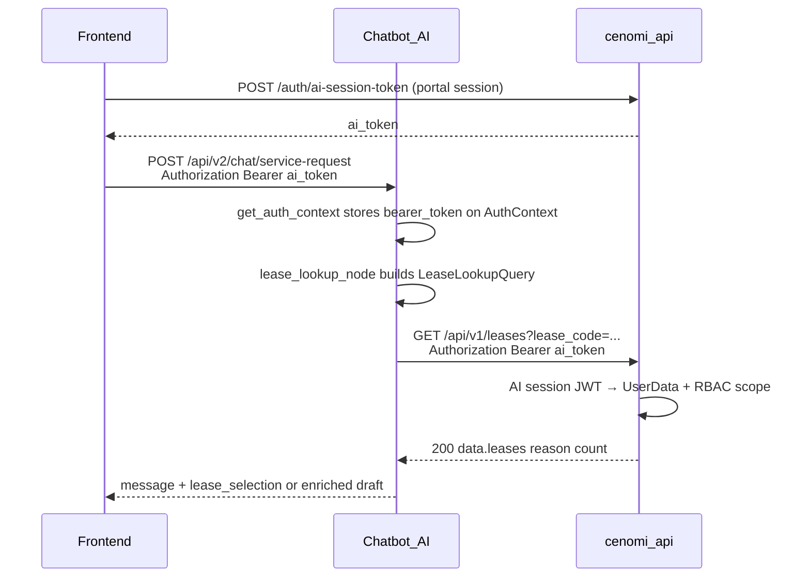

# Plan: Lease Lookup Auth — AI / Frontend / Backend

> **Date:** July 8, 2026  
> **Branch (AI):** `v2` on `cenomi-api-v2`  
> **Status:** AI code implemented on `v2` (unit + integration + e2e tests green). Env align + FE/API smoke pending.  
> **Goal:** Fix live lease lookup 401s so handover chat can resolve real lease codes (e.g. `t0028574`) against cenomi-api.  
> **Related docs:** [`uat-readiness.md`](uat-readiness.md), [`REPORT.md`](../../REPORT.md), [`architecture.md`](architecture.md)

---

## 1. Problem

```
Frontend FAB
  → POST chatbot /api/v2/chat/service-request  (sends Authorization: Bearer <ai_token>)
  → lease_lookup_node
  → HttpLeaseLookupService GET {LEASE_TENANT_API_BASE_URL}/leases?lease_code=...
       ❌ no Authorization header
  → cenomi-api returns 401 Unauthorized
  → chatbot treats error like zero matches → "couldn't find any matches"
```

cenomi-api `GET /leases` requires `UserData` in context, built from an **AI session JWT** (`Authorization: Bearer`). Query params (`lease_code`, `property_id`) alone are **not** enough.

---

## 2. Auth model (do not mix these)

| Token | Who issues | Who consumes | Purpose |
|-------|------------|--------------|---------|
| **AI session JWT** (`Authorization: Bearer`) | cenomi-api `POST /auth/ai-session-token` | Chatbot inbound + **forward to** `GET /leases` | Per-user identity + RBAC scope |
| **S2S platform Bearer** | cenomi-api `POST /cenomi-ai/login` + `x-internal-api-token` | Chatbot `PlatformApiClient` only | SR create/patch, files, status sync |
| **MSP / chatbot service key** (`x-internal-api-token`) | Agreed shared secret | Chatbot inbound (`msp_chat` etc.) | Machine auth MSP → chatbot — **not** for `GET /leases` |

**Decision:** Lease lookup uses **user AI session Bearer forwarding**, not internal API token alone, and not the S2S service-account token (wrong user scope).

---

## 3. End-to-end target flow



---

## 4. Repo A — AI codebase (`cenomi-api-v2`, branch `v2`)

**Status:** Required code changes (not env-only). This is the main work.

### 4.1 `AuthContext` — carry raw Bearer

**File:** `service-request-chatbot/backend/app/types/chat.py`

- Add `bearer_token: str | None = None`.

**File:** `service-request-chatbot/backend/app/core/security.py`

- In `get_auth_context`, set `bearer_token=credentials.credentials` on:
  - successful decode
  - shadow-mode `JWTError` path (`subject_id="unauthenticated"`)
- Do **not** drop the raw token when chatbot `JWT_SECRET_KEY` and platform `AI_SESSION_TOKEN_SECRET` briefly diverge (forwarding still needs the Bearer for cenomi-api).

### 4.2 Lease HTTP adapter — send `Authorization`

**File:** `service-request-chatbot/backend/app/agents/services/lease_lookup_service.py`

- Add `bearer_token: str | None = None` to `LeaseLookupQuery`.
- In `HttpLeaseLookupService.lookup`:
  ```python
  headers = {}
  if query.bearer_token:
      headers["Authorization"] = f"Bearer {query.bearer_token}"
  response = await client.get(endpoint, params=params, headers=headers)
  ```
- Warn when base URL is set but Bearer is missing.
- Store `has_authorization` in request trace payload (boolean only — never log the token).

### 4.3 Graph node — wire token

**File:** `service-request-chatbot/backend/app/agents/graph/nodes/shared/lease_lookup_node.py`

- From `state["auth_context"]`, read `bearer_token` via `getattr`.
- Pass into `LeaseLookupQuery(..., bearer_token=bearer_token)`.
- Keep existing `property_ids` forwarding from `unique_property_ids` (additive scope hint).

**No changes** to supervisor, orchestration routing, or MSP adapter shape — `auth_context` is already on initial state in `ChatOrchestrationService`.

### 4.4 Response envelope parse

**File:** same `lease_lookup_service.py` — `_parse_matches`

cenomi-api returns:

```json
{ "success": true, "data": { "leases": [...], "reason": "", "count": 1 } }
```

Support all of:

- `{ "leases": [...] }`
- `{ "data": [...] }`
- `{ "data": { "leases": [...] } }` ← missing today
- bare list

Optionally (nice-to-have, same PR or follow-up): surface `data.reason` / `existing_handover_sr_id` as `lease_blocked` UI when matches are empty.

### 4.5 Tests

**File:** `service-request-chatbot/backend/tests/unit/test_lease_lookup_service.py`

- Assert `client.get(..., headers={"Authorization": "Bearer …"})` when `bearer_token` set.
- Assert nested `data.leases` envelope parses to `LeaseRecord`s.
- Keep existing flat `leases` / `data` list cases.

### 4.6 Env (AI `.env`)

| Variable | Action |
|----------|--------|
| `LEASE_TENANT_API_BASE_URL` | `http://localhost:8001/api/v1` (remove confusing empty duplicate if present) |
| `SERVICE_REQUEST_API_BASE_URL` | Same host when testing SR create |
| `JWT_SECRET_KEY` | **Must equal** cenomi-api `AI_SESSION_TOKEN_SECRET` |
| `PLATFORM_*` | Needed for SR/files S2S; **not** for lease lookup |
| `RBAC_ENFORCE` | Leave `false` for local shadow; set `true` before prod ([REPORT §8](../../REPORT.md)) |

Restart uvicorn after `.env` changes.

### 4.7 Out of scope for AI in this PR

- Graph / supervisor / `msp_chat` contract changes  
- `sr_status_sync_node` live field-name verification ([REPORT §8](../../REPORT.md))  
- Work Permit agent, webhooks, multi-SR session (S32)

---

## 5. Repo B — Frontend (`cenomi-frontend`)

**Status:** Largely done. Verify only — no mandatory code for lease 401 if FAB already sends Bearer.

### 5.1 Already correct (confirm, do not regress)

| File / concern | Expected |
|----------------|----------|
| `libs/api/src/lib/srChatbot/srChatbotApi.ts` → `aiRequestHeaders` | Sets `Authorization: Bearer ${aiToken}` when token present |
| `postServiceRequestChatTurn(..., aiToken)` | Passes session AI token into headers |
| Chat hook / widget | Obtains token from `POST /auth/ai-session-token` (or stored session) and passes into API client |
| Upload path | Same Bearer (and optional `x-internal-api-token`) if uploads hit chatbot |

### 5.2 Optional frontend hygiene (not blockers)

- Ensure unified session key / token refresh when AI session expires (re-mint via portal).
- Do **not** send only `x-internal-api-token` without Bearer for lease-resolving chat turns.
- Confirm `NEXT_PUBLIC_AI_API_URL` points at chatbot `:8000` (not cenomi-api).

### 5.3 Frontend — no work

- Do not reintroduce Help vs SR client-side routing; supervisor owns routing.
- Do not call cenomi-api `GET /leases` directly from the browser for the FAB flow (chatbot does it).

---

## 6. Repo C — Backend platform (`cenomi-api`)

**Status:** No code change required for the Bearer-forwarding fix. Platforms already accepts AI session JWT on agentic handover routes.

### 6.1 Already in place (verify in local/UAT)

| Piece | Location / role |
|-------|-----------------|
| `GET /leases` handler | `lease/delivery/http/lease_lookup_handler.go` — requires `UserData` |
| AI session JWT parse | `internal/middleware/ai_session_auth.go` — `setContextFromAISessionClaims` |
| Route recognition | `isAgenticHandoverRoute` includes `GET /v1/leases` and `POST /v1/service-requests` |
| Scope | `SearchHandoverEligibleLeases` → `GetPermittedItems` / property & lease RBAC |

### 6.2 Env / ops (cenomi-api)

| Variable | Notes |
|----------|-------|
| `AI_SESSION_TOKEN_SECRET` | Shared secret with chatbot `JWT_SECRET_KEY` |
| Listen port | Local docs often use `:8001` — must match AI `LEASE_TENANT_API_BASE_URL` |

### 6.3 Explicitly do **not** do (rejected approach)

- Register `GET /leases` on internal mux with **only** `x-internal-api-token` and no user context — breaks per-user lease RBAC.
- Rely on chatbot S2S `PLATFORM_LOGIN_EMAIL` token for conversational lease lookup — wrong principal.

### 6.4 Optional later (only if product wants S2S lease)

- New internal route e.g. `GET /cenomi-ai/leases` with internal token **plus** `user_id` (or impersonation headers), load `SSOUser` from DB, then call same usecase. Larger change; not needed if Bearer forward works.

---

## 7. Docs gap (why UAT docs said “env only”)

[`uat-readiness.md`](uat-readiness.md) / [`REPORT.md`](../../REPORT.md) treat live switch as env vars + optional claim remap. That covers:

- User JWT decode into `AuthContext` for RBAC  
- S2S for SR/files via `PlatformApiClient`

They mark lease lookup ✅ under **mock** UAT. Live `HttpLeaseLookupService` never implemented outbound auth — that is why this plan exists. Update those docs after ship (optional follow-up).

---

## 8. Implementation order

1. **AI** — AuthContext + security + lease service + lease node + envelope parse + unit tests (`v2`).
2. **Env** — Align `JWT_SECRET_KEY` ↔ `AI_SESSION_TOKEN_SECRET`; confirm lease base URL; restart chatbot + cenomi-api.
3. **Frontend** — Smoke: Network tab shows Bearer on chat POST; no code unless token missing.
4. **Backend** — Smoke: platform returns 200 for `GET /leases` with same Bearer (curl); no code.
5. **E2E** — FAB → handover message with `t0028574` → expect `lease_lookup.http.success` in uvicorn, not 401.

---

## 9. Verification checklist

- [ ] Unit: Bearer header sent when `bearer_token` set  
- [ ] Unit: `{ data: { leases: [...] } }` parses  
- [ ] Curl: `GET http://localhost:8001/api/v1/leases?lease_code=t0028574` with `Authorization: Bearer <ai_token>` → 200  
- [ ] Chat turn without Bearer → warn `lease_lookup.http.missing_bearer` + platform 401 (expected)  
- [ ] Chat turn with Bearer → auto-enrich or lease_selection UI  
- [ ] Secrets match (`JWT_SECRET_KEY` = `AI_SESSION_TOKEN_SECRET`)

---

## 10. Effort summary

| Repo | Code change? | Effort |
|------|--------------|--------|
| **AI (`cenomi-api-v2`)** | **Yes** — Bearer forward + envelope | ~1–2 hours |
| **Frontend** | No (verify) | ~15 min smoke |
| **Backend (`cenomi-api`)** | No (verify env/secret) | ~15 min smoke |

---

## 11. File checklist (AI)

| File | Change |
|------|--------|
| `backend/app/types/chat.py` | `bearer_token` on `AuthContext` |
| `backend/app/core/security.py` | Populate `bearer_token` (incl. JWTError shadow path) |
| `backend/app/agents/services/lease_lookup_service.py` | Query field, headers, `_parse_matches` |
| `backend/app/agents/graph/nodes/shared/lease_lookup_node.py` | Pass `bearer_token` into query |
| `backend/tests/unit/test_lease_lookup_service.py` | Header + envelope tests |
| `backend/.env` | Secret + URL alignment (local only; do not commit secrets) |
