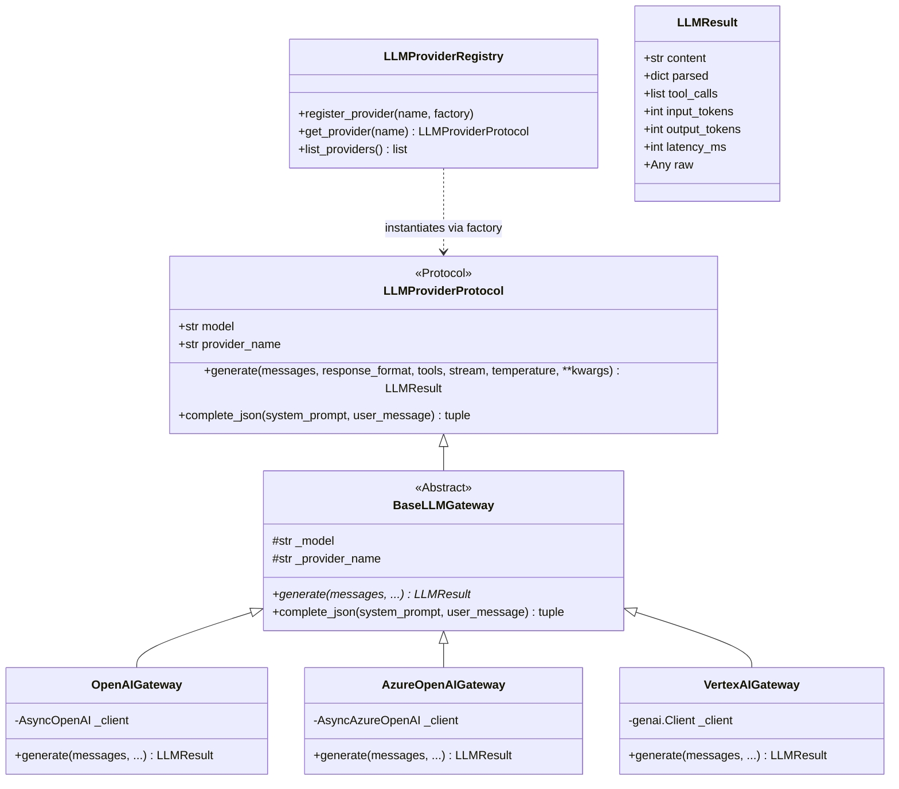
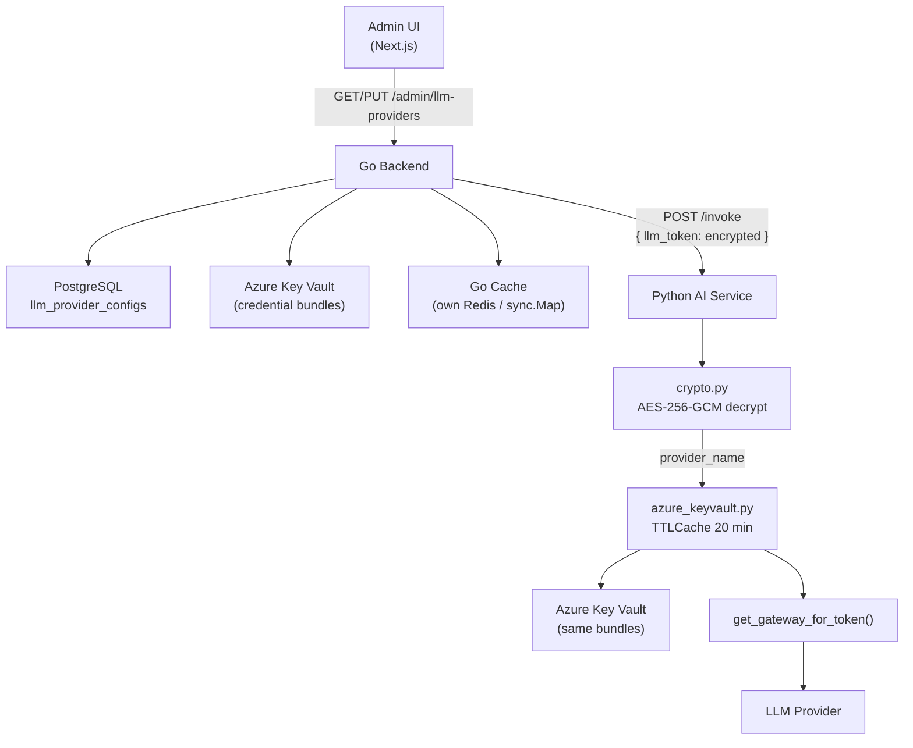

# Product Requirements Document (PRD): Multi-Provider LLM Adapter Architecture

**Document Owner:** Architecture & Core AI Engineering  
**Target Codebase:** `service-request-chatbot/backend` (AI Service), Go Backend, Next.js Frontend  
**Status:** Phase 1 Implemented · Phase 2 Planned  

---

## 1. Executive Summary & Problem Statement

### 1.1 Context
The Cenomi Service Request Chatbot currently relies on `LLMGateway` (`app/agents/llm/gateway.py`), which is hardcoded to use the official OpenAI Python SDK (`openai.AsyncOpenAI`) and exposes a single method: `complete_json(system_prompt, user_message)`.

### 1.2 Problem Statement
1. **Single-Provider Lock-In:** Enterprise deployments require supporting multiple cloud LLM providers—specifically **Azure OpenAI** and **Google Cloud Vertex AI**—to satisfy regional data residency, cloud enterprise agreements, and fallback resilience.
2. **Interface Rigidity:** Exposing only `complete_json()` binds the gateway interface to JSON-only completions. As new conversational features emerge (token streaming, tool/function calling, plain chat generation, multimodal inputs), adding ad-hoc methods (`complete_text`, `complete_stream`, `complete_tool`) would cause unbounded interface bloat.
3. **Risk of Refactoring Regression:** Over 1,400 automated unit and integration tests, as well as critical LangGraph nodes (`supervisor_node`, `faq_node`, `response_generation_node`, `field_extraction_service`), depend on the existing `complete_json()` signature and the `get_default_gateway()` singleton pattern.

### 1.3 Solution Overview
We will implement a **Multi-Provider LLM Adapter Architecture** that:
- Establishes a generic, extensible core interface (`generate()`) capable of supporting chat, structured output, streaming, and tool calls.
- Preserves **100% backward compatibility** by maintaining the exact `complete_json()`, `get_default_gateway()`, and `set_default_gateway()` signatures as convenience wrappers that integrate transparently with the underlying adapters.
- Introduces an **LLM Provider Registry** with out-of-the-box adapters for **OpenAI**, **Azure OpenAI**, and **Google Cloud Vertex AI**, while enabling zero-touch registration for future providers.

---

## 2. Goals & Non-Goals

### 2.1 Goals
- [x] **Multi-Provider Support:** Seamlessly switch between OpenAI, Azure OpenAI, and Google Cloud Vertex AI using a single configuration variable (`LLM_PROVIDER`).
- [x] **Unified `generate()` Core Interface:** Provide a generic, standardized async method for LLM generation across all providers: `generate(messages, response_format, tools, stream, temperature, **kwargs) -> LLMResult`.
- [x] **100% Backward Compatibility:** Do not change any already implemented methods or signatures. `complete_json(system_prompt, user_message)` remains untouched in external signature and behavior, internally delegating to `generate(..., response_format={"type": "json_object"})`.
- [x] **Pluggable Provider Registry:** Enable registering future third-party providers (e.g., AWS Bedrock, Anthropic, Ollama) without modifying existing graph nodes or orchestration logic.
- [x] **Granular Observability:** Ensure token counts (input/output/total) and wall-clock latency are captured uniformly across all providers and recorded in `agent_llm_calls` via `TraceManager`.

### 2.2 Non-Goals
- [ ] **Changing Graph Routing or Business Logic:** No changes will be made to how `supervisor_node` classifies intents or how `field_extraction_service` parses handover schemas.
- [ ] **Modifying Existing Test Assertions:** Existing unit and integration tests must pass unmodified without rewriting their mocks or assertions.
- [ ] **Removing `complete_json()`:** This method will remain a permanently supported convenience wrapper on the gateway interface.

---

## 3. System Architecture & Component Design

### 3.1 Architectural Diagram



### 3.2 Component Interaction & Integration Pattern
1. **`app/core/config.py`**: Reads `LLM_PROVIDER` (`"openai"` | `"azure_openai"` | `"vertex_ai"`) along with provider-specific environment variables.
2. **`LLMProviderRegistry` (`app/agents/llm/registry.py`)**: Stores factory functions for each provider name.
3. **`get_default_gateway()` (`app/agents/llm/gateway.py`)**:
   - Queries `LLMProviderRegistry.get_provider(settings.llm_provider)`.
   - Returns the active provider instance as a singleton.
   - All callers (`supervisor_node`, `faq_node`, etc.) receive an object implementing both `complete_json()` and `generate()`.

---

## 4. Functional Requirements

### 4.1 FR-1: Environment Configuration (`app/core/config.py`)
The system MUST support configuring the active LLM provider via environment variables:

| Setting Field | Env Variable (`.env`) | Default Value | Description |
| :--- | :--- | :--- | :--- |
| **`llm_provider`** | `LLM_PROVIDER` | `"openai"` | Active LLM adapter: `"openai"`, `"azure_openai"`, or `"vertex_ai"`. |
| **`azure_openai_llm_deployment`** | `AZURE_OPENAI_LLM_DEPLOYMENT` | `None` (fallback to `LLM_MODEL`) | Azure OpenAI deployment name for chat completions. |
| **`vertex_ai_project`** | `VERTEX_AI_PROJECT` | `None` (required if `vertex_ai`) | Google Cloud project ID for Vertex AI. |
| **`vertex_ai_location`** | `VERTEX_AI_LOCATION` | `"us-central1"` | GCP region for Vertex AI endpoints. |
| **`vertex_ai_credentials_path`** | `VERTEX_AI_CREDENTIALS_PATH` | `None` (fallback to ADC) | Optional path to GCP service account JSON key. |

### 4.2 FR-2: Unified `generate()` Core Method
Every provider adapter MUST implement:
```python
async def generate(
    self,
    messages: list[dict[str, Any]],
    *,
    response_format: dict[str, Any] | None = None,
    tools: list[dict[str, Any]] | None = None,
    stream: bool = False,
    temperature: float = 0.0,
    **kwargs: Any,
) -> LLMResult:
    ...
```
- **`messages`**: Standard chat message format `[{"role": "system"|"user"|"assistant", "content": "..."}]`.
- **`response_format`**: When set to `{"type": "json_object"}` or a JSON schema, the adapter MUST instruct the backend model to return valid JSON.
- **`LLMResult`**: Frozen dataclass containing `content` (str), `parsed` (optional dict), `input_tokens` (int), `output_tokens` (int), `latency_ms` (int), and `raw` SDK response.

### 4.3 FR-3: Backward-Compatible `complete_json()` Convenience Wrapper
`BaseLLMGateway` MUST provide a concrete implementation of `complete_json(system_prompt, user_message)` that calls `self.generate()` without requiring any child adapter to reimplement it:
```python
async def complete_json(
    self,
    system_prompt: str,
    user_message: str,
) -> tuple[dict[str, Any], int, int, int]:
    """Execute JSON completion and unpack (parsed_json, input_tokens, output_tokens, latency_ms)."""
    result = await self.generate(
        messages=[
            {"role": "system", "content": system_prompt},
            {"role": "user", "content": user_message},
        ],
        response_format={"type": "json_object"},
        temperature=0.0,
    )
    parsed = result.parsed
    if parsed is None:
        parsed = json.loads(result.content or "{}")
    return parsed, result.input_tokens, result.output_tokens, result.latency_ms
```

### 4.4 FR-4: Pluggable Provider Registry (`LLMProviderRegistry`)
- The registry MUST provide `register_provider(name, factory)` and `get_provider(name)`.
- If an unconfigured or unknown provider name is requested, `get_provider(name)` MUST raise a descriptive `ValueError` listing all available registered providers.
- Test suites MUST be able to call `set_default_gateway(mock_gateway)` to override the active singleton instantly.

### 4.5 FR-5: Observability & Token Metrics
- Every adapter MUST extract accurate token usage metrics (`input_tokens`, `output_tokens`) from its native SDK response.
- For Vertex AI (`google.genai`), metrics MUST be parsed from `response.usage_metadata.prompt_token_count` and `response.usage_metadata.candidates_token_count`.
- `supervisor_node.py` MUST pass `provider=getattr(gateway, "provider_name", "openai")` to `TraceManager.capture_llm_call(...)` so that database traces accurately reflect which cloud provider served the request.

### 4.6 FR-6: Dynamic Cost Generation (100% Pure `litellm` End-to-End Accounting)
To prevent model prices from becoming stale over time and avoid requiring code changes or container rebuilds whenever cloud providers adjust token rates, the observability layer MUST delegate 100% of cost accounting to the **`litellm`** Python library without implementing any manual pricing formulas (`input_tokens * x + ...`) or external JSON override configs:

1. **Pure `litellm` End-to-End Delegation:**
   - Whenever an LLM API call is recorded via `TraceManager.capture_llm_call(...)`, if `estimated_cost` is not explicitly provided, the system MUST automatically compute the USD dollar cost using `litellm.cost_per_token(model=model, prompt_tokens=input_tokens, completion_tokens=output_tokens)`.
   - `litellm` maintains an open-source, community-updated pricing registry for 100+ OpenAI, Azure OpenAI (`azure/...`), and Google Cloud Vertex AI/Gemini models in memory, executing calculations in `< 0.05 ms` with zero network overhead.
2. **Custom Deployment Support (`gpt-5.4-mini`):**
   - For internal deployment aliases such as `gpt-5.4-mini`, the pricing module MUST register the deployment alias directly into `litellm`'s model registry (`litellm.register_model()`) upon initialization so that `litellm` calculates every model end-to-end without exception.
3. **Automatic Database Persistence:**
   - The computed `Decimal` cost MUST be persisted automatically to PostgreSQL (`agent_llm_calls.estimated_cost`), ensuring that administrative dashboards and `/api/observability/metrics/summary` report accurate USD totals without requiring modifications to any agent or LangGraph node code.

---


## 5. Master Environment Variable Reference & Provider Comparison

### 5.1 Environment Variable Master Reference Table

| Variable Name | Required By | Default Value | Description |
| :--- | :--- | :--- | :--- |
| **`LLM_PROVIDER`** | *All* | `"openai"` | Controls which adapter is loaded: `"openai"`, `"azure_openai"`, or `"vertex_ai"`. |
| **`LLM_MODEL`** | *All* | `"gpt-4o-mini"` | The primary model name (e.g., `gpt-4o-mini`, `gemini-2.5-flash`). Used as fallback if deployment names are omitted. |
| **`OPENAI_API_KEY`** | OpenAI | *None* | Secret API key for OpenAI official endpoint. |
| **`LLM_BASE_URL`** | OpenAI *(Optional)* | *None* | Optional custom base URL for OpenAI-compatible proxies or endpoints. |
| **`AZURE_AI_ENDPOINT`** | Azure OpenAI | *None* | Azure OpenAI resource URL (e.g. `https://my-instance.openai.azure.com`). |
| **`AZURE_AI_API_KEY`** | Azure OpenAI | *None* | Azure OpenAI API key. |
| **`AZURE_AI_API_VERSION`** | Azure OpenAI | `"2024-02-15-preview"`| Azure OpenAI REST API version for completions. |
| **`AZURE_OPENAI_LLM_DEPLOYMENT`** | Azure OpenAI *(Optional)*| Uses `LLM_MODEL` | Specific Azure deployment name if different from `LLM_MODEL`. |
| **`VERTEX_AI_PROJECT`** | Vertex AI | *None* | Your Google Cloud project ID. |
| **`VERTEX_AI_LOCATION`** | Vertex AI | `"us-central1"` | Google Cloud region where the model/endpoint is hosted. |
| **`VERTEX_AI_CREDENTIALS_PATH`**| Vertex AI *(Optional)*| Uses ADC | Optional absolute path to a GCP Service Account JSON key file. Defaults to Application Default Credentials or Workload Identity. |

### 5.2 Provider Technical Specification Comparison Table

| Feature / Requirement | OpenAI (`OpenAIGateway`) | Azure OpenAI (`AzureOpenAIGateway`) | Google Cloud Vertex AI (`VertexAIGateway`) |
| :--- | :--- | :--- | :--- |
| **SDK / Library** | `openai.AsyncOpenAI` | `openai.AsyncAzureOpenAI` | `google.genai` (`google-genai` SDK) |
| **Authentication** | `OPENAI_API_KEY` | `AZURE_AI_API_KEY` + `AZURE_AI_ENDPOINT` | Application Default Credentials (ADC) or Service Account JSON |
| **Model Specification** | `LLM_MODEL` (e.g., `gpt-4o-mini`) | `AZURE_OPENAI_LLM_DEPLOYMENT` / `LLM_MODEL` | `LLM_MODEL` (e.g., `gemini-2.5-flash` / `gemini-1.5-pro`) |
| **JSON Mode Enforced via** | `response_format={"type": "json_object"}` | `response_format={"type": "json_object"}` | `GenerateContentConfig(response_mime_type="application/json")` |
| **Token Counts Source** | `response.usage.prompt_tokens` / `completion_tokens` | `response.usage.prompt_tokens` / `completion_tokens` | `response.usage_metadata.prompt_token_count` / `candidates_token_count` |
| **Error Handling** | Propagates `OpenAIError` / `JSONDecodeError` | Propagates `OpenAIError` / `JSONDecodeError` | Propagates `genai.errors.APIError` / `JSONDecodeError` |

---

## 6. Ready-to-Copy `.env` Configuration Templates

### 6.1 Option A: OpenAI (Default)
```env
LLM_PROVIDER=openai
LLM_MODEL=gpt-4o-mini
OPENAI_API_KEY=<your_openai_api_key>

# Optional: Custom API base URL
# LLM_BASE_URL=https://api.openai.com/v1
```

### 6.2 Option B: Azure OpenAI
```env
LLM_PROVIDER=azure_openai
LLM_MODEL=gpt-4o-mini
AZURE_AI_ENDPOINT=https://<your_instance_name>.openai.azure.com
AZURE_AI_API_KEY=<your_azure_api_key>
AZURE_AI_API_VERSION=2024-02-15-preview

# Optional: Set explicitly if your Azure deployment name differs from LLM_MODEL
# AZURE_OPENAI_LLM_DEPLOYMENT=my-gpt4o-mini-deployment
```

### 6.3 Option C: Google Cloud Vertex AI
```env
LLM_PROVIDER=vertex_ai
LLM_MODEL=gemini-2.5-flash
VERTEX_AI_PROJECT=<your_gcp_project_id>
VERTEX_AI_LOCATION=us-central1

# Optional: Custom service account JSON file path (otherwise uses gcloud auth / Workload Identity)
# VERTEX_AI_CREDENTIALS_PATH=/path/to/service-account.json
```

---

---

## 8. Phase 2: Dynamic Provider Configuration via Admin UI

> **Phase 1** (Sections 1–7 above) delivered the multi-provider adapter registry driven by `.env` variables. **Phase 2** removes the need for environment changes entirely — an admin UI lets operators configure, enable/disable, and switch providers at runtime with credentials stored securely in Azure Key Vault.

---

### 8.1 Problem Statement (Phase 2)

Phase 1 requires a container restart and `.env` change to switch providers. For production systems with multiple replicas this is operationally risky and slow. Phase 2 makes provider selection and credential management a runtime, UI-driven operation.

---

### 8.2 Design Constraints

- **3 fixed providers only:** `openai`, `azure_openai`, `vertex_ai` — no user-defined providers.
- **Fixed model per provider** — not user-editable. Prevents reasoning regressions from mismatched model capabilities.
- **One active provider at a time** — enforced at DB level via partial unique index.
- **AI service has zero DB access** — all DB operations go through Go backend APIs only.
- **No shared Redis** — Go backend and AI service are assumed to have fully independent infrastructure.
- **No plaintext provider identity or credentials in the invocation payload** — provider info is AES-256-GCM encrypted before transmission.
- **AI service retains its own Azure Key Vault access** — credentials are fetched and cached independently by the AI service.
- **`.env` fallback preserved** — local development requires no changes.

---

### 8.3 System Architecture (Phase 2)



**Key principle:** The invocation payload carries only an opaque encrypted token. Neither the provider name nor any credential ever appears in plaintext in transit.

---

### 8.4 Database Schema (Go Backend Owned)

New table: **`llm_provider_configs`** — created and seeded by Go backend migrations. The Python AI service never reads from this table.

| Column | Type | Notes |
| :--- | :--- | :--- |
| `id` | UUID PK | |
| `provider_name` | TEXT UNIQUE | `'openai'` \| `'azure_openai'` \| `'vertex_ai'` |
| `model_name` | TEXT | Fixed at seed time — never user-editable |
| `is_enabled` | BOOL | `true` = credentials have been stored in Key Vault |
| `is_active` | BOOL | `true` = currently serving requests (max 1 at a time) |
| `key_vault_secret_name` | TEXT | Internal AKV bundle reference — never exposed to UI or payload |
| `display_config` | JSONB | Non-sensitive display metadata for UI (e.g. masked endpoint host) |
| `updated_at` | TIMESTAMPTZ | |

**DB constraint:** `CREATE UNIQUE INDEX idx_one_active ON llm_provider_configs (is_active) WHERE is_active = TRUE`

**Seed data:**

| `provider_name` | `model_name` | `is_enabled` | `is_active` |
| :--- | :--- | :--- | :--- |
| `openai` | `gpt-5.4-mini` | false | false |
| `azure_openai` | `gpt-5.4-mini` | false | false |
| `vertex_ai` | `gemini-2.5-pro` | false | false |

---

### 8.5 Azure Key Vault Credential Bundle Schema

Go backend writes one JSON bundle per provider. AI service reads the same bundle via its own Key Vault access.

**Naming convention** (agreed at deploy time, hardcoded in AI service):

| Provider | KV Secret Name | Bundle Contents |
| :--- | :--- | :--- |
| `openai` | `llm-creds-openai` | `{ "api_key": "sk-..." }` |
| `azure_openai` | `llm-creds-azure-openai` | `{ "api_key": "...", "endpoint": "https://...", "api_version": "2024-02-15-preview" }` |
| `vertex_ai` | `llm-creds-vertex-ai` | `{ "credentials_json": "{...}", "project": "my-gcp-project", "location": "us-central1" }` |

---

### 8.6 Go Backend: Admin Routes

All routes require admin role.

| Method | Path | Action |
| :--- | :--- | :--- |
| `GET` | `/admin/llm-providers` | Returns all 3 rows: `is_enabled`, `is_active`, `display_config`. Never exposes `key_vault_secret_name` or any credential. |
| `PUT` | `/admin/llm-providers/{name}/credentials` | Accepts provider-specific credential fields. Assembles JSON bundle, writes to AKV, saves `key_vault_secret_name` + `display_config` to DB, marks `is_enabled=true`. |
| `DELETE` | `/admin/llm-providers/{name}/credentials` | Removes AKV bundle, clears DB fields, marks `is_enabled=false`. Blocked if provider is currently active. |
| `PUT` | `/admin/llm-providers/{name}/activate` | Sets `is_active=true` for this row, `false` for all others. Requires `is_enabled=true`. Invalidates Go cache immediately. |

**Go backend cache** (own Redis or `sync.Map`):
```
Key:   "llm:active_provider"
Value: { provider_name, model_name }
Invalidated: immediately on PUT activate or PUT/DELETE credentials of active provider
```

**Encrypting the invocation token:**
```go
plaintext := marshal({ provider_name, model_name })
llmToken  := aesGCMEncrypt(plaintext, LLM_PAYLOAD_ENCRYPTION_KEY)
// POST to AI service: { "query": "...", "session_id": "...", "llm_token": llmToken }
```

Go backend **caches and reuses the same ciphertext** until the active provider changes. No re-encryption per request.

---

### 8.7 Shared Encryption Key

Both services share one 32-byte AES key distributed at deploy time via each service's own secrets manager:

```
Go Backend env:   LLM_PAYLOAD_ENCRYPTION_KEY=<base64_32_bytes>
AI Service env:   LLM_PAYLOAD_ENCRYPTION_KEY=<base64_32_bytes>
```

The key never travels in any request payload and is rotated infrequently (quarterly).

---

### 8.8 Python AI Service: New Components

#### FR-7: `app/agents/llm/crypto.py` — Token Decryption

```python
def decrypt_llm_token(token: str, key_b64: str) -> dict:
    """AES-256-GCM decrypt llm_token → { provider_name, model_name }."""
    raw = base64.b64decode(token)
    nonce, ciphertext = raw[:12], raw[12:]
    plaintext = AESGCM(base64.b64decode(key_b64)).decrypt(nonce, ciphertext, None)
    return json.loads(plaintext)
```

#### FR-8: `app/integrations/azure_keyvault.py` — Credential Fetcher with TTL Cache

```python
PROVIDER_KV_SECRET_MAP = {
    "openai":       "llm-creds-openai",
    "azure_openai": "llm-creds-azure-openai",
    "vertex_ai":    "llm-creds-vertex-ai",
}

_cache: TTLCache = TTLCache(maxsize=10, ttl=1200)  # 20 min, keyed on provider_name

async def get_provider_credentials(provider_name: str) -> dict:
    if provider_name in _cache:
        return _cache[provider_name]
    bundle = await _fetch_json_secret(PROVIDER_KV_SECRET_MAP[provider_name])
    _cache[provider_name] = bundle
    return bundle
```

**Cache invalidation logic:**
- Provider switches in payload → different `provider_name` → automatic cache miss → KV fetch
- Same provider, TTL not expired → cache hit → skip KV fetch
- Same provider, TTL expired (20 min) → cache miss → KV re-fetch (handles API key rotation)
- No explicit invalidation signal needed from Go backend

#### FR-9: `app/agents/llm/gateway.py` — Dynamic Gateway

```python
_gateway_cache: dict[str, LLMProviderProtocol] = {}  # keyed on provider_name

async def get_gateway_for_token(llm_token: str) -> LLMProviderProtocol:
    config   = decrypt_llm_token(llm_token, settings.llm_payload_encryption_key)
    provider = config["provider_name"]
    model    = config["model_name"]
    if provider not in _gateway_cache:
        creds = await get_provider_credentials(provider)
        _gateway_cache[provider] = LLMProviderRegistry.get_provider_with_credentials(
            provider, model, creds
        )
    return _gateway_cache[provider]
```

`get_default_gateway()` is preserved untouched for local dev and existing tests.

#### FR-10: Provider `from_config()` Classmethods

Each provider gains a `from_config(model, creds)` classmethod alongside the existing `from_settings()`:

| Provider | `creds` dict keys used |
| :--- | :--- |
| `OpenAIGateway` | `api_key` |
| `AzureOpenAIGateway` | `api_key`, `endpoint`, `api_version` |
| `VertexAIGateway` | `credentials_json`, `project`, `location` |

#### FR-11: Updated Invocation Endpoint Schema

```python
class InvokeRequest(BaseModel):
    query:     str
    session_id: str
    llm_token: str | None = None  # None → local dev fallback to get_default_gateway()
```

---

### 8.9 What Never Appears in the Payload

| Information | Where it lives | In payload? |
| :--- | :--- | :--- |
| Provider name | Encrypted inside `llm_token` | Never plaintext |
| Model name | Encrypted inside `llm_token` | Never plaintext |
| KV secret name | Go backend DB (`key_vault_secret_name`) | Never |
| API key / credentials | Azure Key Vault bundle | Never |
| Encryption key | Each service's own env | Never |

---

### 8.10 Admin UI Specification

Single admin page at `/admin/llm-providers`:

```
Provider Management
──────────────────────────────────────────────────────────────────
Provider       Model              Status          Actions
──────────────────────────────────────────────────────────────────
OpenAI         gpt-5.4-mini      ● ACTIVE        [Configure] [Disable]
Azure OpenAI   gpt-5.4-mini      Configured      [Configure] [Set Active] [Disable]
Vertex AI      gemini-2.5-pro    Not configured  [Configure]
──────────────────────────────────────────────────────────────────
```

**Configure modal inputs (per provider):**

| Provider | Fields |
| :--- | :--- |
| OpenAI | `Model` (read-only: `gpt-5.4-mini`), `API Key` |
| Azure OpenAI | `Model` (read-only: `gpt-5.4-mini`), `API Key`, `Endpoint URL`, `API Version` |
| Vertex AI | `Model` (read-only: `gemini-2.5-pro`), `Service Account JSON` (textarea), `Project ID`, `Location` |

**UI business rules:**
- Model names are read-only — no input field ever exposed
- Cannot activate a provider with `is_enabled=false`
- Cannot disable the currently active provider — must activate another first

---

### 8.11 Phase 2: New Environment Variable

| Variable | Service | Description |
| :--- | :--- | :--- |
| `LLM_PAYLOAD_ENCRYPTION_KEY` | Go Backend + AI Service | Base64-encoded 32-byte AES-256 key shared between both services. When absent, AI service falls back to env-based `get_default_gateway()`. |

---

### 8.12 Phase 2: Files to Create / Modify

**Go Backend (separate repo):**
- New DB migration: `create_llm_provider_configs` + seed rows
- `admin_llm_providers.go` — 4 admin routes
- AES-256-GCM encrypt helper
- Azure Key Vault client wrapper (writes bundles)
- Invoke handler: read from own cache, encrypt, append `llm_token`

**Python AI Service (`service-request-chatbot/backend`):**

| File | Change |
| :--- | :--- |
| `app/core/config.py` | Add `llm_payload_encryption_key: str \| None` |
| `app/agents/llm/crypto.py` | **New** — AES-256-GCM decrypt |
| `app/integrations/azure_keyvault.py` | **New** — KV client + TTLCache + `PROVIDER_KV_SECRET_MAP` |
| `app/agents/llm/gateway.py` | Add `get_gateway_for_token()` |
| `app/agents/llm/registry.py` | Add `get_provider_with_credentials()` |
| `app/agents/llm/providers/openai_provider.py` | Add `from_config()` |
| `app/agents/llm/providers/azure_openai_provider.py` | Add `from_config()` |
| `app/agents/llm/providers/vertex_ai_provider.py` | Add `from_config()` |
| `app/api/routes/` (chat/invoke endpoint) | Add optional `llm_token` field |
| `pyproject.toml` | Add `azure-keyvault-secrets`, `azure-identity`, `cachetools`, `cryptography` |

**Frontend (`service-request-chatbot/frontend`):**
- `src/app/admin/llm-providers/page.tsx` — admin page
- `src/components/llm/ConfigureProviderModal.tsx` — per-provider configure modal

---

### 8.13 Phase 2: Developer Blueprint for Adding a New Provider

To extend Phase 2 to support a new provider (e.g., AWS Bedrock):

1. Add a `from_config(model, creds)` classmethod to the new provider adapter.
2. Register it in `LLMProviderRegistry`.
3. Add a `PROVIDER_KV_SECRET_MAP` entry in `azure_keyvault.py`.
4. Seed a new row in `llm_provider_configs` via Go migration.
5. Add the configure modal fields for the new provider's credential shape.
6. No changes to any LangGraph node, gateway protocol, or existing adapters.
