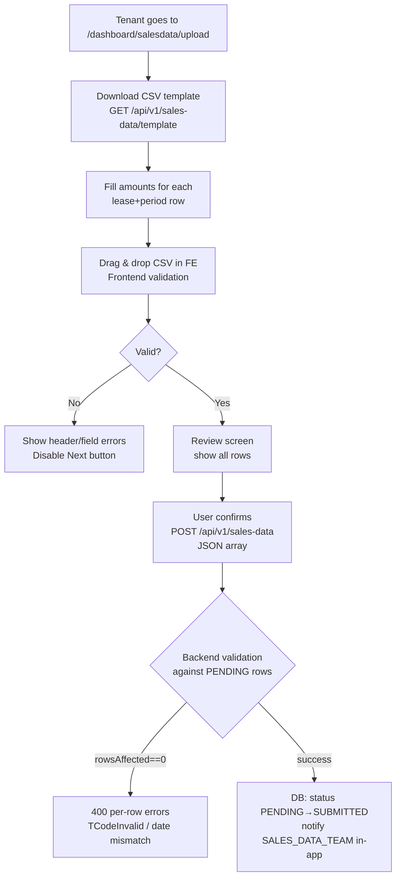
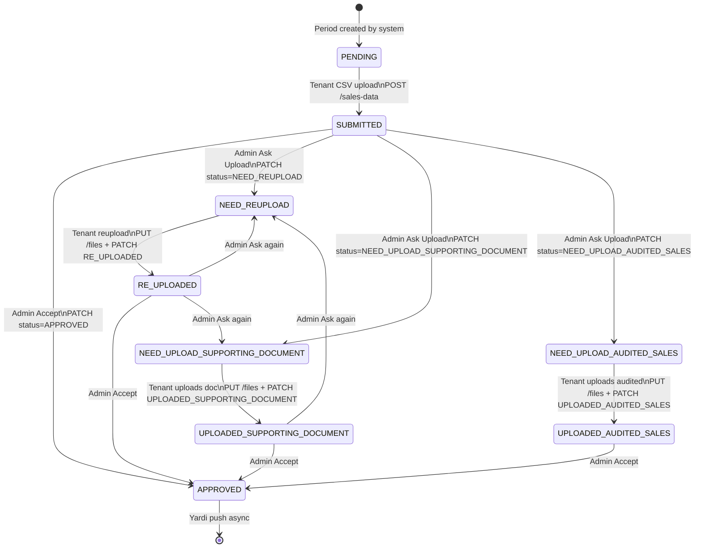
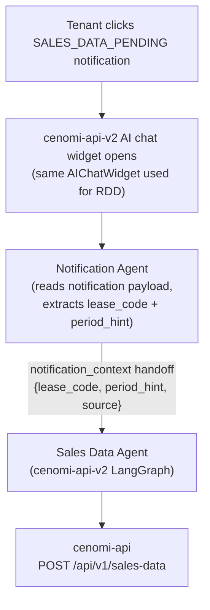
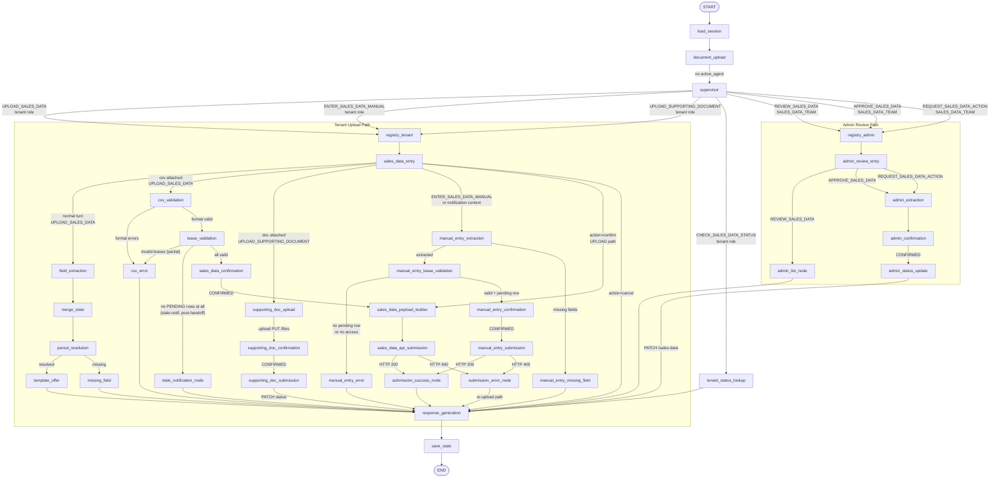

# Sales Data Agent — Product Requirements Document

## 1. Executive Summary

A new `sales_data_agent` will be added to the existing **LangGraph Help Agent system (`cenomi-api-v2`)** — the same codebase that houses the RDD agent, Work Permit agent, and Fitout agents — using the same `WorkflowConfig` registry pattern. All sales data processing calls the existing `cenomi-api` endpoints — zero changes to the backend repo.

Three user groups interact with the agent:

- **Tenants** (roles with `SALES_DATA_UPDATE`): say "upload sales data for Q3", receive a template, upload a CSV, get two-layer validation, confirm and submit — triggering `POST /api/v1/sales-data` and notifying `SALES_DATA_TEAM`.
- **SALES_DATA_TEAM admins** (role_id 30): view pending/submitted records in chat, approve (`APPROVED`), or request action (`NEED_REUPLOAD` / `NEED_UPLOAD_SUPPORTING_DOCUMENT` / `NEED_UPLOAD_AUDITED_SALES`) — all via `PATCH /api/v1/sales-data`.
- **Tenants (responding to admin requests)**: roles with `UPLOAD_SALES_DATA` / `REUPLOAD_SALES_DATA` receive notification, return to agent, upload supporting document or re-upload CSV — triggering `PUT /files` then `PATCH /api/v1/sales-data` with `UPLOADED_SUPPORTING_DOCUMENT` / `RE_UPLOADED` / `UPLOADED_AUDITED_SALES`. Note: Billing Contact and Leasing Manager have `SALES_DATA_UPDATE` only and cannot upload supporting documents.

**Phase 1 scope:** All three flows above — full lifecycle — plus two new input modes for tenants: (a) notification deep-link pre-population and (b) typed single-row sales data entry without a CSV.
**Phase 2 scope:** AI-powered analysis engine (anomaly detection, trend analysis, predictive insights against historical data).

---

## 2. Existing Sales Data Flow (Source of Truth)



**Key backend architecture facts (from exploration):**
- `POST /api/v1/sales-data` accepts **JSON array**, not multipart
- Backend validates rows against pre-existing `PENDING`/`NEED_REUPLOAD` rows in `sales_data` table
- Upload does NOT insert new periods — rows must already exist from PHASE3 sync
- Notification is synchronous in the same DB transaction: `notificationRepo.Store(...)` targets role `SALES_DATA_TEAM` (role id 30) via `SALES_DATA_SUBMITTED` template
- No email/push — in-app `notifications` table only

**Frontend validation rules replicated in agent (Layer 1 — `csv_validation_node`):**

| Rule | Detail | In current platform? |
|---|---|---|
| File format | CSV only | Yes (frontend) |
| File size | Max 5 MB | Yes (frontend) |
| File name | No middle-extension attacks (`.php`, `.exe`, `.js`, etc.) | Yes (frontend) |
| Required headers | `Lease code`, `Brand`, `Property`, `Start date`, `End date`, `Sales amount` (parenthetical suffixes stripped) | Yes (frontend) |
| Empty fields | Lease code, brand, property, start/end date, sales amount all required per row. Error messages per field: "Lease code values not found for all rows", "Brand values not found for all rows", etc. | Yes (frontend) |
| Sales amount: 0 invalid | Sales amount must be a number > 0. **A value of 0 is treated as empty** and triggers the same "Sales amount values not found for all rows" error. | Yes (frontend) |
| Date format | Both `DD-MM-YYYY` and `YYYY-MM-DD` are accepted. An invalid format triggers the same start/end date error. | Yes (frontend) |
| Empty CSV | File with header only (0 data rows) is rejected: "This csv file is Empty, please add valid csv file to proceed" | Yes (frontend) |
| **Atomic rejection** | If any row fails any validation (Layer 1 or Layer 2), the **entire file is rejected and nothing is saved**. The backend `POST /api/v1/sales-data` applies this as an all-or-nothing transaction. | Yes (backend) |
| **Future date** | If `sales_period_start` is after today → per-row error: "Period cannot be in the future. Please use the dates from the downloaded template." | **No — agent improvement** (not in current platform; silently causes `ErrInvalidRecordForUpdate`) |

Note: The current platform has no future date check in either frontend or backend for the tenant CSV upload path. A future-dated row silently receives a confusing backend error ("Use values from downloaded template"). The agent adds an explicit check as a UX improvement, surfacing the real problem immediately.

**Layer 2 validation rules (lease access + existence — `lease_validation_node`):**

| Rule | Detail | In current platform? |
|---|---|---|
| **Lease access check** | User must have access to the lease code in the CSV. Checked by calling `GET /api/v1/sales-data?disable_pagination=true` (user-scoped endpoint). If lease code is not in user's accessible list → per-row error: "You don't have access to lease [LC-123]. Please check with your company admin." | **No — agent improvement** |
| **Pending row existence** | A `PENDING` or `NEED_REUPLOAD` row must exist for this lease code + period. If lease is accessible but no such row exists → per-row error: "No pending submission found for lease [LC-123] in the requested period. Please ensure the period matches your template." | Implicit only (backend returns `ErrInvalidRecordForUpdate`) |

Note: Both checks use a **single API call** (`GET /api/v1/sales-data?disable_pagination=true`). The backend internally calls `GetPermittedItems` (reads `tenant_contacts` table) to scope results to the user's permitted leases — there is no separate "check lease access" endpoint in cenomi-api.

**Security gap in the current platform (confirmed from source code):**

| Endpoint | Lease access check | Mechanism |
|---|---|---|
| `POST /api/v1/sales-data` (bulk CSV upload) | **Not enforced** | SQL WHERE uses only `tenant_profile_id` (company-level). Any user of the company can upload for any lease belonging to that company, regardless of their individual lease access in `tenant_contacts`. |
| `PATCH /api/v1/sales-data` (status update) | Enforced | `UpdateSalesDataStatus` calls `GetPermittedItems` → checks `accessibleItems.Leases` → returns `ErrLeaseIDNotMatch` |
| `GET /api/v1/sales-data` (listing) | Enforced | `Fetch` calls `GetPermittedItems` → sets `params.LeaseIDs` to user's accessible leases |

The agent's `lease_validation_node` closes this gap for the agentic upload path — making it **more secure than the existing platform UI**. This should also be flagged to the backend team as a standalone fix to apply to `POST /api/v1/sales-data` directly.

---

## 2.5 SALES_DATA_TEAM Review / Approve Flow (Current Platform)

### Status Lifecycle

All sales data statuses (from `cenomi-api/internal/constants/constants.go` + `domain/salesdata.go`):

| Status | Who sets it | Meaning |
|---|---|---|
| `PENDING` | System (Yardi sync / period generation) | Awaiting tenant first submission |
| `SUBMITTED` | Tenant (`POST /sales-data` bulk CSV) | Initial amount submitted |
| `APPROVED` | Admin (`PATCH /sales-data`) | Accepted; triggers async Yardi push |
| `NEED_REUPLOAD` | Admin | Tenant must re-upload sales data CSV |
| `NEED_UPLOAD_SUPPORTING_DOCUMENT` | Admin | Tenant must upload supporting document |
| `NEED_UPLOAD_AUDITED_SALES` | Admin | Tenant must upload audited sales |
| `RE_UPLOADED` | Tenant | Responded to `NEED_REUPLOAD` |
| `UPLOADED_SUPPORTING_DOCUMENT` | Tenant | Responded to supporting-doc request |
| `UPLOADED_AUDITED_SALES` | Tenant | Responded to audited-sales request |

**UI status groupings (admin + tenant tabs):**
- Pending tab: `PENDING`, `NEED_REUPLOAD`, `NEED_UPLOAD_SUPPORTING_DOCUMENT`, `NEED_UPLOAD_AUDITED_SALES`
- Submitted tab: `SUBMITTED`, `RE_UPLOADED`, `UPLOADED_SUPPORTING_DOCUMENT`, `UPLOADED_AUDITED_SALES`
- Approved tab: `APPROVED`

### Admin Review Endpoint

**Listing:** `GET /api/v1/sales-data` with params:

| Param | Purpose |
|---|---|
| `status` | Comma-separated (e.g. `SUBMITTED,RE_UPLOADED,UPLOADED_SUPPORTING_DOCUMENT,UPLOADED_AUDITED_SALES`) |
| `page`, `limit` | Pagination (default page=1, limit=10) |
| `sales_period_start`, `sales_period_end` | Date range |
| `tenant_profile_id` / `tenant_profile_ids` | Company filter |
| `lease_code` | Repeatable |

Access scoped to admin's permitted companies/leases via `tenantContactUsecase.GetPermittedItems`.

**Handler:** `List` in `cenomi-api/sales_data/delivery/http/sales_data_handler.go`

### Status Update Endpoint

**`PATCH /api/v1/sales-data`** — identifies row by `(lease_id, lease_code, sales_period_start, sales_period_end)`, **not** `sales_data_id`.

Request body:
```json
{
  "lease_id": 123,
  "lease_code": "ABC-001",
  "sales_period_start": "2025-01-01",
  "sales_period_end": "2025-01-31",
  "sales_amt": 50000.0,
  "status": "APPROVED",
  "document_id": "optional-uuid",
  "comment_text": "optional"
}
```

**`checkUserPermissions` rules (enforced in handler):**

| User type | Allowed statuses to set |
|---|---|
| ADMIN | `APPROVED`, `NEED_REUPLOAD`, `NEED_UPLOAD_SUPPORTING_DOCUMENT`, `NEED_UPLOAD_AUDITED_SALES` |
| TENANT | `SUBMITTED`, `RE_UPLOADED`, `UPLOADED_SUPPORTING_DOCUMENT`, `UPLOADED_AUDITED_SALES` |

**Handler:** `Update` in `sales_data_handler.go` → `UpdateSalesDataStatus` in `sales_data_usecase.go`

### Admin UI Actions (current platform)

Requires permission `SALES_DATA_APPROVE` (from `cenomi-frontend/libs/ui-web/src/lib/components/adminSalesData/adminAction.tsx`):

| Action | When shown | Status sent |
|---|---|---|
| Accept | Row is in submitted-family | `APPROVED` |
| Ask Upload → Sales Data | Row in submitted-family | `NEED_REUPLOAD` |
| Ask Upload → Supporting Document | Row in submitted-family | `NEED_UPLOAD_SUPPORTING_DOCUMENT` |
| Ask Upload → Audited Sales | Row in submitted-family | `NEED_UPLOAD_AUDITED_SALES` |
| Download Supporting Document | `document_id` present | View-only |

Note: There is **no hard REJECTED status**. Admin "rejection" = requesting action via `NEED_*` statuses.

### Notifications (admin → tenant)

**Function:** `handleNotification` in `sales_data_usecase.go`

| New status | Notification key | Target |
|---|---|---|
| `NEED_REUPLOAD` | `SALES_DATA_NEED_REUPLOAD` | Tenant contacts, `ActionRequired: true` |
| `NEED_UPLOAD_SUPPORTING_DOCUMENT` | `SALES_DATA_NEED_UPLOAD_SUPPORTING_DOCUMENT` | Tenant contacts, `ActionRequired: true` |
| `NEED_UPLOAD_AUDITED_SALES` | `SALES_DATA_NEED_UPLOAD_AUDITED_SALES` | Tenant contacts, `ActionRequired: true` |
| `APPROVED` | `SALES_DATA_APPROVED` | Tenant contacts |

### Full Status Transition Diagram



---

## 2.6 Supporting Document / Reupload Flow (Current Platform)

### What Triggers Each NEED_* Status

Admin opens a submitted row → "Ask Upload" → selects document type:
- `NEED_REUPLOAD`: wrong/incomplete sales data — tenant must upload new CSV + optionally change amount
- `NEED_UPLOAD_SUPPORTING_DOCUMENT`: admin needs backup proof (e.g. POS report)
- `NEED_UPLOAD_AUDITED_SALES`: admin needs audited financial statement

### File Upload Endpoint (Two-Step Process)

Step 1 — Upload file bytes:
```
PUT /files?file_extension={ext}&document_type_id={id}&lease_id={id}&file_name={name}
```

| Current status | `document_type_id` |
|---|---|
| `NEED_REUPLOAD` | `SD_RE_UPL` |
| `NEED_UPLOAD_SUPPORTING_DOCUMENT` | `SD_SUP_DOC` |
| `NEED_UPLOAD_AUDITED_SALES` | `SD_AUD_DOC` |

Returns `document_id` (UUID).

**Handler:** `cenomi-api/file_upload/delivery/http/file_upload_handler.go`

Step 2 — Update status with returned document_id via `PATCH /api/v1/sales-data`:
```json
{
  "lease_id": 123,
  "lease_code": "ABC-001",
  "sales_period_start": "2025-01-01",
  "sales_period_end": "2025-01-31",
  "sales_amt": 50000,
  "status": "UPLOADED_SUPPORTING_DOCUMENT",
  "document_id": "<from PUT /files>",
  "comment_text": "Attached POS report"
}
```

**Status mapping for tenant PATCH:**

| Current status | Tenant sends |
|---|---|
| `NEED_REUPLOAD` | `RE_UPLOADED` + new `document_id` |
| `NEED_UPLOAD_SUPPORTING_DOCUMENT` | `UPLOADED_SUPPORTING_DOCUMENT` + `document_id` |
| `NEED_UPLOAD_AUDITED_SALES` | `UPLOADED_AUDITED_SALES` + `document_id` |
| `PENDING` (initial) | `SUBMITTED` |

**UI:** `tenantSalesData/editSalesAmt.tsx` + `reUploadFile.tsx` in cenomi-frontend

### Notifications (tenant → admin after upload)

**Function:** `handleNotification` in `sales_data_usecase.go`

| Tenant status | Notification key | Target |
|---|---|---|
| `RE_UPLOADED` | `SALES_DATA_REUPLOADED` | `SALES_DATA_TEAM` (role_id 30) |
| `UPLOADED_SUPPORTING_DOCUMENT` | `SALES_DATA_UPLOADED_SUPPORTING_DOCUMENT` | `SALES_DATA_TEAM` |
| `UPLOADED_AUDITED_SALES` | `SALES_DATA_UPLOADED_AUDITED_SALES_DATA` | `SALES_DATA_TEAM` |

### Key Implementation Notes for Agent

1. **Row identity for PATCH:** identified by `(lease_id, lease_code, sales_period_start, sales_period_end)`, NOT `sales_data_id`
2. **File upload is a two-step process:** `PUT /files` first → get `document_id` → then `PATCH /sales-data`
3. **Comment is required** for tenant responses to `NEED_*` requests (validated in UI)
4. **`NEED_REUPLOAD` tenant response** is the same CSV upload flow as initial upload (same two-layer validation: csv_validation + lease_validation)
5. **Edit window:** `master_data` type `SALES_DATA` / key `SALES_DATA_EDIT_PERIOD` controls how many days after `sales_period_end` tenants can still edit submitted-family rows
6. **For supporting doc/audited sales:** agent needs to accept PDF, image, or any document file (not just CSV)

---

## 2.6b Notification Agent — Integration with Sales Data Agent

The **Notification Agent** is a separate agent (its own repo/codebase) responsible for reading actionable notifications and delegating to the appropriate domain agent. The Sales Data Agent lives in **`cenomi-api-v2`** alongside the RDD agent — the Notification Agent's sole responsibility here is to extract context from a `SALES_DATA_PENDING` notification and pass it into the Sales Data Agent's existing chat session.

### Agent Collaboration Model



### What the Notification Agent does for Sales Data

1. Reads the raw notification payload: `key = "SALES_DATA_PENDING"`, `text_content.id` (lease code), `text_content.en` (body with period hint)
2. Extracts: `lease_code = text_content.id`, `period_hint` parsed from EN body (e.g. `"month August"`)
3. Identifies the responsible domain agent: `SALES_DATA_PENDING` → Sales Data Agent
4. Passes a `notification_context` handoff payload into the Sales Data Agent's entry node

### Handoff Contract (Notification Agent → Sales Data Agent)

```python
notification_context = {
    "lease_code": "LC-1234",        # from text_content.id
    "period_hint": "month August",  # parsed from text_content.en
    "source": "notification"        # tells Sales Data Agent to skip LLM extraction
}
intent = "ENTER_SALES_DATA_MANUAL"
```

The Sales Data Agent's `manual_entry_extraction_node` checks `notification_context["source"] == "notification"`. When true, it skips LLM extraction and uses the pre-populated `lease_code` and `period_hint` directly, then proceeds to Layer 2 lease validation and asks only for the sales amount.

### Frontend change for notification routing

| File | Change |
|---|---|
| [`libs/ui-web/src/lib/utils/Util.ts`](cenomi-frontend/libs/ui-web/src/lib/utils/Util.ts) | `handleNotificationNavigation`: for `SALES_DATA` type, open the AI chat widget and pass the raw notification payload (or `notification_id`) so the Notification Agent can seed the first turn |
| [`libs/ui-web/src/lib/components/AIChatWidget/AIChatWidget.tsx`](cenomi-frontend/libs/ui-web/src/lib/components/AIChatWidget/AIChatWidget.tsx) | Expose a programmatic open method accepting optional `notificationPayload` to pre-seed the agent session |

> The listing page (`/dashboard/salesdata`) is unchanged — tenants can still navigate there and use the standard platform upload UI.
> The Notification Agent's internal implementation (its own repo/architecture) is out of scope for this PRD. Only the handoff contract above is relevant here.

---

## 2.7 PENDING Notification to Tenant (Current Platform)

### How the Notification is Created

**Trigger:** Phase 3 of the `SALES_DATA_SYNC` cron batch (`salesdatasync.go` → `CalculateSalesDataPeriods` → `sentPendingNotificationForTenant`). Fires when stage data is absent for a lease billing period.

**Template** (`cenomi-api/internal/config/notification.json`):
```
Key:  SALES_DATA_PENDING
Type: SALES_DATA
EN:   "Please submit sales data as of %s for %s."
```
Placeholders: `%s[1]` = humanized period (e.g. `"month August"`), `%s[2]` = `lease.LeaseBrandMall`.

**`text_content` payload stored on the notification row:**
```json
{
  "key": "SALES_DATA_PENDING",
  "en": "Please submit sales data as of month August for BrandName@Mall.",
  "ar": "...",
  "type": "SALES_DATA",
  "category": "PENDING",
  "id": "<lease.PMSTenantCode>"
}
```

**What is and is not included:**

| Field | Present? | Notes |
|---|---|---|
| Lease code | Yes | `text_content.id` = `PMSTenantCode` |
| Humanized month string | Yes | Inside `en`/`ar` body text only |
| ISO period dates (`sales_period_start`, `sales_period_end`) | **No** | Not stored anywhere in notification |
| Numeric `lease_id` | **No** | Not set on the notification row |
| `redirect_url` / `deep_link` | **No** | None |
| Structured metadata JSON | **No** | Only `text_content` JSON |

**Phase 3 Notification Sync Gap — confirmed behavior and agent fallback:**

> **Scope boundary:** Opening the AI chat widget from a notification click is entirely the **Notification Agent's** responsibility (handled in its own repo). The Notification Agent reads the notification payload, opens the chat panel, and passes a `notification_context` handoff (`lease_code` + `period_hint`) into the Sales Data Agent's first turn. Everything described below is what the **Sales Data Agent** does *after* it has already received that handoff — it does not overlap with the Notification Agent's opening flow.

From code analysis of `sales_data_sync_usecase.go`: `sentPendingNotificationForTenant` is called within the same DB transaction (`tx` is passed in). This means the PENDING row in `sales_data` and the tenant notification are **committed atomically** — there is no race between notification delivery and row existence at the moment the notification becomes visible.

However, the real-world gap occurs **after notification delivery** across two scenarios:

| Scenario | Cause | Effect |
|---|---|---|
| **Stale notification** | Tenant submits data via another channel (portal CSV, direct API) between notification delivery and the agent chat session | Row transitions from `PENDING` → `SUBMITTED`; the agent's Layer 2 `GET` may still see `PENDING` if cached, but backend `POST` fails with `ErrInvalidRecordForUpdate` |
| **Long-session stale state** | Tenant opens agent chat, passes Layer 2, but takes a long time before hitting Submit | Another admin marks the row `APPROVED` or it's reprocessed; backend `POST` fails on submission |

**Required LangGraph fallback transitions:**

```
lease_validation_node
  ├──[no accessible PENDING/NEED_REUPLOAD rows at all]──► stale_notification_node
  │     Outputs: "No pending sales data found for any of your leases in the notified period.
  │               This may have already been submitted via another channel. Check [Sales Data]."
  │
  └──[some rows OK, some missing PENDING row]──► csv_validation_error_node (per-row error shown inline)

sales_data_submission_node
  ├──[HTTP 200]──► submission_success_node
  └──[HTTP 400]──► submission_error_node
        ├──[backend error matches "stale-state" pattern: rows passed Layer 2 but now not found]──►
        │     "One or more rows changed status between validation and submission.
        │      None of your rows were saved. Please re-validate or check the Sales Data listing."
        │     Transitions back to csv_upload_prompt_node (re-upload path)
        └──[backend error is a genuine data error: wrong dates, amount, etc]──►
              Show per-row error table. Offer re-upload with corrected file.
              Transitions back to csv_upload_prompt_node.
```

**Concrete agent messages:**

- **No PENDING rows found (notification stale):** `"I checked your lease data for the period mentioned in the notification, but I couldn't find any pending submissions. This may have already been submitted via another channel. You can review your current status on the Sales Data listing page."`
- **HTTP 400 on submission (stale state during session):** `"Your submission was rejected — it looks like the sales data for [LC-123] (Aug 1–31) was updated while we were processing. None of your rows were saved. Please re-validate your file or check the Sales Data listing page for the latest status."`
- **HTTP 400 on submission (data error):** `"Row [N] failed: [backend error message]. Because all rows are submitted together, none were saved. Please correct row [N] and re-upload the file."`

### Current Click Behaviour (Frontend)

Handler: `handleNotificationNavigation` in `cenomi-frontend/libs/ui-web/src/lib/utils/Util.ts`

For `notification_type === "SALES_DATA"`:
```
→ /dashboard/salesdata?page=1&limit=10&lease_code={text_content.id}&section=Pending&from_notification=true
```

Routes to the **sales-data listing page** (Pending tab, filtered by lease code). No existing path to the AI chat widget.

### What the Notification Agent Extracts and Hands Off

The **Notification Agent** (a separate shared agent, already designed for RDD and being extended for Sales Data) is the first handler when a notification is clicked. It reads the notification payload and hands off to the Sales Data Agent (domain agent) with pre-populated context.

| Available from notification | Notification Agent action |
|---|---|
| `text_content.id` (lease code / PMSTenantCode) | Passed as `notification_context.lease_code` in handoff |
| `text_content.en` body text (e.g. `"...as of month August for..."`) | LLM/regex extracts period hint → passed as `notification_context.period_hint` (e.g. `"month August"`) |
| `text_content.category = "PENDING"` | Determines that an upload action is required → routes to Sales Data Agent |
| `text_content.key = "SALES_DATA_PENDING"` | Identifies domain: Sales Data |

**What is not in the payload (resolved downstream):**
- ISO dates (`sales_period_start` / `sales_period_end`) — Sales Data Agent resolves from `period_hint` + current year, confirms with user
- Numeric `lease_id` — resolved from `GET /api/v1/sales-data` in Layer 2 validation

---

## 3. Agent Architecture

### 3.1 Intent Taxonomy

Six new intents added to `supervisor_prompt.py` and `help_agent_schema.py`, covering both tenant and SALES_DATA_TEAM admin roles:

**Tenant intents:**

| Intent | Trigger phrases / trigger source | Who can use |
|---|---|---|
| `UPLOAD_SALES_DATA` | "upload sales data", "submit sales data for Q3", "I want to send monthly sales", "upload my sales figures", "reupload my sales data" | Roles with `SALES_DATA_UPDATE` permission (`TENANT_CSV_UPLOADER` + `TENANT_DOC_UPLOADER`) |
| `ENTER_SALES_DATA_MANUAL` | "sales for August for lease 121342 is 100000", "my sales this month are 85000 for LC-456", "submit amount 200000 for lease 789 July", OR triggered from notification deep-link with pre-populated context | Roles with `SALES_DATA_UPDATE` permission (`TENANT_CSV_UPLOADER` + `TENANT_DOC_UPLOADER`) |
| `UPLOAD_SUPPORTING_DOCUMENT` | "upload supporting document", "attach POS report", "upload audited sales", "I need to respond to document request" | Roles with `UPLOAD_SALES_DATA` / `REUPLOAD_SALES_DATA` permission (`TENANT_DOC_UPLOADER` only — Billing Contact and Leasing Manager are excluded) |
| `CHECK_SALES_DATA_STATUS` | "what is the status of my sales data", "was my sales data submitted", "sales data status for January" | All tenant upload roles (`TENANT_CSV_UPLOADER` + `TENANT_DOC_UPLOADER`) |

`UPLOAD_SALES_DATA` (intent) handles CSV upload for both initial submission and `NEED_REUPLOAD` response. `ENTER_SALES_DATA_MANUAL` handles single-row typed entry and notification deep-link pre-population. `UPLOAD_SUPPORTING_DOCUMENT` handles `NEED_UPLOAD_SUPPORTING_DOCUMENT` and `NEED_UPLOAD_AUDITED_SALES` — restricted to roles that have the `UPLOAD_SALES_DATA` platform permission.

**SALES_DATA_TEAM admin intents:**

| Intent | Trigger phrases | Who can use |
|---|---|---|
| `REVIEW_SALES_DATA` | "show pending sales data", "what sales data needs review", "list submitted sales data", "show me sales submissions" | `SALES_DATA_TEAM` (permission `SALES_DATA_APPROVE`) |
| `APPROVE_SALES_DATA` | "approve sales data for Tenant X", "accept Q3 submission for ABC Corp", "approve lease L-123" | `SALES_DATA_TEAM` |
| `REQUEST_SALES_DATA_ACTION` | "request reupload from tenant", "ask for supporting document", "need audited sales from Tenant X" | `SALES_DATA_TEAM` |

### 3.2 RBAC Design

#### Who can upload sales data today?

**Three distinct permissions govern sales data actions (source: module owner PDF):**

| Permission | What it unlocks |
|---|---|
| `SALES_DATA_UPDATE` | CSV bulk upload (`POST /api/v1/sales-data`) |
| `UPLOAD_SALES_DATA` / `REUPLOAD_SALES_DATA` | Supporting document upload and CSV reupload after admin request (`PUT /files` + `PATCH /api/v1/sales-data`) |
| `SALES_DATA_APPROVE` | Admin approval / status change (`PATCH /api/v1/sales-data` to `APPROVED`, `NEED_REUPLOAD`, etc.) |

**Tenant roles (upload side):**

| Role | User type | CSV upload (`SALES_DATA_UPDATE`) | Supporting docs / reupload (`UPLOAD_SALES_DATA`) |
|---|---|---|---|
| `PRIMARY_TENANT_CONTACT` (id 2) | TENANT | Yes | Yes |
| `AUTHORIZED_SIGNATORY` (id 3) | TENANT | Yes | Yes |
| `COMPANY_ADMIN` (id 72) | TENANT | Yes | Yes |
| `COMPANY_ADMIN_CENTRAL` (id 7) | TENANT | Yes | Yes |
| `BILLING_CONTACT` | TENANT | Yes | **No** |
| `LEASING_MANAGER` | TENANT | Yes | **No** |

**Admin roles (approve side — `SALES_DATA_APPROVE`):**

| Role | User type | Can approve / request action |
|---|---|---|
| `SALES_DATA_TEAM` (id 30) | ADMIN | Yes — main approver; receives all submission notifications |
| `REGIONAL_LEASING_MANAGER_STORE` (id 26) | ADMIN | Yes |
| `REGIONAL_DD_ENGINEER` (id 74) | ADMIN | Yes |

> **Note on source conflict:** A prior code analysis of `cenomi-frontend/.../roles/route.ts` showed `REGIONAL_LEASING_MANAGER_STORE` (26) and `REGIONAL_DD_ENGINEER` (74) with `UPLOAD_SALES_DATA` set. The module owner PDF classifies them as admin approvers only. **The PDF is authoritative.** The frontend code may reflect a stale or over-permissive assignment. Flag this to the backend/frontend team for correction.

`SALES_DATA_TEAM` (role_id: 30) receives in-app notifications after submission but **does not** have `SALES_DATA_UPDATE` — they are the approval target, not uploaders. Tenants cannot approve.

Note: The cenomi-api `POST /api/v1/sales-data` handler does **not** enforce role-level permission checks in code. It only requires a valid `tenantProfileID` in the JWT context. Role/permission enforcement lives entirely at the frontend UI layer. The AI agent adds an explicit RBAC gate that the current frontend relies on implicitly.

**Preferred auth flow — context-dependent (Demo vs Production):**

#### Demo mode (standalone `service-request-chatbot/frontend`)

The standalone demo frontend authenticates against the AI backend's own auth system — it never touches cenomi-api. The flow is:

```
Demo frontend → POST /api/auth/login (AI backend)
             → AI backend issues own HS256 JWT
             → JWT contains { roles: ["TENANT_COMPANY_ADMIN"], ... }
             → Supervisor RBAC gate checks ROLE_PERMITTED_INTENTS
```

**Action required:** Add one new entry to `backend/scripts/seed_users.py`:

```python
{"username": "company_admin@cenomi.com", "password": "test1234",
 "role": "TENANT_COMPANY_ADMIN", "unique_property_ids": [], "mall_names": []}
```

#### Production mode (main Cenomi platform + AI Assistant docked panel)

The tenant is already authenticated via cenomi-api. The AI Assistant panel (`SrCopilotPanel` — the vertical docked panel, not a floating button) calls cenomi-api's `/auth/ai-session-token` endpoint (using the existing platform session cookie) to exchange it for an AI token. The AI backend decodes this token — which carries the cenomi-api role/permission claims — and routes based on permissions.

```
Tenant (logged into Cenomi platform)
  → AIChatWidget calls POST {NEXT_PUBLIC_API_BASE_PATH}/auth/ai-session-token
  → cenomi-api issues AI token with { user_type: "TENANT", permissions: ["SALES_DATA_UPDATE", ...] }
  → AI backend validates token, extracts auth_context
  → Supervisor RBAC gate:
      SALES_DATA_UPDATE   → TENANT_CSV_UPLOADER bucket
      UPLOAD_SALES_DATA   → TENANT_DOC_UPLOADER bucket (superset of TENANT_CSV_UPLOADER)
      SALES_DATA_APPROVE  → SALES_DATA_APPROVER bucket
```

No user seeding needed in production — permission is inherited directly from cenomi-api's role system.

**Supervisor RBAC gate (applies to both modes):**

The agent uses **three permission buckets** to correctly split CSV-only uploaders (Billing Contact, Leasing Manager) from full uploaders (Company Admin, Primary Contact, etc.):

```python
ROLE_PERMITTED_INTENTS = {
    ...
    # Roles with SALES_DATA_UPDATE only (Billing Contact, Leasing Manager)
    # CSV upload + typed entry + status check; NO supporting documents
    "TENANT_CSV_UPLOADER": _SR_READ | {
        "UPLOAD_SALES_DATA",
        "ENTER_SALES_DATA_MANUAL",
        "CHECK_SALES_DATA_STATUS",
    },
    # Roles with UPLOAD_SALES_DATA / REUPLOAD_SALES_DATA
    # (Primary Tenant Contact, Authorized Signatory, Company Admin, Company Admin Central)
    # Full tenant set: CSV + typed + supporting docs + status
    "TENANT_DOC_UPLOADER": _SR_READ | {
        "UPLOAD_SALES_DATA",
        "ENTER_SALES_DATA_MANUAL",
        "UPLOAD_SUPPORTING_DOCUMENT",
        "CHECK_SALES_DATA_STATUS",
    },
    # Admin approver: SALES_DATA_TEAM, Regional Leasing Manager Store, Regional DD Engineer
    "SALES_DATA_APPROVER": _SR_READ | {
        "REVIEW_SALES_DATA",
        "APPROVE_SALES_DATA",
        "REQUEST_SALES_DATA_ACTION",
        "CHECK_SALES_DATA_STATUS",
    },
}
```

In production, the middleware maps:
- `SALES_DATA_UPDATE` only → `TENANT_CSV_UPLOADER`
- `SALES_DATA_UPDATE` + `UPLOAD_SALES_DATA` → `TENANT_DOC_UPLOADER`
- `SALES_DATA_APPROVE` → `SALES_DATA_APPROVER`

In demo mode, separate seeded users cover each bucket.

**Demo seed users (handled in the roles → bucket table below).**

**Which roles map to each bucket in production:**

| Agent bucket | Cenomi-api roles | Permission check |
|---|---|---|
| `TENANT_CSV_UPLOADER` | `BILLING_CONTACT`, `LEASING_MANAGER` | `SALES_DATA_UPDATE` in JWT; does NOT have `UPLOAD_SALES_DATA` |
| `TENANT_DOC_UPLOADER` | `PRIMARY_TENANT_CONTACT`, `AUTHORIZED_SIGNATORY`, `COMPANY_ADMIN`, `COMPANY_ADMIN_CENTRAL` | `SALES_DATA_UPDATE` + `UPLOAD_SALES_DATA` in JWT |
| `SALES_DATA_APPROVER` | `SALES_DATA_TEAM` (id 30), `REGIONAL_LEASING_MANAGER_STORE` (id 26), `REGIONAL_DD_ENGINEER` (id 74) | `SALES_DATA_APPROVE` in JWT permissions |

**Demo seed users (one per bucket):**
```python
# CSV uploader only (limited role — e.g. Billing Contact)
{"username": "billing_contact@cenomi.com", "password": "test1234",
 "role": "TENANT_CSV_UPLOADER", "unique_property_ids": [], "mall_names": []}
# Full tenant uploader (Company Admin, Primary Contact, etc.)
{"username": "company_admin@cenomi.com", "password": "test1234",
 "role": "TENANT_DOC_UPLOADER", "unique_property_ids": [], "mall_names": []}
# Admin approver
{"username": "sales_data_team@cenomi.com", "password": "test1234",
 "role": "SALES_DATA_APPROVER", "unique_property_ids": [], "mall_names": []}
```

### 3.3 Node Architecture (new `nodes/sales_data/` package)

The graph has two sub-paths: **Tenant upload path** and **Admin review path**, both routed from the same supervisor.



### 3.4 Node Responsibilities

#### Tenant Upload Nodes

| Node | File | LLM | Responsibility |
|---|---|---|---|
| `sales_data_entry` | `nodes/sales_data/sales_data_entry_node.py` | No | Parse `action_override`; detect CSV vs doc attachment; route based on current intent (`UPLOAD_SALES_DATA` vs `UPLOAD_SUPPORTING_DOCUMENT`) |
| `period_resolution` | `nodes/sales_data/period_resolution_node.py` | No | Convert extracted period strings (Q3 2026, January 2026) to `start_date`/`end_date` (YYYY-MM-DD). Pure deterministic Python. |
| `template_offer` | `nodes/sales_data/template_offer_node.py` | No | Build response with template download URL + file upload prompt |
| `csv_validation` | `nodes/sales_data/csv_validation_node.py` | No | Layer 1: file format, size, filename safety, required headers, empty fields per row, date format validity, **future date check** (`sales_period_start` after today → per-row error). No API call. |
| `lease_validation` | `nodes/sales_data/lease_validation_node.py` | No | Layer 2 (lease access + existence): single `GET /api/v1/sales-data?disable_pagination=true` (no status filter, user-scoped). Partitions CSV lease codes into: (a) not in user's accessible list → "You don't have access to lease [LC-X]", (b) accessible but no PENDING/NEED_REUPLOAD row for this period → "No pending submission found for [LC-X] in requested period" (notification stale-state path → `stale_notification_node`), (c) valid. Backend scopes the response to user's permitted leases via `GetPermittedItems` internally — no dedicated lease-access endpoint exists. |
| `stale_notification_node` | `nodes/sales_data/stale_notification_node.py` | No | **Sales Data Agent internal node — no overlap with Notification Agent.** Reached when `lease_validation` finds zero PENDING/NEED_REUPLOAD rows for all lease codes *after* the Notification Agent has already handed off `notification_context` and the Sales Data Agent has started its session. This node handles the case where the lease's data is no longer PENDING (already submitted via another channel). Message: _"I couldn't find any pending sales data for the notified period. This may have already been submitted via another channel. Please check the Sales Data listing page."_ Surfaces a link to `/dashboard/salesdata`. Terminates the upload flow; does NOT re-prompt for file. Note: this node is also reachable from a direct (non-notification) agent session where the user uploads a CSV and all rows fail Layer 2 with "no pending row" errors. |
| `sales_data_confirmation` | `nodes/sales_data/sales_data_confirmation_node.py` | No | Build structured `SALES_DATA_REVIEW` message containing the annotated rows array. The frontend renders this as an editable `SalesDataReviewCard` table (only `sales_amt` editable). Sets `workflow_stage = AWAITING_TABLE_CONFIRM`. |
| `sales_data_payload_builder` | `nodes/sales_data/sales_data_payload_builder_node.py` | No | Called after user clicks Submit in the table. Reads the submitted (possibly edited) rows from `state["action_payload"]["rows"]`, builds JSON array payload for `POST /api/v1/sales-data`. Strips non-API fields (brand, property). |
| `sales_data_api_submission` | `nodes/sales_data/sales_data_api_submission_node.py` | No | `POST /api/v1/sales-data`; role guard. On **HTTP 200**: advances to `submission_success_node`. On **HTTP 400**: routes to `submission_error_node` with the parsed per-row `errors[]` array from the response body. |
| `submission_success_node` | `nodes/sales_data/submission_success_node.py` | No | Surfaces a green confirmation card: "All X rows submitted successfully. The SALES_DATA_TEAM has been notified." Sets `workflow_stage = SALES_DATA_COMPLETE`. |
| `submission_error_node` | `nodes/sales_data/submission_error_node.py` | No | Receives per-row `errors[]` from the backend 400 response. Determines error class: (a) **data error** (wrong dates, amount, etc.) → shows per-row error table + "Please correct and re-upload"; (b) **stale-state error** (rows passed Layer 2 but no matching PENDING row at submission time — stale notification or concurrent update) → shows: "This lease's data was updated in another channel while we were processing. None of your rows were saved. Please re-validate or check the Sales Data listing page." Both paths transition back to `csv_upload_prompt_node`. |
| `supporting_doc_upload` | `nodes/sales_data/supporting_doc_upload_node.py` | No | Accept uploaded file (PDF/image/any); determine `document_type_id` from current row status (`SD_SUP_DOC` / `SD_RE_UPL` / `SD_AUD_DOC`); call `PUT /files`; store returned `document_id` in session. |
| `supporting_doc_confirmation` | `nodes/sales_data/supporting_doc_confirmation_node.py` | No | Show file name + target row details + optional comment field. Set `confirmation_status=PENDING`. |
| `supporting_doc_submission` | `nodes/sales_data/supporting_doc_submission_node.py` | No | `PATCH /api/v1/sales-data` with `document_id` + response status (`UPLOADED_SUPPORTING_DOCUMENT` / `RE_UPLOADED` / `UPLOADED_AUDITED_SALES`) + `comment_text`. |
| `tenant_status_lookup` | `nodes/sales_data/tenant_status_lookup_node.py` | No | `GET /api/v1/sales-data` scoped to tenant; summarize statuses (pending/submitted/approved counts + action-required rows). |
| `manual_entry_extraction` | `nodes/sales_data/manual_entry_extraction_node.py` | Yes | LLM extracts lease code, sales amount, period (month/quarter) from free-text user message OR from pre-populated notification context (`lease_code` + `period_hint` in session state). If notification context is present, confirms with user before proceeding. |
| `manual_entry_lease_validation` | `nodes/sales_data/manual_entry_lease_validation_node.py` | No | Same Layer 2 check as `lease_validation` (single `GET /api/v1/sales-data?disable_pagination=true`). Also guards against Phase 3 gap: if no `PENDING`/`NEED_REUPLOAD` row exists, shows: "Your sales data period is not yet ready for submission. Please try again in a few hours." |
| `manual_entry_missing_field` | `nodes/sales_data/manual_entry_missing_field_node.py` | No | Ask for any missing field (lease code, amount, or period) that the LLM could not extract. |
| `manual_entry_confirmation` | `nodes/sales_data/manual_entry_confirmation_node.py` | No | Show confirmation card: "Submitting: Lease [LC-X], Period Aug 1 – Aug 31, Amount SAR 100,000. [Confirm] [Cancel]" |
| `manual_entry_submission` | `nodes/sales_data/manual_entry_submission_node.py` | No | Build single-row JSON payload. `POST /api/v1/sales-data` with same guards as CSV path. Reports success/failure. |
| `manual_entry_error` | `nodes/sales_data/manual_entry_error_node.py` | No | Surface typed-entry-specific errors (no access, no pending row, Phase 3 gap) with clear user-friendly messages and suggested next steps. |

#### Admin Review Nodes

| Node | File | LLM | Responsibility |
|---|---|---|---|
| `admin_review_entry` | `nodes/sales_data/admin_review_entry_node.py` | No | Route based on intent: list → `admin_list_node`; approve/request-action → `admin_extraction` |
| `admin_list_node` | `nodes/sales_data/admin_list_node.py` | No | `GET /api/v1/sales-data` with admin-scoped filters (status, period, tenant); format paginated results as chat cards (company, lease, period, amount, current status) |
| `admin_extraction` | `nodes/sales_data/admin_extraction_node.py` | Yes | LLM extracts: target tenant/company, lease code, period, action type (`APPROVED` / `NEED_REUPLOAD` / `NEED_UPLOAD_SUPPORTING_DOCUMENT` / `NEED_UPLOAD_AUDITED_SALES`), optional comment from free text |
| `admin_confirmation` | `nodes/sales_data/admin_confirmation_node.py` | No | Build confirmation card: "You are about to set status X for [Tenant, Lease, Period]. Comment: Y. [Confirm] [Cancel]" |
| `admin_status_update` | `nodes/sales_data/admin_status_update_node.py` | No | `PATCH /api/v1/sales-data` with extracted `(lease_id, lease_code, start, end, status, comment_text)`; guards: CONFIRMED + admin role + valid target status for admin |

**Two-layer validation (tenant upload):**

| Layer | Node | What it checks | API call? | Error on failure |
|---|---|---|---|---|
| 1 — Format + sanity | `csv_validation` | File type, size, filename safety, required headers, empty cells, date format, future date | No | Per-row format/date errors |
| 2 — Lease access + existence | `lease_validation` | (a) User has access to this lease, (b) a PENDING/NEED_REUPLOAD row exists for lease + period | Yes — single `GET /api/v1/sales-data?disable_pagination=true` (no status filter, returns all statuses the user can see) | (a) "You don't have access to lease [LC-123]" or (b) "No pending submission found for lease [LC-123] in the requested period" |

**Why a single API call for Layer 2:**

`GET /api/v1/sales-data` is already user-scoped on the backend. It internally calls `GetPermittedItems` (reads `tenant_contacts` table) and filters results to only the user's permitted leases. There is no dedicated "check lease access" endpoint — access control is enforced implicitly by the listing endpoint itself.

By calling it once without a status filter (`disable_pagination=true`), we get all the user's accessible rows across all statuses. We then partition CSV lease codes into three buckets:
- Lease code not in user's full list → user has **no access** (report before any period check)
- Lease code in user's list but no PENDING/NEED_REUPLOAD row for this period → **no pending row** for this period
- Lease code + period matches a PENDING/NEED_REUPLOAD row → passes Layer 2

---

## 3.5 Agent Design Principles (from module owner)

The following rules must be embedded in agent prompts and node logic:

1. **Template-first mandate:** The agent MUST offer/remind the user to download the CSV template before uploading. Lease code, brand, property, start date, and end date are pre-filled in the template. The user fills **only the Sales amount column**.

2. **Sales amount only:** The agent's validation and instructions always emphasize: "Fill Sales amount only. Do not change any other column — lease code, dates, brand, and property must exactly match the template."

3. **Amount > 0 required:** A sales amount of 0 is invalid. The agent surfaces: "Sales amount cannot be 0. Please enter the actual sales figure." during Layer 1 validation.

4. **Exact match required:** Every submitted row must exactly match a `PENDING` or `NEED_REUPLOAD` record for that tenant. If even one row fails, the entire submission is rejected. The agent communicates this clearly in the confirmation card: "All X rows will be submitted together. If any row has an error, the entire file will be rejected."

5. **For typed entry (ENTER_SALES_DATA_MANUAL):** Agent must still enforce the same rules — amount > 0, lease code must match a PENDING row for that period, amount must be numeric.

---

## 3.6 AI Assistant Entry Point — Vertical Docked Panel (Existing Infrastructure)

The AI chatbot is no longer a floating action button (FAB). It is now a **docked right-side panel** (`SrCopilotPanel`) accessible via the vertical "AI Assistant" tab visible in the screenshot. This panel is:

- Mounted globally in `layout.tsx` for every authenticated page
- Already production-ready and live for the RDD agent
- A true split screen: when open, it reserves space via `--sr-copilot-w` CSS variable, pushing the page content left so both are simultaneously visible
- Drag-resizable (left edge of the panel)
- Has a `draftFields` prop that bridges the chat (right side) and the platform page (left side) — as the agent fills or processes data, the `draftFields` object updates and the left-side page component re-renders with those values

**The `AgenticSplitScreenDemo`** at `/dashboard/servicerequest/agentic/split` is a UI-only prototype and is NOT the live split-screen implementation.

---

## 3.7 Sales Data Agent — Split Screen + Auto-Navigation

For the RDD agent, the user is already on the SR creation/detail page when they open the copilot, so both sides are naturally visible. For the Sales Data Agent, the user can be on **any page**. This section describes the exact same sequence of components and calls used by RDD, adapted for sales data.

### The Exact RDD Mirror Mechanism (Reference)

The RDD split-screen works through a precise chain of components — this is what the Sales Data Agent must replicate:

```
AI Backend (Python/LangGraph)
  └── response.draft_preview.fields[] ─────────────────────────────────────────┐
                                                                                ↓
useServiceRequestChat.ts                                                        │
  └── mergeFromDraftPreview() merges fields into draftFields state ────────────┘
  └── draftFields (React state) ─────────────────────────────────────────────→ AIChatWidget.tsx
                                                                                │
AIChatWidget.tsx                                                                │
  └── registerSrSession({ draftFields, patchDraftFields, isAiModeActive })     │
      → writes to global AgenticRegistryState (external store, not Context)    │
  └── watches chat.workflowStage → calls router.push() to navigate left side  │
                                                                                │
SalesDataUpload.tsx (left side page)                                           │
  └── useSrSessionFromRegistry() reads srSession.draftFields from external store
  └── when salesDataAgenticActive: renders based on draftFields instead of local state
```

### Step 1 — AI Backend: `draft_preview.fields[]`

The Sales Data Agent nodes must emit fields in the **same `draft_preview.fields[]` format** the RDD agent uses. The existing `mergeFromDraftPreview()` function in `useServiceRequestChat.ts` already handles this — no frontend changes needed.

Backend response shape for a sales data turn:

```json
{
  "session_id": "...",
  "active_agent": "sales_data_agent",
  "message": "I can help with that. Please upload your CSV...",
  "ui": { "type": "message" },
  "state": {
    "workflow_stage": "SALES_DATA_CSV_REQUESTED"
  },
  "draft_preview": {
    "type": "sales_data",
    "fields": [
      { "key": "sales_stage",    "value": "CSV_REQUESTED" },
      { "key": "lease_code",     "value": "LC-1234" },
      { "key": "period_label",   "value": "Q3 2026" }
    ]
  }
}
```

After CSV upload and Layer 1 validation:

```json
{
  "draft_preview": {
    "type": "sales_data",
    "fields": [
      { "key": "sales_stage",        "value": "CSV_VALIDATED" },
      { "key": "csv_rows",           "value": "[{\"lease_code\":\"LC-1234\",\"sales_period_start\":\"2026-07-01\",\"sales_period_end\":\"2026-09-30\",\"sales_amt\":150000}]" },
      { "key": "csv_row_count",      "value": "12" }
    ]
  }
}
```

The `csv_rows` value is a JSON-stringified array so it travels through the existing `{key, value}` structure. The left-side consumer parses it with `JSON.parse()`.

### Step 2 — `useServiceRequestChat.ts`: No Changes

The existing `mergeFromDraftPreview()` already merges all `draft_preview.fields[]` into `draftFields` state. The `setDraftFields()` update triggers a re-render of `AIChatWidget.tsx`, which calls `registerSrSession()`.

**Sales data fields that appear in `draftFields` after merging:**

| `draftFields` key | Type | Populated from |
|---|---|---|
| `sales_stage` | string | `draft_preview.fields[]` |
| `lease_code` | string | `draft_preview.fields[]` |
| `period_label` | string | `draft_preview.fields[]` |
| `csv_rows` | string (JSON) | `draft_preview.fields[]` |
| `csv_row_count` | string | `draft_preview.fields[]` |
| `validation_errors` | string (JSON) | `draft_preview.fields[]` |
| `highlighted_row_lease_id` | string | `draft_preview.fields[]` |

### Step 3 — `AIChatWidget.tsx`: Two Additions

**Addition A — `salesDataAgenticActive` flag and `registerSrSession`**

Currently `AIChatWidget.tsx` only calls `registerSrSession()` when `canUseSrMode && registry.handoverAgenticActive`. For sales data, `handoverAgenticActive` will never be true (that's RDD-specific). A parallel flag `salesDataAgenticActive` must be added to the registry and activated when a sales data `workflow_stage` is detected:

```typescript
// In serviceRequestAgenticRegistry.ts — add to AgenticRegistryState:
salesDataAgenticActive: boolean;

// In AIChatWidget.tsx — new useEffect:
useEffect(() => {
  const stage = chat.workflowStage ?? '';
  const isSalesDataStage = stage.startsWith('SALES_DATA_');
  if (isSalesDataStage) {
    updateServiceRequestAgenticState({ salesDataAgenticActive: true });
  }
}, [chat.workflowStage]);

// Extend the existing registerSrSession effect:
useEffect(() => {
  if ((canUseSrMode && registry.handoverAgenticActive) || registry.salesDataAgenticActive) {
    registerSrSession({
      draftFields: chat.draftFields,
      patchDraftFields: chat.patchDraftFields,
      isAiModeActive: true,
      activeField: chat.activeField ?? null,
      activeSrId: chat.activeSrId ?? srIdFromUrl,
    });
  } else if (!registry.fabOpen) {
    registerSrSession(null);
  }
}, [/* same deps + registry.salesDataAgenticActive */]);
```

**Addition B — Auto-Navigation (left-side routing)**

`router` is available in `AIChatWidget.tsx`. A `useEffect` on `chat.workflowStage` drives `router.push()` once per session, exactly how the `pendingCreateSeed` pattern navigates for RDD:

```typescript
const salesDataNavigatedRef = useRef(false);

useEffect(() => {
  if (!chat.workflowStage) return;
  const stage = chat.workflowStage;

  if (!salesDataNavigatedRef.current) {
    if (stage === 'SALES_DATA_CSV_REQUESTED' || stage === 'SALES_DATA_MANUAL_ENTRY') {
      salesDataNavigatedRef.current = true;
      router.push('/dashboard/salesdata/upload');
    } else if (['SALES_DATA_ADMIN_REVIEW', 'SALES_DATA_APPROVE', 'SALES_DATA_NEED_ACTION'].includes(stage)) {
      salesDataNavigatedRef.current = true;
      router.push('/dashboard/salesdata');
    }
  }

  // For supporting doc requests, navigate + pass lease_id as query param
  if (stage === 'SALES_DATA_NEED_SUPPORTING_DOC') {
    const leaseId = chat.draftFields['highlighted_row_lease_id'];
    router.push(`/dashboard/salesdata${leaseId ? `?highlight=${leaseId}` : ''}`);
  }
}, [chat.workflowStage, chat.draftFields, router]);

// Reset on session clear (same as reviewBootstrappedRef pattern):
useEffect(() => {
  if (!isChatOpen) salesDataNavigatedRef.current = false;
}, [isChatOpen]);
```

### Step 4 — `SalesDataUpload.tsx`: Registry Consumer (NOT React Context)

**No React Context needed.** `SalesDataUpload.tsx` uses `useSrSessionFromRegistry()` directly — the same external store hook that `HandoverAgenticBridge` uses — to read `draftFields`. When `salesDataAgenticActive` is false (direct navigation), `srSession` is null and the page behaves exactly as today.

```typescript
// In SalesDataUpload.tsx (simplified):
const srSession = useSrSessionFromRegistry();
const agentDraft = useServiceRequestAgenticState().salesDataAgenticActive
  ? srSession?.draftFields ?? {}
  : {};

const salesStage = agentDraft['sales_stage'] as string | undefined;
const csvRows: SalesDataRow[] = salesStage === 'CSV_VALIDATED'
  ? JSON.parse((agentDraft['csv_rows'] as string) ?? '[]')
  : [];

// Render: if csvRows.length > 0, show SalesDataReview editable table
// instead of the file upload dropzone.
```

This is simpler than `HandoverAgenticBridge` because:
- Sales data is **one-way** (chat → page). The page does not sync edits back to the chat on `focusout`.
- The only user edit is `sales_amt` in the review table, which is submitted all at once on confirm.
- No Formik, no `applyDraftFieldsToFormik()`, no debounced silent patch turns.

### Step 5 — `salesDataListing.tsx`: Row Highlighting

Same pattern as `SalesDataUpload.tsx` — reads `srSession?.draftFields?.highlighted_row_lease_id` from the registry and applies a CSS highlight class to the matching row. No additional bridge component needed.

### `workflow_stage` Values (AI Backend → Frontend)

The Sales Data Agent uses `state.workflow_stage` (the existing field, same as RDD) — not a separate `state.intent` field. The `useServiceRequestChat.ts` hook already stores this in `chat.workflowStage`. All navigation and activation logic in `AIChatWidget.tsx` reads from `chat.workflowStage`.

| `state.workflow_stage` (AI backend) | Left side navigates to | `salesDataAgenticActive` |
|---|---|---|
| `SALES_DATA_CSV_REQUESTED` | `/dashboard/salesdata/upload` | true |
| `SALES_DATA_MANUAL_ENTRY` | `/dashboard/salesdata/upload` | true |
| `SALES_DATA_NEED_SUPPORTING_DOC` | `/dashboard/salesdata?highlight={lease_id}` | true |
| `SALES_DATA_ADMIN_REVIEW` | `/dashboard/salesdata` | true |
| `SALES_DATA_APPROVE` | `/dashboard/salesdata` | true |
| `SALES_DATA_SUBMITTED` | stays on current page | true |
| `SALES_DATA_COMPLETE` | stays on current page | true |

### What This Means for the User

```
Tenant opens AI Assistant panel (vertical button, any page)
  → Types: "I want to upload sales data for Q3 2026"
  → AI backend returns workflow_stage: "SALES_DATA_CSV_REQUESTED"
     + draft_preview.fields: [{ key:"sales_stage", value:"CSV_REQUESTED" }, ...]
  → AIChatWidget.tsx detects stage, sets salesDataAgenticActive: true, calls router.push
  → LEFT side: automatically navigates to /dashboard/salesdata/upload
  → RIGHT side: "Please download the template and upload your CSV."
  ← Left side: SalesDataUpload reads draftFields from registry, shows agent-driven state

Tenant downloads template, fills amounts, uploads CSV back in chat
  → Agent: Layer 1 + Layer 2 validation runs
  → AI backend returns workflow_stage: "SALES_DATA_CSV_VALIDATED"
     + draft_preview.fields: [{ key:"sales_stage", value:"CSV_VALIDATED" }, { key:"csv_rows", value:"[...]" }]
  → LEFT side: SalesDataUpload reads csv_rows, renders SalesDataReview editable table
  → RIGHT side: Same editable SalesDataReviewCard in chat bubble

Tenant edits any sales_amt values, clicks Submit (from either side)
  → POST /api/v1/sales-data (with corrected rows)
  → LEFT side: Success modal appears (same AppModal as current flow)
  → RIGHT side: "12 records submitted successfully."
```

Both sides stay in sync because they read from the same global `srSession.draftFields` store.

---

## 4. CSV File Handling + Editable Review Table (Key Architectural Decision)

The existing AI backend upload route (`POST /api/v2/upload`) accepts only PDF/JPEG/PNG (for SR documents). CSV upload for sales data requires a **separate route or route extension**.

### 4.1 Upload Endpoint (AI Backend)

**New dedicated endpoint:**

```
POST /api/v2/sales-data/upload
Content-Type: multipart/form-data
Fields: file (CSV), session_id
Auth: Bearer AI token
```

This route:
1. Validates file is CSV, ≤ 5 MB, valid filename
2. Parses CSV using Python `csv` module
3. Runs all Layer 1 validation rules (headers, empty fields, date format, future date, 0 amount)
4. If Layer 1 passes: runs Layer 2 (calls `GET /api/v1/sales-data?disable_pagination=true`) and annotates each row with lease access / pending-row result
5. Stores annotated rows in session draft (`collected_data.csv_rows`)
6. Returns a structured response used by the frontend to render the editable review table (see 4.2)

If Layer 1 fails (missing headers, wrong file type, etc.) the entire file is rejected and no table is shown — the user must re-upload a corrected file.

### 4.2 Editable Review Table (UX — matches existing platform)

**After a successful upload (Layer 1 pass), the chat widget renders an editable review table directly inside the chat message bubble — mirroring the existing `/dashboard/salesdata/upload` Step 2 screen.**

The table shows the same columns as `SalesDataReview.tsx`:

| Column | Editable? | Source |
|---|---|---|
| Lease Code | No | CSV column 1 |
| Brand | No | CSV column 2 |
| Property | No | CSV column 3 |
| Start Date | No | CSV column 4 |
| End Date | No | CSV column 5 |
| Sales Amount | **Yes — numeric input** | CSV column 6; user can correct the value inline |
| Validated | No — status icon | Layer 1 + Layer 2 annotation per row |

**Layer 2 error annotation:** If a row fails Layer 2 (no lease access or no PENDING row for period), the `Validated` column shows the error message inline — same as the backend-returned `validationErrors` in the existing platform. These rows are flagged and the Submit button is disabled until all rows pass (or the user re-uploads).

**Submit behaviour:**
- Submit button is enabled only when all rows have `Sales Amount > 0` (same `checkErrors()` logic as `SalesDataUpload.tsx`)
- Clicking Submit sends a new chat turn to `POST /api/v2/chat/service-request` with `action: "CONFIRM_CSV_SUBMISSION"` and the current (possibly edited) row data as structured payload in the message body
- The agent receives the edited rows, builds the JSON array payload, and calls `POST /api/v1/sales-data`
- Any backend validation errors returned are displayed per-row in the table (user can correct `sales_amt` and re-submit)

### 4.3 New Frontend Component

A new `SalesDataReviewCard` component is created inside the `AIChatWidget` directory. It is rendered as a special chat message bubble type when the agent turn response contains `message_type: "SALES_DATA_REVIEW"` and a `rows` array. The component:
- Mirrors `SalesDataReview.tsx` column structure and inline-edit behaviour
- Tracks edited `sales_amt` values in local React state
- Emits a new chat turn on Submit with the edited rows
- Is read-only after submission (replaced by the agent's success/error reply)

### 4.4 Frontend Upload Trigger

The `AIChatWidget` file attachment mechanism already exists (upload button in `ChatInput`). The `onDocumentUploaded` callback needs to route CSV attachments to the new `/api/v2/sales-data/upload` endpoint instead of `/api/v2/upload`. PDF/image files continue to route to the existing `/api/v2/upload` or the new `/api/v2/sales-data/supporting-doc` endpoint (context-dependent).

---

## 5. Conversation Flow (Typical 4-Turn Journey)

```
Turn 1 — User states intent + period
  User:  "I want to upload sales data for Q3 2026"
  Agent: period_resolution → Q3 2026 = 2026-07-01 to 2026-09-30
         template_offer node → response with download button
  Reply: "I can help you upload your sales data for July–September 2026.
          First, download the pre-filled template, add your sales amounts,
          then upload the filled CSV here.
          [Download Template]"

Turn 2 — User uploads filled CSV
  User:  [Attaches SalesData_Q3_2026.csv]
  Agent: sales_data_entry → detects CSV attachment
         → POST /api/v2/sales-data/upload (AI backend route):
           Layer 1 (csv_validation): headers ✓, no empty fields ✓, dates valid ✓, no future dates ✓
           Layer 2 (lease_validation): GET /api/v1/sales-data?disable_pagination=true
             → 12 PENDING rows for tenant → all 12 CSV lease codes match ✓
         → sales_data_confirmation_node builds structured SALES_DATA_REVIEW message
  Reply: Agent message with message_type: "SALES_DATA_REVIEW"
         → Frontend renders SalesDataReviewCard (editable table):

         | Lease Code | Brand  | Property        | Start      | End        | Sales Amt    | ✓ |
         |------------|--------|-----------------|------------|------------|--------------|---|
         | T0028604   | Nike   | Mall of Arabia  | 2026-07-01 | 2026-09-30 | [85,000 ✏️] | ✓ |
         | T0105712   | Zara   | Cenomi Centre   | 2026-07-01 | 2026-09-30 | [120,000 ✏️]| ✓ |
         | ...        | ...    | ...             | ...        | ...        | ...          | ✓ |

         [Submit 12 Records]  [Cancel]

         (Only Sales Amt column is editable — all other columns read-only)

Turn 3 — User clicks Submit (or edits amounts first then submits)
  User:  [clicks Submit in table] → frontend sends:
         POST /api/v2/chat/service-request
         { action: "CONFIRM_CSV_SUBMISSION", rows: [{lease_code, brand, property, sales_period_start, sales_period_end, sales_amt},...] }
  Agent: sales_data_payload_builder → sales_data_api_submission
         POST /api/v1/sales-data → [{lease_code, sales_period_start, sales_period_end, sales_amt}]
         DB: status PENDING→SUBMITTED; notifies SALES_DATA_TEAM in-app
  Reply: "Your Q3 2026 sales data has been submitted successfully.
          12 records submitted. The SALES_DATA_TEAM will review shortly."

Turn 2 (alternate) — Layer 1 format / sanity errors (no table shown)
  Agent: POST /api/v2/sales-data/upload → Layer 1 fails → entire file rejected
  Reply: "Your file has errors that must be fixed before uploading:
          Row 5 (LC-789): Sales amount is missing
          Row 9 (LC-012): Start date '32-07-2026' is not a valid date
          Row 11 (LC-345): Period cannot be in the future. Please use
            the dates from the downloaded template.
          Please fix these in your CSV and re-upload."

Turn 2 (alternate) — Layer 2 lease access error
  Agent: csv_validation passes → lease_validation:
         GET /api/v1/sales-data?disable_pagination=true (all statuses, user-scoped)
         CSV row 4 lease 'LC-NOACCESS' → not in user's accessible lease list at all
         CSV row 7 lease 'T0028604' → in user's list but no PENDING row for Q3 2026
  Reply: "2 rows have lease errors:
          Row 4 (LC-NOACCESS): You don't have access to lease LC-NOACCESS.
            Please check with your company admin.
          Row 7 (T0028604): No pending submission found for lease T0028604
            in the requested period. Please ensure the period matches
            your downloaded template.
          Please correct these in your CSV and re-upload."

Turn 3b — User confirms
  User:  Clicks Confirm
  Agent: 3-guard check → payload_builder → sales_data_api_submission
         POST /api/v1/sales-data → 200 success
         Backend: 12 rows → SUBMITTED; SALES_DATA_TEAM notified in-app
  Reply: "Your sales data for Q3 2026 has been submitted successfully.
          12 records updated. The Sales Data team has been notified and
          will review your submission."
```

---

### 5b. Typed Single-Row Entry Flow (ENTER_SALES_DATA_MANUAL)

```
Scenario A — Pure typed entry (no notification context)

Turn 1 — User types sales amount
  User:  "My sales for August for lease LC-1234 is SAR 100,000"
  Agent: supervisor → ENTER_SALES_DATA_MANUAL
         manual_entry_extraction: LLM extracts
           lease_code = "LC-1234"
           amount = 100000, currency = "SAR"
           period = "August 2026" → sales_period_start = 2026-08-01
                                    sales_period_end = 2026-08-31
         manual_entry_lease_validation:
           GET /api/v1/sales-data?disable_pagination=true
           → LC-1234 found in user's list, PENDING row exists for Aug 2026 ✓
         → manual_entry_confirmation
  Reply: [Confirmation card]:
         "Submitting sales data:
          Lease: LC-1234
          Period: Aug 1 – Aug 31, 2026
          Amount: SAR 100,000
          [Confirm] [Cancel]"

Turn 2 — User confirms
  User:  Clicks Confirm
  Agent: manual_entry_submission
         POST /api/v1/sales-data → [{lease_code: "LC-1234", sales_period_start: ..., sales_amt: 100000}]
         SALES_DATA_TEAM notified in-app by backend
  Reply: "Your sales data for August 2026 (Lease LC-1234) has been
          submitted. Amount: SAR 100,000."

Scenario A — Phase 3 gap (no PENDING row yet)
  Agent: manual_entry_lease_validation:
         LC-1234 is in user's accessible leases BUT no PENDING/NEED_REUPLOAD row for Aug 2026
         → manual_entry_error
  Reply: "Your August 2026 sales data period for lease LC-1234 is not
          yet ready for submission. The system is still preparing your
          billing period. Please try again in a few hours, or visit the
          Sales Data page to upload directly."

Scenario A — User has multiple pending leases
  Agent: after successful single-row submission, agent checks if tenant
         has other PENDING leases in the same period (from the cached
         Layer 2 response)
  Reply: "Your data for LC-1234 has been submitted. You also have
          3 other leases with pending data for August 2026:
          LC-5678, LC-9012, LC-3456.
          Would you like to submit them individually here, or upload
          all at once using the CSV template?
          [Upload CSV] [Enter individually]"
```

### 5c. Notification → Notification Agent → Sales Data Agent Flow

```
Trigger: Tenant receives in-app notification:
  "Please submit sales data as of month August for BrandName@Mall."
  notification_type = "SALES_DATA"
  text_content.id   = "LC-1234"   (PMSTenantCode / lease code)
  text_content.category = "PENDING"
  text_content.key  = "SALES_DATA_PENDING"

Old behaviour: notification click → /dashboard/salesdata (listing page)
New behaviour: notification click → AI chat widget opens directly
               → Notification Agent is the first handler

─────────────────────────────────────────────
Step 1: Notification Agent (separate agent, handles notification context)
─────────────────────────────────────────────
  Notification Agent reads text_content payload from the notification.
  Identifies domain: key="SALES_DATA_PENDING" → Sales Data domain.
  Identifies action: category="PENDING" → upload action required.
  Extracts: lease_code = text_content.id = "LC-1234"
            period_hint = "month August"  (parsed from EN body text)

  Reply: "You have a pending sales data submission:
          Lease: LC-1234 (BrandName@Mall)
          Period: August 2026
          Action required: Please submit your monthly sales data.
          Would you like to submit it now?"

─────────────────────────────────────────────
Step 2: Notification Agent hands off to Sales Data Agent
─────────────────────────────────────────────
  Handoff context passed to Sales Data Agent (cenomi-api-v2):
  {
    intent: "ENTER_SALES_DATA_MANUAL",
    notification_context: {
      lease_code: "LC-1234",
      period_hint: "month August",   ← raw string from notification body
      source: "notification"
    }
  }

─────────────────────────────────────────────
Step 3: Sales Data Agent (cenomi-api-v2) takes over
─────────────────────────────────────────────
  sales_data_entry_node sees intent=ENTER_SALES_DATA_MANUAL + notification_context present
  → routes to manual_entry_extraction_node

  manual_entry_extraction_node:
    notification_context["source"] = "notification" → skip LLM extraction
    lease_code = "LC-1234" (from handoff)
    period resolved: "month August" → August 1–31, 2026 (current year)

  → manual_entry_lease_validation (Layer 2 check):
    GET /api/v1/sales-data?disable_pagination=true
    LC-1234 found in user's accessible leases ✓
    PENDING row exists for Aug 2026 ✓

  Reply: "Submitting sales data for lease LC-1234, August 2026.
          Please enter the sales amount:"

  User: "SAR 85,000"
  Agent: → manual_entry_confirmation:
         "Please confirm:
          Lease: LC-1234
          Period: Aug 1 – Aug 31, 2026
          Amount: SAR 85,000
          [Confirm] [Cancel]"

  User: Confirms
  Agent: → manual_entry_submission → POST /api/v1/sales-data
         SALES_DATA_TEAM notified by backend
  Reply: "Your August 2026 sales data for lease LC-1234 has been
          submitted. Amount: SAR 85,000."
```

**Frontend changes required:**

| File | Change |
|---|---|
| [`libs/ui-web/src/lib/utils/Util.ts`](cenomi-frontend/libs/ui-web/src/lib/utils/Util.ts) | `handleNotificationNavigation`: change `SALES_DATA` type redirect from listing page to opening the AI chat widget, passing the raw notification payload (or notification ID) so the Notification Agent can read it |
| [`libs/ui-web/src/lib/components/AIChatWidget/AIChatWidget.tsx`](cenomi-frontend/libs/ui-web/src/lib/components/AIChatWidget/AIChatWidget.tsx) | Expose a programmatic open method that accepts an optional `notificationPayload` to seed the Notification Agent's first turn |

> The listing page (`/dashboard/salesdata`) is unchanged — tenants can still navigate there and use the standard platform upload UI.
> The Notification Agent's internal implementation (its own repo) is out of scope for this PRD.

---

## 6. State Schema Extensions

New fields added to `ServiceRequestGraphState` (all persisted in `service_request_drafts.collected_data`):

**CSV upload path fields:**

| Field | Type | Description |
|---|---|---|
| `sales_period_start` | `str` | YYYY-MM-DD resolved from user input (for context only) |
| `sales_period_end` | `str` | YYYY-MM-DD resolved from user input (for context only) |
| `period_label` | `str` | Human-readable label ("Q3 2026", "January 2026") |
| `csv_rows` | `list[dict]` | Parsed CSV rows. After Layer 2 validation, dates are **replaced** with exact PENDING row dates from the GET response to guarantee backend match. Each dict: `{lease_code, sales_period_start (YYYY-MM-DD from PENDING row), sales_period_end (YYYY-MM-DD from PENDING row), sales_amt (float > 0)}` |
| `csv_row_count` | `int` | Total valid row count |
| `csv_validation_errors` | `list[dict]` | Per-row errors `{row, field, code, message}` |
| `csv_total_amount` | `float` | Sum of `sales_amt` across all rows (for confirmation card) |
| `csv_lease_id_map` | `dict[str, int]` | `{lease_code: lease_id}` — numeric lease IDs fetched from Layer 2 GET; cached for PATCH calls (supporting doc, reupload) |
| `sales_submission_result` | `dict` | Backend response (success / errors) |

**Manual typed entry fields:**

| Field | Type | Description |
|---|---|---|
| `manual_entry_lease_code` | `str` | Lease code extracted from free text or notification context |
| `manual_entry_amount` | `float` | Sales amount extracted from free text |
| `manual_entry_currency` | `str` | Currency extracted (default `"SAR"`) |
| `manual_entry_period_label` | `str` | Human-readable period extracted ("August 2026") |
| `manual_entry_period_start` | `str` | YYYY-MM-DD resolved from extracted period |
| `manual_entry_period_end` | `str` | YYYY-MM-DD resolved from extracted period |
| `manual_entry_pending_lease_id` | `int` | Numeric `lease_id` found from Layer 2 GET response — required for PATCH (supporting doc / re-upload); also used to cache for PATCH calls |
| `manual_entry_exact_period_start` | `str` | YYYY-MM-DD from the PENDING row in Layer 2 GET — used in POST payload (NOT the agent-resolved date) |
| `manual_entry_exact_period_end` | `str` | YYYY-MM-DD from the PENDING row in Layer 2 GET — used in POST payload |
| `manual_entry_other_pending` | `list[str]` | Other lease codes with PENDING data in same period (for multi-lease prompt) |

**Notification context fields (populated by Notification Agent handoff — transient, not persisted after first turn):**

| Field | Type | Source | Description |
|---|---|---|---|
| `notification_context.lease_code` | `str` | Notification Agent extracts from `text_content.id` | Lease code (PMSTenantCode) |
| `notification_context.period_hint` | `str` | Notification Agent parses from `text_content.en` body | Raw period string (e.g. `"month August"`) |
| `notification_context.source` | `str` | Set by Notification Agent to `"notification"` | Tells `manual_entry_extraction_node` to skip LLM extraction and use these values directly |

---

## 7. WorkflowConfig Registration

In [`backend/app/agents/registries/workflow_config.py`](cenomi-api-v2/service-request-chatbot/backend/app/agents/registries/workflow_config.py):

```python
register_workflow(WorkflowConfig(
    agent_name="sales_data_agent",
    extraction_prompt=SALES_DATA_EXTRACTION_SYSTEM_PROMPT,
    field_questions=SALES_DATA_FIELD_QUESTIONS,  # period, quarter
    stage_sync_nodes={},            # no multi-user stage sync
    collection_stages=frozenset({"UPLOAD_SALES_DATA"}),
    confirmation_nodes={"UPLOAD_SALES_DATA": "sales_data_confirmation"},
    terminal_stages=frozenset({"SALES_DATA_SUBMITTED", "SALES_DATA_CANCELLED"}),
    backend_fields=frozenset({"tenant_profile_id"}),  # from JWT, never user-provided
    auto_generated_fields=frozenset({"csv_total_amount", "csv_row_count"}),
    lease_trigger_fields=(),          # no lease lookup (rows come from CSV)
    action_intents=frozenset({"UPLOAD_SALES_DATA", "CHECK_SALES_DATA_STATUS"}),
))
```

In [`backend/app/agents/registry.py`](cenomi-api-v2/service-request-chatbot/backend/app/agents/registry.py):

```python
SERVICE_REQUEST_AGENT_REGISTRY["SALES_DATA"] = {
    "BULK_UPLOAD": {
        "agent_name": "sales_data_agent",
        "display_name": "Sales Data Agent",
        "schema_key": "sales_data_schema",
    }
}
```

---

## 8. New Platform API Client

New file: `backend/app/agents/services/sales_data_api_client.py`

Auth: Same service-to-service Bearer token pattern as `platform_api_client.py`.

| Method | HTTP | cenomi-api endpoint | Request shape | Used by |
|---|---|---|---|---|
| `get_sales_data_template(tenant_profile_id)` | GET | `/api/v1/sales-data/template` | — | `template_offer_node` |
| `upload_sales_data(rows[])` | POST | `/api/v1/sales-data` | **JSON array** `[{lease_code, sales_period_start (YYYY-MM-DD), sales_period_end (YYYY-MM-DD), sales_amt (float > 0)}]` — `tenant_profile_id` from JWT, NOT in body | `sales_data_api_submission_node`, `manual_entry_submission_node` |
| `get_sales_data_list(filters)` | GET | `/api/v1/sales-data` | Query params | `tenant_status_lookup_node` |
| `get_all_user_leases()` | GET | `/api/v1/sales-data?disable_pagination=true` | No status filter — returns all statuses user-scoped; cache `lease_id`, exact dates, and status per row | `lease_validation_node`, `manual_entry_lease_validation_node` |
| `get_sales_data_list_admin(filters)` | GET | `/api/v1/sales-data` | Query params (no tenant_profile_id scope) | `admin_list_node` |
| `update_sales_data_status(lease_id, lease_code, start, end, status, document_id, comment_text)` | PATCH | `/api/v1/sales-data` | **Single JSON object** `{lease_id (uint64 required), lease_code, sales_period_start (YYYY-MM-DD), sales_period_end (YYYY-MM-DD), status, document_id?, comment_text?}` | `admin_status_update_node`, `supporting_doc_submission_node` |
| `upload_file(file_bytes, file_extension, document_type_id, lease_id, file_name)` | PUT | `/files` | Multipart | `supporting_doc_upload_node` |

**Critical field naming:**
- `sales_amt` — NOT `sales_amount`. JSON key from `SalesDataDTO.SalesAmount json:"sales_amt,omitempty"`.
- PATCH requires numeric `lease_id` (uint64) — **must be cached from the Layer 2 GET response**, not derived from lease code alone.
- POST body is always an **array** (wrap single typed entry in `[...]`).
- PATCH body is always a **single object** (not array).
- Both POST and PATCH dates use `YYYY-MM-DD` format.
- For typed entry, POST payload must use **exact dates from the PENDING row** returned by Layer 2 GET, not agent-resolved dates — the backend does exact date matching.

---

## 9. API Payload Reference (Backend-Compatible Shapes)

This section documents the exact JSON structures the agent must produce to call cenomi-api correctly. Field names and types are sourced directly from `cenomi-api/domain/salesdatadto.go` and the handler code.

---

### 9.1 POST /api/v1/sales-data — CSV Upload & Typed Entry

**Request body:** JSON **array** (even for a single typed row — always wrap in `[]`).

```json
[
  {
    "lease_code": "T0028604",
    "sales_period_start": "2026-08-01",
    "sales_period_end": "2026-08-31",
    "sales_amt": 100000.00
  }
]
```

| Field | Type | Required | Notes |
|---|---|---|---|
| `lease_code` | `string` | Yes | Exact PMSTenantCode from template / PENDING row |
| `sales_period_start` | `string` | Yes | **Format: `YYYY-MM-DD`** (Go `DateLayout = "2006-01-02"`) |
| `sales_period_end` | `string` | Yes | **Format: `YYYY-MM-DD`** |
| `sales_amt` | `float64` | Yes | **Key is `sales_amt`, not `sales_amount`.** Must be > 0 (0 treated as empty by backend). |
| `lease_id` | `uint64` | No | Only used by daily sales endpoint; omit for bulk upload. |
| `document_id` | `string` | No | Omit for initial upload. |

**What the agent must NOT include in the body:** `status` (backend sets this automatically: `PENDING → SUBMITTED`, `NEED_REUPLOAD → RE_UPLOADED`), `tenant_profile_id` (comes from JWT context).

**Date sourcing rule for typed entry:** The agent MUST use the exact `sales_period_start` / `sales_period_end` values from the Layer 2 GET response (the PENDING row). The backend does an **exact date match** — if the agent constructs its own dates (e.g. "August 1–31") and they differ even by a day from the stored PENDING row, the submission fails with `ErrInvalidRecordForUpdate`. Layer 2 validation fetches and caches these exact dates for reuse in the payload.

**Success response:** HTTP 200, body `""`.
**Error response:** HTTP 400, body `{ "errors": [{ "index": 1, "field": "lease_code,sales_period_start,sales_period_end", "code": "...", "message": "..." }] }`.

**Backend transaction behavior (confirmed from `sales_data_usecase.go:UpdateSalesData`):**

The backend wraps ALL rows in a **single database transaction** via `transactionRunner.Run`. The `processSalesData` loop iterates every row and collects per-row errors in `validationErrors[i]`. After all rows are processed:
- If `len(validationErrors) > 0` → function returns `domain.ErrInvalidRecordForUpdate` → **the entire transaction rolls back. Zero rows are saved.**
- If `len(validationErrors) == 0` → transaction commits. All rows are saved atomically.

**There is no partial success.** The backend returns per-row error details (index, field, message), but all rows are rejected together.

**Agent responsibility:** The `sales_data_submission_node` must:
1. On HTTP 200: report success, advance to complete state.
2. On HTTP 400: parse the per-row `errors[]` array. Display a message like: _"Row 3 failed: No matching pending submission found (lease T0028604, Aug 1–31). Because of this, none of the X rows were saved. Please re-upload a corrected file."_ Then transition back to `csv_upload_prompt_node` so the user can re-upload.
3. On HTTP 400 with "stale notification" pattern (row was PENDING at Layer 2 time but is no longer PENDING at submission time — e.g., another channel submitted it in the window): display: _"It looks like this lease's data may have already been submitted by another channel while we were processing. Please check the Sales Data listing page to confirm."_ Then surface a link/prompt to `/dashboard/salesdata`.

---

### 9.2 PATCH /api/v1/sales-data — Status Update (Supporting Doc / Admin Approval)

**Request body:** A **single JSON object** (NOT an array).

```json
{
  "lease_id": 456,
  "lease_code": "T0028604",
  "sales_period_start": "2026-08-01",
  "sales_period_end": "2026-08-31",
  "status": "UPLOADED_SUPPORTING_DOCUMENT",
  "document_id": "uuid-of-uploaded-file",
  "comment_text": ""
}
```

| Field | Type | Required | Notes |
|---|---|---|---|
| `lease_id` | `uint64` | Yes | **Numeric lease ID — NOT the string lease code.** Must be fetched from the Layer 2 GET `/api/v1/sales-data` response (`lease_id` field on the row). |
| `lease_code` | `string` | Yes | String lease code (e.g. `"T0028604"`) |
| `sales_period_start` | `string` | Yes | **Format: `YYYY-MM-DD` only** (`TimestampLayout = "2006-01-02"`). Backend will reject `"2026-08-01T00:00:00Z"` with a parse error. Agent must truncate GET response dates to `[:10]` before using here. |
| `sales_period_end` | `string` | Yes | **Format: `YYYY-MM-DD` only.** Same truncation rule applies. |
| `status` | `string` | Yes | Target status. Must be a valid transition (see table below). |
| `document_id` | `string` | Conditional | Required for `UPLOADED_SUPPORTING_DOCUMENT`, `RE_UPLOADED`, `UPLOADED_AUDITED_SALES`. Returned by `PUT /files`. |
| `comment_text` | `string` | No | Optional admin comment; empty string if not provided. |
| `sales_amt` | `float64` | No | Omit unless admin is updating the stored amount. |

**Valid status transitions per actor:**

| Actor | Can set to |
|---|---|
| Tenant (`TENANT_DOC_UPLOADER`) | `UPLOADED_SUPPORTING_DOCUMENT`, `RE_UPLOADED`, `UPLOADED_AUDITED_SALES` |
| Admin (`SALES_DATA_APPROVER`) | `APPROVED`, `NEED_REUPLOAD`, `NEED_UPLOAD_SUPPORTING_DOCUMENT`, `NEED_UPLOAD_AUDITED_SALES` |

The backend `checkUserPermissions` enforces this — an admin setting `SUBMITTED` or a tenant setting `APPROVED` returns 403.

**Success response:** HTTP 201, body `"success"`.
**Error response:** HTTP 403/404/400 with error message.

---

### 9.3 GET /api/v1/sales-data — Layer 2 Validation & Status Lookup

Used for both lease access + existence check (Layer 2) and tenant status summary.

```
GET /api/v1/sales-data?disable_pagination=true
```

**IMPORTANT — GET response date format:** `SalesPeriodStart` and `SalesPeriodEnd` are `time.Time` in Go, which serializes as RFC 3339: `"2026-08-01T00:00:00Z"`. The agent must **always truncate to `[:10]`** (i.e., `"2026-08-01"`) before using these in any POST or PATCH request body. Passing the raw RFC 3339 string to POST/PATCH will cause a date parse error on the backend.

**Response fields used by the agent:**

From `SalesDataDTO` (field name → JSON key):

| Go field | JSON key | GET response format | Used for |
|---|---|---|---|
| `LeaseID` | `lease_id` | `uint64` (number) | Required for PATCH — cache this |
| `LeaseCode` | `lease_code` | `string` | Match against CSV / typed input |
| `SalesPeriodStart` | `sales_period_start` | RFC 3339 e.g. `"2026-08-01T00:00:00Z"` — **truncate to `[:10]`** | Exact date for POST/PATCH body |
| `SalesPeriodEnd` | `sales_period_end` | RFC 3339 — **truncate to `[:10]`** | Exact date for POST/PATCH body |
| `SalesAmount` | `sales_amt` | `float64` | Show in status summary |
| `Status` | `status` | `string` | Determine if PENDING/NEED_REUPLOAD exists |

**Layer 2 partition logic:**

```python
all_rows = GET /api/v1/sales-data?disable_pagination=true
# all_rows is already scoped to the authenticated user's permitted leases
# NOTE: all_rows dates are RFC 3339 (e.g. "2026-08-01T00:00:00Z") — always [:10] before comparison

for csv_row in csv_rows:
    # csv_row dates are already YYYY-MM-DD (from CSV template or typed entry)
    matching = [r for r in all_rows if r["lease_code"] == csv_row["lease_code"]]
    if not matching:
        → error: "You don't have access to lease {csv_row.lease_code}"
    pending = [r for r in matching
               if r["status"] in ["PENDING", "NEED_REUPLOAD"]
               and r["sales_period_start"][:10] == csv_row["sales_period_start"]
               and r["sales_period_end"][:10] == csv_row["sales_period_end"]]
    if not pending:
        → error: "No pending submission found for {csv_row.lease_code} in this period"
    else:
        # cache: pending_lease_id = pending[0]["lease_id"]          → for PATCH
        # cache: period_start = pending[0]["sales_period_start"][:10]  → for POST/PATCH body
        # cache: period_end   = pending[0]["sales_period_end"][:10]    → for POST/PATCH body
        → passes Layer 2
```

---

### 9.4 Agent Field Collection — What the Agent Asks For

**CSV upload path (`UPLOAD_SALES_DATA` intent):**

| What agent collects | How | Required from user? |
|---|---|---|
| Period (Q3 2026, August, etc.) | User's opening message | Yes — to offer relevant context |
| CSV file (with `sales_amt` filled) | File attachment | Yes — contains all other fields |
| Confirmation | Confirm card click | Yes |

**The user fills the CSV template with `sales_amt` only. All other fields (lease code, brand, property, start date, end date) must remain exactly as in the downloaded template.** The agent must communicate this clearly in its template offer message.

**Typed entry path (`ENTER_SALES_DATA_MANUAL` intent):**

| What agent collects | Source | Required from user? |
|---|---|---|
| Lease code | User text / notification context | Yes |
| Period / month | User text / notification context | Yes |
| Sales amount | User text | Yes — must be numeric > 0 |
| Exact period dates | Layer 2 GET response (PENDING row) | No — fetched automatically |
| Lease ID (numeric) | Layer 2 GET response | No — fetched automatically |

**Supporting document path (`UPLOAD_SUPPORTING_DOCUMENT` intent):**

| What agent collects | Source | Required from user? |
|---|---|---|
| Which row to respond to | Status lookup / notification context | Yes (user selects or context pre-fills) |
| Document file (PDF/image) | File attachment | Yes |
| Comment | Optional text | No |
| Lease ID, dates, target status | Session state from status lookup | No — already in session |

**Admin approval/action path (`APPROVE_SALES_DATA` / `REQUEST_SALES_DATA_ACTION` intent):**

| What agent collects | Source | Required from user? |
|---|---|---|
| Which tenant / lease / row to act on | Admin list selection + extraction | Yes |
| Action type (approve / request reupload / etc.) | User's text or button click | Yes |
| Comment | User's text | Optional |
| Lease ID, dates | Admin list GET response (cached) | No |

---

## 10. Files to Create / Modify

### New files (AI backend — cenomi-api-v2/service-request-chatbot)

**Tenant CSV upload nodes:**
- `backend/app/agents/graph/nodes/sales_data/__init__.py`
- `backend/app/agents/graph/nodes/sales_data/sales_data_entry_node.py`
- `backend/app/agents/graph/nodes/sales_data/period_resolution_node.py`
- `backend/app/agents/graph/nodes/sales_data/template_offer_node.py`
- `backend/app/agents/graph/nodes/sales_data/csv_validation_node.py`
- `backend/app/agents/graph/nodes/sales_data/lease_validation_node.py`
- `backend/app/agents/graph/nodes/sales_data/sales_data_confirmation_node.py`
- `backend/app/agents/graph/nodes/sales_data/sales_data_payload_builder_node.py`
- `backend/app/agents/graph/nodes/sales_data/sales_data_api_submission_node.py`
- `backend/app/agents/graph/nodes/sales_data/submission_success_node.py`
- `backend/app/agents/graph/nodes/sales_data/submission_error_node.py` ← handles all-or-nothing backend 400 (data error + stale-state error)
- `backend/app/agents/graph/nodes/sales_data/stale_notification_node.py` ← handles Phase 3 notification sync gap (no PENDING rows at Layer 2)
- `backend/app/agents/graph/nodes/sales_data/tenant_status_lookup_node.py`

**Typed entry / notification deep-link nodes:**
- `backend/app/agents/graph/nodes/sales_data/manual_entry_extraction_node.py`
- `backend/app/agents/graph/nodes/sales_data/manual_entry_lease_validation_node.py`
- `backend/app/agents/graph/nodes/sales_data/manual_entry_missing_field_node.py`
- `backend/app/agents/graph/nodes/sales_data/manual_entry_confirmation_node.py`
- `backend/app/agents/graph/nodes/sales_data/manual_entry_submission_node.py`
- `backend/app/agents/graph/nodes/sales_data/manual_entry_error_node.py`

**Supporting document / reupload nodes:**
- `backend/app/agents/graph/nodes/sales_data/supporting_doc_upload_node.py`
- `backend/app/agents/graph/nodes/sales_data/supporting_doc_confirmation_node.py`
- `backend/app/agents/graph/nodes/sales_data/supporting_doc_submission_node.py`

**Admin review nodes:**
- `backend/app/agents/graph/nodes/sales_data/admin_review_entry_node.py`
- `backend/app/agents/graph/nodes/sales_data/admin_list_node.py`
- `backend/app/agents/graph/nodes/sales_data/admin_extraction_node.py`
- `backend/app/agents/graph/nodes/sales_data/admin_confirmation_node.py`
- `backend/app/agents/graph/nodes/sales_data/admin_status_update_node.py`

**Shared:**
- `backend/app/agents/prompts/sales_data_extraction_prompt.py` (tenant period extraction for CSV upload path)
- `backend/app/agents/prompts/sales_data_manual_entry_prompt.py` (LLM extraction: lease code + amount + period from free text OR notification context pre-fill)
- `backend/app/agents/prompts/sales_data_admin_extraction_prompt.py` (admin action extraction)
- `backend/app/agents/schemas/sales_data_schema.py`
- `backend/app/agents/services/sales_data_api_client.py`
- `backend/app/api/routes/sales_data_upload.py` (CSV upload route — POST /api/v2/sales-data/upload)
- `backend/app/api/routes/supporting_doc_upload.py` (doc upload route — POST /api/v2/sales-data/supporting-doc)

### Modified files (AI backend — cenomi-api-v2)

- [`backend/app/agents/registries/workflow_config.py`](cenomi-api-v2/service-request-chatbot/backend/app/agents/registries/workflow_config.py) — register `sales_data_agent` WorkflowConfig
- [`backend/app/agents/registry.py`](cenomi-api-v2/service-request-chatbot/backend/app/agents/registry.py) — add `SALES_DATA / BULK_UPLOAD` entry
- [`backend/app/agents/graph/help_agent_graph.py`](cenomi-api-v2/service-request-chatbot/backend/app/agents/graph/help_agent_graph.py) — add nodes + edges for all sales_data paths
- [`backend/app/agents/schemas/help_agent_schema.py`](cenomi-api-v2/service-request-chatbot/backend/app/agents/schemas/help_agent_schema.py) — add `TENANT_CSV_UPLOADER`, `TENANT_DOC_UPLOADER`, `SALES_DATA_APPROVER` to `ROLE_PERMITTED_INTENTS`
- [`backend/app/agents/prompts/supervisor_prompt.py`](cenomi-api-v2/service-request-chatbot/backend/app/agents/prompts/supervisor_prompt.py) — document new intents
- [`backend/app/main.py`](cenomi-api-v2/service-request-chatbot/backend/app/main.py) — mount new upload routes
- `backend/scripts/seed_users.py` — add three demo users: `billing_contact@cenomi.com` (TENANT_CSV_UPLOADER), `company_admin@cenomi.com` (TENANT_DOC_UPLOADER), `sales_data_team@cenomi.com` (SALES_DATA_APPROVER)

### New files (cenomi-frontend)

- `libs/ui-web/src/lib/components/AIChatWidget/SalesDataReviewCard.tsx` — **Editable review table rendered inside a chat message bubble.** Mirrors `SalesDataReview.tsx` columns (Lease Code, Brand, Property, Start Date, End Date, Sales Amount, Validated). Only `sales_amt` is editable (numeric-only input, same regex `/^-?\d*$/` guard as existing). Accepts `rows[]`, `validationErrors[]`, `onSubmit(editedRows)`, `onCancel` props. Renders a Submit button (disabled until all rows have `sales_amt > 0`) and a Cancel button. On Submit emits `onSubmit` with the current edited rows — `ChatPanel` then sends `action: "CONFIRM_CSV_SUBMISSION"` as a new chat turn.
- `libs/ui-web/src/lib/components/AIChatWidget/useSalesDataUpload.ts` — hook for CSV upload to new AI endpoint; returns `{upload, isLoading, error}` and handles routing `.csv` files to `POST /api/v2/sales-data/upload`
- `libs/ui-web/src/lib/components/AIChatWidget/useSupportingDocUpload.ts` — hook for supporting document upload
- `libs/api/src/lib/srChatbot/salesDataAgentApi.ts` — `postSalesDataCsvUpload()`, `postSupportingDocUpload()` functions

### Modified files (cenomi-frontend)

- [`libs/ui-web/src/lib/components/AIChatWidget/AIChatWidget.tsx`](cenomi-frontend/libs/ui-web/src/lib/components/AIChatWidget/AIChatWidget.tsx) — **three additions** (mirrors RDD pattern exactly):
  - Add `salesDataNavigatedRef` (same pattern as `reviewBootstrappedRef`) and a `useEffect` that watches `chat.workflowStage`. When it first sees a `SALES_DATA_*` stage, sets `salesDataAgenticActive: true` in registry and calls `router.push()` to the correct page (see §3.7 nav map).
  - Extend existing `registerSrSession` `useEffect` to also fire when `registry.salesDataAgenticActive` (identical call, same `draftFields` + `patchDraftFields` args as the RDD path).
  - Reset `salesDataNavigatedRef.current = false` and `salesDataAgenticActive: false` when `isChatOpen` drops to false (same `isChatOpen` effect that clears RDD refs).

- [`libs/ui-web/src/lib/components/serviceRequestChatbot/serviceRequestAgenticRegistry.ts`](cenomi-frontend/libs/ui-web/src/lib/components/serviceRequestChatbot/serviceRequestAgenticRegistry.ts) — add `salesDataAgenticActive: boolean` field to `AgenticRegistryState` (default `false`) and a `setSalesDataAgenticActive(v: boolean)` helper. No other changes — the existing `registerSrSession`, `useSrSessionFromRegistry`, and `subscribeServiceRequestAgentic` infrastructure is reused as-is.

- [`libs/ui-web/src/lib/components/salesDataUpload/SalesDataUpload.tsx`](cenomi-frontend/libs/ui-web/src/lib/components/salesDataUpload/SalesDataUpload.tsx) — add `useSrSessionFromRegistry()` call (same hook used by `HandoverAgenticBridge`). Read `srSession?.draftFields` when `salesDataAgenticActive` is true. Parse `draftFields['csv_rows']` with `JSON.parse()` to get the validated rows; render `SalesDataReview` editable table instead of the file dropzone when rows are present. When `salesDataAgenticActive` is false (direct navigation without agent), page behaves exactly as today. **No React Context. No Formik bridge. One-way: registry → page state.**

- [`libs/ui-web/src/lib/components/tenantSalesData/salesDataListing.tsx`](cenomi-frontend/libs/ui-web/src/lib/components/tenantSalesData/salesDataListing.tsx) — add `useSrSessionFromRegistry()` call. Highlight the row whose `lease_id` matches `srSession?.draftFields?.['highlighted_row_lease_id']` with a CSS highlight class when `salesDataAgenticActive` is true.

- [`libs/ui-web/src/lib/components/AIChatWidget/ChatPanel.tsx`](cenomi-frontend/libs/ui-web/src/lib/components/AIChatWidget/ChatPanel.tsx) — four changes: (1) route `.csv` attachments to `POST /api/v2/sales-data/upload`; (2) detect `ui.type === "SALES_DATA_REVIEW"` in agent turn responses and render `SalesDataReviewCard` instead of plain text; (3) on table Submit, send `{ action: "CONFIRM_CSV_SUBMISSION", correctedFields: { rows: [...edited rows...] } }` as a new chat turn (same `onConfirm` mechanism as RDD confirmation card); (4) route PDF/image to `/api/v2/sales-data/supporting-doc` when `workflow_stage` is `SALES_DATA_NEED_SUPPORTING_DOC`

- [`libs/ui-web/src/lib/utils/Util.ts`](cenomi-frontend/libs/ui-web/src/lib/utils/Util.ts) — `handleNotificationNavigation`: change `SALES_DATA` notification type from listing-page redirect to opening the AI chat widget (dispatch `cenomi-fab:open-sr` custom event, same event `openCopilotInSrMode` dispatches), passing the notification payload as `notificationContext`

- [`libs/ui-web/src/lib/components/serviceRequestChatbot/agenticSrAccess.ts`](cenomi-frontend/libs/ui-web/src/lib/components/serviceRequestChatbot/agenticSrAccess.ts) — add `TENANT_CSV_UPLOADER`, `TENANT_DOC_UPLOADER`, `SALES_DATA_APPROVER` roles to access checks

### No changes needed

| Repo | Reason |
|---|---|
| `cenomi-api` | All endpoints consumed as-is. Zero backend changes. |
| `cenomi-frontend` sales data pages | Listing page, upload page, per-row reupload UI — all remain unchanged. |
| `mosiac-poc` | Out of scope. Notification Agent internal implementation is separate. |

---

## 10. Open Technical Decisions (Requires Stakeholder Input)

1. **Template download in agent** — The template endpoint (`GET /api/v1/sales-data/template`) requires auth. Options: (a) AI backend proxies the download and streams the CSV, or (b) agent provides a deep-link to the existing `/dashboard/salesdata/upload` page where the user can download it, then returns to the chat to upload the filled file.

2. **Period ambiguity resolution** — When user says "Q3" without a year, agent should ask: "Which year — 2026?" This is deterministic (no LLM needed for period math).

3. ~~**Partial success handling**~~ — **Resolved.** The backend `POST /api/v1/sales-data` uses a single database transaction. There is no partial success: if any row fails, the entire batch rolls back and HTTP 400 is returned with per-row error details. The agent must surface the per-row failure reason and redirect the user to re-upload a corrected file (stays in chat session). See Section 9.1 for the full node transition spec.

---

## 11. Out of Scope

**Phase 1 Out of Scope:**
- `NEED_UPLOAD_AUDITED_SALES` flow (optional stretch — same pattern as `NEED_UPLOAD_SUPPORTING_DOCUMENT`; can be added with minimal delta once supporting doc flow is complete)
- Daily POS transaction upload (`POST /sales-data/daily`) — separate API-key-based machine-to-machine flow
- Admin sales data reporting / analytics in agent (Phase 2)

**Phase 2 (Future):**
- AI-powered analysis engine: anomaly detection, trend analysis, predictive insights against historical data
- Comparison of current vs prior period with LLM commentary
- Automated flagging of suspicious submissions before they reach `SALES_DATA_TEAM`
