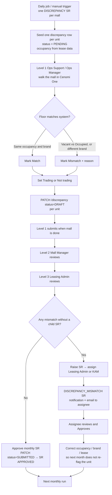
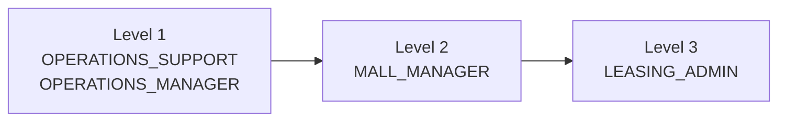
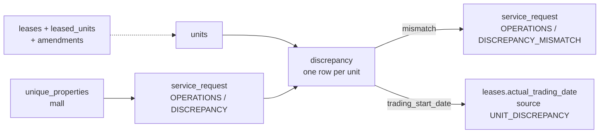

# Unit Discrepancy — End-to-End Flow

> **Purpose:** Single source of truth for the current Cenomi Unit Discrepancy module, written so an agent can be planned against the real platform (same pattern as RDD Handover and Sales Data).
>
> **Audience:** Product, backend, and AI-agent implementers.
>
> **Related docs:**
> - Platform creation notes: [`cenomi-api/docs/discrepancy-flow.md`](../../../cenomi-api/docs/discrepancy-flow.md)
> - Internal report API: [`cenomi-api/docs/discrepancy-internal-api.md`](../../../cenomi-api/docs/discrepancy-internal-api.md)
> - Agent architecture to copy: [`sales_data_agent_PRD.md`](sales_data_agent_PRD.md), [`rdd-handover-agent.md`](rdd-handover-agent.md), [`extensibility-guide.md`](extensibility-guide.md)

---

## Table of Contents

1. [What this module does](#1-what-this-module-does)
2. [Actors and roles](#2-actors-and-roles)
3. [Two service request types](#3-two-service-request-types)
4. [End-to-end lifecycle](#4-end-to-end-lifecycle)
5. [Monthly SR creation](#5-monthly-sr-creation)
6. [Occupancy calculation](#6-occupancy-calculation)
7. [Checking units in Cenomi One](#7-checking-units-in-cenomi-one)
8. [Three-level approval on the monthly SR](#8-three-level-approval-on-the-monthly-sr)
9. [Mismatch follow-up SR](#9-mismatch-follow-up-sr)
10. [Permissions and visibility](#10-permissions-and-visibility)
11. [Notifications and email](#11-notifications-and-email)
12. [Reporting and dashboards](#12-reporting-and-dashboards)
13. [Data model](#13-data-model)
14. [API contract](#14-api-contract)
15. [Validation rules](#15-validation-rules)
16. [Code map](#16-code-map)
17. [What must stay non-agentic](#17-what-must-stay-non-agentic)
18. [Agent planning map](#18-agent-planning-map)
19. [Platform gaps to confirm before building](#19-platform-gaps-to-confirm-before-building)
20. [Suggested phasing](#20-suggested-phasing)

---

## 1. What this module does

Every month, Cenomi needs to verify that **what is actually happening on the mall floor** (occupied vs vacant, brand, trading vs not trading) matches **what the system believes from lease data**.

Unit Discrepancy is that monthly reconciliation. It is **not** a lease-area math check and **not** RDD handover. It is an operations walk-through:

1. The platform creates **one monthly Service Request per mall**.
2. Every unit in that mall is seeded as a row.
3. Mall operations walk the floor and mark each unit **Match** or **Mismatch**, plus **Trading / Not trading**.
4. The SR is approved through **Operations → Mall Manager → Leasing Admin**.
5. For each remaining mismatch, Leasing Admin raises a **follow-up mismatch SR** so Leasing Admin or KAM can correct occupancy / brand / lease data before the next monthly run.

**System of record:** Go `cenomi-api` (`discrepancy/` + `service_request`). The existing UI is the SR detail page (`DiscrepancyAdminView`), not a dedicated chatbot.

---

## 2. Actors and roles

Seven roles appear in this flow. Only five perform workflow actions.

### 2.1 Workflow actors

| # | Role (platform name) | Monthly SR | Mismatch SR |
|---|----------------------|------------|-------------|
| 1 | `OPERATIONS_SUPPORT` | Level 1 — walk the mall, mark units, submit | No |
| 2 | `OPERATIONS_MANAGER` | Level 1 — parallel with Ops Support; either can complete the walk | No |
| 3 | `MALL_MANAGER` | Level 2 — review checks, approve to Leasing | No |
| 4 | `LEASING_ADMIN` | Level 3 — final review, **Raise SR** on mismatches, approve monthly SR | Can raise and can be assigned |
| 5 | Key Account Manager (`KAM`) | Not on the monthly workflow | Can be assigned; Approves only |

Level 1 is **parallel**: Operations Support **or** Operations Manager can complete the walk-through. Unit edits are allowed while Level 1 is still `IN_PROGRESS`.

### 2.2 Visibility-only / no access

| Role | Access |
|------|--------|
| Super Admin | Can open the SR if they have SR-list access. No workflow action unless they are also on a level. |
| Tenant | Explicitly blocked. No view, no check, no approve. |

KAM does **not** need `VIEW_AND_UPDATE_UNITS_DISCREPANCY`. They receive the mismatch SR by assignment (in-app notification + email) and Approve from that SR.

---

## 3. Two service request types

| | Monthly Unit Discrepancy | Discrepancy Mismatch |
|---|--------------------------|----------------------|
| Category / sub-category | `OPERATIONS` / `DISCREPANCY` | `OPERATIONS` / `DISCREPANCY_MISMATCH` |
| Frequency | One per mall, per month | One per mismatched unit |
| Created by | Daily scheduler (or manual trigger) as `tenantcentral@cenomi.com` | Leasing Admin on Level 3 of the monthly SR |
| Contents | All units in the mall | One unit + mismatch flags + comment |
| Assigned to | Workflow levels (Ops → MM → Leasing Admin) | Chosen **Leasing Admin or KAM** at workflow level 1 |
| Title pattern | `Unit Discrepancy of {mall} for the Month {Month} - {Year}` | `Discrepancy for unit {unit_code} in service request {parent_sr_id}` |
| Terminal action | Approve monthly SR | **Approve only** (no Reject) |

Both live on the generic Service Request engine (`service_request` + `workflow` + `service_request_operations`).

---

## 4. End-to-end lifecycle



**Success condition for next month:** a mismatch that was raised and approved should not reappear, because the underlying lease/occupancy/brand data was corrected.

---

## 5. Monthly SR creation

### 5.1 Daily scheduler

| | |
|---|---|
| Job | `CreateServiceRequestForDiscrepancy` |
| Wiring | `DailyRoutine` in `cenomi-api/app/main.go` |
| Start time | `22:40:00` **server local**. Production has no TZ env → treated as **UTC** (`22:40 UTC = 01:10 KSA = 04:10 IST`). |
| Interval | Every 24 hours |
| Creator | `tenantcentral@cenomi.com` |
| Initial SR status | `IN_PROGRESS` |

The job is **daily, not calendar-gated to the 1st**. It is idempotent: it only creates an SR for a mall if none exists for the current calendar month. In practice that is “once per mall per month”.

### 5.2 What the job does

1. Load existing monthly SRs: `category = OPERATIONS`, `sub_category = DISCREPANCY`, `created_at` in the current month.
2. Load all malls from `unique_properties` (grouped by `property_group_id`).
3. Skip excluded malls (Section 5.4).
4. Branch:

| Case | Action |
|------|--------|
| No SRs yet this month | Create one SR per eligible mall + seed `discrepancy` rows |
| SR count = mall count | Update `operators` on existing rows (Ops Support / Ops Manager contacts) |
| SR count < mall count | Create SRs only for malls missing an SR this month + seed rows |

5. SR payload stores mall name (EN/AR), `property_group_id`, and floor levels. `PropertyID` is set to the mall’s first `property_id` so notifications go to the correct mall, not every mall.

### 5.3 Unit seeding

`AddDiscrepancyForProperty` inserts **one `discrepancy` row per unit** in that mall:

| Column | Value at seed time |
|--------|--------------------|
| `service_request_id` | The new monthly SR |
| `property_group_id` | Mall id |
| `unit_id` | Unit |
| `status` | `PENDING` |
| `payload` | JSONB; seeds `trading_start_date` from the unit’s current lease `actual_trading_date` when present |
| `operators` | Ops Support / Ops Manager user ids for the mall |

Occupancy is **not stored as a fixed snapshot column**. When the SR is opened, occupancy is computed live from lease data (Section 6).

### 5.4 Excluded malls

Skipped by **both** the daily scheduler **and** `POST /discrepancy/trigger-sr-creation`.

| Mall | `property_group_id` (current code) |
|------|-------------------------------------|
| Jawharat Riyadh | `31` |
| Jawharat Jeddah | `30` |
| Dummy Mall Riyadh | `380` (`DummyMallPropertyGroupID`) |

Source: `internal/constants/constants.go` → `DiscrepancyExcludedPropertyGroupIDs`.

> Older docs listed `36116` / `36136`. **Trust the constants slice in code.** To enable a mall later, remove its ID and redeploy. Existing SRs already created for an excluded mall are not auto-deleted.

### 5.5 Manual create (ops / testing)

| | |
|---|---|
| Endpoint | `POST /discrepancy/trigger-sr-creation` |
| Body | `{"property_group_id": 12345}` |
| Usecase | `TriggerDiscrepancySRCreationForMall` |

Same create + seed path for one mall, with extras:

- Excluded malls **are rejected** (`property_group_id X is excluded from discrepancy SR creation`).
- Inactive properties are allowed (`is_primary = true` only; no PMS status filter).
- If an SR exists with **zero** discrepancy rows (orphan after a failed seed), it reseeds and returns `recovered: true`.
- If an SR already exists with rows → conflict (`ErrDiscrepancySRAlreadyExists`).
- Uses `context.WithoutCancel` so a gateway timeout does not abort in-flight DB work.

---

## 6. Occupancy calculation

**Occupancy is calculated from leases, never from `units.pms_unit_status`.**

Shared SQL fragment: `cenomi-api/internal/repositorysql/unit_occupancy.go` (`CTEUnitLeaseOccupancy`). Used by SR unit breakdown, export, month-wise reports, dashboard occupancy, and property overview so they all agree.

### Rules

| Result | When |
|--------|------|
| **Occupied** | There is an active, **non-cancelled** lease covering the unit **today**, after applying the best activated amendment |
| **Vacant** | No such lease, lease cancelled, or the lease no longer covers this unit (e.g. activated termination that still applies) |

Activated amendments are included: termination, assignment, expansion, holdover, modification. The CTE picks the best lease per unit using amendment type, whether the unit is in the amendment’s `unit_code` array, and date coverage.

Brand shown on the unit row comes from the current lease → brand join, not from PMS unit status.

**Mismatch vs system occupancy** (operator judgment, not SQL):

- System vacant, store is occupied on the floor (or the reverse).
- Both occupied, but the **brand on the floor is different**.

---

## 7. Checking units in Cenomi One

### 7.1 How the operator opens the SR

Mall-scoped users see only SRs for their malls. They open the monthly SR from the Service Request list / notification.

Frontend:

1. SR detail page detects `category === OPERATIONS` and `sub_category === DISCREPANCY`.
2. Calls `GET /service-requests/discrepancy/{sr_id}` (`getServiceRequestsDiscrepancyDetails`).
3. Formats units into `addOnData` grouped by floor.
4. Renders `DiscrepancyAdminView` (floor accordion, match/mismatch counts, Raise SR, export).

### 7.2 Per-unit check

For each unit the operator compares **system Occupied / Vacant + brand** with the floor, then:

1. Mark **Match** or **Mismatch**.
2. If mismatch, pick a reason (at least one flag).
3. Set **Trading** or **Not trading**.
4. If **Occupied + Not trading**, pick a not-trading reason.
5. Optionally attach photos (`document_ids`).
6. Save.

### 7.3 Mismatch reasons

Stored as boolean flags on the unit / payload:

| Flag | Label |
|------|--------|
| `store_closed` | Store closed |
| `wrong_location` | Wrong location |
| `open_without_contract` | Open without contract |
| `brand_changed` | Brand changed |
| `others` | Others (`other_comment` when used) |

### 7.4 Not-trading reasons

Required when occupancy is **Occupied** and `trading_status = not_trading`. At least one flag must be true:

| Flag | Label |
|------|--------|
| `fitout_not_started` | Fitout not started |
| `fitout_ongoing` | Fitout ongoing |
| `legal_case` | Legal case |
| `contract_under_cancellation` | Contract under cancellation |
| `closed_by_tenant` | Closed by tenant |
| `not_handed_over` | Not handed over |
| `non_trading_others` | Others — requires `non_trading_others_comment` |

UI: `TradingComponents.tsx` (`NotTradingReason`). Backend: `validateDiscrepancyDraftPayload`.

### 7.5 Save vs submit (two PATCH modes)

`PATCH /v1/discrepancy` is the write API. Permission: `VIEW_AND_UPDATE_UNITS_DISCREPANCY`. The caller must have an **IN_PROGRESS operation at workflow Level 1**.

| Request `status` | Meaning |
|------------------|---------|
| `DRAFT` | Save **one unit**. Validates payload. Writes `discrepancy` row. If `trading_status=trading` and `trading_start_date` is set, also writes `leases.actual_trading_date` with source `UNIT_DISCREPANCY`. |
| `SUBMITTED` | Finalize **all units on the SR**. Bulk-updates discrepancy rows, then sets the parent SR to `APPROVED`. |

Draft payload must include `trading_status`. Occupied + not-trading without a reason is rejected.

### 7.6 Two-tier status (easy to mix up)

| Layer | Field | Values | Meaning |
|-------|-------|--------|---------|
| Row lifecycle | `discrepancy.status` | `PENDING` → `DRAFT` → `SUBMITTED` | Has this row been saved / has the mall been submitted? |
| Operator judgment | `payload.status` | `pending` / `match` / `mismatch` | Did the floor match the system? |

Reports and the UI “Match / Mismatch / Pending” badges read **payload status** (and related flags), not the row lifecycle column.

---

## 8. Three-level approval on the monthly SR

Workflow is stored on `workflow.flow` for `OPERATIONS` / `DISCREPANCY` (migration `1730970248_update_workflow_for_service_request_discrepancy.up.sql`).



| Level | Role | What they do | Typical SR action |
|-------|------|----------------|-------------------|
| 1 | Operations Support, Operations Manager | Walk the mall. Mark Match/Mismatch and Trading/Not trading. Submit when the mall is done. | Complete Level 1 / send to Mall Manager |
| 2 | Mall Manager | Review the checks. Approve to Leasing. | Approve |
| 3 | Leasing Admin | Final review. Raise a mismatch SR on each unmatched unit. Approve the monthly SR. | Approve + Raise SR |

**Raise SR** is shown only when **all** of these are true:

- Current user is on Level 3 (`workflow_level === 3`, operation `IN_PROGRESS`, assigned role matches).
- Unit judgment is `mismatch`.
- Payload does **not** already have `discrepancy_mismatch_service_request_id`.

Frontend: `DiscrepancyAdminView` `isFinalLevel`.

Action buttons still follow the generic SR workflow (current level + assigned role). Mall-scoped users only see their malls.

---

## 9. Mismatch follow-up SR

### 9.1 Who raises it

Leasing Admin at Level 3, from the monthly SR unit row (`UnitDiscrepancyModal` → `POST /discrepancy/service-request` → `CreateServiceRequestAgainstDiscrepancy`).

Assignee picker: **Leasing Admin or KAM** (`getUsersByRoles`). Message is required.

### 9.2 Create payload

```json
{
  "payload": {
    "unit_code": "A-101",
    "unit_status": "Occupied",
    "unit_type": "Store",
    "floor": "Ground Floor",
    "open_without_contract": false,
    "wrong_location": false,
    "store_closed": false,
    "brand_changed": true,
    "others": false,
    "other_comment": "",
    "comment": "...",
    "message": "Please correct brand on lease",
    "discrepancy_service_request_id": "<parent monthly SR id>",
    "parent_discrepancy_id": "<parent monthly SR id>",
    "discrepancy_id": "<discrepancy row id>",
    "trading_status": "not_trading",
    "fitout_ongoing": true
  },
  "assigned_user_id": 123,
  "title": "Discrepancy for unit A-101 in service request 456",
  "property_ids": [789],
  "created_for": 123,
  "discrepancy_id": 111
}
```

Required API fields: `assigned_user_id`, `title`, `property_ids`, `discrepancy_id`.

### 9.3 What create does

1. Load the parent discrepancy row; fail if missing.
2. Resolve assignee roles; fail if user not found.
3. Create `OPERATIONS` / `DISCREPANCY_MISMATCH` SR with `status=IN_PROGRESS`.
4. Create level-1 operation assigned to that user/role.
5. Copy parent `document_ids` onto the new SR as attachments.
6. Write `payload.discrepancy_mismatch_service_request_id` back onto the **parent discrepancy row**.
7. Store in-app notification (`ActionRequired: true`) for the assignee.
8. Email assignee with subject **`Cenomi: Discrepancy Mismatch`**.

The monthly SR unit row then shows the child SR number and status (`IN_PROGRESS` until the child completes).

### 9.4 Assignee review

The assignee opens the mismatch SR (notification / email / SR list). They check occupancy, brand, and lease data. They **Approve only** — there is no Reject path.

On completion, `UpdateSRstatusDiscrepancyStatus` updates the parent discrepancy payload with the child SR status (`discrepancy_mismatch_service_request_status`).

Business expectation after approve: leasing/KAM corrects occupancy, brand, or lease so the **next month’s run does not flag the same unit again**. The agent/platform does not auto-mutate lease occupancy; that correction is a human data-fix outside this module.

Mismatch workflow mapping is a dedicated `workflow` row (`1745301187_add_sr_workflow_for_discrepancy_mismatch.up.sql`) with a simple form (floor, comment, unit flags). Assignment is the real routing mechanism.

---

## 10. Permissions and visibility

### 10.1 Permissions

| Permission | Who typically has it | Unlocks |
|------------|----------------------|---------|
| `VIEW_AND_UPDATE_UNITS_DISCREPANCY` | Operations Support, Operations Manager, Mall Manager, Leasing Admin | Open monthly SR, see units, save Match/Mismatch and Trading (`GET`/`PATCH /discrepancy`) |
| `VIEW_DISCREPANCY_REPORT` | Leasing Admin, Mall Manager, Operations, Super Admin | Dashboard graph + month-wise report |
| `VIEW_REPORTS` | Mall Manager, Leasing Admin (and other report roles) | Reports page → Unit Discrepancy Excel export |

Path map: `cenomi-api/internal/config/pathpermission.json`.

### 10.2 Monthly SR — who does what

| Role | See SR | Check units | Approve this level | Raise mismatch SR |
|------|--------|-------------|--------------------|-------------------|
| Operations Support | Yes (their mall) | Yes (Level 1) | Yes, Level 1 | No |
| Operations Manager | Yes (their mall) | Yes (Level 1) | Yes, Level 1 | No |
| Mall Manager | Yes (their mall) | Yes (review) | Yes, Level 2 | No |
| Leasing Admin | Yes | Yes (review) | Yes, Level 3 | Yes |
| Super Admin | If they have SR list access | No workflow action unless on a level | — | No |
| Tenant | No | No | No | No |
| KAM | Only via assigned mismatch SR | No on monthly SR | Approve mismatch SR | No |

Mall-scoped users only see SRs for their malls. Tenants are blocked in `service_request_usecase.go` for subcategory `DISCREPANCY`.

---

## 11. Notifications and email

| Event | Channel | Who |
|-------|---------|-----|
| Monthly SR created | Standard SR create pipeline (in-app / email as configured for OPERATIONS SRs). `PropertyID` on the SR is used so FM/ops mail is mall-scoped. | Level 1 operators |
| Monthly SR moves to next level | Generic SR workflow notifications | Mall Manager, then Leasing Admin |
| Mismatch SR created | In-app `ActionRequired` + email `Cenomi: Discrepancy Mismatch` | Assigned Leasing Admin or KAM |

The **agent must not send these itself**. Same rule as RDD and Sales Data: call the platform API; `cenomi-api` owns notifications.

---

## 12. Reporting and dashboards

| Surface | Route / API | Permission |
|---------|-------------|------------|
| Admin dashboard Match vs Mismatch graph (mall-wise or month-wise) | `GET /discrepancy/monthly-graph` | `VIEW_DISCREPANCY_REPORT` |
| Graph unit drill-down | `GET /discrepancy/monthly-graph/mismatch-units` | same |
| Month-wise report (tabs: Match/Mismatch and Trading/Not trading) | `/dashboard/unit-discrepancy-month-wise-report` → `GET /discrepancy/month-wise` | `VIEW_DISCREPANCY_REPORT` |
| Reports → Unit Discrepancy Excel | `GET /discrepancy/export?month=YYYY-MM` | `VIEW_REPORTS` |
| Master Data → Units | Latest discrepancy per unit (`discrepancy_status`, match, trading) | Master data permissions |
| Internal map / vendor API | `GET /discrepancy/report` (internal token) | `x-internal-api-token` |

Export and reports only include malls that **have a DISCREPANCY SR created in the selected month**, not every mall in `unique_properties`.

Frontend:

- Graph widget: `UnitDiscrepancyReport.tsx`
- Month-wise page: `UnitDiscrepancyMonthWiseReportPage.tsx` / `UnitDiscrepancyMonthWiseTab.tsx`
- API client: `libs/api/src/lib/discrepancy/discrepancyApi.ts`

---

## 13. Data model

### 13.1 Tables



| Entity | Role |
|--------|------|
| `unique_properties` | Mall list (`property_group_id`) |
| `units` / `properties` | Unit inventory |
| `leases`, `leased_units`, `leased_units_amendments`, `brands` | Live occupancy + brand |
| `service_request` | Monthly parent + mismatch child |
| `workflow` / `workflow_service_request_mapping` / `service_request_operations` | Approval levels and assignment |
| `discrepancy` | One row per unit per monthly SR |
| `lease_planned_dates_tracking` | Audit of trading-date writes (`source=UNIT_DISCREPANCY`) |
| `discrepancy_archive_recent` / `discrepancy_archive_cold` | Archived child of archived SRs |

### 13.2 `discrepancy` row

| Column | Notes |
|--------|--------|
| `discrepancy_id` | PK |
| `service_request_id` | Monthly parent SR |
| `property_group_id` | Mall (renamed from `property_id`) |
| `unit_id` | Unit |
| `status` | `PENDING` / `DRAFT` / `SUBMITTED` |
| `payload` | JSONB — judgment, trading, reasons, child SR link |
| `document_ids` | Photos / attachments |
| `operators` | Ops user ids |
| `created_by` / `updated_by` / timestamps | Audit |

### 13.3 Payload fields that matter

| Field | Purpose |
|-------|---------|
| `status` | `match` / `mismatch` / `pending` |
| `trading_status` | `trading` / `not_trading` |
| `trading_start_date` | When marked trading; may persist to lease |
| `store_closed`, `wrong_location`, `open_without_contract`, `brand_changed`, `others` | Mismatch reasons |
| `fitout_not_started`, `fitout_ongoing`, `legal_case`, `contract_under_cancellation`, `closed_by_tenant`, `not_handed_over`, `non_trading_others` | Not-trading reasons |
| `non_trading_others_comment` | Required if `non_trading_others` |
| `discrepancy_mismatch_service_request_id` | Child mismatch SR id |
| `discrepancy_mismatch_service_request_status` | Child SR status after it completes |

---

## 14. API contract

All paths are under `/v1` unless noted.

| Method | Path | Permission | Purpose |
|--------|------|------------|---------|
| `PATCH` | `/discrepancy` | `VIEW_AND_UPDATE_UNITS_DISCREPANCY` | Save one unit (`DRAFT`) or submit mall (`SUBMITTED`) |
| `GET` | `/discrepancy?unit_id=&service_request_id=` | same | One discrepancy row |
| `GET` | `/discrepancy/service-requests/{id}` | same | All units for an SR |
| `GET` | `/service-requests/discrepancy/{id}` | same | Frontend alias used by SR detail |
| `POST` | `/discrepancy/service-request` | same | Create mismatch follow-up SR |
| `GET` | `/discrepancy/export` | `VIEW_REPORTS` | Excel |
| `GET` | `/discrepancy/month-wise` | report permission / property scope | Pivoted year report |
| `GET` | `/discrepancy/monthly-graph` | `VIEW_DISCREPANCY_REPORT` | Graph |
| `GET` | `/discrepancy/monthly-graph/mismatch-units` | same | Unit drill-down |
| `POST` | `/discrepancy/trigger-sr-creation` | ops/internal | Manual mall SR create |
| `GET` | `/discrepancy/report` | internal token | Vendor / map feed |

### 14.1 `PATCH /discrepancy` body

```json
{
  "discrepancy_id": 111,
  "service_request_id": 456,
  "status": "DRAFT",
  "document_ids": ["uuid-optional"],
  "payload": {
    "status": "mismatch",
    "trading_status": "not_trading",
    "brand_changed": true,
    "fitout_ongoing": true
  }
}
```

`SUBMITTED` uses the same endpoint; backend then updates **by service_request_id** and approves the parent SR.

### 14.2 There is no bulk-DRAFT API today

Each unit save is one `PATCH` with `status=DRAFT`. An agent that records many units from one sentence would currently loop. A bulk-DRAFT endpoint would be an optional platform improvement (Section 19).

---

## 15. Validation rules

Enforced in `validateDiscrepancyDraftPayload` (Go). Any agent must **re-implement the same rules in Python before calling PATCH**, then still rely on the API as the last gate.

| Rule | When | Error |
|------|------|--------|
| `trading_status` required | Any `DRAFT` update | `ErrDiscrepancyTradingStatusRequired` |
| At least one not-trading reason flag | Occupied + `not_trading` | `ErrDiscrepancyNotTradingReasonRequired` |
| `non_trading_others_comment` required | `non_trading_others=true` | `ErrDiscrepancyNotTradingOthersCommentRequired` |
| Level-1 IN_PROGRESS operation | Any PATCH | `ErrMeterReadingNoPermission` |
| Discrepancy row exists | PATCH / raise SR | `ErrDiscrepancyNotFound` |
| Assignee exists | Raise mismatch SR | `ErrUserNotFound` |
| Raise SR only if no child id | UI (and should be agent-enforced) | Button hidden / skip |

Vacant + not-trading does **not** require a reason flag.

Trading date side effect: if `trading_status=trading` and `trading_start_date` is set (YYYY-MM-DD or DD/MM/YYYY), `persistDiscrepancyTradingStartDate` writes `leases.actual_trading_date` with `SourceForTradingDateUnitDiscrepancy`. No-op if the unit has no `lease_id`.

---

## 16. Code map

### Backend (`cenomi-api`)

| Area | Path |
|------|------|
| HTTP | `discrepancy/delivery/http/discrepancy_handler.go` |
| Usecase | `discrepancy/usecase/discrepancy_usecase.go` |
| Repository | `discrepancy/repository/postgres/discrepancy_repository.go` |
| Occupancy SQL | `internal/repositorysql/unit_occupancy.go` |
| Monthly job | `servicerequest/usecase/service_request_usecase.go` → `CreateServiceRequestForDiscrepancy` |
| Scheduler | `app/main.go` (`DailyRoutine`, `22:40:00`) |
| Domain / DTO | `domain/discrepancy.go`, `domain/discrepancydto.go` |
| Constants | `internal/constants/constants.go` |
| Monthly workflow | `migration/.../1730970248_update_workflow_for_service_request_discrepancy.up.sql` |
| Mismatch workflow | `migration/.../1745301187_add_sr_workflow_for_discrepancy_mismatch.up.sql` |

### Frontend (`cenomi-frontend`)

| Area | Path |
|------|------|
| SR detail UI | `libs/ui-web/.../serviceRequestForms/DiscrepancyAdminView.tsx` |
| Raise-SR modal | `libs/ui-web/.../serviceRequestForms/UnitDiscrepancyModal.tsx` |
| Trading / not-trading fields | `libs/ui-web/.../serviceRequestForms/TradingComponents.tsx` |
| SR routing | `ServiceReqForms.tsx` (`subServiceCategory === 'DISCREPANCY'`) |
| Load units | `apps/cenomi-tenant-web/.../servicedetails/page.tsx` |
| Month-wise report | `libs/ui-web/.../salesdata/UnitDiscrepancyMonthWiseReportPage.tsx` |
| Dashboard graph | `libs/ui-web/.../dashboards/admin/components/UnitDiscrepancyReport.tsx` |
| API client | `libs/api/src/lib/discrepancy/discrepancyApi.ts` |

---

## 17. What must stay non-agentic

These pieces are deterministic platform jobs. Do **not** put them behind an LLM.

| Piece | Why |
|-------|-----|
| Daily `CreateServiceRequestForDiscrepancy` | Pure cron; no user input |
| Occupancy CTE | Auditable lease math; must stay exact |
| Workflow engine / level routing | Shared SR infrastructure |
| Notification and email send | Owned by `cenomi-api` after API writes |
| Lease occupancy / brand correction after mismatch approve | Human data-fix in leasing/PMS; agent should not silently rewrite contracts |

The agent sits **in front of** the same REST APIs the UI uses. Principle, identical to RDD and Sales Data:

> **LLM proposes; code decides. Thin agent, fat platform. HITL at every write.**

---

## 18. Agent planning map

Register under category `OPERATIONS` in `SERVICE_REQUEST_AGENT_REGISTRY`, same house as RDD (`FIT_OUT_AND_HANDOVER`) and Sales Data (`SALES_DATA`). Runtime: `cenomi-api-v2/service-request-chatbot` LangGraph graph.

Recommended shape: **one lifecycle agent with three entry stages** (like `rdd_handover_agent`), not three unrelated products. Optional fourth read-only report agent.

### 18.1 Proposed agents / stages

| `active_agent` / stage | Analog | Who | Platform APIs |
|------------------------|--------|-----|---------------|
| `discrepancy_walkthrough` (Level 1) | Sales Data CSV + manual entry | Ops Support / Ops Manager | `GET` units, `PATCH` DRAFT, `PATCH` SUBMITTED |
| `discrepancy_review` (Level 2–3) | RDD FM/RDD review + Sales Data admin review | Mall Manager, Leasing Admin | SR approve + `POST /discrepancy/service-request` |
| `discrepancy_mismatch` (child SR) | Fitout confirm (narrow approve) | Assigned Leasing Admin or KAM | GET child SR, Approve (platform PATCH) |
| `discrepancy_report` (optional, Phase 2) | Help FAQ but structured | Roles with `VIEW_DISCREPANCY_REPORT` | month-wise / graph / mismatch-units / export |

### 18.2 Level 1 — walkthrough (highest value)

Mall teams currently click unit-by-unit. The agent should accept **bulk natural language** (and later photo/voice), then show an **editable confirmation table** before any PATCH.

Example utterance:

> Units 101–108 on floor 1 are all match and trading. Unit 109 is mismatch — brand changed, not trading, fitout ongoing.

Pipeline (copy Sales Data, not the RDD shared field-extraction loop):

```
discrepancy_entry
  → load monthly SR (notification / sr_id / “this month’s discrepancy for {mall}”)
  → GET /discrepancy/service-requests/{id}
  → extraction (LLM) → structured unit rows
  → validation (deterministic: unit exists on this SR, match/mismatch rules, trading rules)
  → confirmation card (editable table, HITL)
  → loop PATCH DRAFT per unit
  → optional SUBMITTED when operator says the mall is done
```

Photo/voice can reuse RDD `document_upload_node` later (Phase 2): draft a mismatch reason from a shutter/signboard image, still confirm with the user.

### 18.3 Level 2–3 — review

Mall Manager / Leasing Admin:

- Summarize match vs mismatch vs pending counts.
- “Approve all except unit 205.”
- Leasing Admin only: “Raise SR for unit 205, assign to KAM Fatima.”

Guards the UI already has:

- Raise SR only at Level 3.
- Only on `payload.status = mismatch`.
- Only if `discrepancy_mismatch_service_request_id` is empty.

Assignee lookup: same `getUsersByRoles` as `UnitDiscrepancyModal`.

### 18.4 Mismatch child — approve only

Triggered by notification Open (`active_notification_id`), same as Sales Data `notification_context` and RDD `open_notification_node`.

- Load child SR + parent unit context.
- Show occupancy, brand, flags, comment.
- Confirm → Approve. **Never invent a Reject path.**

### 18.5 Supervisor intents (draft)

Add to `supervisor_prompt.py`, `WorkflowConfig.action_intents`, and `ROLE_PERMITTED_INTENTS`.

| Intent | Typical phrases | Roles |
|--------|-----------------|-------|
| `CHECK_UNITS_DISCREPANCY` | “start unit discrepancy for Mall of Dhahran”, “walk floor 1” | Ops Support, Ops Manager |
| `UPDATE_UNIT_DISCREPANCY` | “101–108 match and trading”, “109 mismatch brand changed” | Ops Support, Ops Manager (Level 1 in progress) |
| `SUBMIT_UNIT_DISCREPANCY` | “mall walk is done”, “submit discrepancy” | Ops Support, Ops Manager |
| `REVIEW_UNIT_DISCREPANCY` | “show mismatches this month”, “review discrepancy SR” | Mall Manager, Leasing Admin |
| `APPROVE_UNIT_DISCREPANCY` | “approve to leasing”, “approve monthly discrepancy” | Mall Manager, Leasing Admin |
| `RAISE_DISCREPANCY_MISMATCH` | “raise SR for unit 205, assign to KAM …” | Leasing Admin only |
| `APPROVE_DISCREPANCY_MISMATCH` | “approve this mismatch” | Assigned Leasing Admin or KAM |
| `CHECK_DISCREPANCY_REPORT` | “mismatch trend last 3 months” | Report permission roles |

Deterministic phrase shortcuts (Sales Data style) should bypass the LLM for “unit discrepancy”, “raise mismatch SR”, “approve discrepancy”.

### 18.6 RBAC buckets (draft)

Map platform roles into agent buckets the same way Sales Data maps `SALES_DATA_UPDATE` → `TENANT_CSV_UPLOADER`.

| Agent bucket | Platform roles | Intents |
|--------------|----------------|---------|
| `DISCREPANCY_WALKER` | `OPERATIONS_SUPPORT`, `OPERATIONS_MANAGER` | check / update / submit monthly |
| `DISCREPANCY_MALL_REVIEWER` | `MALL_MANAGER` | review + approve Level 2 |
| `DISCREPANCY_LEASING` | `LEASING_ADMIN` | review + approve Level 3 + raise mismatch + approve mismatch |
| `DISCREPANCY_KAM` | KAM | approve mismatch only (assignment-gated, not permission-gated) |
| `DISCREPANCY_REPORTER` | roles with `VIEW_DISCREPANCY_REPORT` | report Q&A |

Production JWT: extend `POST /auth/ai-session-token` like `RDD_AGENT`. Either:

- stamp `VIEW_AND_UPDATE_UNITS_DISCREPANCY` / `VIEW_DISCREPANCY_REPORT` into the AI session, or
- add `DISCREPANCY_AGENT` (read) and later `DISCREPANCY_ACTION_AGENT` (write), mirroring `PermissionRDDAgent`.

KAM must be able to open the mismatch flow **without** `VIEW_AND_UPDATE_UNITS_DISCREPANCY`, because that is how the live product works.

### 18.7 Notification handoff

| Notification | Handoff context | Lands on |
|--------------|-----------------|----------|
| Monthly DISCREPANCY SR created / assigned | `{ sr_id, property_group_id, mall_name, month, source: "notification" }` | walkthrough or review, based on current `service_request_operations` |
| DISCREPANCY_MISMATCH assigned | `{ sr_id, parent_sr_id, discrepancy_id, unit_code, source: "notification" }` | mismatch approve |

Stage routing should follow RDD `sr_status_sync_node`:

| Live operation | `workflow_stage` |
|----------------|------------------|
| Level 1 Ops `IN_PROGRESS` | `WALKTHROUGH` |
| Level 2 Mall Manager `IN_PROGRESS` | `MALL_REVIEW` |
| Level 3 Leasing Admin `IN_PROGRESS` | `LEASING_REVIEW` |
| Child mismatch `IN_PROGRESS` | `MISMATCH_REVIEW` |
| All finished / parent `APPROVED` | `SR_COMPLETED` |

### 18.8 Files an implementation would add

Mirror Sales Data’s layout:

```
backend/app/agents/graph/nodes/discrepancy/
  discrepancy_entry_node.py
  unit_extraction_node.py
  unit_validation_node.py
  walkthrough_confirmation_node.py
  discrepancy_payload_builder_node.py
  discrepancy_api_submission_node.py
  review_entry_node.py
  raise_mismatch_node.py
  mismatch_approve_node.py
backend/app/agents/schemas/discrepancy_schema.py
backend/app/agents/services/discrepancy_api_client.py
backend/app/agents/prompts/discrepancy_extraction_prompt.py
backend/app/agents/prompts/discrepancy_review_prompt.py
```

Wire: `registry.py`, `workflow_config.py`, `help_agent_graph.py`, `supervisor_prompt.py`, `help_agent_schema.py`.

Frontend (later, same as Sales Data): confirmation table card in chat, notification Open → copilot, optional split-screen with `DiscrepancyAdminView`. Official `cenomi-frontend` wiring can trail a demo app, as it did for Sales Data.

---

## 19. Platform gaps to confirm before building

| Gap | Why it matters | Suggested default |
|-----|----------------|-------------------|
| Bulk DRAFT PATCH | Walkthrough agent would N-call `PATCH /discrepancy` | Start with a loop; add bulk only if malls are too large |
| “My pending discrepancy SRs” list | Entry node needs mall + month SR without the user pasting an id | Filter existing SR list by `OPERATIONS/DISCREPANCY` + mall scope; or add a small dedicated GET |
| PATCH gated to Level 1 | `ServiceRequestOperationStatusForInitialLevel` — Mall Manager / Leasing Admin may not be able to edit units via the same PATCH | Agent should treat Level 2/3 as review/approve, not re-walk, unless product wants edits at those levels |
| Assignee user search | Raise SR needs `assigned_user_id` | Reuse `getUsersByRoles` (Leasing Admin, KAM) |
| AI session permission | RDD has `RDD_AGENT` on the JWT | Add discrepancy permissions / `DISCREPANCY_AGENT` to `/auth/ai-session-token` |
| Excluded-mall IDs | Docs historically disagreed (`31/30` vs `36116/36136`) | Always read `DiscrepancyExcludedPropertyGroupIDs` |
| No named frontend `patchDiscrepancy` helper | Unit save path is easy to miss when wiring UI | Agent should call `cenomi-api` directly, not the Next BFF, unless product requires cookie session |

**Do not change occupancy SQL or the monthly job as part of the agent.** If product wants the job to run only on the 1st, that is a separate platform ticket (today it is daily + idempotent).

---

## 20. Suggested phasing

| Phase | Scope | Same idea as |
|-------|--------|----------------|
| **Phase 1** | Walkthrough (NL → validated table → DRAFT/SUBMITTED) + Level 2/3 review/approve + Raise mismatch SR + mismatch Approve + notification Open | Sales Data Phase 1 (full lifecycle, HITL, no analysis engine) |
| **Phase 2** | Report Q&A; photo/voice draft of mismatch reason; “this unit mismatched last month too” hint | Sales Data Phase 2 (insights, not writes) |

Phase 1 writes **only** through existing discrepancy / SR APIs. No automatic lease correction. No Reject on mismatch SRs. No auto-submit without a confirmation card.

---

## Appendix A — Conversation sketches (Phase 1)

**Ops Support, Level 1**

1. “Open this month’s unit discrepancy for Mall of Dhahran.”
2. Agent: 420 units, 12 pending on Ground Floor. Start there?
3. “Ground floor 1–20 match and trading except 14: vacant in system but occupied, brand Zara, mismatch open without contract.”
4. Confirmation table → user edits two rows → Confirm.
5. Agent PATCHes DRAFT rows, reports remaining pending.
6. “Submit the mall.” → confirmation → SUBMITTED / Level 1 complete.

**Leasing Admin, Level 3**

1. Notification Open on the monthly SR.
2. Agent: 8 mismatches, 2 already have child SRs.
3. “Raise SR for the other six, assign to KAM Noura except unit B-12 to me.”
4. Confirmation list → POST per unit → emails/notifications sent by platform.
5. “Approve the monthly SR.”

**KAM**

1. Opens mismatch notification.
2. Agent shows unit, lease, brand, flags, parent SR.
3. “Approve.” → child SR approved; parent row shows child status.

---

## Appendix B — Design principles (do not violate)

1. **LLM extracts unit judgments; Python validates; Go API is the source of truth.**
2. **No write without an explicit user confirmation card.**
3. **Do not send email/notifications from the AI service.**
4. **Do not recompute occupancy in the agent** — display the platform’s Occupied/Vacant.
5. **KAM access is assignment-based**, not `VIEW_AND_UPDATE_UNITS_DISCREPANCY`.
6. **Mismatch SR is Approve-only.**
7. **One confirmation, then platform workflow moves the level** — the agent syncs stage from `service_request_operations` every turn (RDD `sr_status_sync` pattern).
)
